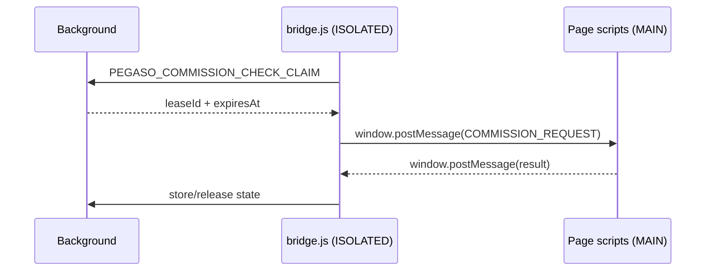
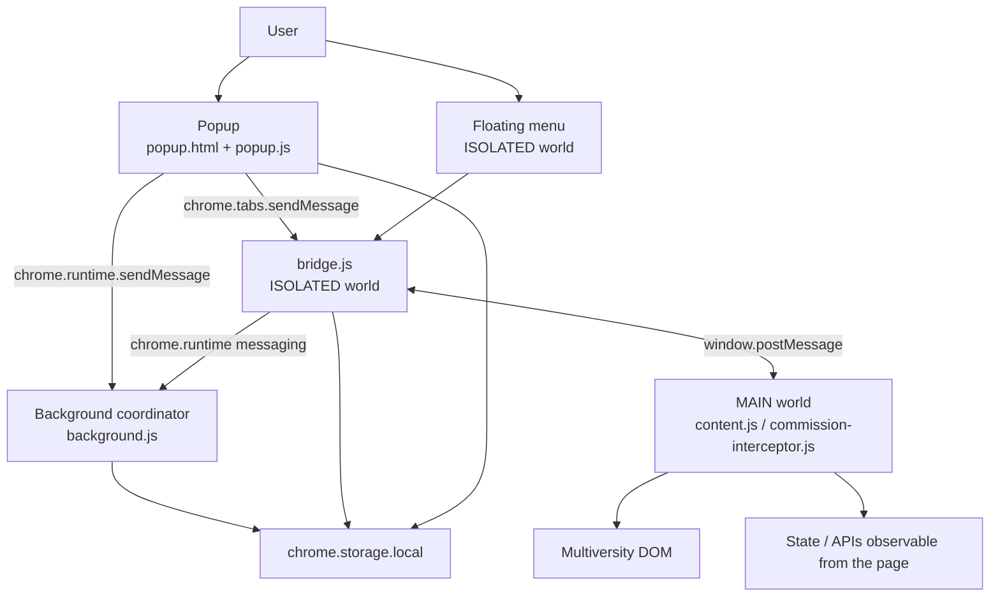

# 01 — Anatomy of PlumePilot

## What happens when the extension comes to life?

A browser extension does not start from `main()`.

There is not necessarily a single entry point. Instead, the browser reads a special file, `manifest.json`, and from there discovers **which components it must create, where they should live, and when they should run**.

In our reference snapshot, the manifest begins like this:

```json
{
  "manifest_version": 3,
  "name": "PlumePilot – Assistente per Multiversity",
  "version": "2.35.1"
}
```

`manifest_version: 3` tells us that we are using the modern Chromium extension model and compatible WebExtensions.

But the truly interesting lines come shortly afterward.

---

## 1. The manifest as a map of the system

In PlumePilot's `manifest.json` we find four important families:

```text
manifest.json
├── action
│   └── popup.html
│
├── background
│   └── background.js (+ support scripts)
│
├── content_scripts
│   ├── MAIN world
│   └── ISOLATED world
│
└── web_accessible_resources
    └── assets usable by supported pages
```

This is already our first architectural lesson:

> The browser creates boundaries before our code even starts running.

We cannot understand PlumePilot by looking only at functions. We need to understand **which runtime** each function executes in.

---

## 2. The popup: an extension page

The manifest declares:

```json
"action": {
  "default_title": "PlumePilot – Assistente per Multiversity",
  "default_popup": "popup.html"
}
```

When we click the PlumePilot icon, the browser opens `popup.html`, which loads the popup logic.

It is important to understand what the popup is *not*.

It is not an HTML element inserted into the Multiversity page.

It is a page that belongs to the extension, with its own document, its own lifecycle, and access to the APIs granted to the extension.

When the popup opens, `popup.js` rebuilds much of the visible state by reading `chrome.storage.local`:

```js
chrome.storage.local.get(
  {
    enabled: true,
    stopAtTests: false,
    autoplaySkipCompletedVideos: false,
    themePreference: "system",
    menuSize: "medium",
    floatingMenuEnabled: true,
    commissionCheckEnabled: false,
    // ...
  },
  (result) => {
    // update the UI
  },
);
```

Real file: `popup.js`, approximately lines 1308–1375 in the reference snapshot.

### Why rebuild the state?

Because the popup is **ephemeral**.

The user can open it, close it, and open it again. Treating the popup's JavaScript variables as the extension's persistent memory would be a poor design.

From a backend developer's perspective, you can think of the popup more as a view rebuilt from persistent state than as a central process that is always alive.

This anticipates a concept we will explore in the storage chapter:

> The lifetime of a UI does not necessarily match the lifetime of the application's state.

---

## 3. The background: the coordinator that cannot see the DOM

In the manifest we find:

```json
"background": {
  "scripts": [
    "achievements.js",
    "commission-state.js",
    "sound-settings.js",
    "whats-new.js",
    "background.js"
  ],
  "service_worker": "background.js"
}
```

This configuration supports the cross-browser source base.

In Chrome's Manifest V3 model, `background.js` is used as an **extension service worker**. Firefox supports the `scripts` form for background code. The same source base can therefore be transformed by the build process into the package best suited to each browser.

The conceptual role of the background matters more than the packaging detail:

> The background coordinates activities that belong to the extension as a whole, not to a single page currently being displayed.

For example, near the end of `background.js` we find a real message dispatcher:

```js
chrome.runtime.onMessage.addListener((message, sender, sendResponse) => {
  let action = null;

  if (message?.type === "PEGASO_GET_OPERATION")
    action = reconcileOperationOwner();
  else if (message?.type === "PEGASO_START_EXPORT")
    action = startExport({ ...message, sourceTabId });
  else if (message?.type === "PEGASO_CANCEL_EXPORT")
    action = cancelExport(message);
  else if (message?.type === "PEGASO_COMMISSION_CHECK_CLAIM")
    action = claimCommissionCheck(sourceTabId, message.platformId);

  // ...

  action.then(sendResponse).catch(/* ... */);
  return true;
});
```

Real file: `background.js`, approximately lines 918–945.

This looks very similar to a backend router or controller:

```text
message.type
    ↓
dispatcher
    ↓
handler
    ↓
asynchronous response
```

It is not HTTP, but the mental model is surprisingly similar.

### So why doesn't the background do everything?

Because it does not live inside the page DOM.

If it needs to know which lessons are rendered, read a button on the page, or observe JavaScript state belonging to the site, it needs code that lives in the tab.

That is where content scripts enter the picture.

---

## 4. Content scripts: JavaScript inside a page, but not necessarily *of* the page

PlumePilot's manifest registers several groups of `content_scripts`.

One of them loads:

```json
{
  "js": ["commission-interceptor.js"],
  "run_at": "document_start",
  "all_frames": false,
  "world": "MAIN"
}
```

Another loads:

```json
{
  "js": [
    "commission-state.js",
    "sound-settings.js",
    "bridge.js"
  ],
  "run_at": "document_start",
  "all_frames": false
}
```

Here `world` is not specified, so the content script normally runs in the **ISOLATED** world.

This distinction is fundamental.

---

## 5. MAIN world and ISOLATED world

Imagine the Multiversity page as a room with the same table — the DOM — but two separate sets of JavaScript variables.

```text
                 same DOM
                    │
        ┌───────────┴───────────┐
        │                       │
   MAIN world              ISOLATED world
        │                       │
 page code                content script
 + content.js             bridge.js
 + interceptor            floating-menu.js
        │                       │
        └──── window.postMessage ────┘
```

### MAIN world

The code runs in the same JavaScript environment as the page.

This is useful when PlumePilot needs to observe or interact with behavior that belongs directly to the web application.

But there is a cost: that code does not automatically benefit from the isolation and privileged APIs normally available to content scripts.

### ISOLATED world

The code shares the document and can therefore work with the DOM, but its JavaScript scope is separate from the page's scope.

In return, it is the appropriate place to use extension APIs such as `chrome.storage` and `chrome.runtime`.

This comment in `content.js` tells the architectural story almost better than the manifest:

```js
// Receives the enabled/paused state from bridge.js, which runs in the
// extension's isolated world and therefore has access to chrome.storage.
```

Real file: `content.js`, approximately lines 248–249.

Immediately afterward, `content.js` listens for messages coming from the same `window`:

```js
window.addEventListener("message", (event) => {
  if (event.source !== window) return;
  if (!event.data) return;

  // interpret bridge messages
});
```

So we have a deliberate pattern:

```text
ISOLATED world
bridge.js
    │
    │ window.postMessage(...)
    ▼
MAIN world
content.js / interceptor
```

And in the opposite direction as well.

---

## 6. Why do we need `bridge.js`?

The name is not metaphorical. It really is a bridge.

Take the exam commission check.

`bridge.js` can talk to the background:

```js
chrome.runtime.sendMessage({
  type: "PEGASO_COMMISSION_CHECK_CLAIM",
  platformId: PLATFORM_ID,
}, (response) => {
  // ...
});
```

But when it needs to ask code living in the `MAIN` world to perform an operation related to the page, it uses:

```js
window.postMessage({
  type: COMMISSION_REQUEST,
  requestId: leaseId,
  expiresAt,
}, "*");
```

We can represent the flow like this:



This is **message passing across boundaries**.

If every component lived in the same scope, we could simply call a function:

```js
requestCommissionData();
```

But these runtimes are separated. The message becomes the contract.

---

## 7. Popup → tab: another kind of message

The popup also needs to query the active tab directly.

In `popup.js` we find:

```js
chrome.tabs.sendMessage(
  tabId,
  { type: "PEGASO_COURSE_PROGRESS_STATUS_REQUEST" },
  { frameId: 0 },
  (response) => {
    if (chrome.runtime.lastError || !response?.status) return;
    renderCourseProgress(response.status);
  },
);
```

Here we are not using `window.postMessage`.

Why?

Because sender and recipient are not two JavaScript worlds in the same page: the sender is an **extension page** (the popup), while the recipient is a content script in the tab.

So we already have at least two different communication buses:

```text
chrome.runtime / chrome.tabs messaging
    → between extension components

window.postMessage
    → between JavaScript worlds in the same page
```

This distinction will be at the heart of Chapter 2.

---

## 8. A more complete diagram

At this point we can build our first useful map of the architecture.



This is not yet the complete map of every feature, but it is enough to answer the opening question:

> Why can't we put everything into a single file?

Because the responsibilities require **different privileges, lifetimes, and execution environments**.

---

## 9. `run_at`: *when* matters too

Content scripts are not all loaded at the same moment.

PlumePilot uses both:

```json
"run_at": "document_start"
```

and:

```json
"run_at": "document_idle"
```

`document_start` is useful when we need to be present very early in the page lifecycle. `document_idle` is appropriate when we can wait until the document is substantially ready.

For example, `commission-interceptor.js` is loaded in the `MAIN` world at `document_start`.

This suggests a general rule:

> If you need to observe page behavior that may happen very early, arriving later means you may miss the event.

By contrast, a UI that depends on elements already present in the page can often wait until `document_idle`.

So the manifest specifies not only **where** code should run. It also specifies **when** it enters the life of the document.

---

## 10. `all_frames`: a page is not always a single document

Some script groups use:

```json
"all_frames": true
```

This reminds us that a tab can contain iframes and therefore multiple documents.

It is easy to say “the script runs in the page,” but technically the better question is:

> Which frame in the tab does it run in?

When the popup sends some requests to the tab, PlumePilot explicitly specifies:

```js
{ frameId: 0 }
```

meaning the main frame.

It looks like a small detail, but it prevents ambiguity when the same extension may be loaded in multiple frames.

---

## 11. `web_accessible_resources`: extension assets visible to the page

The manifest also exposes some resources, such as Gaming-mode images, fonts, and audio.

Not everything included in an extension package must automatically be reachable by a web page.

`web_accessible_resources` explicitly declares which files can be requested from contexts that match the declared patterns.

This is another example of the **least privilege** principle:

> expose what is needed, not the entire package.

The same principle will return when we discuss `permissions` and `host_permissions`.

---

## 12. Permissions: what PlumePilot can do is not implicit

In the current snapshot, the manifest declares:

```json
"permissions": ["storage"]
```

along with `host_permissions` for hosts needed to manage materials and resources.

Extension APIs are explicit capabilities. This differs from an ordinary web page, where code already runs within the site's origin security model.

When we mentally design a feature, a good question will always be:

> Which context should this function live in, and what is the minimum privilege it needs?

That question often determines the architecture before it determines the code.

---

## 13. A concrete case: the popup wants to show progress

Let us finally follow a small end-to-end path.

### Step 1 — the user opens the popup

The browser creates `popup.html` and runs `popup.js`.

### Step 2 — the popup rebuilds persistent preferences

```text
popup.js
    ↓
chrome.storage.local.get(...)
    ↓
UI rendering
```

### Step 3 — it identifies the active tab

In the code we find:

```js
chrome.tabs.query({ active: true, currentWindow: true }, ...)
```

### Step 4 — it requests course state

```text
popup
  │
  │ PEGASO_COURSE_PROGRESS_STATUS_REQUEST
  ▼
content script in the tab
```

through `chrome.tabs.sendMessage`.

### Step 5 — it receives the state and renders it

```js
renderCourseProgress(response.status);
```

### Step 6 — it keeps listening

The popup also registers:

```js
chrome.runtime.onMessage.addListener(...)
```

so it can update itself when new state arrives while it is open.

The popup therefore does not “own” progress. It **displays** it.

This is an excellent example of separating state from presentation.

---

## 14. For backend developers: three analogies

### `chrome.runtime.onMessage` as an internal router

You can think of `message.type` values as logical endpoints:

```text
PEGASO_START_EXPORT
PEGASO_CANCEL_EXPORT
PEGASO_GET_OPERATION
...
```

They are not URLs, but they identify commands and requests.

### The background as an application service

It coordinates operations, storage, and ownership without knowing the visual details of the DOM.

### The bridge as an adapter

It translates communication and capabilities between two incompatible environments:

```text
Extension APIs ⇄ bridge ⇄ Page runtime
```

In software architecture, we would often call a component like this an **adapter** or **gateway**.

---

## 15. An important architectural note: a large file does not automatically mean bad architecture

The current snapshot contains several very large files, including `content.js`, `floating-menu.js`, and `popup.js`.

It is easy to look only at size and conclude that the system is monolithic.

But there are two different levels:

1. **physical modularity** — how we divide code into files;
2. **runtime modularity** — which responsibilities live in separate processes/contexts.

PlumePilot has room for greater physical modularity, a topic we will revisit in the final chapter. But it already has real runtime boundaries imposed and used by the WebExtensions architecture.

It is important not to confuse the two.

---

## 16. What we learned from `manifest.json` alone

Without yet studying autoplay, APIs, or EPUB, we already know that PlumePilot:

- uses Manifest V3;
- has a popup UI separate from the page;
- has a background coordinator;
- executes code in both the `MAIN` and `ISOLATED` worlds;
- uses different timings (`document_start` / `document_idle`);
- explicitly accounts for different frames;
- exposes only selected resources to the page;
- requests capabilities through declared permissions;
- must use messaging to cross boundaries.

The manifest is therefore much more than “store metadata.”

It is a **declarative map of the runtime architecture**.

---

## Concepts to carry forward

### Execution context

The environment in which a piece of code runs: which globals it sees, which APIs it can use, and what lifetime it has.

### MAIN world

The JavaScript context shared with the web page.

### ISOLATED world

A separate context used by content scripts that shares the DOM but not the page's JavaScript scope.

### Extension page

An HTML page that belongs to the extension, such as the popup.

### Background / service worker

A component dedicated to handling events and operations that do not belong to a single page.

### Message passing

Communication between separated components through serializable messages.

### Adapter / bridge

A component that translates between different interfaces or environments.

### Least privilege

Granting and exposing only the capabilities that are actually needed.

---

## Small thought exercise

Before reading the next chapter, try to classify these operations:

1. saving the `themePreference` preference;
2. reading a JavaScript value that belongs to the Multiversity page;
3. displaying that value in the popup;
4. coordinating an export that must survive the popup being closed;
5. updating an element in the course DOM.

For each one, ask yourself:

```text
Where should it live?
Popup?
Background?
MAIN world?
ISOLATED world?
```

Not all of them have only one possible answer. The point is to start reasoning in terms of **boundaries and responsibilities**.

---

## Further reading

Recommended primary sources:

- MDN — Anatomy of an extension: https://developer.mozilla.org/en-US/docs/Mozilla/Add-ons/WebExtensions/Anatomy_of_a_WebExtension
- MDN — Content scripts: https://developer.mozilla.org/en-US/docs/Mozilla/Add-ons/WebExtensions/Content_scripts
- MDN — `content_scripts` manifest key: https://developer.mozilla.org/en-US/docs/Mozilla/Add-ons/WebExtensions/manifest.json/content_scripts
- MDN — `background` manifest key: https://developer.mozilla.org/en-US/docs/Mozilla/Add-ons/WebExtensions/manifest.json/background
- Chrome for Developers — `chrome.scripting` and execution worlds: https://developer.chrome.com/docs/extensions/reference/api/scripting
- Chrome for Developers — Manifest V3 overview: https://developer.chrome.com/docs/extensions/develop/migrate/what-is-mv3

When reading extension documentation, pay attention to two separate axes:

```text
Manifest V2 vs Manifest V3
Chrome vs Firefox/WebExtensions
```

An example you find online may be correct in one browser without precisely representing the runtime model of another.

---

## In the next chapter

Now we know **who** the components are.

The next question is:

> How do they communicate without turning the extension into an impossible-to-follow network of messages?

We will follow a real message from the UI to the background, from the tab to the bridge, and from the bridge to the `MAIN` world. We will look at callbacks, Promises, `sendResponse`, asynchronous listener lifetimes, `window.postMessage`, and the first real concurrency problems.

---

[← 00 — Introduction](00-introduction.md) · [Contents](index.md) · [02 — Contexts and messaging →](02-contexts-and-messaging.md)
