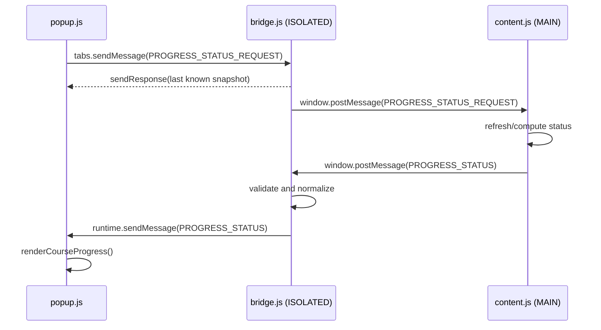
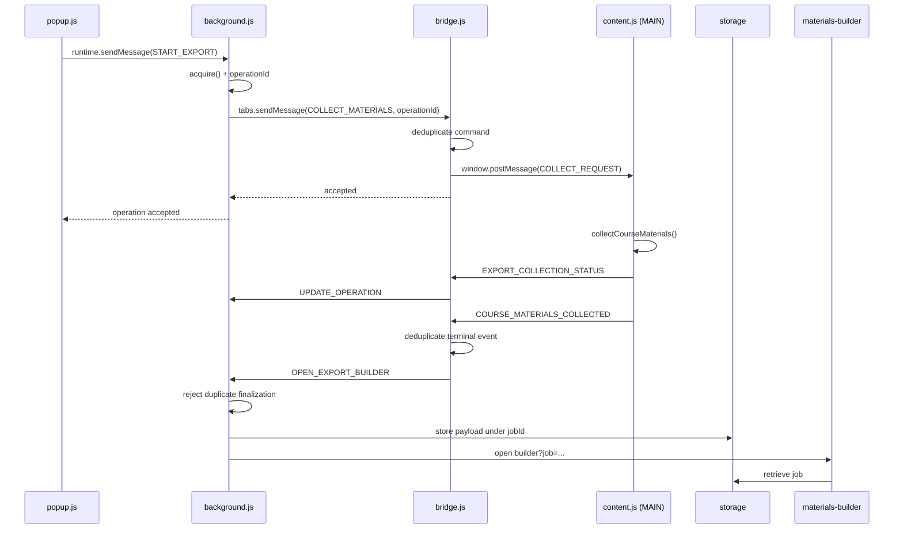

# 02 — Contexts and messaging

## Making separate worlds communicate

In the previous chapter we saw that PlumePilot does not live inside a single JavaScript environment.

The popup, background, isolated content scripts, `MAIN`-world scripts, and builder pages are separate components. They belong to the same extension, but **they do not automatically share memory, global scope, or lifecycle**.

In an ordinary function, we can write:

```js
const result = calculateSomething(input);
```

Across extension contexts, the interaction looks more like this:

```text
component A
    │
    │  { type: "DO_SOMETHING", ... }
    ▼
boundary
    │
    ▼
component B
    │
    │  { accepted: true, ... }
    ▼
component A
```

Component A does not directly invoke one of B's private functions. Instead it sends **a message describing what it wants to accomplish**. This is *message passing*, one of the most useful concepts for understanding PlumePilot.

---

## 1. From function calls to contracts

When two pieces of code share a scope, the contract can simply be a function signature:

```js
startExport(format, tabId);
```

Across a boundary, the contract becomes serializable data:

```js
{
  type: "PEGASO_START_EXPORT",
  format: "materials",
  sourceTabId: tabId,
  requestSource: "toolbar-popup"
}
```

The object carries a request, not executable behavior. Its `type` field plays a role similar to an HTTP route such as `POST /exports/start`. The recipient uses it to choose the handler.

In `background.js`, the dispatcher follows this pattern:

```js
chrome.runtime.onMessage.addListener((message, sender, sendResponse) => {
  let action = null;

  if (message?.type === "PEGASO_GET_OPERATION")
    action = reconcileOperationOwner();
  else if (message?.type === "PEGASO_START_EXPORT")
    action = startExport({ ...message, sourceTabId });
  else if (message?.type === "PEGASO_CANCEL_EXPORT")
    action = cancelExport(message);

  // ...
});
```

Source: [`background.js`, message dispatcher](https://github.com/PlumePilot/plumepilot/blob/a8007425f81792e7570516dbdf1e7fb2cbda4d53/background.js#L918-L945).

```text
message.type
     │
     ├── PEGASO_START_EXPORT  → startExport()
     ├── PEGASO_CANCEL_EXPORT → cancelExport()
     └── PEGASO_GET_OPERATION → reconcileOperationOwner()
```

### A concept to remember

Crossing a boundary does not merely mean "calling a function somewhere else." It means defining **a protocol**, even when that protocol is entirely internal to an application.

---

## 2. PlumePilot's three main communication channels

Three mechanisms appear repeatedly:

```text
1. chrome.runtime.sendMessage()
2. chrome.tabs.sendMessage()
3. window.postMessage()
```

They may look similar, but they solve different problems.

### `chrome.runtime.sendMessage()`

This sends a message within the extension runtime, typically to the background coordinator:

```js
chrome.runtime.sendMessage(message, (response) => {
  // use the response
});
```

Use it when the destination is an extension component rather than a content script in a particular tab.

### `chrome.tabs.sendMessage()`

This addresses the content scripts in a specific browser tab:

```js
chrome.tabs.sendMessage(
  tabId,
  { type: "PEGASO_COURSE_PROGRESS_STATUS_REQUEST" },
  { frameId: 0 },
  callback,
);
```

Notice the addressing information: the tab ID, and in this case the top frame.

### `window.postMessage()`

This is a standard Web API, not an extension-specific one. PlumePilot uses it to bridge the `ISOLATED` and `MAIN` worlds, which share the page's `window` but not the same JavaScript scope.

```js
// bridge.js
window.postMessage(
  { type: "PEGASO_COURSE_PROGRESS_STATUS_REQUEST" },
  "*",
);
```

```js
// content.js
window.addEventListener("message", (event) => {
  if (event.source !== window) return;
  if (!event.data) return;

  if (event.data.type === "PEGASO_COURSE_PROGRESS_STATUS_REQUEST") {
    // ...
  }
});
```

The page's `window` acts as a local message channel.

---

## 3. A mental map of the channels

```text
                         EXTENSION

 popup / builder                       background
      │                                    ▲
      │ chrome.runtime.sendMessage         │
      └────────────────────────────────────┘

 background / popup
      │
      │ chrome.tabs.sendMessage(tabId)
      ▼
 bridge.js / isolated content script
      │
      │ window.postMessage
      ▼
 content.js / MAIN world
      │
      ▼
 Multiversity page
```

Messages may travel back in the opposite direction as well. The important question is: **which boundary does this message need to cross?**

When reading the code, first ask: "Which context am I in, and which context am I trying to reach?"

---

# Part I — A simple flow

## 4. Real example: the popup requests course progress

When the popup opens, it needs information about the current course. In `popup.js`:

```js
chrome.tabs.sendMessage(
  tabId,
  { type: "PEGASO_COURSE_PROGRESS_STATUS_REQUEST" },
  { frameId: 0 },
  (response) => {
    if (chrome.runtime.lastError || !response?.status) return;
    renderCourseProgress(response.status);
  },
);
```

Source: [`popup.js` L1392–L1399](https://github.com/PlumePilot/plumepilot/blob/a8007425f81792e7570516dbdf1e7fb2cbda4d53/popup.js#L1392-L1399).

The popup knows the active tab ID and addresses that tab's isolated content script, `bridge.js`. Its listener handles the request approximately as follows:

```js
if (message?.type === "PEGASO_COURSE_PROGRESS_STATUS_REQUEST") {
  window.postMessage(
    { type: "PEGASO_COURSE_PROGRESS_STATUS_REQUEST" },
    "*",
  );

  sendResponse({
    accepted: true,
    status: courseProgressStatus,
  });

  return;
}
```

Source: [`bridge.js` L368–L371](https://github.com/PlumePilot/plumepilot/blob/a8007425f81792e7570516dbdf1e7fb2cbda4d53/bridge.js#L368-L371).

Two things happen:

1. The bridge immediately returns the last known progress status.
2. At the same time, it requests a refresh from the `MAIN` world.

These are separate operations with different timing guarantees.

---

## 5. Immediate response, later update

A naive implementation might make the popup wait for a complete recalculation:

```text
popup → calculate everything → wait → respond
```

PlumePilot instead uses a more reactive pattern:

```text
popup
  ├── receives last known snapshot immediately
  └── triggers a refresh in MAIN
                      │
                      ▼
                new status
                      │
                      ▼
                pushed update
```

The bridge's `courseProgressStatus` is a **snapshot cache**: useful for a responsive interface, even if a fresher value is still being calculated.

### This introduces eventual consistency

For a short period, two components may hold different snapshots. They converge as updates propagate. That does not automatically mean something is broken; consistency is obtained through messages rather than synchronously shared memory.

This model appears throughout distributed systems, reactive interfaces, and event-driven applications. PlumePilot gives us a compact example we can inspect directly.

---

## 6. Crossing the ISOLATED → MAIN boundary

After the bridge posts a request, `content.js` receives it:

```js
if (event.data.type === "PEGASO_COURSE_PROGRESS_STATUS_REQUEST") {
  scheduleCourseProgressInitialization(0);
  publishCourseProgressStatus();
  return;
}
```

Source: [`content.js` L423–L426](https://github.com/PlumePilot/plumepilot/blob/a8007425f81792e7570516dbdf1e7fb2cbda4d53/content.js#L423-L426).

The `MAIN` world computes or publishes its own state:

```js
window.postMessage({
  type: "PEGASO_COURSE_PROGRESS_STATUS",
  status: {
    courseCode: state.courseCode,
    available: percent !== null && state.chapterCount > 0,
    percent,
    chapterCount: state.chapterCount,
    knownChapters: courseProgressChapters.size,
    exact: exactAvailable,
    // ...
  },
}, "*");
```

Source: [`content.js` L4478–L4500](https://github.com/PlumePilot/plumepilot/blob/a8007425f81792e7570516dbdf1e7fb2cbda4d53/content.js#L4478-L4500).

Now the message travels in the opposite direction:

```text
content.js (MAIN)
    │ window.postMessage
    ▼
bridge.js (ISOLATED)
```

---

## 7. The bridge as an adapter

The bridge does not blindly forward the returned payload. It normalizes it first:

```js
courseProgressStatus = courseCode ? {
  platformId: PLATFORM_ID,
  courseCode,
  available: source.available === true && Number.isFinite(percent),
  percent: Number.isFinite(percent)
    ? Math.max(0, Math.min(100, Math.floor(percent)))
    : null,
  chapterCount: Math.max(0, Math.floor(Number(source.chapterCount) || 0)),
  knownChapters: Math.max(0, Math.floor(Number(source.knownChapters) || 0)),
  exact: source.exact === true,
  updatedByStudyWing: source.updatedByStudyWing === true,
  message: safeText(source.message, 160) || "",
} : null;
```

Then it publishes the normalized state to the extension runtime:

```js
chrome.runtime.sendMessage({
  type: "PEGASO_COURSE_PROGRESS_STATUS",
  status: courseProgressStatus,
});
```

Source: [`bridge.js` L513–L534](https://github.com/PlumePilot/plumepilot/blob/a8007425f81792e7570516dbdf1e7fb2cbda4d53/bridge.js#L513-L534).

The word *bridge* is appropriate, but *adapter* is equally important:

```text
MAIN-world payload
      ↓
validation and normalization
      ↓
extension-runtime payload
```

### General principle

A boundary is a natural place to validate, normalize, reduce, reject, or translate data. The same principle motivates DTOs, serializers, and adapters in backend architectures.

---

## 8. The popup receives the pushed update

The initial reply is not the popup's only source of information:

```js
chrome.runtime.onMessage.addListener((message, sender) => {
  if (
    message?.type === "PEGASO_COURSE_PROGRESS_STATUS" &&
    sender?.tab?.id === activeCourseTabId
  ) {
    renderCourseProgress(message.status || null);
  }
});
```

Source: [`popup.js` L1402–L1409](https://github.com/PlumePilot/plumepilot/blob/a8007425f81792e7570516dbdf1e7fb2cbda4d53/popup.js#L1402-L1409).

The sender check matters. Without it, progress events from tab B might update the UI for course A.

A message system needs to ask not only **what type of message is this?**, but also **who sent it?**

---

## 9. The entire progress flow



We have request, immediate response, asynchronous refresh, pushed update, snapshot cache, and sender validation—all in one relatively small workflow.

---

# Part II — Asynchronous request/response

## 10. `sendResponse()` and the problem of time

Consider the background listener:

```js
chrome.runtime.onMessage.addListener((message, sender, sendResponse) => {
  let action = null;

  // ... select the action ...

  action
    .then(sendResponse)
    .catch((error) => {
      sendResponse({ accepted: false, reason: error.message });
    });

  return true;
});
```

Why `return true`?

With a synchronous response, the handler can call `sendResponse` before it finishes:

```js
chrome.runtime.onMessage.addListener((message, sender, sendResponse) => {
  sendResponse({ accepted: true });
});
```

With an asynchronous response, the Promise may settle after the listener has returned:

```js
chrome.runtime.onMessage.addListener((message, sender, sendResponse) => {
  doSomethingAsync().then((result) => {
    sendResponse(result);
  });

  return true;
});
```

In this callback-based messaging model, `return true` keeps the response channel available for the later callback.

```text
request → handler → asynchronous work starts
                      ↓
                 listener returns
                      ↓
            Promise settles later
                      ↓
                  sendResponse
```

Without the required signal, the channel may already have closed when the response is attempted.

### Backend analogy

Think of a route that needs a database query before producing its response. The analogy is imperfect—the extension runtime manages the callback channel—but the same timing question arises: **is the response produced before or after the initial handler returns?**

---

## 11. Why PlumePilot wraps callbacks in Promises

The popup includes an adapter around the callback-oriented runtime API. Conceptually:

```js
function runtimeMessage(message) {
  return new Promise((resolve, reject) => {
    chrome.runtime.sendMessage(message, (response) => {
      if (chrome.runtime.lastError) {
        reject(new Error(chrome.runtime.lastError.message));
        return;
      }
      resolve(response);
    });
  });
}
```

Now the caller can write:

```js
try {
  const response = await runtimeMessage({
    type: "PEGASO_GET_OPERATION",
  });
  // use response
} catch (error) {
  // handle delivery/runtime failure
}
```

The adapter turns two different mechanisms—callback completion and browser runtime errors—into a single Promise-based interface.

### A small asynchronous adapter

This is not merely syntax sugar. It creates a clearer contract for callers and makes sequential workflows easier to reason about. **A rejected Promise still differs from a successfully delivered application-level response such as `{ accepted: false }`.**

---

# Part III — A long-running workflow

## 12. Real example: exporting course materials

The progress request is short. Exporting course materials is different: collection can take time, the popup may close, and a separate builder page must eventually produce a file.

The workflow crosses multiple contexts and uses its own operation identity.

---

## 13. Step 1 — The popup sends a command

When the user starts material collection:

```js
const response = await runtimeMessage({
  type: "PEGASO_START_EXPORT",
  format: "materials",
  sourceTabId: tabId,
  requestSource: "toolbar-popup",
});
```

Source: [`popup.js` L2112–L2133](https://github.com/PlumePilot/plumepilot/blob/a8007425f81792e7570516dbdf1e7fb2cbda4d53/popup.js#L2112-L2133).

This is a **command**: an intention to start something.

### Command

```text
START_EXPORT
CANCEL_EXPORT
FIND_FIRST_INCOMPLETE
```

### Event

An event describes something that already happened:

```text
COURSE_PROGRESS_STATUS
COURSE_MATERIALS_COLLECTED
EXPORT_COLLECTION_FAILED
```

The code does not implement formal CQRS or event sourcing, but the conceptual distinction helps us trace messages.

---

## 14. Step 2 — The background acquires the operation

The dispatcher routes the command to `startExport()`, which first attempts to acquire ownership:

```js
const result = await acquire(format, message.sourceTabId);
if (!result.accepted) return result;
```

Source: [`background.js` L700–L719](https://github.com/PlumePilot/plumepilot/blob/a8007425f81792e7570516dbdf1e7fb2cbda4d53/background.js#L700-L719).

Collection does **not** start immediately. The background first checks whether the operation may proceed, preventing incompatible workflows from running concurrently.

This is why a coordinator with a global view is useful: no individual course tab necessarily knows every operation in progress.

---

## 15. Step 3 — An `operationId` is created

The acquired operation has an ID:

```js
result.operation.id
```

It is carried into messages sent to the course tab:

```js
const response = await sendTabMessage(message.sourceTabId, {
  type: "PEGASO_COLLECT_COURSE_MATERIALS",
  format,
  operationId: result.operation.id,
});
```

Without an identifier, a sequence of messages might look like:

```text
START
STATUS 25%
STATUS 80%
COMPLETE
```

But which export do these updates describe?

```text
operationId = 9f2...

START     9f2...
STATUS    9f2...
STATUS    9f2...
COMPLETE  9f2...
```

The identifier acts as a **correlation ID**, a fundamental pattern in asynchronous jobs, queues, tracing, and distributed systems.

---

## 16. Step 4 — The background addresses a specific tab

The helper used for tab messaging is shaped like this:

```js
function sendTabMessage(tabId, message) {
  return new Promise((resolve, reject) =>
    chrome.tabs.sendMessage(
      tabId,
      message,
      { frameId: 0 },
      (response) =>
        chrome.runtime.lastError
          ? reject(new Error(chrome.runtime.lastError.message))
          : resolve(response),
    ),
  );
}
```

Source: [`background.js` L677–L683](https://github.com/PlumePilot/plumepilot/blob/a8007425f81792e7570516dbdf1e7fb2cbda4d53/background.js#L677-L683).

`tabId` and `frameId: 0` are addresses. This is not a broadcast to every tab; it is a request to a specific content-script destination.

---

## 17. Step 5 — The bridge deduplicates before forwarding

The isolated bridge checks the operation ID:

```js
if (message?.type === "PEGASO_COLLECT_COURSE_MATERIALS") {
  const operationId = exportOperationId(message.operationId);

  if (!operationId) {
    sendResponse({
      accepted: false,
      reason: "Identificativo operazione mancante.",
    });
    return;
  }

  if (requestedExportOperationIds.has(operationId)) {
    sendResponse({ accepted: true, duplicate: true });
    return;
  }

  rememberExportOperation(requestedExportOperationIds, operationId);

  window.postMessage({
    type: "PEGASO_COLLECT_COURSE_MATERIALS_REQUEST",
    format: message.format,
    operationId,
  }, "*");

  sendResponse({ accepted: true, duplicate: false });
}
```

Source: [`bridge.js` L373–L390](https://github.com/PlumePilot/plumepilot/blob/a8007425f81792e7570516dbdf1e7fb2cbda4d53/bridge.js#L373-L390).

The error message is left in Italian because it comes from the **actual code snapshot**, not from a translated UI.

### True idempotency versus deduplication

Setting a preference to the same value repeatedly is naturally idempotent:

```text
SET theme = dark
SET theme = dark
SET theme = dark
```

Collecting all course materials is expensive. PlumePilot instead asks whether the same `operationId` has already been observed.

This provides a useful form of duplicate suppression **within the lifetime of the component that remembers the ID**. It is not a blanket guarantee of exactly-once execution or permanent idempotency. We should never attribute stronger guarantees to the code than it really provides.

---

## 18. Step 6 — Collection begins in the MAIN world

The bridge posts the command into the `MAIN` world. `content.js` checks the ID again before the actual side effect:

```js
if (event.data.type === "PEGASO_COLLECT_COURSE_MATERIALS_REQUEST") {
  const operationId = /* normalization */;

  if (!operationId) return;

  if (handledExportOperationIds.has(operationId)) {
    return;
  }

  rememberHandledExportOperation(operationId);

  void collectCourseMaterials(format, operationId).finally(() => {
    // completion logging
  });

  return;
}
```

Source: [`content.js` L287–L311](https://github.com/PlumePilot/plumepilot/blob/a8007425f81792e7570516dbdf1e7fb2cbda4d53/content.js#L287-L311).

Why deduplicate again? Because the layers defend different boundaries:

- `bridge.js` protects the transfer from the extension runtime into `MAIN`.
- `content.js` protects the actual collection side effect.

This is **defence in depth for reliability**, not only for security.

---

## 19. Why `void collectCourseMaterials(...)` instead of `await`?

```js
void collectCourseMaterials(format, operationId).finally(...);
```

The message handler does not await the entire collection. Starting the workflow is a short operation; completing it may take much longer.

```text
short request/response
          ≠
long asynchronous workflow
```

Instead of holding a message response open for the entire job, PlumePilot sends subsequent events:

```text
COMMAND: start
EVENT:   status updated
EVENT:   status updated
EVENT:   completed
```

The backend analogy is familiar:

```text
POST /exports
→ 202 Accepted + jobId

GET /jobs/:id
or pushed events
```

---

## 20. Step 7 — Status updates travel back up the chain

During collection, the `MAIN` world publishes progress:

```js
window.postMessage(
  {
    type: "PEGASO_EXPORT_COLLECTION_STATUS",
    operationId,
    message,
  },
  "*",
);
```

Source: [`content.js` L2388–L2401](https://github.com/PlumePilot/plumepilot/blob/a8007425f81792e7570516dbdf1e7fb2cbda4d53/content.js#L2388-L2401).

The bridge converts it into an extension-runtime update:

```js
chrome.runtime.sendMessage({
  type: "PEGASO_UPDATE_OPERATION",
  operationId,
  patch: { message: event.data.message },
});
```

Source: [`bridge.js` L584–L588](https://github.com/PlumePilot/plumepilot/blob/a8007425f81792e7570516dbdf1e7fb2cbda4d53/bridge.js#L584-L588).

```text
content.js
    ↓ status event
bridge.js
    ↓ operation update
background
    ↓
central operation state
```

The user may close the popup while collection continues. When the popup opens again, it can reconstruct its UI from the operation state.

> **The UI does not own the job. The UI observes the job.**

---

## 21. Step 8 — Collection ends with an event

When the payload is ready, the `MAIN` world publishes `PEGASO_COURSE_MATERIALS_COLLECTED`.

The bridge checks a *different* set for terminal events:

```js
if (terminalExportOperationIds.has(operationId)) {
  return;
}

rememberExportOperation(
  terminalExportOperationIds,
  operationId,
);
```

Then:

```js
chrome.runtime.sendMessage({
  type: "PEGASO_OPEN_EXPORT_BUILDER",
  format: event.data.format,
  operationId,
  payload: event.data.payload,
});
```

Source: [`bridge.js` L550–L570](https://github.com/PlumePilot/plumepilot/blob/a8007425f81792e7570516dbdf1e7fb2cbda4d53/bridge.js#L550-L570).

The workflow has two distinct moments worth protecting:

```text
START    → do not start twice
COMPLETE → do not finalize twice
```

Duplicate completion events must not open duplicate builder pages.

---

## 22. Step 9 — The background opens the builder only once

The background checks that finalization is not already in progress:

```js
if (
  operation.phase === "building" ||
  operation.jobKey ||
  Number.isInteger(operation.builderTabId)
) {
  return {
    accepted: true,
    duplicate: true,
    operation,
  };
}
```

Source: [`background.js` L784–L850](https://github.com/PlumePilot/plumepilot/blob/a8007425f81792e7570516dbdf1e7fb2cbda4d53/background.js#L784-L850).

It creates a new `jobId`, stores the payload, and opens a builder page:

```js
const jobId = crypto.randomUUID();
const storageKey = `pegasoExportJob:${jobId}`;

await storageSet({
  [storageKey]: {
    ...message.payload,
    format,
    operationId: operation.id,
    courseTabId: operation.sourceTabId,
  },
});

chrome.tabs.create({
  url: chrome.runtime.getURL(`${builderPage}?job=${jobId}`),
});
```

The URL carries only a small reference, `?job=<jobId>`. The builder retrieves the larger payload from storage.

This is the familiar backend pattern:

```text
small identifier → lookup of large state
```

---

## 23. The complete export workflow



We are not merely looking at a script that clicks buttons; this is a small **event-driven system**.

---

# Part IV — Protocol reliability

## 24. `accepted` does not mean `completed`

A message response such as:

```js
{ accepted: true }
```

usually means the request was accepted for further handling. It does **not** mean the course materials have already been generated.

```text
accepted ≠ completed
```

As with HTTP `202 Accepted`, the response is about admission into a workflow, not necessarily about the workflow's final result.

---

## 25. Three classes of messages

A useful mental classification is:

### A. Query

A request for information:

```text
PEGASO_GET_OPERATION
PEGASO_COURSE_PROGRESS_STATUS_REQUEST
PEGASO_CHAPTER_LIMIT_STATUS_REQUEST
```

### B. Command

An intention to perform an action:

```text
PEGASO_START_EXPORT
PEGASO_CANCEL_EXPORT
PEGASO_FIND_FIRST_INCOMPLETE_COMMAND
```

### C. Event

A statement about something that happened:

```text
PEGASO_COURSE_PROGRESS_STATUS
PEGASO_COURSE_MATERIALS_COLLECTED
PEGASO_EXPORT_COLLECTION_FAILED
```

This is a reading aid, not a taxonomy formally enforced by the browser or codebase.

---

## 26. Fire-and-forget versus request/response

Not every message requires an awaited application response.

### Request/response

```js
chrome.runtime.sendMessage(message, (response) => {
  // the reply matters to the caller
});
```

### Fire-and-forget

```js
chrome.runtime.sendMessage({
  type: "PEGASO_UPDATE_OPERATION",
  operationId,
  patch: { message },
});
```

The sender can continue without waiting for a domain result. This reduces coupling, but it changes error handling: a lost update must not silently make the overall workflow impossible to understand.

Ask whether the sender needs proof that the recipient completed the action, or merely needs to publish the information.

---

## 27. Transport errors versus application errors

A **transport/runtime error** may be exposed through:

```js
chrome.runtime.lastError
```

The target tab might have been closed, the content script might be unavailable, or the response channel might have failed.

An **application error** means the message arrived but the operation was rejected:

```js
{
  accepted: false,
  reason: "Scheda del corso non disponibile."
}
```

Again, the Italian string is preserved from the code example. The conceptual distinction is analogous to:

```text
network/transport failure
           ≠
successfully delivered domain error
```

---

## 28. Why `runtime.lastError` is checked so frequently

```js
chrome.tabs.sendMessage(tabId, message, (response) => {
  if (chrome.runtime.lastError) {
    // handle delivery error
    return;
  }

  // use response
});
```

In callback-style Chrome APIs, asynchronous runtime failures may be reported through `chrome.runtime.lastError`. If it is ignored, an undefined response might be mistaken for a meaningful domain result even though the request never reached its destination.

Promise wrappers help turn this API-specific pattern into consistent handling for the rest of the code.

---

## 29. Messages must be serializable

Messaging does not share JavaScript object identity or the same heap.

It is inappropriate to design a message that expects a callback or DOM node to be directly usable in the recipient:

```js
{
  callback: () => doSomething(),
  domNode: document.querySelector("video")
}
```

Instead, send data:

```js
{
  type: "PEGASO_UPDATE_OPERATION",
  operationId: "...",
  patch: {
    phase: "building",
    message: "Preparazione in corso…"
  }
}
```

Serializable contracts force boundaries to become explicit. That constraint is often an architectural advantage.

---

# Part V — `window.postMessage()` and the trust boundary

## 30. Sharing `window` does not mean sharing trust

A message listener may check:

```js
if (event.source !== window || !event.data) return;
```

This verifies that the event came from the expected window object, but it is **not cryptographic authentication**. Page JavaScript can also post messages on the same window.

Treat `MAIN` ↔ `ISOLATED` as a trust boundary:

- Accept only the message types you need.
- Validate identifiers, values, and payload shapes.
- Avoid moving secrets between contexts unnecessarily.
- Normalize information before sending it into the more privileged extension runtime.

Examples of defensive helpers in PlumePilot include `safeText(...)`, `exportOperationId(...)`, `Number.isFinite(...)`, and `Array.isArray(...)`.

### General lesson

Prefer a narrow bridge with a handful of explicit, validated commands over a general "execute whatever the other side requests" interface.

The same principle applies to iframes, workers, plugin systems, and backend APIs.

---

## 31. Why `"*"` as `targetOrigin` does not mean "send this to the Internet"

```js
window.postMessage(message, "*");
```

Here, `"*"` does not restrict the target origin, but the target is still the page's own `window`. It does not broadcast the message to arbitrary websites.

Nevertheless, JavaScript running in the page may be able to observe or post messages on that channel. The payload should not be treated as secret. For communications *between different windows or origins*, strict origin verification becomes even more important.

---

# Part VI — Concurrency hidden inside messages

## 32. Two valid messages may still cause a bug

Imagine two valid commands:

```text
A: START_EXPORT
B: CANCEL_EXPORT
```

What if they arrive almost simultaneously?

Or imagine:

```text
A: STATUS 40%
B: COMPLETE
C: STATUS 50%  ← arrives late
```

The problem is not an invalid payload. It is **ordering and timing**.

That is why PlumePilot uses operation IDs, phases, deduplication sets, serialized background operations, and guards around terminal events. We will explore these patterns further in the asynchrony chapter.

> In a message-driven system, time and ordering are part of the design.

---

## 33. Terminal state is special

```js
if (terminalExportOperationIds.has(operationId)) {
  return;
}
```

Once a workflow has ended, a late or duplicate message should not reopen it.

```text
idle
  ↓
collecting
  ↓
building
  ↓
completed / released
```

A message can be syntactically valid yet **invalid for the current lifecycle phase**. This is our first glimpse of why explicit state machines are helpful.

---

# Part VII — Startup and synchronization

## 34. A listener may be registered too late

A comment in `content.js` reveals a real startup-ordering issue:

```js
// bridge.js may have sent its startup state before this document-idle
// listener existed. Request an explicit synchronization after subscribing.
window.postMessage({ type: "PEGASO_AUTONEXT_STATE_REQUEST" }, "*");
```

Source: [`content.js` L557–L559](https://github.com/PlumePilot/plumepilot/blob/a8007425f81792e7570516dbdf1e7fb2cbda4d53/content.js#L557-L559).

Recall the injection timing:

```text
bridge.js  → document_start
content.js → document_idle
```

This can happen:

```text
bridge loads
    ↓
bridge publishes startup state
    ↓
content.js has not registered its listener yet
    ↓
message is lost
```

`postMessage` is not a persistent queue. It cannot retroactively deliver an event that no suitable listener was ready to process.

PlumePilot fixes the ordering problem by:

1. Registering the listener.
2. Explicitly requesting current state.
3. Receiving a fresh publication from the bridge.

This is a **handshake**, or explicit synchronization.

### Important concept

Events tell you "something changed." New subscribers also need a way to ask "what is the state *right now*?"

---

## 35. Snapshot plus events: a recurring pattern

```text
QUERY
  ↓
current snapshot

EVENT
  ↓
future changes
```

The snapshot brings a newly started or reopened component up to date. Events keep it informed afterward.

Backend analogies include an initial `GET /resource` followed by a WebSocket or SSE subscription, or a database query followed by change notifications.

The implementations differ, but the architectural problem is the same.

---

# Part VIII — How to read PlumePilot's messaging

## 36. A practical reverse-engineering method

When you encounter a `message.type`, reconstruct the path in four steps.

### 1. Find its producer

Search for:

```js
{ type: "MESSAGE_NAME" }
```

Ask: **who sends it?**

### 2. Find its consumer

Search for:

```js
message?.type === "MESSAGE_NAME"
```

or:

```js
event.data.type === "MESSAGE_NAME"
```

Ask: **who receives it?**

### 3. Identify the channel

Is the producer calling `runtime.sendMessage`, `tabs.sendMessage`, or `window.postMessage`? That reveals the boundary.

### 4. Find the response or next event

```text
REQUEST → STATUS
START   → UPDATE → COMPLETE
```

Once you can trace producers, recipients, channels, and follow-up events, you have reconstructed the protocol.

---

## 37. A table of the main boundaries

| From | To | Typical mechanism | Example |
|---|---|---|---|
| Popup | Background | `runtime.sendMessage` | Start export |
| Builder | Background | `runtime.sendMessage` | Update/release operation |
| Background | Content script | `tabs.sendMessage` | Collect materials |
| Popup | Content script | `tabs.sendMessage` | Request course progress |
| ISOLATED | MAIN | `window.postMessage` | Collection command |
| MAIN | ISOLATED | `window.postMessage` | Status/completion |
| Bridge | Popup/extension runtime | `runtime.sendMessage` | Updated progress |

This is almost a dependency map of PlumePilot's runtime architecture.

---

# Part IX — What could we have done differently?

## 38. A single message bus?

We could create one abstraction:

```js
bus.send("START_EXPORT", payload);
```

It might hide whether the implementation calls `runtime.sendMessage`, `tabs.sendMessage`, or `postMessage`.

### Benefit

Calling code could become more uniform.

### Cost

It could hide important architecture: **where is this message going, which boundary does it cross, and what capabilities does the receiver have?**

A useful abstraction might centralize error handling and contracts **while keeping destinations explicit**, rather than hiding every difference.

---

## 39. A centralized registry of message types?

Today, many message names are string literals scattered across the codebase:

```js
"PEGASO_START_EXPORT"
"PEGASO_UPDATE_OPERATION"
"PEGASO_COURSE_PROGRESS_STATUS"
```

One possible evolution would be:

```js
const Messages = Object.freeze({
  START_EXPORT: "PEGASO_START_EXPORT",
  UPDATE_OPERATION: "PEGASO_UPDATE_OPERATION",
  COURSE_PROGRESS_STATUS: "PEGASO_COURSE_PROGRESS_STATUS",
});
```

TypeScript could also associate payload types with each message.

### What would we gain?

Fewer typos, easier refactoring, visible contracts, and potential type checking.

### What would it cost?

More infrastructure, a shared module available in several execution contexts, and potentially limited value for very small messages.

The current approach is not automatically wrong. This is the kind of trade-off we will revisit in the architectural retrospective.

---

## 40. A versioned protocol?

Components in one extension package normally update together. PlumePilot therefore does not need every message to carry a field such as:

```text
protocolVersion: 3
```

In a system where senders and receivers deploy independently, versioned contracts would become much more important.

> The amount of protocol infrastructure you need depends partly on how your components are distributed and released.

---

# Part X — Connections to backend development

## 41. A shared vocabulary

| Browser extension | Backend/distributed-system analogy |
|---|---|
| `message.type` | Route, event name, or command name |
| `runtime.onMessage` | Dispatcher/controller |
| `sendResponse()` | Response handler |
| `operationId` | Job ID/correlation ID |
| `accepted: true` | Accepted request/`202 Accepted` |
| `runtime.lastError` | Transport/runtime failure |
| `accepted: false` | Domain/application failure |
| `window.postMessage` | Local message bus / IPC-like boundary |
| `tabs.sendMessage(tabId)` | Addressing one particular instance |
| Snapshot + events | Initial query + subscription |
| Deduplication | Duplicate suppression/idempotency key |

These are analogies, not exact equivalences. A browser extension is not a distributed cluster, and `postMessage` is not Kafka. But the underlying questions are related: separated components, asynchronous delivery, partial failures, timing, correlation, duplicate handling, and non-shared state.

---

# Part XI — Small exercises

## 42. Exercise 1 — Choose the channel

Imagine implementing these features.

### A. The popup asks the background whether an export is active

Use `runtime.sendMessage`: the recipient is the extension-wide coordinator.

### B. The background asks tab 37 to stop collecting materials

Use `tabs.sendMessage(37, ...)`: this addresses a particular content script.

### C. `content.js` in MAIN asks the bridge to read a stored preference

Use `window.postMessage` to cross MAIN → ISOLATED; the bridge then uses the appropriate extension APIs.

---

## 43. Exercise 2 — Find the bug

```js
chrome.runtime.onMessage.addListener((message, sender, sendResponse) => {
  fetchSomething().then((result) => {
    sendResponse(result);
  });
});
```

What is missing from the callback-based pattern used by PlumePilot?

```js
return true;
```

Without it, the asynchronous response channel may close before `fetchSomething()` completes.

---

## 44. Exercise 3 — Query, command, or event?

```text
PEGASO_GET_OPERATION         → query
PEGASO_CANCEL_EXPORT        → command
PEGASO_EXPORT_COLLECTION_FAILED → event
```

The browser does not demand this classification. It is a way for *us* to reason more clearly.

---

## 45. Exercise 4 — Why do we need `operationId`?

Suppose exports A and B are started close together. A message arrives saying only "collection completed."

Without an operation identity, we cannot tell which export it refers to. With `operationId: A`, the message is unambiguous.

---

## 46. Exercise 5 — An event lost during startup

```text
bridge.js: document_start
content.js: document_idle
```

If the bridge publishes startup state only once, `content.js` may not receive it because its listener does not exist yet.

A robust strategy is:

```text
subscribe → request current snapshot
```

That is exactly the purpose served by `PEGASO_AUTONEXT_STATE_REQUEST`.

---

# Part XII — Concepts to carry forward

## 47. Message passing

Communicating through messages instead of directly sharing functions and memory.

## 48. Protocol

The set of message shapes, names, and expectations that allow senders and receivers to understand one another. In PlumePilot it largely consists of objects with a `type` and associated payload.

## 49. Dispatcher

A component that routes incoming messages to the appropriate handler. The background's `runtime.onMessage` listener is an example.

## 50. Command

A message expressing an intention to perform an action.

## 51. Event

A message describing something that has happened.

## 52. Query

A message primarily requesting information, not requesting a state change.

## 53. Correlation ID

An identifier linking multiple messages to one logical workflow. `operationId` is our central example.

## 54. Deduplication

Recognizing and suppressing a repeated request or event that has already been processed.

## 55. Eventual consistency

A situation in which components can temporarily have different snapshots but converge as updates propagate.

## 56. Fire-and-forget

Sending a message without awaiting an application-level response before continuing.

## 57. Request/response

An interaction in which the sender needs a response associated with its request.

## 58. Handshake / explicit synchronization

A procedure by which a newly initialized subscriber asks for current state rather than relying on events that may have been published before it was listening.

## 59. Boundary validation

Validating and normalizing data as it crosses a component boundary or trust domain.

---

# Part XIII — Further reading

## 60. Recommended primary documentation

### Chrome Extensions — Message passing

https://developer.chrome.com/docs/extensions/develop/concepts/messaging

Read about `runtime.sendMessage()`, `tabs.sendMessage()`, one-time requests, and long-lived connections.

### Chrome Extensions — Tabs API

https://developer.chrome.com/docs/extensions/reference/api/tabs

Especially useful for understanding why `tabs.sendMessage()` accepts a tab ID and can target a particular frame/document.

### MDN — `runtime.sendMessage()`

https://developer.mozilla.org/en-US/docs/Mozilla/Add-ons/WebExtensions/API/runtime/sendMessage

### MDN — `runtime.onMessage`

https://developer.mozilla.org/en-US/docs/Mozilla/Add-ons/WebExtensions/API/runtime/onMessage

Pay attention to `sendResponse()`, synchronous and asynchronous responses, `return true`, Promises, and cross-browser compatibility details.

### MDN — `Window.postMessage()`

https://developer.mozilla.org/en-US/docs/Web/API/Window/postMessage

Read this alongside the security discussion, especially the origin checks required when communicating between different windows.

### Chrome — Execution worlds

https://developer.chrome.com/docs/extensions/reference/api/scripting#type-ExecutionWorld

Connect the messaging patterns in this chapter to the `MAIN` / `ISOLATED` distinction from Chapter 1.

---

# 61. What have we really learned?

At first glance, this chapter was about APIs such as:

```text
sendMessage()
postMessage()
onMessage
```

The deeper lesson is that **communication becomes part of the architecture when an application is split into contexts with different lifetimes and privileges**.

It is no longer sufficient to say "function A calls function B." We must ask:

- Who produces a message, and who consumes it?
- Which boundary does it cross?
- Is a response expected, and can it arrive later?
- How are updates correlated with their operation?
- What if a message is delivered twice or out of order?
- What if the subscriber is not ready yet?

These questions lead naturally into the next chapter.

In **Chapter 3**, we leave the extension infrastructure and examine one of the least stable environments PlumePilot must work with:

> **The DOM of a web application we do not control.**

Reading an HTML element is easy. Building reliable automation on top of a continuously changing interface is another matter.

---

[← 01 — Anatomy of PlumePilot](01-anatomy-of-an-extension.md) · [Contents](index.md) · [03 — DOM and dynamic pages →](03-dom-and-dynamic-pages.md)
