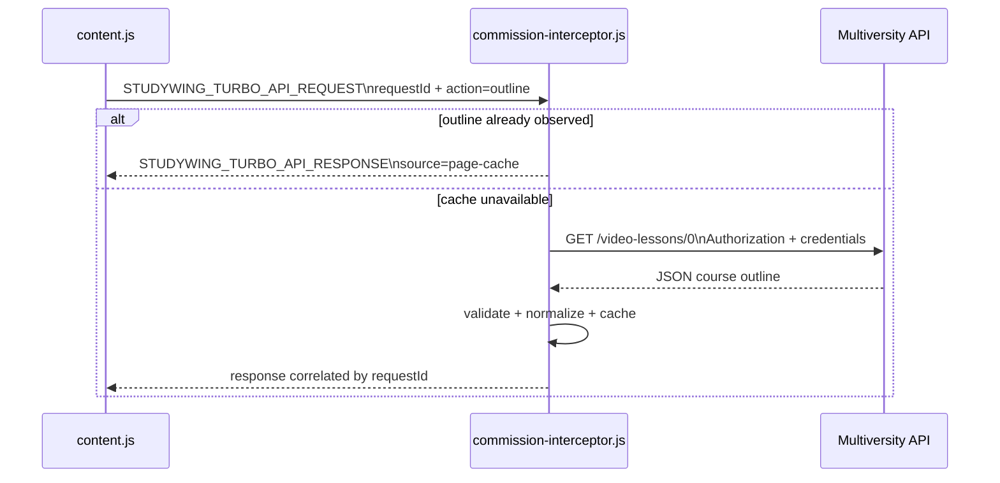
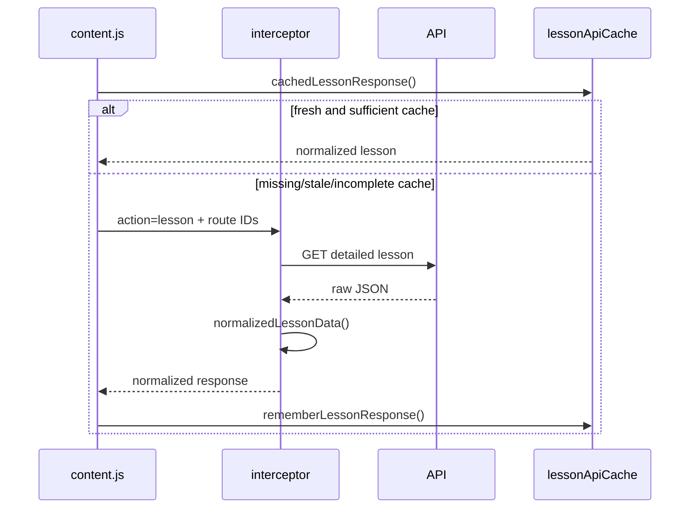

# 04 — APIs and reverse engineering

## Understanding the platform by observing its traffic

So far we have studied PlumePilot from the outside in: extension components, messages, and the DOM of a dynamic web application.

But a modern web application does not live in the DOM alone. The interface is often the visible result of requests made to a backend. Understanding those requests lets us work with more structured data, avoid unnecessary UI navigation, and discover identifiers that the rendered page does not expose clearly.

In this chapter, we will study a real integration technique: observing the host application's network interactions, mapping the responses into a small internal model, and safely reusing the authenticated context already established by the application.

This is not a guide to bypassing authentication or accessing somebody else's data. PlumePilot works inside the user's existing authenticated browser session, and the architectural questions are about **boundaries, validation, credentials, failure handling, and resilience**.

---

# Part I — A web application is also an HTTP client

## 1. Looking beyond the DOM

Chapter 03 taught us that the DOM is a temporary representation of application state. Add another layer to the model:

```text
backend
   ↓
API response
   ↓
frontend state
   ↓
DOM
```

When a sidebar shows `80%`, we may be looking at a value that the frontend received from an API, transformed, stored internally, and finally rendered as text.

The DOM is often the **last link in the chain**, not the first.

For some tasks, obtaining structured data closer to the source can be faster, more complete, less dependent on CSS, and easier to correlate with stable identifiers. That does **not** mean an API response is automatically authoritative for every decision. We will return to this distinction repeatedly.

---

## 2. A public API is not the same as a frontend API

When developers talk about an API, they often imagine a documented interface:

```text
GET /v1/users
Authorization: Bearer ...
```

with SDKs, versioning, and explicit compatibility promises.

But almost every web application also uses HTTP interfaces intended primarily for **its own frontend**. The browser must ask:

```text
Which course modules exist?
What is the progress percentage?
Which activities belong to a lesson?
Where can the course material be retrieved?
Which exams have been completed?
```

These requests may be ordinary HTTP+JSON even if the endpoints are not advertised as a third-party integration API.

```text
Multiversity frontend
       │ HTTP + JSON
       ▼
Multiversity backend
```

PlumePilot already runs in that browser environment. It can observe selected parts of this conversation without inventing a separate login flow.

---

# Part II — Why `commission-interceptor.js` runs in the MAIN world

## 3. The architectural problem

The manifest loads `commission-interceptor.js` using:

```json
"world": "MAIN"
```

Why? To observe `window.fetch` as used by the webpage's own JavaScript, our code must run in the **same JavaScript execution world** as that page.

An isolated content script can share the DOM without necessarily seeing the same modified JavaScript objects. Therefore PlumePilot uses the `MAIN` world as its observation point for the host runtime.

Source: [`manifest.json`](https://github.com/PlumePilot/plumepilot/blob/a8007425f81792e7570516dbdf1e7fb2cbda4d53/manifest.json).

---

## 4. The supported API origins

Near the top of `commission-interceptor.js`:

```js
const PLATFORM_API_ORIGINS = Object.freeze([
  ["pegaso", "pegaso.multiversity.click", "https://lms-api.prod.pegaso.multiversity.click"],
  ["mercatorum", "mercatorum.multiversity.click", "https://lms-api.prod.mercatorum.multiversity.click"],
  ["utsr", "utsr.multiversity.click", "https://lms-api.prod.utsr.multiversity.click"],
]);
```

Source: [`commission-interceptor.js` L21–L25](https://github.com/PlumePilot/plumepilot/blob/a8007425f81792e7570516dbdf1e7fb2cbda4d53/commission-interceptor.js#L21-L25).

This is more than a configuration table. It defines an **explicit observation boundary**:

```text
Pegaso page      → Pegaso API
Mercatorum page  → Mercatorum API
UTSR page        → UTSR API
```

The interceptor does **not** say "inspect every Authorization header in the browser." It selects requests for the current platform's expected API origin.

This is a practical expression of *least privilege* and scope minimization.

---

# Part III — Observing `fetch()` without breaking the page

## 5. Preserve the original implementation

PlumePilot saves the original function before installing its wrapper:

```js
const originalFetch = window.fetch;

window.fetch = function studyWingFetch(input, init) {
  // PlumePilot observation
  const promise = originalFetch.call(this, input, init);
  // Observe the response without replacing its behavior
  return promise;
};
```

Source: [`commission-interceptor.js` L708–L720](https://github.com/PlumePilot/plumepilot/blob/a8007425f81792e7570516dbdf1e7fb2cbda4d53/commission-interceptor.js#L708-L720).

This technique is called *wrapping*, *instrumentation*, or—less formally—*monkey patching*:

```text
page calls fetch()
        ↓
PlumePilot wrapper
        ↓
original fetch()
        ↓
network
```

The wrapper observes an existing operation without replacing the host application's underlying request mechanism.

---

## 6. Preserve the observable contract

The wrapper returns:

```js
return promise;
```

This is essential. If the frontend writes:

```js
const response = await fetch(url);
```

and our wrapper unexpectedly returns `undefined` instead of the original Promise, the host application can break.

Instrumentation should preserve, as far as possible, the function's observable contract:

```text
accepted arguments
appropriate this receiver
return value
errors from the original operation
```

Observing someone else's application must be as non-invasive as practical.

---

## 7. Why `call(this, ...)`?

The wrapper invokes:

```js
originalFetch.call(this, input, init);
```

rather than simply:

```js
originalFetch(input, init);
```

In this particular case, `window.fetch` does not normally depend on a complex application-specific receiver. Nevertheless, preserving the receiver makes the wrapper more faithful to the original call.

It is a useful habit when decorating APIs that our code does not own.

---

# Part IV — Read a response without consuming it

## 8. A `Response` body is a stream, not infinitely reusable data

The Fetch API exposes response bodies as streams. If PlumePilot did this in the wrapper:

```js
const body = await response.json();
```

it might consume the body before the host frontend tries to parse it:

```js
await response.json();
```

PlumePilot avoids that interference:

```js
const body = await response.clone().json();
```

Source: [`commission-interceptor.js` L688–L705](https://github.com/PlumePilot/plumepilot/blob/a8007425f81792e7570516dbdf1e7fb2cbda4d53/commission-interceptor.js#L688-L705).

Conceptually:

```text
original Response ─────► Multiversity frontend

cloned Response ───────► PlumePilot observer
```

The original response remains available to its intended consumer.

---

## 9. Cloning is not free

`Response.clone()` is convenient, but there are memory and buffering implications. When two consumers read a streamed response at different speeds, the browser may need to buffer data.

The JSON payloads observed in these PlumePilot flows are considerably smaller than whole PDFs, making the trade-off reasonable here. But we will revisit this broader principle in the performance chapter:

> **A convenient API may hide implicit copies and buffers.**

---

# Part V — Why intercept XMLHttpRequest as well?

## 10. A web application may use more than `fetch()`

The host frontend may contain:

```text
fetch()
XMLHttpRequest
libraries built on either API
older and newer components side by side
```

PlumePilot therefore instruments `XMLHttpRequest` too:

```js
const originalOpen = XMLHttpRequest.prototype.open;
const originalSend = XMLHttpRequest.prototype.send;
const originalSetRequestHeader = XMLHttpRequest.prototype.setRequestHeader;
```

Source: [`commission-interceptor.js` L723–L725](https://github.com/PlumePilot/plumepilot/blob/a8007425f81792e7570516dbdf1e7fb2cbda4d53/commission-interceptor.js#L723-L725).

---

## 11. Reconstructing an XHR request

XHR exposes different request properties at different steps.

The URL is set during:

```js
xhr.open(method, url);
```

An authentication header may be supplied later:

```js
xhr.setRequestHeader("Authorization", value);
```

The interceptor temporarily remembers the URL:

```js
this.__studyWingRequestUrl = url;
```

It can then associate an observed authorization header with the particular request and API origin.

This is a small example of **correlation state**: information observed at separate moments is combined into one meaningful request context.

---

# Part VI — Existing authentication

## 12. The Bearer token

Authenticated platform requests may carry an HTTP Authorization header:

```js
const authorization = new Headers(headers)
  .get("authorization")
  ?.trim();

if (/^Bearer\s+\S+$/i.test(authorization || "")) {
  bearerToken = authorization;
}
```

Source: [`commission-interceptor.js` L73–L83](https://github.com/PlumePilot/plumepilot/blob/a8007425f81792e7570516dbdf1e7fb2cbda4d53/commission-interceptor.js#L73-L83).

```text
Authorization: Bearer <token>
```

means, broadly, "this request presents a credential that the server can verify."

A bearer token is not necessarily the user's password. In this case, it is a session/access credential already obtained by the official frontend through the platform's normal authentication process.

---

## 13. Authentication versus authorization

These terms are related but distinct:

```text
Authentication: "Who are you?"
Authorization:  "What are you permitted to do?"
```

A bearer credential lets the server relate an API request to a session and its permissions.

PlumePilot does not acquire new privileges. It operates within the context of the user already authenticated in the browser.

---

## 14. Where does PlumePilot keep the token?

In `commission-interceptor.js`:

```js
let bearerToken = null;
```

The token is held in the interceptor's in-memory closure—not written into:

```text
chrome.storage.local
PlumePilot localStorage
window.postMessage payloads
application logs
a PlumePilot server
```

Instead of asking another component to handle:

```js
{ token: "..." }
```

the rest of the extension requests a capability:

```js
{
  action: "lesson",
  courseCode,
  lessonNumber,
  // ...
}
```

The interceptor uses its credential internally and returns **normalized domain data**, not the secret itself.

---

## 15. Secret containment

The intended architecture is:

```text
content.js
    │ "Give me the data for lesson 5"
    ▼
commission-interceptor.js
    │ temporarily owns the Bearer token
    ▼
Multiversity API
```

A riskier design would distribute the credential through:

```text
interceptor → content.js → bridge → background → storage
```

Every additional component could accidentally log, serialize, persist, or forward it.

Minimizing the number of places where credentials can appear is **secret containment**, or **credential minimization**.

---

# Part VII — Do not intercept everything

## 16. Check the origin before looking at Authorization

The interceptor includes:

```js
function isCurrentPlatformApiUrl(value) {
  try {
    return new URL(String(value), window.location.href).origin === API_ORIGIN;
  } catch {
    return false;
  }
}
```

Source: [`commission-interceptor.js` L52–L58](https://github.com/PlumePilot/plumepilot/blob/a8007425f81792e7570516dbdf1e7fb2cbda4d53/commission-interceptor.js#L52-L58).

The check precedes credential capture:

```text
an arbitrary request
      ↓
is its origin the current platform API?
      ├── no  → ignore
      └── yes → possibly inspect Authorization
```

This simple check is an important boundary.

---

## 17. An allowlist instead of blanket observation

The strategy is an **allowlist**:

```text
these supported platform hosts
this platform's API origin
these relevant routes
```

rather than "intercept everything and decide what to do later."

Narrow scope makes it easier to understand what can be observed, where data may flow, and which assumptions we need to test.

---

# Part VIII — The first essential endpoint: the course index

## 18. The endpoint we call the "master call"

One of the most important endpoints is constructed as follows:

```js
url = `${API_ORIGIN}/student/course/${encodeURIComponent(courseCode)}/video-lessons/0`;
```

Source: [`commission-interceptor.js` L453–L455](https://github.com/PlumePilot/plumepilot/blob/a8007425f81792e7570516dbdf1e7fb2cbda4d53/commission-interceptor.js#L453-L455).

During development, we often called this the **master call**. That is our project terminology, not necessarily the platform's official endpoint name.

It yields a synthetic overview of course modules and their progress:

```text
course
 ├── module A   100%
 ├── module B   100%
 ├── module C    80%
 ├── module D     0%
 └── module E   100%
```

Such an index is extremely useful for prioritizing subsequent work.

---

## 19. From a raw payload to an internal model

PlumePilot does not pass raw backend JSON directly throughout the extension. It normalizes the response into a smaller structure:

```js
return {
  displayOrder,
  masterOrder,
  folderId,
  id,
  lpId,
  title,
  percentage,
};
```

Source: [`commission-interceptor.js` L99–L120](https://github.com/PlumePilot/plumepilot/blob/a8007425f81792e7570516dbdf1e7fb2cbda4d53/commission-interceptor.js#L99-L120).

Backend developers may recognize this as DTO mapping, an adapter, an anti-corruption layer, or a normalization boundary. Other components no longer need to know every detail of the external payload.

---

## 20. Why normalize?

Suppose the backend returns:

```json
{
  "display_order": "5",
  "percentage": "80",
  "lp_id": 123
}
```

The internal logic would rather receive:

```js
{
  displayOrder: 5,
  percentage: 80,
  lpId: 123
}
```

with basic assumptions already checked.

```text
external schema
       ↓
validation + normalization
       ↓
internal schema
```

The complexity is moved to a clearly identified boundary.

---

# Part IX — Identifiers: the detail that changes everything

## 21. `displayOrder` is not enough

The master response includes several identifiers:

```text
displayOrder
masterOrder
folderId
id
lpId
```

The number visible to a student need not be a globally unique identifier.

A course might have:

```text
Section A
1 - Introduction
2 - Concepts

Section B
1 - Introduction
2 - Examples
```

"Chapter 1" does not necessarily identify one specific entity across the entire course.

---

## 22. The crucial comment in `playbackCourseRouteMap()`

The code contains:

```js
// A matching course-wide order is stronger than a display_order, which
// can restart at 1 in each folder. Use it only when every title agrees.
```

Source: [`content.js` L2900–L2914](https://github.com/PlumePilot/plumepilot/blob/a8007425f81792e7570516dbdf1e7fb2cbda4d53/content.js#L2900-L2914).

This is an important data-modeling lesson:

> **A value that looks like an ID may only be a local label.**

Before adopting a field as identity, determine its uniqueness scope.

---

## 23. Composite identity

For tests, PlumePilot uses:

```js
function testRouteKey(route) {
  return [route.folderId, route.lpId, route.id].join(":");
}
```

Source: [`content.js` L2925–L2928](https://github.com/PlumePilot/plumepilot/blob/a8007425f81792e7570516dbdf1e7fb2cbda4d53/content.js#L2925-L2928).

This is a straightforward **composite identity**. When a single field is not reliable enough, combining several fields may identify the intended resource more accurately.

---

# Part X — The detail request

## 24. From the index to module contents

The master call tells us a lot, but not everything. To retrieve a specific lesson's contents, PlumePilot constructs a path like:

```text
/student/course/{courseCode}/video-lesson/{lpId}/paragraphs/{paragraphId}
```

Source: [`commission-interceptor.js` L456–L466](https://github.com/PlumePilot/plumepilot/blob/a8007425f81792e7570516dbdf1e7fb2cbda4d53/commission-interceptor.js#L456-L466).

The detail response may allow us to reconstruct objectives, videos, progress, final tests, and downloadable materials.

---

## 25. Normalize lesson details too

The interceptor reduces lesson data to:

```js
return {
  dataAvailable,
  objective,
  test,
  material,
  playbackItems,
  playbackDataComplete,
  progressItems,
  progressDataComplete,
};
```

Source: [`commission-interceptor.js` L384–L397](https://github.com/PlumePilot/plumepilot/blob/a8007425f81792e7570516dbdf1e7fb2cbda4d53/commission-interceptor.js#L384-L397).

The rest of the application can reason about PlumePilot concepts rather than raw, potentially inconsistent external JSON.

---

# Part XI — A miniature RPC built on `postMessage`

## 26. `content.js` does not need the token

To request API data, `content.js` uses:

```js
function turboApiRequest(action, payload = {}) {
  return new Promise((resolve) => {
    const requestId = `studywing-${Date.now()}-${++turboApiRequestSequence}`;
    // ...
    window.postMessage({
      type: TURBO_API_REQUEST,
      requestId,
      action,
      ...payload,
    }, "*");
  });
}
```

Source: [`content.js` L4904–L4923](https://github.com/PlumePilot/plumepilot/blob/a8007425f81792e7570516dbdf1e7fb2cbda4d53/content.js#L4904-L4923).

To the caller, the message protocol behaves like an asynchronous function:

```js
const response = await turboApiRequest("lesson", {
  courseCode,
  lessonNumber,
});
```

Conceptually, this is a small **local RPC**: remote procedure call over a message boundary.

---

## 27. Request IDs

A `requestId` allows responses to arrive in a different order from requests:

```text
request A ──────────────────┐
request B ───────────┐      │
                     │      │
response B ◄─────────┘      │
response A ◄────────────────┘
```

Chapter 02 called this a **correlation ID**. Here we see it in a practical API bridge.

---

## 28. Pending requests map

`content.js` maintains:

```js
const pendingTurboApiRequests = new Map();
```

Conceptually, it stores:

```text
requestId → resolve callback + timeout
```

When `STUDYWING_TURBO_API_RESPONSE` arrives, the listener finds the corresponding ID, clears its timeout, and resolves the right Promise.

The same pattern appears in many real RPC systems.

---

## 29. Application-level timeouts

Requests also have a timeout:

```js
setTimeout(() => {
  pendingTurboApiRequests.delete(requestId);
  resolve({ ok: false, error: "RESPONSE_TIMEOUT" });
}, TURBO_API_RESPONSE_TIMEOUT_MS);
```

Without it, a caller could wait forever if a message is lost, the interceptor fails to respond, a network request hangs, or a context changes.

A serious asynchronous protocol needs not just a success path, but explicit **failure semantics**.

---

# Part XII — The API dispatcher in the MAIN world

## 30. Actions rather than endpoint URLs at the call site

The interceptor accepts actions such as:

```text
outline
lesson
complete
test-source
```

And dispatches internally:

```js
if (message.action === "outline") { /* ... */ }
else if (message.action === "lesson") { /* ... */ }
else if (message.action === "complete") { /* ... */ }
else if (message.action === "test-source") { /* ... */ }
```

Source: [`commission-interceptor.js` L433–L498](https://github.com/PlumePilot/plumepilot/blob/a8007425f81792e7570516dbdf1e7fb2cbda4d53/commission-interceptor.js#L433-L498).

Thus `content.js` only needs to know "I want lesson data," not the exact URL template, headers, or parsing rules.

---

## 31. The API adapter

We can view `commission-interceptor.js` as an **API adapter** exposing:

```text
outline(courseCode)
lesson(courseCode, route)
complete(activity)
testSource(test)
```

while encapsulating:

```text
exact URLs
Authorization header
credentials
JSON parsing
normalization
AbortController
HTTP errors
```

This is separation of concerns applied to a browser extension.

---

# Part XIII — `fetch()` and HTTP errors

## 32. An important Fetch API detail

`fetch()` does not automatically reject its Promise for ordinary HTTP error statuses such as `401`, `404`, or `500`. It may resolve to a `Response` whose `ok` property is false.

PlumePilot therefore checks both the HTTP status and application body:

```js
if (!response.ok || Number(body?.code) !== 200) {
  throw new Error(`API_${response.status || "INVALID_RESPONSE"}`);
}
```

Source: [`commission-interceptor.js` L420–L430](https://github.com/PlumePilot/plumepilot/blob/a8007425f81792e7570516dbdf1e7fb2cbda4d53/commission-interceptor.js#L420-L430).

This creates a clearer failure contract for callers.

---

## 33. Transport success is not application success

A response may carry HTTP `200` while its JSON reports a domain error. An HTTP `401` response may contain perfectly valid JSON.

We must distinguish five questions:

```text
Did the network respond?
Was the HTTP status successful?
Was the response valid JSON?
Was the application status successful?
Are the required data fields actually present?
```

They are not interchangeable.

---

# Part XIV — Valid but incomplete responses

## 34. A particularly useful PlumePilot case

An API can respond successfully before all the data we need is available:

```js
function hasRequiredLessonData(response, requiredData) {
  if (response.data?.dataAvailable !== true) return false;
  if (requiredData === "material") return Boolean(response.data.material);
  if (requiredData === "test") return Boolean(response.data.test);
  if (requiredData === "objective") return Boolean(response.data.objective);
  if (requiredData === "playback") {
    return response.data.playbackDataComplete === true;
  }
  return true;
}
```

Source: [`content.js` L2414–L2423](https://github.com/PlumePilot/plumepilot/blob/a8007425f81792e7570516dbdf1e7fb2cbda4d53/content.js#L2414-L2423).

A failed request is different from **a successful request whose response is not complete enough for the caller's purpose**.

---

## 35. Semantic retry

`requestLessonWithRetry()` can retry even when the request returned `ok: true`, if the necessary material, test, objective, or playback data is still incomplete.

Source: [`content.js` L2715–L2777](https://github.com/PlumePilot/plumepilot/blob/a8007425f81792e7570516dbdf1e7fb2cbda4d53/content.js#L2715-L2777).

This is a **semantic retry**. It asks not only "did the request succeed?" but also:

> **Did the response provide enough information to continue?**

---

# Part XV — Retry and pacing

## 36. Do not hammer the backend

The code defines delays including:

```js
const COURSE_INDEX_RETRY_DELAYS_MS = [350, 750];
const API_LESSON_RETRY_DELAYS_MS = [750, 1500];
const API_MATERIAL_PACING_MS = 150;
const TURBO_API_PACING_MS = 350;
```

Source: [`content.js` L60–L65](https://github.com/PlumePilot/plumepilot/blob/a8007425f81792e7570516dbdf1e7fb2cbda4d53/content.js#L60-L65).

There are two distinct ideas.

### Retry delay

Wait before repeating a request that did not produce usable data.

### Pacing

Space out otherwise valid requests in a batch operation.

These solve different problems.

---

## 37. Why not use `Promise.all()` across the entire course?

We could imagine:

```js
await Promise.all(
  lessons.map((lesson) => fetchLesson(lesson))
);
```

But maximum concurrency may produce bursts of requests, complicate cancellation, amplify transient failures, increase memory and simultaneous parsing, and deviate from the pacing of the host frontend.

PlumePilot often uses sequential operations because **maximum parallelism is not automatically maximum quality**.

---

# Part XVI — `AbortController`

## 38. Explicit network timeout

In the interceptor:

```js
const controller = new AbortController();
const timeout = setTimeout(() => controller.abort(), API_TIMEOUT_MS);
```

Then:

```js
fetch(url, {
  signal: controller.signal,
  // ...
});
```

Source: [`commission-interceptor.js` L500–L529](https://github.com/PlumePilot/plumepilot/blob/a8007425f81792e7570516dbdf1e7fb2cbda4d53/commission-interceptor.js#L500-L529).

This turns a potentially unbounded request into an operation with a deadline.

---

## 39. Cancellation is part of the protocol

`content.js` can send:

```text
STUDYWING_TURBO_API_CANCEL
```

The interceptor reacts:

```js
for (const controller of turboControllers.values()) {
  controller.abort();
}
```

Source: [`commission-interceptor.js` L792–L795](https://github.com/PlumePilot/plumepilot/blob/a8007425f81792e7570516dbdf1e7fb2cbda4d53/commission-interceptor.js#L792-L795).

Cancellation crosses several layers:

```text
user
  ↓
PlumePilot operation
  ↓
message
  ↓
AbortController
  ↓
interrupted fetch
```

Chapter 05 will study this in greater depth.

---


# Part XVII — The page cache as a free source

## 40. Observe first, then request if necessary

The interceptor can reuse course outlines already observed in the host page's network traffic:

```js
if (message.action === "outline") {
  const cached = courseOutlines.get(courseCode);
  if (cached?.length) {
    return { entries: cached, source: "page-cache" };
  }
}
```

Source: [`commission-interceptor.js` L437–L442](https://github.com/PlumePilot/plumepilot/blob/a8007425f81792e7570516dbdf1e7fb2cbda4d53/commission-interceptor.js#L437-L442).

```text
host page requests API data
          ↓
PlumePilot observes the response
          ↓
in-memory cache
          ↓
a later feature needs the same data
          ↓
no additional network request
```

This is **passive caching**.

---

## 41. Observation and explicit requests work together

The system has two complementary modes.

### Passive

```text
the host page makes a request → PlumePilot observes
```

### Active

```text
PlumePilot needs data → PlumePilot makes a request
```

Together, they implement a common strategy: **reuse if available, otherwise fetch**.

---

# Part XVIII — Lesson snapshots

## 42. Reusing detailed responses observed from the page

When the interceptor observes a detailed lesson route, it creates:

```js
const snapshot = {
  type: PAGE_LESSON_SNAPSHOT,
  courseCode,
  displayOrder,
  lpId,
  paragraphId,
  data: normalizedLessonData(body),
};
```

Source: [`commission-interceptor.js` L399–L417](https://github.com/PlumePilot/plumepilot/blob/a8007425f81792e7570516dbdf1e7fb2cbda4d53/commission-interceptor.js#L399-L417).

The cache is explicitly bounded:

```js
if (pageLessonSnapshots.size > 50) {
  pageLessonSnapshots.delete(pageLessonSnapshots.keys().next().value);
}
```

Thus it does not grow indefinitely.

---

## 43. Bounded cache

An unbounded cache can become a memory leak with a nicer name. A rule such as "keep at most 50 snapshots" is not an elaborate LRU policy, but it provides an essential constraint: predictable limits on retained entries.

Often that limit matters more than the theoretical elegance of an eviction algorithm.

---

# Part XIX — The cache in `content.js`

## 44. `lessonApiCache`

`content.js` maintains:

```js
const lessonApiCache = new Map();
```

with a composite key equivalent to course code plus lesson number.

Source: [`content.js` L2425–L2427](https://github.com/PlumePilot/plumepilot/blob/a8007425f81792e7570516dbdf1e7fb2cbda4d53/content.js#L2425-L2427).

This cache contains **normalized domain data**, not the Bearer token:

```text
credential cache  → interceptor only
application cache → course logic
```

---

## 45. TTL

The freshness window is defined by:

```js
const API_LESSON_CACHE_FRESH_MS = 5 * 60 * 1000;
```

Source: [`content.js` L64](https://github.com/PlumePilot/plumepilot/blob/a8007425f81792e7570516dbdf1e7fb2cbda4d53/content.js#L64).

This is a **time to live (TTL)**: the period after which cached data may no longer be fresh enough for certain purposes.

---

## 46. Different data ages differently

`cachedLessonResponse()` handles general data, playback, tests, and objectives differently.

For example:

```js
if (requiredData === "test" && !fresh && entry.test?.completed !== true) {
  return null;
}
```

Source: [`content.js` L2560–L2574](https://github.com/PlumePilot/plumepilot/blob/a8007425f81792e7570516dbdf1e7fb2cbda4d53/content.js#L2560-L2574).

A completed test is generally a more stable fact than an incomplete one, which may change shortly. Cache validity therefore depends not just on time, but on the **meaning of the data**.

---

# Part XX — Monotonic state

## 47. Preventing progress regression after stale responses

For activity progress, PlumePilot often keeps the higher of the old and new percentages:

```js
const percentage = Math.max(
  Number(activity.percentage) || 0,
  sameActivity ? Number(previousActivity.percentage) || 0 : 0,
);
```

Source: [`content.js` L2461–L2484](https://github.com/PlumePilot/plumepilot/blob/a8007425f81792e7570516dbdf1e7fb2cbda4d53/content.js#L2461-L2484).

The domain assumption is that recorded completion progress should not decrease. This protects against temporarily stale responses.

---

## 48. When would `Math.max()` be dangerous?

If a domain allows genuine decreases—a bank balance, stock inventory, a revised score, or a revoked permission—always retaining the highest value would be incorrect.

Caching can encode **domain rules**, not merely technical optimizations.

---

# Part XXI — Connecting API identifiers to the DOM

## 49. APIs know IDs; the DOM knows visible structure

PlumePilot must correlate a visual chapter with an API entry. The `courseIndexRouteMap()` strategy considers:

1. A unique title.
2. An unambiguous visual number.
3. Course-wide ordering, only when titles confirm the mapping.

Source: [`content.js` L2857–L2923](https://github.com/PlumePilot/plumepilot/blob/a8007425f81792e7570516dbdf1e7fb2cbda4d53/content.js#L2857-L2923).

This is a **reconciliation problem**: aligning different representations of the same domain.

---

## 50. Never trust an ambiguous match

The code contains:

```js
// A stale label must never make us skip a genuinely unfinished chapter as "100%".
```

Source: [`content.js` L2913–L2919](https://github.com/PlumePilot/plumepilot/blob/a8007425f81792e7570516dbdf1e7fb2cbda4d53/content.js#L2913-L2919).

A false positive ("this chapter is complete") is worse than admitting uncertainty and checking further.

This is **asymmetric error cost**: mistakes have different consequences.

---

# Part XXII — The master call as an index, not absolute truth

## 51. Aggregate progress is extremely useful

`getPlaybackCourseIndex()` retrieves, normalizes, and sorts the course index:

```js
const entries = response.data.entries
  .map(...)
  .filter(Boolean)
  .sort((a, b) => a.displayOrder - b.displayOrder);
```

Source: [`content.js` L5760–L5823](https://github.com/PlumePilot/plumepilot/blob/a8007425f81792e7570516dbdf1e7fb2cbda4d53/content.js#L5760-L5823).

If the summary is:

```text
A 100%
B 100%
C  80%
D 100%
```

there is little reason to open A and B before investigating C.

---

## 52. But it is not a perfect source of truth

During development, aggregate percentages proved insufficient to identify every specific incomplete activity with certainty.

The right model is:

```text
master percentage = excellent search index
```

rather than:

```text
master percentage = definitive truth about every activity
```

---

## 53. Index versus source of truth

An index answers:

```text
"Where should I search first?"
```

A source of truth answers:

```text
"What is the actual final state?"
```

Imperfect information can still be highly valuable when used for the right purpose. This will be central to Chapter 08.

---

# Part XXIII — API-first, visual fallback

## 54. A concrete example: material collection

`collectCourseMaterialsViaApi(...)` first tries to gather materials from API data.

Source: [`content.js` L2995–L3188](https://github.com/PlumePilot/plumepilot/blob/a8007425f81792e7570516dbdf1e7fb2cbda4d53/content.js#L2995-L3188).

The process combines:

```text
visual course outline
        +
master course index
        ↓
route mapping
        ↓
lesson detail API
        ↓
material URL
```

If the API route is unavailable, it returns `false` and the caller can continue with visual collection.

---

## 55. Graceful degradation

```text
is API path available?
     ├── yes → faster, structured path
     └── no  → slower, visual path
```

This is **graceful degradation**: the preferred method need not always work.

---

## 56. Why retain the DOM fallback?

API access may fail because credentials have not been observed yet, the response is incomplete, route mapping is ambiguous, endpoints change, some data is absent, or platform versions differ.

The DOM is structurally fragile. An inferred API is contractually fragile. Both paths together offer resilience to different failure modes.

---

# Part XXIV — Source hierarchy

## 57. No single source knows everything

At runtime, PlumePilot may have:

```text
master response
lesson detail response
page-observed snapshot
in-memory cache
DOM percentage
video player state
```

Which is authoritative? **It depends on the decision being made.**

---

## 58. Example: course progress

A possible hierarchy is:

```text
complete API data
      ↓
DOM baseline + observed session updates
      ↓
visible indicator
      ↓
heuristic
```

A different operation may prioritize differently. The principle is not "always use APIs first," but **use the appropriate source for the decision**.

---

# Part XXV — Commission status and existing authentication

## 59. A different endpoint, the same principle

The commission feature targets:

```js
const TARGET_PATH = "/student/exam-online/exams-list-done";
```

Source: [`commission-interceptor.js` L11](https://github.com/PlumePilot/plumepilot/blob/a8007425f81792e7570516dbdf1e7fb2cbda4d53/commission-interceptor.js#L11).

Its authenticated fetch uses the original implementation with the remembered token, includes browser credentials, and accepts an abort signal.

Source: [`commission-interceptor.js` L640–L671](https://github.com/PlumePilot/plumepilot/blob/a8007425f81792e7570516dbdf1e7fb2cbda4d53/commission-interceptor.js#L640-L671).

---

## 60. `credentials: "include"`

This setting tells Fetch to include compatible browser-managed credentials, such as cookies where applicable.

An explicit Authorization header and browser-managed credentials can coexist; the backend determines what is required.

PlumePilot operates in the context of an already authenticated browser session.

---

# Part XXVI — 401 and 403

## 61. When credentials are no longer valid

The commission flow contains:

```js
if (error?.message === "API_401" || error?.message === "API_403") {
  bearerToken = null;
}
```

Source: [`commission-interceptor.js` L662–L665](https://github.com/PlumePilot/plumepilot/blob/a8007425f81792e7570516dbdf1e7fb2cbda4d53/commission-interceptor.js#L662-L665).

In simplified terms:

```text
401 → missing or invalid authentication
403 → request recognized but not authorized
```

Services vary in how they use these statuses, but both reasonably indicate that the cached credential should no longer be trusted.

---

## 62. Why not persist an expired credential?

When the page context ends, a memory-only credential is naturally forgotten.

The secret's lifetime stays close to the lifetime of the component that actually needs it.

---

# Part XXVII — The token does not cross the bridge

## 63. A design decision worth emphasizing

The protocol sends:

```text
action
courseCode
lessonNumber
lpId
paragraphId
requestId
```

not:

```text
bearerToken
```

The calling component requests a permitted capability, not the secret needed to implement it independently. This resembles **capability-based design**.

---

# Part XXVIII — Validate at the boundary

## 64. Course codes

Before constructing URLs:

```js
function validCourseCode(value) {
  return typeof value === "string" &&
    /^[A-Za-z0-9_-]{3,80}$/.test(value);
}
```

Source: [`commission-interceptor.js` L86–L88](https://github.com/PlumePilot/plumepilot/blob/a8007425f81792e7570516dbdf1e7fb2cbda4d53/commission-interceptor.js#L86-L88).

---

## 65. Numeric identifiers

Helpers such as `validPositiveInteger(...)` and `validNonNegativeInteger(...)` reject invalid route identifiers.

A value should not be trusted merely because it supposedly originated inside PlumePilot: a messaging boundary is still a validation boundary.

---

## 66. Limit payload sizes

Normalization uses bounds such as:

```text
slice(0, 1000)
slice(0, 200)
slice(0, 20)
safeString(..., maxLength)
```

They limit pathological payloads and protect against uncontrolled memory growth. This is **defensive parsing**.

---

# Part XXIX — The anti-corruption layer

## 67. Protect the internal domain from an external schema

Suppose the API changes `display_order` to `position`.

If the raw name appears across dozens of modules, every call site may require modification. With a single adapter:

```text
raw API response
       ↓
normalizeCourseOutline()
       ↓
internal displayOrder
```

the change can remain localized.

---

## 68. Anti-corruption layer

Domain-Driven Design describes an **anti-corruption layer** that prevents an external system's model from contaminating the internal model.

PlumePilot does not formally implement DDD, but the interceptor's normalization serves much the same purpose.

---


# Part XXX — Reverse engineering as a scientific process

## 69. How do you discover an endpoint in practice?

The right method is not guessing random URLs. It is observing the host application's behavior:

1. Perform one action in the UI.
2. Inspect the associated request in DevTools Network.
3. Examine its method, URL, headers, and payload.
4. Inspect the response.
5. Repeat while changing one variable.
6. Determine which fields remain stable.
7. Form and then test a hypothesis.

This is **reverse engineering through observation**.

---

## 70. A thought experiment

Suppose opening module 5 produces:

```text
GET /student/course/ABC/video-lesson/123/paragraphs/456
```

Opening module 6 produces:

```text
GET /student/course/ABC/video-lesson/789/paragraphs/999
```

Possible interpretations:

```text
ABC     → course code
123/789 → lesson-package identifiers
456/999 → paragraph or route identifiers
```

Compare each response with the rendered UI, repeat the observation, and only then formalize the mapping.

---

# Part XXXI — Correlation is not meaning

## 71. A field can look obvious without being obvious

For:

```json
{"id": 5}
```

we do not yet know whether `5` is a global ID, a local ID, a paragraph ID, display order, or a foreign key.

Field names are clues, not proof. Meaning emerges from multiple consistent observations.

---

## 72. The numbering-reset bug

`displayOrder` looked like a global course order, but could restart at `1` in each folder. Therefore:

```text
displayOrder = 1
```

did not necessarily identify the first chapter of the entire course.

This is why the normalized model keeps several related identifiers rather than assuming one number has universal meaning.

---

# Part XXXII — APIs accelerate autoplay

## 73. Before: visual search

A purely visual search may need to:

```text
open section
open chapter
wait for rendering
inspect activities
move to another chapter
repeat
```

For a long course, this becomes expensive.

---

## 74. After: use an index to reduce the search space

With a course index:

```text
1  100% → skip
2  100% → skip
3  100% → skip
4   80% → investigate
```

This does not eliminate the detailed check. It makes that check **targeted**.

---

## 75. Complexity reduction

The algorithm changes from:

```text
scan everything
```

to:

```text
consult inexpensive index
        ↓
select candidate modules
        ↓
inspect only necessary details
```

The same principle underlies database indexes, search engines, and file systems.

---

# Part XXXIII — Collecting tests

## 76. The master index is not enough here either

PlumePilot combines several sources:

```js
const masterResponse = await turboApiRequest("outline", { courseCode });
const courseIndex = masterResponse.ok ? masterResponse.data?.entries : null;
outline = await recoverCourseTestOutline(..., courseIndex, ...);
```

Source: [`content.js` L3663–L3671](https://github.com/PlumePilot/plumepilot/blob/a8007425f81792e7570516dbdf1e7fb2cbda4d53/content.js#L3663-L3671).

Again:

```text
master data + visual structure + detail requests
```

rather than trusting one source for every purpose.

---

# Part XXXIV — Discovering an API contract

## 77. The contract is not documented for us

Official APIs may provide OpenAPI schemas, SDKs, and reference documentation.

Here, the contract is inferred from actual requests, responses, and observed behavior. That creates greater uncertainty about compatibility and future changes.

---

## 78. Treat an inferred contract as unstable

The practical consequences are:

- Validate payloads.
- Preserve fallback paths.
- Avoid dependencies on unnecessary fields.
- Centralize endpoint construction and parsing.
- Classify errors rather than crashing the extension.
- Expect some responses to be incomplete.

These choices together form **defensive integration**.

---

# Part XXXV — GET and POST

## 79. Read operations

For `outline` and `lesson`, PlumePilot uses HTTP `GET`, requesting representations of existing resources.

---

## 80. State-changing operations

Operations such as completing an introductory test use `POST` with a JSON body.

Source: [`commission-interceptor.js` L467–L480](https://github.com/PlumePilot/plumepilot/blob/a8007425f81792e7570516dbdf1e7fb2cbda4d53/commission-interceptor.js#L467-L480).

A useful starting interpretation is:

```text
GET  → read
POST → ask the server to process or change something
```

The method is a strong semantic clue, even though real APIs can vary.

---

# Part XXXVI — Idempotency and writes

## 81. Why writes require greater care

Repeating:

```text
GET lesson details
```

usually has different consequences from repeating:

```text
POST complete activity
```

State-changing requests demand more attention to retries, duplicates, already-completed state, mid-operation cancellation, and confirmation.

This connects to the state machines and idempotency patterns discussed in later chapters.

---

# Part XXXVII — CORS is not magically bypassed

## 82. MAIN world does not disable browser security

When PlumePilot uses:

```js
originalFetch.call(window, API_ORIGIN, ...);
```

the request remains subject to browser policies and the server's access rules.

`MAIN` is not a "CORS-free mode." It simply exposes the JavaScript environment used by the page.

---

## 83. Why this matters

Being able to invoke `fetch()` from JavaScript does not mean being allowed to contact every server with arbitrary credentials.

Origin policy, CORS, cookie handling, authentication, and authorization still apply.

---

# Part XXXVIII — Error taxonomy

## 84. A good system distinguishes failure categories

PlumePilot uses error names such as:

```text
AUTH_UNAVAILABLE
INVALID_COURSE_CODE
INVALID_LESSON_NUMBER
INVALID_ACTION
REQUEST_ABORTED
REQUEST_TIMEOUT
LESSON_DATA_INCOMPLETE
API_401
API_403
```

These describe meaningfully different problems.

---

## 85. Why `catch (e) { return false; }` is not enough

If every error is reduced to:

```text
FAILED
```

a caller cannot choose whether to retry, wait for authentication, switch to a DOM fallback, ask the user to reload, or diagnose an implementation bug.

Recovery depends on the precision of the error categories.

---

# Part XXXIX — API architecture and privacy

## 86. Keeping data local

The current design allows:

```text
session credential → page memory
normalized data    → extension-local memory
preferences/state  → browser storage as needed
```

without requiring a PlumePilot backend.

This significantly reduces the project's data surface.

---

## 87. Privacy is an architectural property, not only a legal page

A privacy policy can describe how data is handled. Stronger assurance comes when the architecture itself minimizes data movement and persistence.

For example, with no PlumePilot server, many ordinary server-side collection paths do not exist. Keeping the session token out of persistent storage shortens its lifetime by construction.

This is **privacy by design**.

---

# Part XL — What happens during an `outline` request

## 88. Follow the complete flow

When `content.js` needs the course index:

```js
response = await turboApiRequest("outline", { courseCode });
```

The sequence:



This diagram captures passive caching, explicit API requests, normalization, and local message-based RPC.

---

# Part XLI — What happens during a `lesson` request

## 89. The detailed path



The interceptor's page-observation cache and `content.js`'s application cache have distinct responsibilities.

---

# Part XLII — A backend analogy

## 90. If PlumePilot were a backend

```text
content.js
    ≈ domain/service layer

commission-interceptor.js
    ≈ external API client / gateway

normalizeCourseOutline()
normalizedLessonData()
    ≈ DTO mappers

lessonApiCache
    ≈ application cache

window.postMessage + requestId
    ≈ RPC transport
```

These are not exact equivalences, but the analogy makes the architecture easier to read if you already know backend development.

---

# Part XLIII — What might we change in a larger codebase?

## 91. Extract a dedicated API client

A larger project might use:

```text
api/
├── platform-client.js
├── course-api.js
├── exams-api.js
├── normalizers.js
├── validators.js
└── errors.js
```

with calls such as:

```js
platformApi.getCourseOutline(courseCode)
platformApi.getLesson(route)
platformApi.completeActivity(activity)
platformApi.getTestSource(test)
```

---

## 92. Why it was not immediately necessary

Abstractions have costs. With only a handful of endpoints, keeping the logic in one interceptor was practical.

A formal API client becomes more valuable as endpoint count, supported platforms, call sites, and error handling all grow.

This is **evolutionary architecture**.

---

# Part XLIV — Mistakes in naive reverse engineering

## 93. Treating one request as the definitive contract

One observed request may depend on the current state, feature flags, platform, frontend version, navigation order, or caching. We need multiple examples.

---

## 94. Assuming a field is always present

Checks such as:

```js
Array.isArray(...)
Number.isInteger(...)
typeof value === "string"
```

may seem repetitive until a response changes shape.

---

## 95. Persisting raw payloads everywhere

That couples the entire project to the host's schema.

Prefer:

```text
raw response
   ↓
one normalization boundary
   ↓
small internal domain model
```

---

## 96. Moving tokens through too many components

If a token is required only by an API client, ideally it should remain there.

---

## 97. Removing fallbacks too early

An inferred API can change, and a UI can change. Their weaknesses differ.

A hybrid approach is often more robust than absolute trust in one source.

---

# Part XLV — Guided exercise: reading a response like an investigator

## 98. Examine this payload

```json
{
  "code": 200,
  "data": [
    {
      "display_order": 3,
      "folder_id": 2,
      "lp_id": 481,
      "id": 912,
      "title": "Limiti",
      "percentage": 80
    }
  ]
}
```

Before proceeding, ask:

1. Which fields look like visual labels or order?
2. Which fields look like identifiers?
3. Which might be scoped to a folder?
4. Which would you display to users?
5. Which would you use to construct an API route?
6. Which would you use to choose where to search for incomplete activities?

---

## 99. One possible interpretation

```text
display_order → visual/local ordering; verify its scope
folder_id     → folder/section scope
lp_id         → technical ID useful for a route
id            → another technical/paragraph ID
percentage    → progress indicator
```

The key qualifier is always **"to be verified."**

Good reverse engineering distinguishes:

```text
observation
hypothesis
confirmation
```

---

# Part XLVI — Exercise: designing the boundary

## 100. Which API would you choose?

### A

```js
const token = await getToken();
const response = await fetch(url, {
  headers: { Authorization: token }
});
```

repeated separately in every feature.

### B

```js
const lesson = await api.request("lesson", route);
```

with the credential confined to the API client.

For PlumePilot, B better supports separation of concerns, credential minimization, testing, and changing the implementation later.

---

# Part XLVII — Concepts to carry forward

## 101. API adapter

A component that translates an external API into a more stable internal interface.

## 102. Boundary normalization

Validating and transforming data at the point where it enters the system.

## 103. Bearer token

A credential supplied through an `Authorization: Bearer ...` header, according to the server's authorization model.

## 104. Credential minimization

Reducing both the number of components that can access a credential and how long it remains accessible.

## 105. Passive caching

Reusing data from requests the host application would already have made.

## 106. TTL

*Time to live*: the period after which cached data may be too old for certain uses.

## 107. Semantic retry

Retrying not only after transport failure but because the response lacks required domain data.

## 108. Pacing

Spacing valid requests to avoid unnecessary bursts.

## 109. Graceful degradation

Using an alternative path when the preferred one is unavailable.

## 110. Reconciliation

Aligning different representations of the same domain.

## 111. Anti-corruption layer

A boundary that prevents an external system's data model from spreading directly into the application's internal model.

## 112. Asymmetric error cost

A situation where different incorrect outcomes have different consequences, warranting greater caution around the more costly mistake.

## 113. Bounded cache

A cache with explicit limits on how much data it retains.

## 114. Monotonic state

State that should advance but not regress according to domain rules; recorded completion progress is treated this way in parts of PlumePilot.

## 115. Defensive integration

Treating an external system as capable of incomplete data, changing schemas, and failure, using validation, error classification, and fallbacks.

---

# Part XLVIII — Further reading

## 116. Fetch API

### MDN — Fetch API

https://developer.mozilla.org/en-US/docs/Web/API/Fetch_API

Focus on `Request`, `Response`, Promises, and the difference between rejected network requests and non-2xx HTTP statuses.

---

## 117. Response cloning

### MDN — `Response.clone()`

https://developer.mozilla.org/en-US/docs/Web/API/Response/clone

This is directly connected to the interceptor observing JSON without consuming the page's original response body.

---

## 118. HTTP headers

### MDN — `Headers`

https://developer.mozilla.org/en-US/docs/Web/API/Headers

### MDN — `Authorization`

https://developer.mozilla.org/en-US/docs/Web/HTTP/Reference/Headers/Authorization

Distinguish the HTTP header, the Bearer authentication scheme, and the token value itself.

---

## 119. AbortController

### MDN — `AbortController`

https://developer.mozilla.org/en-US/docs/Web/API/AbortController

The foundation of PlumePilot's network request timeout and cancellation behavior.

---

## 120. XMLHttpRequest

### MDN — `XMLHttpRequest`

https://developer.mozilla.org/en-US/docs/Web/API/XMLHttpRequest

### MDN — `setRequestHeader()`

https://developer.mozilla.org/en-US/docs/Web/API/XMLHttpRequest/setRequestHeader

These explain why PlumePilot instruments `open()`, `setRequestHeader()`, and `send()` at separate steps.

---

## 121. Execution worlds

### Chrome for Developers — `ExecutionWorld`

https://developer.chrome.com/docs/extensions/reference/api/scripting#type-ExecutionWorld

Revisit `MAIN` and `ISOLATED` with a new question: "Which actual `window.fetch` am I changing?"

---

# Part XLIX — What have we really learned?

The heart of this chapter is not a list of endpoints. Endpoints can change.

The transferable knowledge is the method. A web application can be studied at multiple layers:

```text
UI
DOM
frontend runtime
HTTP requests
API responses
backend state
```

PlumePilot observes the host runtime in the `MAIN` world, recognizes only expected API origins, temporarily reuses existing authentication, confines credentials to the component that needs them, and normalizes external data before passing it into the rest of the application.

It uses passive caches when possible, explicit requests when necessary, and visual fallbacks when API assumptions are not reliable enough.

The larger lesson is:

> **Discovering an API does not remove uncertainty. It changes where uncertainty lives and how we manage it.**

In **Chapter 05**, we will study JavaScript asynchrony: events, Promises, `async`/`await`, timeouts, retries, cancellation, and race conditions. We will see why `await` does not block the browser and why many seemingly random bugs are actually timing problems.

---

[← 03 — DOM and dynamic pages](03-dom-and-dynamic-pages.md) · [Contents](index.md) · [05 — JavaScript asynchrony →](05-javascript-asynchrony.md)
