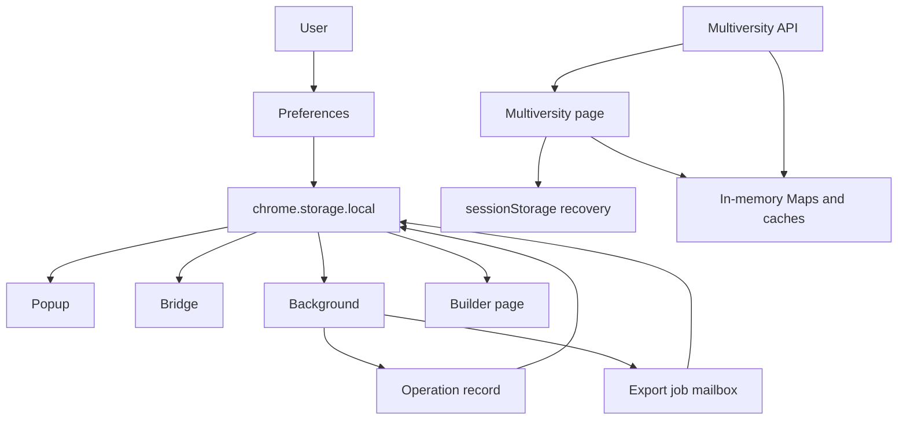

# 06 — State, cache, and storage

## Where the truth lives

In the preceding chapters we studied the DOM, APIs, messaging, and asynchrony. We can now ask a deceptively simple question:

> **When PlumePilot says it knows something, where is that information stored?**

There is no single answer. A user preference such as the theme may remain useful for months. An API response may be useful for five minutes. An in-flight Promise belongs to one script instance. A cancelled export should no longer block future work, even if the popup that started it has disappeared.

The real architectural problem is not merely:

```text
store data
```

but:

```text
what to store
    +
where to store it
    +
how long it must live
    +
who is allowed to change it
    +
when to stop trusting it
```

---

# Part I — State is not one thing

## 1. A useful taxonomy

We can distinguish at least six categories in PlumePilot:

| Category | Example | Typical lifetime | Survive a reload? |
|---|---|---|---|
| Ephemeral state | `busy`, `pendingTurboApiRequests` | Script instance | No |
| In-memory cache | `lessonApiCache` | Page lifetime | No |
| Per-tab recovery | `sessionStorage` | Tab/page session | Yes, as needed |
| User preferences | `enabled`, `stopAtTests` | Browser sessions | Yes |
| Coordination state | `pegasoActiveOperation` | Until job releases/expires | Yes |
| Temporary handoff | `pegasoExportJob:<jobId>` | Producer → consumer | Until consumed |

These categories differ in ownership, durability, scope, and the cost of losing them.

---

## 2. Lifetime is an architectural requirement

Consider four facts:

```text
A. The popup is in Gaming mode.
B. A course-material export is running.
C. A lesson API response was read 30 seconds ago.
D. The page is recovering from a session conflict after a reload.
```

When the popup closes, the preference and the export state must still be recoverable. The lesson cache and the page's recovery state do not depend on the popup in the first place.

After a course-page reload, the API cache can be discarded, but the session-conflict recovery needs to survive long enough to finish. After a browser restart, the user's preferences should remain; a stale operation record should be *reconciled*, not blindly assumed alive.

This is why one global variable—or one indiscriminate database—would be conceptually weak.

---

# Part II — Volatile state: variables and `Map`

## 3. The cheapest state is the state we can afford to lose

Near the beginning of `content.js`, the code maintains structures such as:

```js
const pendingTurboApiRequests = new Map();
const lessonApiCache = new Map();
const courseProgressChapters = new Map();
const pendingLessonVerificationAttempts = new Map();
const materialLinkCache = new Map();
const materialOutlineCache = new Map();
const testSourceCache = new Map();
```

Source: `content.js`, approximately lines 131–137 in the historical snapshot.

These are JavaScript objects owned by the current script instance, not persistent databases. A page reload destroys them.

That is not automatically a problem. Sometimes it is the best possible invalidation policy.

---

## 4. Rebuildable cache versus indispensable state

Consider:

```js
const lessonApiCache = new Map();
```

If the cache disappears, PlumePilot may need to repeat API requests. That is less efficient, but it need not corrupt the workflow. This is a **rebuildable optimization**.

Compare a preference such as:

```text
autoplayStopAt70Enabled = true
```

If the user explicitly selected it, losing it on reload would be a bug.

The question is not simply whether information is valuable, but **what happens if it vanishes**.

---

## 5. A practical question: what if this value disappeared now?

Four useful answers:

### A. The program could recompute it

It is probably a cache or derived state.

### B. The user would lose a decision

It probably needs persistence.

### C. The program might perform a dangerous operation twice

It is probably operational or coordination state.

### D. A recovery could repeat indefinitely

It may need narrowly scoped persistence across reloads.

This mental model helps choose storage *before* choosing an API.

---

# Part III — `chrome.storage.local`

## 6. Why not simply use `localStorage`?

PlumePilot declares the WebExtension storage permission:

```json
"permissions": [
  "storage"
]
```

and uses:

```js
chrome.storage.local
```

Unlike ordinary page-specific Web Storage, extension storage provides a shared extension API accessible across its permitted contexts, including short-lived popup and background components.

This matters because **popup JavaScript variables disappear when the popup closes**, and an MV3 background service worker may be stopped and restarted.

---

## 7. Storage as a common point between contexts

Recall:

```text
popup
background
bridge
floating menu
builder
```

These contexts do not share one mutable JavaScript global.

But several can read the same extension storage:

```text
popup
   │ writes enabled=false
   ▼
chrome.storage.local
   │
   └─ storage.onChanged → bridge
                              │
                              ▼
                          MAIN world
```

Storage is therefore more than a settings folder. In some flows, it is also part of the synchronization architecture.

---

# Part IV — The popup's lifecycle

## 8. Popup cold start

When the popup opens, `popup.js` reads a broad configuration snapshot:

```js
chrome.storage.local.get(
  {
    enabled: true,
    stopAtTests: false,
    autoCompleteTests: false,
    autoplaySkipCompletedVideos: false,
    autoplayChapterLimitEnabled: false,
    autoplayChapterLimits: {},
    autoplayChapterLimitSessions: {},
    autoplayChapterLimitStatuses: {},
    courseProgressOverlayEnabled: false,
    autoplayStopAt70Enabled: false,
    playbackErrorRecovery: "automatic",
    visualStyle: "standard",
    themePreference: "system",
    menuSize: "medium",
    floatingMenuEnabled: true,
    commissionCheckEnabled: false,
    commissionExams: [],
    pegasoActiveOperation: null,
    // ...
  },
  (result) => {
    // Render current UI state
  },
);
```

Source: `popup.js`, approximately lines 1308–1374.

```text
popup opens
   ↓
reads persisted snapshot
   ↓
initial render
```

The popup never assumes that an older instance is still alive. Every opening reconstructs the view from current state.

---

## 9. Initial snapshot plus incremental updates

The popup also observes later storage changes:

```js
chrome.storage.onChanged.addListener((changes, area) => {
  if (area !== "local") return;

  if (changes.pegasoActiveOperation) {
    renderOperation(changes.pegasoActiveOperation.newValue || null);
  }

  if (changes.enabled) {
    // Update the UI
  }
});
```

Source: `popup.js`, approximately line 1410 onward.

The pattern is familiar from Chapter 02:

```text
1. Read current snapshot.
2. Render.
3. Subscribe to subsequent changes.
```

Events alone are insufficient: a popup that opens after a change needs the current value, not an event that was emitted before it existed.

---

# Part V — Stored intent versus effective state

## 10. A saved preference is not always the active configuration

In `bridge.js`, `readAndSendState()` reads `stopAtTests` and `autoCompleteTests`.

The runtime derives:

```js
const autoEnabled = result.autoCompleteTests === true;

const stopEnabled =
  result.stopAtTests !== false && !autoEnabled;
```

The original code comment explains:

```js
// Keep the user's stop-at-tests preference in storage, but make it
// inactive at runtime while automatic test completion is enabled.
```

This separates two ideas:

### Stored intent

What the user chose. The preference remains saved even while another feature temporarily supersedes it.

### Effective state

What the runtime can actually enable given the entire configuration.

The app should not erase a user's preference just because it cannot apply that preference at the present moment.

---

# Part VI — Scoped preferences and composite keys

## 11. A session chapter limit is not a global number

PlumePilot supports several platforms and courses. A setting such as:

```text
autoplay limit = 5 chapters
```

might mean five chapters for *every* course or five for *one particular course*.

For several settings, PlumePilot chooses course-scoped behavior. The popup constructs composite keys combining the platform and course, so two courses with the same code on different platforms do not collide. The Italian edition includes this simplified function:

```js
function courseStorageKey(courseCode, platformId = "pegaso") {
  ...
  return `${platformId}:${course}`;
}
```

The keys distinguish platforms even when the course code is identical:

```text
pegaso:ABC123
mercatorum:ABC123
utsr:ABC123
```

This is illustrative pseudocode (the ellipsis omits input normalization), not a function to paste into production. What matters is that **platform identity belongs in the key**, not just the course code.

---

## 12. Scope is part of identity

A general principle:

> **The identity of a stored value includes its scope.**

Knowing:

```text
courseCode = ABC123
```

may not be enough if that code is not unique across platforms. We need:

```text
(platformId, courseCode)
```

This is the same idea as a database composite primary key:

```sql
PRIMARY KEY (tenant_id, user_id)
```

or a distributed cache key scoped by tenant and resource.

A string such as `pegaso:ABC123` is just one way to serialize a composite identity.

---

## 13. A real small-scale migration

`popup.js` also understands an earlier key format:

```js
function courseScopedValue(map, courseCode, platformId = "pegaso") {
  const key = courseStorageKey(courseCode, platformId);
  if (Object.prototype.hasOwnProperty.call(map, key)) return map[key];
  return platformId === "pegaso" ? map[courseCode] : undefined;
}
```

It first looks for the new key:

```text
pegaso:ABC123
```

but recognizes the old Pegaso-only key:

```text
ABC123
```

During subsequent writes, legacy entries are progressively retired.

This is **lazy migration**: support older data when reading, then write the new representation without requiring a one-time global migration step.

---

# Part VII — Background state and Manifest V3

## 14. The Manifest V3 background problem

Chromium uses:

```json
"background": {
  "service_worker": "background.js"
}
```

An extension service worker is **not a permanently running backend process**. The browser may start it when needed and terminate it when idle.

`background.js` contains in-memory Promise queues such as:

```js
let operationQueue = Promise.resolve();
let builderQueue = Promise.resolve();
let commissionQueue = Promise.resolve();
```

Those queues coordinate work within the current worker instance. They are not, by themselves, durable records of which user operations remain active.

---

## 15. `pegasoActiveOperation`: persisted operational state

The background defines:

```js
const OPERATION_KEY = "pegasoActiveOperation";
const MAX_OPERATION_AGE_MS = 2 * 60 * 60 * 1000;
```

An acquired operation is recorded with details such as:

```js
const operation = {
  id: crypto.randomUUID(),
  kind,
  phase: batch ? "running" : "collecting",
  message,
  startedAt: Date.now(),
  sourceTabId,
};

await storageSet({ [OPERATION_KEY]: operation });
```

This is not a preference. It is a **coordination record**, describing what is running, who owns it, which phase it is in, and when it started.

---

## 16. Why not `let activeOperation`?

Imagine:

```js
let activeOperation = null;
```

Then:

```text
1. EPUB export begins.
2. activeOperation is set.
3. The service worker is stopped and later recreated.
4. activeOperation becomes null again.
5. A second incompatible operation starts.
```

Persisting the coordination record allows a fresh worker instance to reconstruct its knowledge.

The backend analogy:

```text
process memory ≠ durable state
```

A server can restart; a container can be replaced; a worker can die. Important coordination information cannot rely solely on process globals.

---

## 17. Persistence does not mean immortality

A persisted operation introduces a different danger: what if the owner never releases it?

```text
pegasoActiveOperation = "export still running"
```

could remain forever even after its process or tab vanished.

PlumePilot imposes an age limit:

```js
async function currentOperation() {
  const operation = await storageGet(OPERATION_KEY);

  if (
    operation &&
    Date.now() - operation.startedAt > MAX_OPERATION_AGE_MS
  ) {
    await storageRemove(OPERATION_KEY);
    return null;
  }

  return operation;
}
```

An operation older than two hours is treated as stale.

---

## 18. Reconciliation with the real owner

The second check is ownership:

```js
function operationOwnerTabId(operation) {
  if (
    operation.phase === "building" &&
    Number.isInteger(operation.builderTabId)
  ) {
    return operation.builderTabId;
  }

  return operation.sourceTabId;
}
```

Then:

```js
if (await tabExists(ownerTabId)) {
  return { accepted: true, released: false, operation };
}

await removeOperation(operation);
```

```text
persisted record
      ↓
check actual owner tab
      ↓
owner exists? ─ yes → keep record
      │
      no
      ▼
remove orphaned record
```

The stored record is **reconciled with reality**, not trusted blindly.

A perfectly well-formed persisted value can still be stale.

---

# Part VIII — Coordination through leases

## 19. Commission checks need more than a Boolean

To prevent several tabs from checking commission status simultaneously, PlumePilot uses a **lease**.

The background defines:

```js
const COMMISSION_CHECK_INTERVAL_MS = 10 * 60 * 1000;
const COMMISSION_LEASE_MS = 45 * 1000;
```

A lease has the shape:

```js
const lease = {
  id: crypto.randomUUID(),
  platformId: normalized,
  sourceTabId,
  startedAt: now,
  expiresAt: now + COMMISSION_LEASE_MS,
};
```

It is stored in `commissionCheckLeases`, scoped per platform.

---

## 20. Lock versus lease

A lock conceptually says:

```text
this resource is occupied
```

A lease says:

```text
this resource is occupied until time T
```

That distinction matters if its owner crashes or disappears.

```text
plain lock → might remain occupied forever
lease      → eventually expires
```

PlumePilot validates not only whether a lease is expired but whether its timestamps are plausible. The Italian source makes all three guards visible:

```js
if (
  !Number.isFinite(Number(lease.expiresAt)) ||
  Number(lease.expiresAt) <= Date.now() ||
  Number(lease.expiresAt) - Date.now() > COMMISSION_LEASE_MS * 2
) {
  // remove the invalid or expired lease
}
```

It rejects missing or non-finite timestamps, already expired leases, **and** implausibly distant expiration values. The last guard prevents a corrupted or unexpected future timestamp from locking the workflow for an unreasonable duration.

This is **defensive state validation**.

---

## 21. Timestamps are part of the state semantics

Values such as:

```text
createdAt
startedAt
expiresAt
fetchedAt
lastAttemptAt
```

are not just audit decorations. They let the program ask:

```text
Can I still trust this value?
```

Time is part of the contract.

---

# Part IX — `sessionStorage`: survive a reload, not the whole world

## 22. A specific recovery problem calls for specific storage

Some playback recovery paths intentionally reload the host page.

An ordinary variable:

```js
let recovery = ...;
```

would vanish on reload. Putting this state in `chrome.storage.local` would make it too persistent and too global.

PlumePilot uses document `sessionStorage`:

```js
sessionStorage.setItem(
  SESSION_CONFLICT_RECOVERY_KEY,
  JSON.stringify({
    attempts: 1,
    createdAt: Date.now(),
    // ...
  }),
);
```

This gives the recovery information the right kind of scope: the current tab's page session, surviving a reload when necessary.

---

## 23. Even recovery state is validated

When read:

```js
const state = JSON.parse(raw);
const age = Date.now() - Number(state?.createdAt || 0);
```

PlumePilot rejects invalid state:

```js
if (
  state?.attempts !== 1 ||
  !Number.isFinite(age) ||
  age < 0 ||
  age > SESSION_CONFLICT_RECOVERY_MAX_AGE_MS
) {
  sessionStorage.removeItem(SESSION_CONFLICT_RECOVERY_KEY);
  return null;
}
```

Notice three safeguards: attempt count, valid timestamp, and maximum age.

Even storage with a suitably limited lifetime needs **logical expiration**.

---

## 24. Why not `chrome.storage.session`?

WebExtensions also provide:

```js
chrome.storage.session
```

which holds extension-scoped in-memory storage during a browser session.

But its lifecycle and sharing semantics are not the same as `window.sessionStorage`.

This recovery must be:

```text
specific to this tab/page session
+ survive reload
+ naturally disappear with the page session
```

Document `sessionStorage` directly matches that scope. Extension `storage.session` would introduce different access and lifecycle considerations.

---


# Part X — `lessonApiCache` as a real data-structure design

## 25. `lessonApiCache`

One central cache is:

```js
const lessonApiCache = new Map();
```

The key is built from the course code and lesson number:

```js
function lessonApiCacheKey(courseCode, lessonNumber) {
  return `${courseCode}:${Number(lessonNumber)}`;
}
```

Conceptually, each entry is timestamped:

```js
fetchedAt: Date.now()
```

The base freshness window is five minutes. But the actual design is far more interesting than "Map plus TTL."

---

## 26. Not all fields become stale at the same rate

`cachedLessonResponse()` first calculates:

```js
const fresh =
  Date.now() - Number(entry.fetchedAt || 0) <=
  API_LESSON_CACHE_FRESH_MS;
```

Then applies data-specific rules:

```js
if (!allowStaleMutableData) {
  if (requiredData === "data" && !fresh) return null;
  if (requiredData === "playback" && !fresh) return null;

  if (
    requiredData === "test" &&
    !fresh &&
    entry.test?.completed !== true
  ) return null;

  if (
    requiredData === "objective" &&
    !fresh &&
    entry.objective?.completed !== true
  ) return null;
}
```

This is an example of **semantic cache policy**. We are not merely saying, "older than five minutes means unusable." We are saying:

```text
How freshness affects correctness depends on
which kind of data the caller needs.
```

---

## 27. Monotonic state and caching

Recall the concept of **monotonic state** from Chapter 04.

If a test is marked completed:

```text
0% → 100%
```

we normally do not expect it to become:

```text
100% → 0%
```

merely because several minutes passed.

PlumePilot can therefore reuse some confirmed completion facts more generously than still-mutable information.

In progress merges, the code also preserves the maximum percentage for the **same** identified activity:

```js
const percentage = Math.max(
  Number(activity.percentage) || 0,
  sameActivity ? Number(previousActivity.percentage) || 0 : 0,
);
```

A stale response should not necessarily erase a stronger completion observation. Another source example explicitly merges progress items:

```js
{ ...item, percentage: Math.max(old.percentage, item.percentage) }
```

This only makes sense **after verifying that the two values belong to the same activity**. Otherwise a monotonically merged number can propagate progress from the wrong route.

This is a domain-specific choice, not a universal law of caches.

---

## 25.1 The abstract model: key → value

A cache is first a partial mapping:

```text
key → cached value
```

For lessons:

```text
"COURSE_CODE:1" → normalized lesson 1 data
"COURSE_CODE:2" → normalized lesson 2 data
"COURSE_CODE:3" → normalized lesson 3 data
```

The concrete JavaScript data structure is:

```js
const lessonApiCache = new Map();
```

The cache key is built by a concrete helper preserved in the Italian chapter:

```js
function lessonApiCacheKey(courseCode, lessonNumber) {
  return `${courseCode}:${Number(lessonNumber)}`;
}
```

For example, `"ABC:1"` and `"XYZ:1"` refer to separate lessons. Normalizing the lesson number means `"03"` and `3` map to the same numeric component. The permitted course code characters are alphanumeric, `_` and `-`, so the separator `:` is unambiguous for this project's current input contract.

Conceptually, the type would resemble:

```ts
Map<string, LessonCacheEntry>
```

The existing project is JavaScript rather than TypeScript. A normalized lesson cache entry contains data such as objective, videos, test, material, progressItems, routeKey, and fetchedAt. The key identifies the lesson, while these fields represent the domain facts known about it.

---

## 25.2 Why a `Map` is a good fit

JavaScript `Map` is a collection of key–value pairs with explicit operations:

```js
lessonApiCache.get(key);
lessonApiCache.set(key, value);
lessonApiCache.delete(key);
lessonApiCache.has(key);
lessonApiCache.size;
```

The dominant workflow is:

```text
construct key
      ↓
look up entry
      ↓
found?
  ┌───┴───┐
 yes      no
  │        │
check     request API
freshness    │
  │          ↓
reuse /    cache.set(...)
refresh
```

A `Map` expresses a lookup by identity without requiring a linear scan of all lessons.

One precision matters: ECMAScript requires appropriate lookup performance but does not mandate a particular engine implementation. We should not simplistically claim:

```text
Map === hash table with guaranteed O(1) operations
```

as though every JavaScript runtime used the same internals.

---

## 25.3 Why not an `Array`?

A naive version:

```js
const lessonCache = [];

lessonCache.push({
  courseCode,
  lessonNumber,
  data,
});
```

To retrieve one lesson:

```js
lessonCache.find(
  (entry) =>
    entry.courseCode === courseCode &&
    entry.lessonNumber === lessonNumber,
);
```

We are using a sequential collection to solve an identity-lookup problem.

For `n` entries, `Array.find()` may need to examine many of them. `Map.get()` directly expresses lookup by key.

Could we use `lessonNumber` as an array index? Not safely across multiple courses:

```text
Course ABC / lesson 1
Course XYZ / lesson 1
```

Both would want index 1. We would need nested structures or composite keys anyway.

---

## 25.4 Why not a plain `Object`?

We could implement:

```js
const lessonApiCache = {};
lessonApiCache[key] = value;
```

That can work. Plain objects with string keys can be used as dictionaries.

Why prefer `Map`?

### Clearer semantics

```js
const cache = new Map();
```

immediately communicates "dynamic key–value collection." A plain object can mean either a fixed-shape record or a dynamic dictionary.

### Purpose-built API

`Map` provides `get`, `set`, `has`, `delete`, `clear`, `size`, and iteration without mixing cache entries with object-prototype concerns.

A null-prototype object could avoid inherited-property collisions:

```js
Object.create(null)
```

It remains a possible dictionary implementation, but `Map` directly communicates the intended dynamic collection.

### Keys and iteration

`Map` supports different key types and predictable iteration behavior. Even though this particular cache uses string keys, its interface communicates the intended data structure more directly.

Using `Object` would not be inherently incorrect; `Map` is simply a better conceptual fit.

---

## 25.5 Why not `WeakMap`?

A `WeakMap` can allow garbage collection of entries when their object keys are no longer reachable.

But the actual key here is a string:

```text
"courseCode:lessonNumber"
```

`WeakMap` keys must be eligible object or non-registered symbol keys; arbitrary strings cannot be used.

Could we create an object instead?

```js
const key = { courseCode, lessonNumber };
weakMap.set(key, value);
```

Then:

```js
weakMap.get({ courseCode, lessonNumber });
```

would **not** retrieve the same entry, because the newly created object has a different identity.

The suitable case for a `WeakMap` would instead be object-lifetime metadata, for example:

```js
WeakMap<HTMLElement, Metadata>
```

Also, `WeakMap` is not enumerable, which would make inspection and cleanup less convenient.

We need a **reconstructible composite value key**, not an ephemeral object-identity key.

---

## 25.6 The composite key is part of the data structure

The cache does not use only:

```text
lessonNumber
```

It uses:

```text
courseCode + ":" + Number(lessonNumber)
```

Consider:

```text
Course ABC → lesson 1
Course XYZ → lesson 1
```

A key consisting only of `1` would collide. With:

```text
ABC:1
XYZ:1
```

the entries remain distinct.

The numeric conversion:

```js
Number(lessonNumber)
```

also normalizes input representations such as `"1"` and `1` to a consistent key component.

The key is not an implementation afterthought. It is part of the cache's correctness contract.

---

## 25.7 The primary cache key is not always enough: `routeKey`

A lesson is indexed primarily by course code plus lesson number, but the cache also stores a `routeKey` assembled from identifiers such as `lpId` and `paragraphId`.

Why hold a second identity?

```text
cache key
    ↓
How do I find the entry quickly?

routeKey
    ↓
Does this new payload belong to the same logical route?
```

A useful lookup key need not be sufficient to prove that two responses describe exactly the same underlying resource.

This distinction matters when the host changes routing or numbering.

---

## 25.8 Value anatomy: cache a read model, not raw JSON

`lessonApiCache` does not simply perform:

```js
cache.set(key, responseBody);
```

It retains a normalized representation, approximately:

```js
{
  dataAvailable: true,
  objective,
  videos,
  playbackDataComplete,
  test,
  progressItems,
  progressDataComplete,
  routeKey,
  material,
  fetchedAt,
}
```

This is a small internal **read model**.

Advantages:

```text
less coupling to external schema
+
simpler lookups
+
centralized update policy
+
already-normalized values
```

The page API might contain many fields that PlumePilot does not need. The cache holds the data useful to its own domain.

---

## 25.9 A complete cache lookup

`requestLessonWithRetry()` first attempts:

```js
const cachedResponse = forceFresh
  ? null
  : cachedLessonResponse(
      courseCode,
      lessonNumber,
      requiredData,
      allowStaleMutableCache,
    );

if (cachedResponse) return cachedResponse;
```

In pseudocode:

```text
key = makeKey(course, lesson)
entry = cache.get(key)

if no entry:
    MISS

if an entry exists:
    check requiredData
    check TTL and reuse policy

    if usable:
        HIT
    otherwise:
        SEMANTIC / STALE MISS
```

The third outcome is crucial. An entry may exist but lack the **specific data required by the current call**.

```text
HIT
MISS
STALE / SEMANTIC MISS
```

For example, an entry may contain a material link but not complete playback information. Presence is not enough.

---

## 25.10 A cache hit does not mean "skip every check"

A shallow cache might do:

```js
const cached = cache.get(key);
if (cached) return cached;
```

PlumePilot instead asks:

```text
Does the entry exist?
       ↓
Does it contain the requested data?
       ↓
Is it fresh enough?
       ↓
Does monotonic state make stale reuse safe?
       ↓
Does route identity still match?
```

A **physical hit** means the key exists. A **semantic hit** means the stored entry can safely answer the question being asked.

PlumePilot needs the latter.

---

## 25.11 Writing by merge instead of blind replacement

When a new response arrives, PlumePilot does not always do:

```js
cache.set(key, newestResponse);
```

It reads the previous normalized entry:

```js
const storedPrevious = lessonApiCache.get(key) || {};
```

Then builds the next state using both versions. For example:

```js
percentage: Math.max(
  Number(item.percentage) || 0,
  Number(previousItem?.percentage) || 0,
)
```

The update operation is closer to:

```text
next = merge(previous, newResponse, domainRules)
```

than:

```text
next = newResponse
```

Abstractly, the cache is both a lookup structure and a state reconciliation mechanism.

---

## 25.12 Monotonic state: why `Math.max()` is a domain decision

Suppose:

```text
previous cached progress → 100%
new API response         →  80%
```

Blind replacement would produce:

```text
100% → 80%
```

But PlumePilot can preserve:

```js
Math.max(100, 80) // 100
```

**Only when the data refers to the same activity**, and when the domain assumption that completion progress is monotonic is valid.

This is not a universal caching rule. A price, balance, stock quantity, or revocable status may legitimately decrease.

> **Merge policy must understand the meaning of the data.**

---

## 25.13 Temporal freshness versus semantic freshness

Entries store:

```js
fetchedAt: Date.now()
```

A basic freshness calculation:

```js
const fresh =
  Date.now() - Number(entry.fetchedAt || 0) <=
  API_LESSON_CACHE_FRESH_MS;
```

That is **temporal freshness**.

But PlumePilot also evaluates **semantic freshness**.

An incomplete test cached some time ago may now have been completed, so the old "incomplete" fact is risky. A confirmed `completed` result may be much more stable under the project's domain assumptions.

The source chapter also illustrates the policy as a decision tree: if an entry is fresh, reuse it; if stale, ask whether it contains a confirmed monotonic fact. Reuse such a fact only when identity and required fields still match; otherwise refresh the mutable data. This makes the distinction between time-based freshness and semantic validity explicit.

Thus an older entry may be reusable for one kind of information but not another. **TTL alone does not decide every cache hit.**

---

## 25.14 Why not persist `lessonApiCache`?

If caching saves API calls, why discard it on every reload?

Because persistence would fundamentally change the problem.

Currently its lifetime is:

```text
current page
```

After reload, we obtain:

```text
empty cache
```

which is a straightforward full invalidation.

Persisting it in `chrome.storage.local` would require thinking about:

```text
schema versions
persisted TTL
periodic cleanup
platform/course scope
migration
storage size
extension updates
old data from previous releases
```

For this modest, reconstructible working set, page-scoped memory is a reasonable trade-off.

---

## 25.15 Is this cache bounded?

The implementation is:

```js
const lessonApiCache = new Map();
```

without an explicit rule like:

```js
if (cache.size > 100) evictOldest();
```

Formally, it is **not an explicitly bounded cache**.

Why can this still be reasonable? Its natural working set is limited by lessons visited or requested in the current page, and the entire cache disappears when the page ends.

This gives practical boundedness through workload and lifetime, not a guaranteed numeric cap.

We should distinguish those properties precisely.

---

## 25.16 When would an LRU cache make sense?

LRU means:

```text
Least Recently Used
```

It enforces a maximum capacity and removes the entry used least recently when space is needed.

```text
capacity = 3

A, B, C
use A
recent-use order: B, C, A
insert D
evict B
cache: C, A, D
```

JavaScript `Map` iteration order can support a small educational LRU:

```js
function touch(cache, key, value) {
  cache.delete(key);
  cache.set(key, value);
}

function setWithLru(cache, key, value, maxSize) {
  if (cache.has(key)) cache.delete(key);
  cache.set(key, value);

  if (cache.size > maxSize) {
    const oldestKey = cache.keys().next().value;
    cache.delete(oldestKey);
  }
}
```

**This is an illustrative example, not current PlumePilot code.**

An LRU could be useful with a very large working set, high memory pressure, or a long-lived cache shared across many courses. Today the page-scoped cache is simpler.

---

## 25.17 TTL and LRU solve different problems

### TTL

```text
How long may I trust this value?
```

### LRU

```text
Which values should I keep when I cannot keep them all?
```

```text
TTL → validity
LRU → capacity
```

A cache can use both. PlumePilot's current `lessonApiCache` has time-based freshness rules but no explicit LRU eviction.

These are independent design decisions.

---

## 25.18 What about IndexedDB?

IndexedDB is a browser-side database for larger amounts of structured data, with indexes, transactions, and durable storage.

It could support a much larger persistent cache. But for `lessonApiCache`, the actual requirements are:

```text
small working set
key-based lookup
page lifetime
no required persistence
```

IndexedDB would introduce transactions, schema versioning, asynchronous database operations, cleanup, and more testing complexity without proportional value.

Choosing the least complex suitable data structure is a legitimate engineering skill.

---

## 25.19 Comparing alternatives

| Structure | Identity lookup | Durable | Suitable composite key | Enumerable | Fit here |
|---|---|---|---|---|---|
| `Map` | Native key lookup | No | Yes | Yes | **Excellent** |
| `Object` | Property lookup | No | Yes | Yes | Good |
| `Array` | Scan or index | No | Awkward | Yes | Weak |
| `WeakMap` | Object identity | No | Not with string keys | No | Unsuitable |
| `chrome.storage.local` | Async storage access | Yes | Yes | Yes | Unnecessary |
| IndexedDB | Indexed async storage | Yes | Yes | Yes | Overkill |

The best fit is:

```text
volatile cache
+
reconstructible composite key
+
frequent lookups
+
moderate number of entries
+
no serialization requirement
```

---

## 25.20 Other caches do not all follow the same model

### `lessonApiCache`

```text
key: courseCode:lessonNumber
value: normalized lesson read model
invalidation: TTL + semantic validity + route identity
```

### `materialLinkCache`

```text
key: courseCode:lessonNumber
value: URL + status + attempts + source + error
invalidation: actual download failure
```

### `materialOutlineCache`

```text
key: courseCode
value: sectionSignature + outline
invalidation: structural fingerprint mismatch
```

### `testSourceCache`

A cache for discovered test-source information, with identity and suitability rules specific to that workflow.

### `playbackCourseIndex`

Not a general-purpose `Map` but a single in-memory snapshot tied to the current course context—conceptually, a **capacity-one cache**.

These are all called caches, yet their keys, values, expiration conditions, and uses are different.

---

## 25.21 From a data structure to a complete algorithm

We can now describe `lessonApiCache` as an algorithm.

### Read path

```text
1. Normalize courseCode and lessonNumber.
2. Construct composite key.
3. Map.get(key).
4. Check dataAvailable.
5. Check requiredData.
6. Check TTL.
7. Apply semantic freshness.
8. Return reconstructed response if usable.
```

### Write path

```text
1. Validate API response.
2. Construct key.
3. Read previous entry.
4. Compare route identity.
5. Normalize objective, test, video, progress.
6. Merge with previous state.
7. Preserve monotonic progress where valid.
8. Update fetchedAt.
9. Map.set(key, nextEntry).
10. Refresh course-level aggregation as appropriate.
```

### Invalidation path

There is not one central `delete()` operation for every invalidation. Correctness is governed by:

```text
page lifetime
+
TTL
+
route identity
+
semantic refresh requirements
```

The absence of a generic `cache.clear()` does not mean there is no invalidation strategy.

---

## 25.22 A useful abstraction: index + record + policy

We can reduce the cache to three conceptual components.

### 1. Index

```text
Map
```

Answers: **Where is the entry?**

### 2. Record

```text
LessonCacheEntry
```

Answers: **What is stored?**

### 3. Policy

```text
TTL + requiredData + monotonicity + route identity
```

Answers: **When can the entry be trusted and how should it be updated?**

When someone says "we should add a cache," ask immediately: What is the identity? What is the record schema? What are the lookup, merge, invalidation, lifetime, and eviction policies?

If any are unknown, the design is incomplete.

---

## 25.23 Exercise: design a different cache

Imagine retaining at most 50 lesson entries.

We must decide:

```text
A. Which entry is evicted?
B. Does TTL remain five minutes?
C. Can stale confirmed completions remain useful?
D. Does a cache hit update recency?
E. Is eviction per course or global?
F. Do we clear on course changes or retain a working set?
```

A casual request such as "let's add LRU" immediately introduces real domain choices.

This is why the existing simple page-scoped cache remains reasonable while the data volume is modest.

---

## 25.24 Lessons from this data-structure case study

A well-designed cache is not merely:

```text
Map + TTL
```

It is:

```text
identity
+
data structure
+
value schema
+
lookup policy
+
merge policy
+
invalidation policy
+
lifetime
+
optional eviction policy
```

For `lessonApiCache`:

```text
identity        → courseCode + lessonNumber (+ routeKey check)
data structure  → Map
value schema    → normalized lesson read model
lookup          → requiredData + freshness
merge           → conservative / monotonic
invalidation    → TTL + route mismatch + page lifetime
lifetime        → current page
eviction        → no explicit LRU
```

Now a line like:

```js
lessonApiCache.get(key);
```

is no longer "just a Map call." It is the visible tip of a small data-structure and cache-coherence design.

---


# Part XI — Cache identity is part of the algorithm

## 28. A cache can return valid data for the wrong thing

A dangerous failure is not only:

```text
cache miss
```

but also:

```text
cache hit with the wrong identity
```

`rememberLessonResponse()` therefore derives a route identity:

```js
const routeKey = courseProgressRouteKey(courseCode, routeIdentity);
```

Before overwriting a previous entry, it may reject a conflicting route:

```js
if (
  preserveConflictingCache &&
  routeKey &&
  storedPrevious.routeKey &&
  storedPrevious.routeKey !== routeKey
) {
  // keep the existing entry; the logical route differs
  return;
}
```

The critical idea is that a nominal cache-key match alone does not prove **route identity**.

The nominal key:

```text
courseCode:lessonNumber
```

is useful for fast lookup, but may not prove that two responses refer to exactly the same host-platform resource.

As in Chapter 03, **identity must be checked independently from representation**.

---

# Part XII — Material-link caching

## 29. Remembering a successful result

Downloadable course materials have a separate cache:

```js
const materialLinkCache = new Map();
```

When a usable URL is found:

```js
materialLinkCache.set(key, {
  status: "ready",
  url: safeUrl,
  section: entry.identity.sectionText,
  chapterTitle: entry.identity.chapterText,
  order: entry.order,
  lessonNumber: entry.lessonNumber,
  source,
  attempts: (previous?.attempts || 0) + 1,
  lastAttemptAt: Date.now(),
  error: null,
});
```

This is more than acceleration. Diagnostic metadata records where a URL came from, which attempt discovered it, and when.

---

## 30. Negative caching

When discovery fails, the cache can also remember an unsuccessful attempt:

```js
materialLinkCache.set(key, {
  status,
  url: null,
  // ...
  attempts: (previous?.attempts || 0) + 1,
  lastAttemptAt: Date.now(),
  error,
});
```

This is **negative caching**:

```text
I already tried to obtain this value,
and it was not available.
```

However, PlumePilot protects an already known positive result using a specific guard:

```js
if (
  previous?.status === "ready" &&
  validMaterialUrl(previous.url)
) return;
```

A later failed attempt must not blindly destroy a previously confirmed usable URL. This distinguishes negative caching from downgrading valid positive knowledge.

---

## 31. Invalidation triggered by real failure

When the builder fails to download a material, it can collect the corresponding cache keys and send them back to the source page.

The content script performs:

```js
materialLinkCache.delete(cacheKey);
```

only after checking that the key belongs to the current course.

The loop is:

```text
cache says URL is valid
        ↓
builder tries to download
        ↓
actual download fails
        ↓
invalidate entry
        ↓
next export rediscovers URL
```

This is **event-driven invalidation**, not TTL.

---

# Part XIII — Structural cache: `materialOutlineCache`

## 32. When cached data depends on external structure

For the course outline, PlumePilot uses:

```js
const materialOutlineCache = new Map();
```

It does not reuse an entry merely because one exists. It computes a structural signature:

```js
const sectionSignature = initialSections.join("\u001f");
```

and compares it with the cached version:

```js
if (
  cached?.sectionSignature === sectionSignature &&
  cached.outline?.length
) {
  return cached.outline;
}
```

The check also requires a nonempty cached outline; matching a structural fingerprint without usable content would not be enough.

This is **cache validation by fingerprint**. When the host platform does not provide a formal version of its rendered course structure, PlumePilot can derive a signature from meaningful input.

When the signature changes, the outline must be rebuilt.

---

## 33. TTL, fingerprint, and event: three different invalidation methods

### Time-based

```text
lessonApiCache
fetchedAt + TTL
```

### Fingerprint-based

```text
materialOutlineCache
sectionSignature
```

### Event-based

```text
materialLinkCache
real download failure
```

There is no universally correct invalidation method. The correct method depends on **how the cached fact can become false**.

---

# Part XIV — The hard part: cache invalidation

## 34. Why "There are only two hard things..." is a famous joke

A popular programming joke, commonly attributed to Phil Karlton, mentions:

```text
cache invalidation
naming things
```

The joke contains an important reality.

Caching is useful precisely because it avoids repeatedly asking the authoritative system for the truth. But each time we avoid checking, we must decide **how long our local copy remains trustworthy**.

That tension can be managed but not completely eliminated.

---

## 35. Four questions for every cache

### 1. What is the source of truth?

For `lessonApiCache`:

```text
Multiversity API
```

### 2. How quickly can it change?

Incomplete progress can change within seconds. A lesson title is likely to be much more stable.

### 3. How costly would stale data be?

Displaying 80% rather than 81% briefly is usually less serious than incorrectly deciding to skip an unfinished lesson.

### 4. How do we know when the cache is invalid?

Possible strategies include TTL, fingerprints, runtime events, explicit failure feedback, route identity, and comparison with authoritative state.

A good cache policy reflects the **cost of making the wrong decision**.

---

# Part XV — Course progress combines sources

## 36. There is not always one perfect reading

The course progress model in `content.js` includes:

```js
courseProgressState = {
  courseCode,
  baselinePercent: null,
  domPercent: null,
  sessionDelta: 0,
  exactPercent: null,
  chapterCount: 0,
  expectedKeys: null,
  expectedSignature: null,
};
```

Different sources coexist.

### `baselinePercent`

The percentage observed in the official Multiversity UI.

### `sessionDelta`

Progress PlumePilot has observed during the current session and can add to the baseline.

### `exactPercent`

A percentage calculated when sufficiently complete course data becomes available.

The displayed value may be:

```js
const value = exactAvailable
  ? Number(state.exactPercent)
  : state.baselinePercent + Math.max(0, Number(state.sessionDelta) || 0);
```

This is derived state with explicit sources, not one magic counter.

---

## 37. Rebasing when the external source updates

When the official DOM percentage changes:

```js
if (
  domPercent !== null &&
  courseProgressState.domPercent !== null &&
  domPercent !== courseProgressState.domPercent
) {
  courseProgressState.baselinePercent = domPercent;
  courseProgressState.domPercent = domPercent;
  courseProgressState.sessionDelta = 0;
  courseProgressState.exactPercent = null;
}
```

Conceptually, PlumePilot performs a **rebase**.

Before:

```text
official baseline = 63%
observed delta    = +2%
local estimate    = 65%
```

If the official UI updates to 65%, keeping the old +2% delta would count the same progress twice.

The new official value becomes the baseline, and the local delta resets.

This is state reconciliation across different timelines.

---

## 38. Data provenance: know where a value comes from

When PlumePilot publishes progress status, it includes metadata such as:

```js
{
  percent,
  chapterCount,
  knownChapters,
  exact: exactAvailable,
  updatedByStudyWing: exactAvailable || state.sessionDelta >= 1,
  message: ...
}
```

The value is not merely:

```text
65%
```

It also indicates whether that value is exact, how much chapter data is known, and whether PlumePilot has updated the progress estimate.

This is **data provenance**. Numerically identical values can have different levels of authority depending on their origin.

---

# Part XVI — Durable handoff of temporary jobs

## 39. The `pegasoExportJob:<jobId>` pattern

After collection, the background must open a builder page that does not exist yet. The payload may be large and needs to survive this transition.

The background generates:

```js
const jobId = crypto.randomUUID();
const storageKey = `pegasoExportJob:${jobId}`;
```

Then stores:

```js
await storageSet({
  [storageKey]: {
    ...message.payload,
    format,
    operationId: operation.id,
    courseTabId: operation.sourceTabId,
  },
});
```

The builder is opened with a URL containing only the job ID. It reads the payload using that identifier and removes the temporary job after consuming it.

---

## 40. Persistent storage can hold temporary data

This sounds paradoxical:

```text
durable storage
used for temporary information
```

But durability and retention duration are not the same thing.

The requirement is not that the job live forever. It is that the data **survive the gap between the producer and consumer**:

```text
background writes payload
       ↓
builder tab is created
       ↓
builder reads payload
       ↓
temporary entry is removed
```

The storage key functions as a small **durable mailbox**, conceptually similar to a simplified work queue.

---

# Part XVII — Versioning stored state

## 41. Local data also has a schema

`commission-state.js` creates snapshots shaped like:

```js
return {
  version: 2,
  state: classifyExam(exam),
  commission: ...,
  result: ...,
  reject_motivation: ...,
  vote: ...,
  status: ...,
};
```

The field:

```js
version: 2
```

matters because stored state can outlive the extension version that wrote it. A new release may encounter data generated by older code.

---

## 42. Reading legacy state

`normalizeStoredSnapshot()` handles multiple representations:

```js
if (value && typeof value === "object" && value.version === 2) {
  return createSnapshot(value);
}

if (typeof value !== "string") return null;

try {
  const legacy = JSON.parse(value);
  return legacy && typeof legacy === "object"
    ? createSnapshot(legacy)
    : null;
} catch {
  return null;
}
```

```text
schema v2 ─────┐
               ├──► current model
legacy format ─┘
```

This is **schema migration at read time**.

---

## 43. Postel's law? Yes, with caution

We might summarize the migration approach as:

```text
accept supported legacy input formats
produce one normalized current output format
```

But backward compatibility should not imply accepting arbitrary values.

The code validates types, normalizes strings, reconstructs the current snapshot, and returns `null` for data it cannot safely interpret.

A compatibility layer is still a validation layer.

---

# Part XVIII — What PlumePilot deliberately does not persist

## 44. Choosing not to persist is an important design decision

Chapter 04 showed that:

```js
let bearerToken = null;
```

is held in memory in the `MAIN`-world interceptor.

It is not written into:

```text
chrome.storage.local
sessionStorage
localStorage
```

That is consistent with a security principle:

> **Persist only what actually needs persistence.**

Extension local storage should not be treated as encrypted secret storage. Keeping a temporary session credential out of persistent storage reduces its lifetime and exposure surface.

---

# Part XIX — Storage as reactive communication

## 45. When storage also carries change notifications

The bridge listens:

```js
chrome.storage.onChanged.addListener((changes, area) => {
  if (area !== "local") return;

  if (
    changes.enabled ||
    changes.stopAtTests ||
    changes.autoCompleteTests
    // ...
  ) {
    readAndSendState(false);
  }
});
```

This produces:

```text
popup
  │ storage.local.set
  ▼
storage
  │ onChanged
  ▼
bridge
  │ read current state
  ▼
window.postMessage
  ▼
content.js
```

It is a simple form of **reactive state propagation** across extension contexts.

---

## 46. Why reread the whole snapshot?

The bridge could try to apply only the new values from the change event:

```js
changes.enabled.newValue
changes.stopAtTests.newValue
// ...
```

Instead, for related settings it calls:

```js
readAndSendState(false);
```

This matters because effective settings are derived from **multiple persisted preferences together**.

For example, `autoCompleteTests` may temporarily deactivate `stopAtTests` without erasing it.

Rereading and recomputing gives the bridge a consistent view of the current configuration rather than piecing together a partial state from one notification.

---

# Part XX — Where does the truth actually live?

## 47. The answer depends on the domain

### User preferences

Authoritative local source:

```text
chrome.storage.local
```

### Active PlumePilot operation

Application coordination source:

```text
pegasoActiveOperation in storage.local
+
reconciliation with existing tabs
```

### Page recovery

Temporary, tab-scoped state:

```text
sessionStorage
```

### Recently observed API response

Reusable local optimization:

```text
in-memory cache
```

### Actual course/activity state

Ultimately owned by the **Multiversity platform**; PlumePilot observes it through APIs and DOM signals with differing reliability.

The source of truth is not simply "where the easiest object to read happens to live."

---

## 48. A complete map



```text
persisted state
cache
source of truth
derived state
```

are different concepts, even when implemented with ordinary JavaScript objects and browser storage APIs.

---

# Part XXI — Failure modes from choosing the wrong storage

## 49. User preference stored only in memory

```text
user enables a feature
closes the popup
preference disappears
```

Cause: **lifetime too short**.

---

## 50. API cache persisted unnecessarily

```text
reopen browser tomorrow
old cache is treated as current
activities are skipped incorrectly
```

Cause: **lifetime too long**.

---

## 51. Recovery guard persisted globally

```text
yesterday's error in course A
affects course B today
```

Cause: **scope too broad**.

---

## 52. Operational state stored only in the service worker

```text
worker is recreated
logical lock is lost
second incompatible operation starts
```

Cause: **insufficient persistence**.

---

## 53. Token written to persistent storage

```text
credential lifetime unnecessarily extended
larger accidental exposure surface
```

Cause: **excessive persistence for a sensitive value**.

---

# Part XXII — A state pyramid

## 54. From volatile representations to external authority

A useful conceptual picture:

```text
                 PLATFORM / SERVER
               external source of truth
                         ▲
                         │ reconcile
                  persisted state
                chrome.storage.local
                         ▲
                         │ hydrate / events
                   session state
                   sessionStorage
                         ▲
                         │ initialize
                   process/page memory
                   Maps, timers, flags
                         ▲
                         │ render
                         DOM / UI
```

The top is not always "better"; each level has a different contract, lifetime, and access cost.

---

## 55. Authoritative versus convenient state

The most convenient value is often closest to the UI:

```text
DOM: 80%
```

But it may be less complete or authoritative than a detailed API response.

Conversely, fetching every lesson's complete API data may be more informative but also more expensive.

A good architecture balances:

```text
correctness
freshness
performance
available evidence
cost of stale decisions
```

rather than always choosing either the closest or the most powerful source.

---

# Part XXIII — Backend analogies

## 56. `chrome.storage.local` as a small durable store

It is not PostgreSQL, but it can be understood as:

```text
an application-owned durable key–value store
```

with read, write, remove, and change notification operations.

---

## 57. `Map` as a process cache

```js
const lessonApiCache = new Map();
```

resembles a local process cache. When the owning script instance ends, the cache ends. That can be perfectly appropriate.

---

## 58. `sessionStorage` as client-session-scoped state

It is closer to a temporary client-session context than a global application database.

For PlumePilot it can represent:

```text
this tab has already attempted this specific recovery once
```

without affecting unrelated tabs or future sessions.

---

## 59. A lease as a simplified distributed lock

`commissionCheckLeases` resembles an expiring ownership record:

```text
owner
lease ID
expiresAt
```

The entire system runs inside one browser, but the conceptual pattern is similar to a simplified distributed lease.

---

## 60. `pegasoExportJob:*` as work queue / mailbox

The producer stores a payload. The consumer starts later and retrieves it.

There is no full-fledged message queue, but the architectural responsibility is similar: **durable handoff between independently created components**.

---

# Part XXIV — Alternative architectural choices

## 61. A central State Store

A future version might expose:

```js
StateStore.getPreferences()
StateStore.updatePreferences(...)
StateStore.getOperation()
StateStore.claimOperation(...)
StateStore.getCourseState(...)
```

Advantages:

```text
centralized schemas
clearer migrations
fewer scattered storage calls
uniform validation
```

Costs:

```text
another abstraction
migration of existing code
cross-context module organization
risk of over-generalization
```

PlumePilot's current architecture is understandable because these patterns emerged incrementally when the project needed them.

---

## 62. A generic TTL cache?

We could introduce:

```js
new Cache({ ttl: 300_000, maxEntries: 100 })
```

But a generic abstraction might hide essential domain behavior:

```text
confirmed completion may remain reusable after TTL
a material URL is invalidated by an actual download failure
a course outline depends on a section signature
```

A generic cache helps only when it does not erase the rules that make a cached value safe to use.

---

## 63. Could `storage.session` be useful?

It may fit extension-wide state that must survive service worker recreation but need not persist to disk between browser sessions.

Some coordination metadata might be candidates in theory.

However, we would need to evaluate browser support, which extension contexts can access it, restart requirements, and whether the intended scope is per-tab or global.

The decisive criterion should be **required lifecycle**, not how recently an API was introduced.

---

# Part XXV — A practical decision checklist

## 64. Questions to ask

Whenever we add a feature, define:

### Identity

```text
Who does the value belong to?
user? course? platform? tab? operation?
```

### Authority

```text
Who owns the truth?
user? extension? DOM? external API?
```

### Lifetime

```text
Must it survive a function return?
a popup close?
a page reload?
a service worker restart?
a browser restart?
```

### Freshness

```text
How quickly can it become stale?
```

### Invalidation

```text
Timeout?
TTL?
Fingerprint?
Event?
Observed failure?
Owner reconciliation?
```

### Security

```text
Does it contain secrets?
Which contexts truly need access?
```

### Migration

```text
Could a future release encounter an older schema?
```

When these questions have clear answers, the choice of browser storage API becomes substantially easier.

---

# Part XXVI — Exercises

## 65. Where would you store these values?

### A. Light/dark theme

```text
chrome.storage.local
```

It is a durable user preference.

### B. Promise resolver waiting for a `requestId` reply

```text
in-memory Map
```

It cannot meaningfully be serialized and belongs to the current script runtime.

### C. "This tab already attempted this recovery reload"

```text
document sessionStorage
```

It needs per-tab scope and reload survival, but not indefinite persistence.

### D. Current Bearer token

```text
interceptor memory only
```

The secret should remain confined to the component that needs it.

### E. Recently discovered course-material PDF URL

```text
materialLinkCache in page memory
```

with an invalidation mechanism if the builder discovers that the link no longer works.

---

## 66. Why not store everything?

Imagine persisting every API response in `chrome.storage.local`. Problems would include:

```text
stale data
schema migration
storage quotas
unnecessary I/O
privacy
cleanup
multiple competing sources of truth
```

Persistence has an architectural cost.

---

## 67. Why not keep everything in RAM?

The opposite problems:

```text
popup closes → state lost
worker terminates → coordination lost
reload → recovery lost
independent contexts cannot synchronize state directly
```

Volatility has a cost too.

---

# Part XXVII — Concepts to carry forward

## 68. State does not mean storage

State is information with meaning and a lifecycle. Storage is only the mechanism used to retain it.

---

## 69. Lifetime matching

The storage lifetime should match the data's required lifetime.

```text
script memory < page session < extension storage < external server state
```

These are conceptual durability levels, not a strict total order of authority. More persistence is not automatically better engineering.

---

## 70. Source of truth

The system that has final authority over a particular fact.

A cache does not become authoritative merely because it is easier to read.

---

## 71. Cache invalidation

The policy under which a cache stops being trusted.

PlumePilot uses:

```text
TTL
structural fingerprint
event-driven invalidation
monotonic domain knowledge
```

---

## 72. Reconciliation

Comparing stored state against reality and correcting it.

Examples:

```text
Does the operation owner tab still exist?
Has the official DOM percentage changed?
Does the route identity still match?
```

---

## 73. Lease

Time-limited ownership with explicit expiration. More resilient than an eternal lock when owners can disappear.

---

## 74. Durable handoff

Temporarily using durable storage to transfer a payload between a producer and consumer with independent lifecycles.

`pegasoExportJob:*` is a concrete example.

---

## 75. Stored intent versus effective state

A persisted preference represents the user's choice, while the runtime derives a compatible operational configuration under current constraints.

---

## 76. Data provenance

Knowing not only a value, but where it came from and how reliable it is.

For progress:

```text
DOM baseline
session delta
exact API-derived value
```

---

## 77. Schema migration

Even local storage is a small database. When formats change, we need a way to read or migrate data created by earlier releases.

---

# Part XXVIII — Connecting to the next chapter

We now have the essential ingredients:

```text
Chapter 02 → messaging
Chapter 03 → dynamic DOM
Chapter 04 → APIs and sources of truth
Chapter 05 → asynchrony and race conditions
Chapter 06 → state, cache, lifetime, and persistence
```

We can finally study autoplay not as one enormous chain of `if` statements, but as a system moving between states:

```text
IDLE
  ↓
PLAYING
  ↓
WAITING_COMPLETION
  ↓
TEST_BOUNDARY
  ↓
ADVANCING
  ↓
RECOVERY
  ↓
STOPPED
```

Those states have transitions, guards, invariants, and cancellation paths. Some depend on DOM readiness; some depend on APIs; all must respect the shared state and lifetime decisions studied here.

**Chapter 07 — Autoplay as a state machine** will put those pieces together.

---

[← 05 — JavaScript asynchrony](05-javascript-asynchrony.md) · [Contents](index.md) · [07 — Autoplay as a state machine →](07-autoplay-as-a-state-machine.md)
