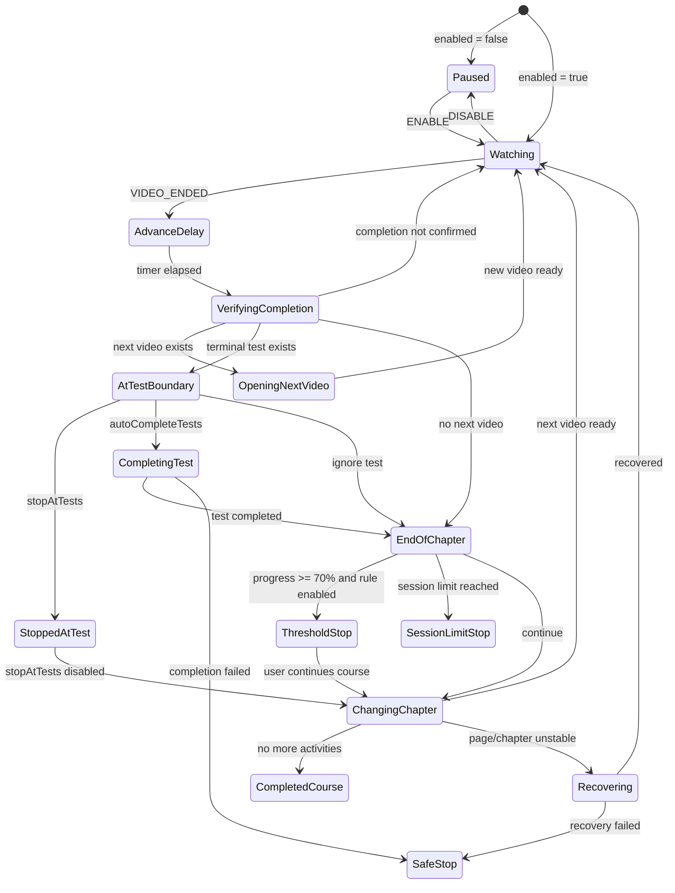
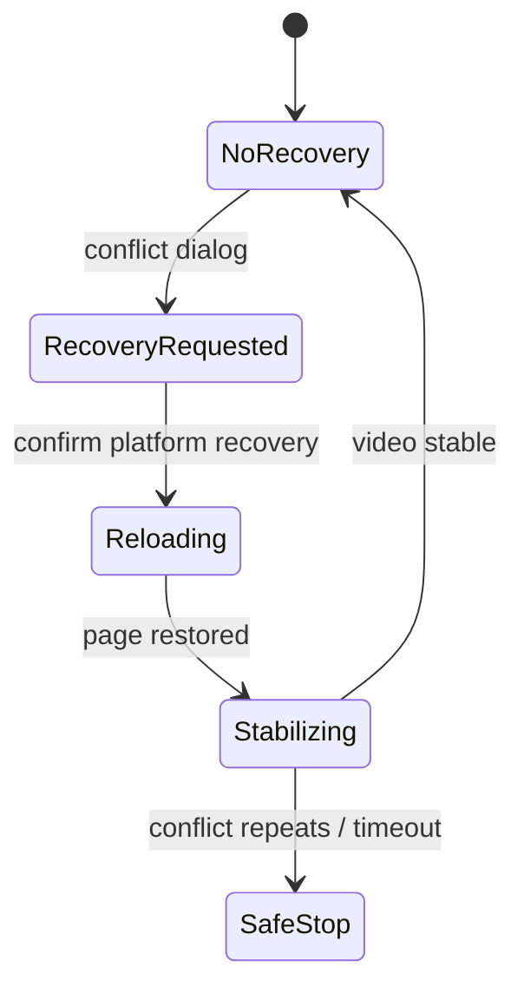
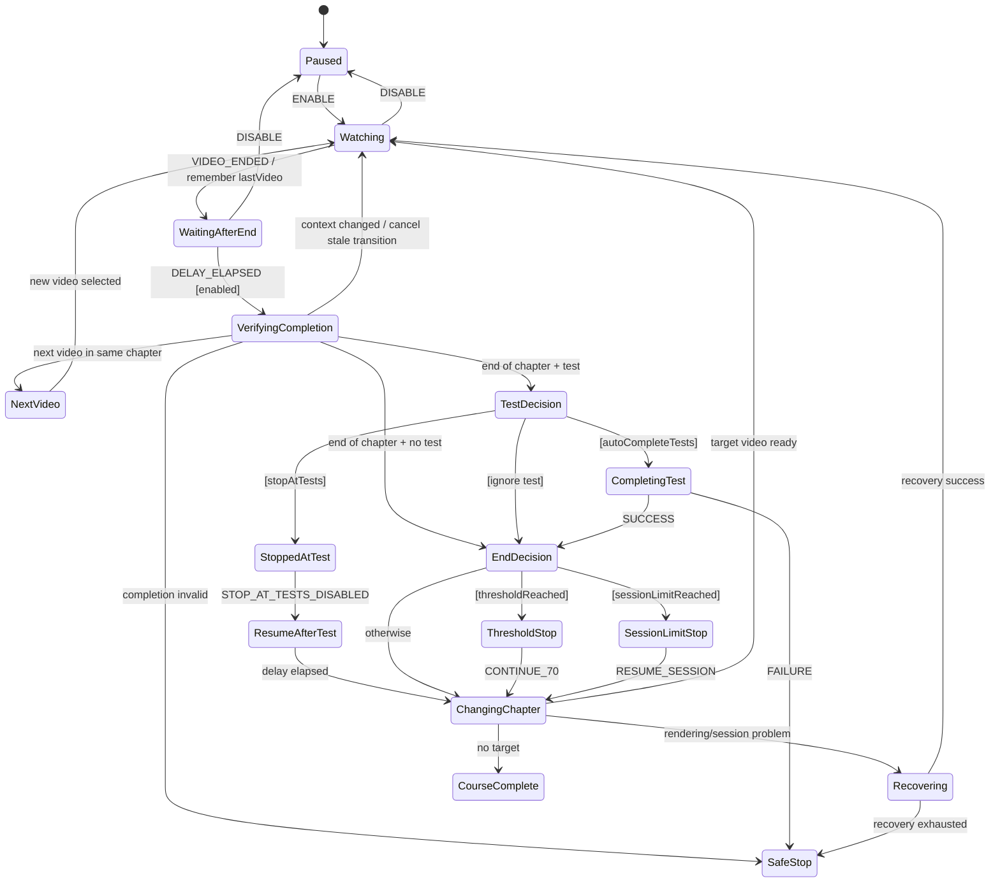

# 07 — Autoplay as a state machine

## From function flow to system behavior

We have now studied almost all the ingredients that make PlumePilot's autoplay possible: the host platform's dynamic DOM, the extension's JavaScript execution contexts, messaging, Multiversity APIs, Promises, timers and race conditions, caches, and persisted state.

Now we can change perspective.

Instead of asking:

> **Which function calls which function next?**

we can ask:

> **What state is autoplay in, which event just occurred, and which transitions are permitted from here?**

This is a significant difference. A simple program can be read as:

```text
A → B → C → D
```

PlumePilot's autoplay cannot.

While the same video is playing, the user or the host platform may change `enabled`, test preferences, the chapter session limit, the 70% threshold, the sidebar DOM, the selected lesson, page visibility, server-side progress, a recovery workflow, or another PlumePilot operation.

The actual behavior resembles a graph:

```text
                ┌──────────────┐
                │    PAUSED    │
                └──────┬───────┘
                       │ resume
                       ▼
                ┌──────────────┐
                │   WATCHING   │
                └──────┬───────┘
                       │ video ended
                       ▼
              ┌──────────────────┐
              │ VERIFY COMPLETION│
              └────────┬─────────┘
                       │
           ┌───────────┼───────────────┐
           │           │               │
           ▼           ▼               ▼
     NEXT VIDEO   TEST BOUNDARY   END OF CHAPTER
                       │               │
                       │               ├─ threshold → STOP
                       │               ├─ limit → STOP
                       │               └─ next chapter
                       ▼
               STOP / COMPLETE
```

This is the natural territory of **state machines**.

---

# Part I — What is a state machine?

## 1. What is a state machine?

A state machine describes a system's behavior using a few fundamental elements:

- **States**: the modes the system can be in.
- **Events**: things that happen.
- **Transitions**: permitted moves between states.
- **Guards**: conditions controlling transitions.
- **Actions**: effects performed when transitions occur.

The smallest representation is:

```text
STATE A --event--> STATE B
```

For example:

```text
WATCHING --VIDEO_ENDED--> VERIFYING_COMPLETION
```

A transition may only be legal when some condition is true:

```text
WATCHING --VIDEO_ENDED [enabled]--> VERIFYING_COMPLETION
```

The condition in brackets is a **guard**. A guard does not tell us *what to do*; it tells us **whether the transition is allowed**.

We can separate four questions:

```text
Where are we?     → state
What happened?    → event
May we proceed?   → guard
What should we do? → action / effect
```

This separation becomes more valuable as the number of conditions grows.

---

# Part II — An implicit machine in real code

## 2. PlumePilot does not use an FSM library, but the behavior is there

The current code does not contain a formal declaration such as:

```js
const autoplayMachine = createMachine(...);
```

or a single authoritative variable:

```js
let autoplayState = "watching";
```

Instead, relevant state is distributed across variables in `content.js`:

```js
let playbackContext = null;
let busy = false;
let enabled = true;
let stopAtTests = false;
let autoCompleteTests = false;
let autoplaySkipCompletedVideos = false;
let autoplayStopAt70Enabled = false;
let autoplayStopAt70Bypassed = false;
let stoppedAtTestContext = null;
```

There are also `smartResumeRunning`, `chapterLimitEnabled`, `chapterLimitSession`, `lastVideo`, recovery information in `sessionStorage`, `collectingCourseMaterials`, batch-operation state, advancement timers, and current lesson identity.

Together they form a **state vector**:

```text
autoplay = {
    enabled,
    busy,
    modeAtTests,
    currentLesson,
    currentVideo,
    stoppedAtTestContext,
    chapterLimit,
    threshold70,
    recovery,
    competingOperation,
    discoveryRunning,
    ...
}
```

A state machine therefore exists **semantically**, even though the code does not declare one formally. This is common in mature applications that grew incrementally.

---

## 3. Explicit versus implicit state

Consider:

```js
if (!enabled) return;
if (busy) return;
if (collectingCourseMaterials) return;
if (courseBatchRunning()) return;
```

We can see four unrelated `if` statements. Or we can understand them as one rule:

> The transition to `ADVANCING` is permitted only when autoplay is enabled, no advance is underway, and no incompatible operation controls the course.

In other words:

```text
if statements
```

can implement:

```text
guards on a transition
```

The distinction is principally architectural: it helps us reason about behavior as a whole instead of one condition at a time.

---

# Part III — Finding the real events

## 4. Actual autoplay events

Before defining states, identify the events in the existing implementation.

### Video started

`attach(v)` registers:

```js
v.addEventListener("play", () => {
    const row = currentLesson();
    if (row) rememberPlaybackLesson(row, v);
    ...
});
```

Conceptually:

```text
VIDEO_PLAYED
```

### Video ended

The same function listens for `ended`:

```js
v.addEventListener("ended", () => {
    void captureEndedVideoProgress(v);

    if (!enabled || smartResumeRunning) {
        return;
    }

    if (lastVideo === v) return;
    lastVideo = v;

    clearTimeout(timer);
    timer = setTimeout(() => {
        if (enabled) {
            advance(v);
        }
    }, DELAY_MS);
});
```

This provides:

```text
VIDEO_ENDED
```

but also several guards:

```text
[enabled]
[!smartResumeRunning]
[lastVideo !== v]
```

and a delayed transition:

```text
VIDEO_ENDED
    ↓
WAITING_ADVANCE_DELAY
    ↓ after DELAY_MS
ADVANCING
```

### Settings changed

The bridge publishes `PEGASO_AUTONEXT_STATE`. `content.js` updates:

```js
enabled = event.data.enabled !== false;
autoCompleteTests = event.data.autoCompleteTests === true;
autoplaySkipCompletedVideos = event.data.autoplaySkipCompletedVideos === true;
chapterLimitEnabled = event.data.autoplayChapterLimitEnabled === true;
autoplayStopAt70Enabled = event.data.autoplayStopAt70Enabled === true;
```

This is effectively:

```text
SETTINGS_CHANGED
```

Depending on the current state, it can mean:

```text
PAUSED --SETTINGS_CHANGED(enabled=true)--> WATCHING
```

or:

```text
STOPPED_AT_TEST --SETTINGS_CHANGED(stopAtTests=false)--> RESUMING
```

The second transition exists in the real code; it is not just a hypothetical diagram.

---

## 5. An event does not necessarily imply a transition

Receiving:

```text
VIDEO_ENDED
```

does **not** automatically mean "open the next video."

The system must ask:

```text
Is autoplay enabled?
Is another advance running?
Is this still the current video?
Has the platform recorded completion?
Does the DOM still represent the same lesson?
Is there a test?
Must we stop at the test?
May we complete it automatically?
Has 70% been reached?
Has the chapter session limit been reached?
Does another operation have ownership?
```

The event is only a **trigger**. The transition is a decision based on state, context, and guards.

---

# Part IV — Reconstructing the main machine

## 6. A conceptual autoplay machine

Here is one useful behavioral model:



This is **not a one-to-one transcription of the JavaScript**. It is a model of the behavior: the essential rules of the system, not every implementation detail or local variable.

---

## 7. `advance(v)` is almost a transition dispatcher

The central function begins:

```js
async function advance(v) {
```

Its early guards include:

```js
if (collectingCourseMaterials) {
    return;
}

if (courseBatchRunning()) {
    return;
}

if (!enabled) {
    return;
}

if (busy || v !== lastVideo) {
    return;
}
```

Then:

```js
busy = true;
```

The function has entered a guarded critical region. In state-machine language:

```text
EVENT: ADVANCE_REQUESTED

GUARDS:
- autoplay enabled
- no material collection
- no batch operation
- not already advancing
- requested video is still authoritative

TRANSITION:
WATCHING / DELAYED → VERIFYING_CURRENT_LESSON
```

The remaining workflow decides which branch to take.

---

## 8. `busy` is not the state machine

It is tempting to equate:

```text
busy = false → idle
busy = true  → advancing
```

That is too simplistic. `busy` is a **reentrancy guard**: it prevents two advancement workflows from entering the same sequence simultaneously.

It does not tell us *why* autoplay has stopped.

With `busy === false`, we might be paused, waiting for a video, stopped at a test, stopped at 70%, stopped by a session limit, recovering, or at the end of the course.

> **A flag may represent one property of state without representing the whole state.**

---

## 9. The combinatorial explosion of Boolean flags

With three flags:

```text
enabled
busy
stopAtTests
```

there are formally:

```text
2³ = 8 combinations
```

With ten Boolean flags:

```text
2¹⁰ = 1024 combinations
```

Many combinations are nonsensical or invalid—for instance a conceptual state that is simultaneously `PAUSED` and `ADVANCING`.

A well-designed explicit state machine can make these combinations **impossible by construction**.

Instead of inconsistent settings:

```js
enabled = false;
busy = true;
stoppedAtTestContext = ...;
```

we might represent one state:

```text
paused
```

with additional context stored separately.

This is the distinction between **finite state** and **extended state/context**.

---

# Part V — State versus context

## 10. Finite state and context

A machine does not need a separate state for every piece of data:

```text
watching chapter 5 lesson 2
watching chapter 5 lesson 3
watching chapter 5 lesson 4
```

All three can be:

```text
state = WATCHING
```

with:

```js
context = {
    courseCode,
    chapterIdentity,
    lessonIdentity,
    videoElement
}
```

PlumePilot already uses something similar:

```js
playbackContext = {
    videoElement,
    courseCode: courseCodeFromUrl(),
    lessonNumber: lessonNumberFromUrl(),
    identity,
    name: lessonName(row),
    index,
};
```

The **state** describes the mode. The **context** contains the data needed while in that mode.

---

## 11. `playbackContext` keeps identity stable across transitions

Chapter 03 showed why DOM nodes can become stale. We can now understand the same problem in state-machine terms.

During `advance(v)`:

```js
let cur = await recoverPlaybackLesson(v);
```

Then:

```js
const completedLesson = playbackContext;
```

After waiting:

```js
const completed = await waitForLessonCompletion(cur, v);
```

the code resolves and validates the current state again:

```js
const stableCur = await recoverPlaybackLesson(v);

if (
    !enabled ||
    v !== lastVideo ||
    video() !== v ||
    !stableCur ||
    playbackLessonRow(completedLesson) !== stableCur
) {
    return;
}
```

Think of it as:

```text
VERIFYING_COMPLETION
      │
      │ await platform state
      ▼
REVALIDATE CONTEXT
      │
      ├─ context unchanged → continue transition
      └─ context changed   → cancel transition
```

The machine does not assume the world is unchanged after an asynchronous wait.

---

# Part VI — Guards and transitions

## 12. Guards are scattered throughout the code

Consider these real conditions.

### Autoplay is enabled

```js
if (!enabled) return;
```

### An event has not already been handled

```js
if (lastVideo === v) return;
```

### No advance is already in progress

```js
if (busy) return;
```

### The same video is still current

```js
if (v !== lastVideo) return;
```

### No incompatible operation is running

```js
if (collectingCourseMaterials || courseBatchRunning()) return;
```

### Stop at the test

```js
if (test && stopAtTests) {
```

### Automatically complete the test

```js
else if (test && autoCompleteTests) {
```

### Threshold reached

```js
if (thresholdReached) {
```

### Session limit reached

```js
if (sessionLimitReached) {
```

Taken together, these checks are more than unrelated flow-control statements. They constitute autoplay's **implicit transition table**.

---

## 13. An explicit transition table

| State | Event | Guard | New state / action |
|---|---|---|---|
| `WATCHING` | `VIDEO_ENDED` | `enabled && !smartResumeRunning` | `ADVANCE_DELAY` |
| `ADVANCE_DELAY` | `TIMER` | `enabled` | `VERIFYING_COMPLETION` |
| `VERIFYING_COMPLETION` | `COMPLETED` | next video exists | `OPENING_NEXT_VIDEO` |
| `VERIFYING_COMPLETION` | `COMPLETED` | terminal test + stop | `STOPPED_AT_TEST` |
| `VERIFYING_COMPLETION` | `COMPLETED` | terminal test + auto-complete | `COMPLETING_TEST` |
| `COMPLETING_TEST` | `SUCCESS` | — | `END_OF_CHAPTER` |
| `COMPLETING_TEST` | `FAILURE` | — | `SAFE_STOP` |
| `END_OF_CHAPTER` | `CONTINUE` | threshold reached | `THRESHOLD_STOP` |
| `END_OF_CHAPTER` | `CONTINUE` | session limit reached | `SESSION_LIMIT_STOP` |
| `END_OF_CHAPTER` | `CONTINUE` | otherwise | `CHANGING_CHAPTER` |
| `STOPPED_AT_TEST` | `SETTINGS_CHANGED` | `!stopAtTests` | `RESUMING` |
| Any active state | `DISABLE` | — | `PAUSED` |

A table makes forgotten cases more visible. It also gives us an initial **test matrix**.

---

# Part VII — Deduplicating events

## 14. Duplicate `ended` events and `lastVideo`

The `ended` handler checks:

```js
if (lastVideo === v) return;
lastVideo = v;
```

Why? Because event-driven systems should not blindly assume that an important semantic event will be observed *exactly once*.

The browser and host application may reuse a video player, rebuild the DOM, change the source, or produce unexpected intermediate states.

The guard suppresses a repeated:

```text
VIDEO_ENDED(video X)
VIDEO_ENDED(video X)
```

so that only one logical advance is attempted for the same observed end.

This is **event deduplication**, or from the state-machine perspective, ignoring an event that should no longer cause a transition from the current state.

---

## 15. `play` adjusts the state when a video player is reused

There is a complication: the platform may reuse the *same `<video>` DOM element* for different logical videos.

The `play` handler therefore contains:

```js
if (
    lastVideo === v &&
    !v.ended &&
    (!Number.isFinite(v.duration) || v.currentTime < v.duration - 0.5)
) {
    lastVideo = null;
}
```

Without this reset:

```text
video element A ends
lastVideo = A

platform reuses element A for next lesson

new ended event on A
    ↓
"it is already lastVideo"
    ↓
event incorrectly ignored
```

State must reflect **semantic identity**, not only JavaScript object identity. This is the same lesson we learned about the DOM, now applied to event handling.

---

# Part VIII — Time is part of the machine

## 16. Delayed transitions are more than pauses

After `ended`, PlumePilot does not call `advance(v)` immediately:

```js
timer = setTimeout(() => {
    if (enabled) {
        advance(v);
    }
}, DELAY_MS);
```

A state-machine model might say:

```text
VIDEO_ENDED
   ↓
WAITING_AFTER_END
   ↓ after DELAY_MS
VERIFYING_COMPLETION
```

This is a **delayed transition**. The machine remains in a state during the delay, and other events may invalidate the eventual transition.

The callback rechecks:

```js
if (enabled)
```

because the user might have paused autoplay during the wait.

A timer does not freeze the world.

---

## 17. Lesson completion is a waiting state, not an instantaneous property

`waitForLessonCompletion()` illustrates this especially well.

When a video ends, the platform may not have updated its sidebar or progress yet. The incorrect model would be:

```text
video ended → completed
```

The more accurate model is:

```text
VIDEO ENDED
    ↓
AWAITING PLATFORM CONFIRMATION
    ↓
100% registered
```

or:

```text
VIDEO ENDED
    ↓
AWAITING PLATFORM CONFIRMATION
    ↓ timeout
real video end confirmed
    ↓
continue with safeguards
```

or:

```text
VIDEO ENDED
    ↓
platform validation fails
    ↓
SAFE STOP / RECOVERY
```

The state model must reflect the external system's actual timing.

---

## 18. The machine and the external platform

An application state machine does not control everything.

PlumePilot cannot decide when Multiversity updates progress, rebuilds its DOM, releases a video session, or responds to an API call. The user may also change lessons manually.

These are **external events** relative to PlumePilot.

```text
          ┌────────────────────┐
          │    Multiversity    │
          └──────┬─────────────┘
                 │
      DOM / API / video events
                 ▼
         ┌──────────────────┐
         │ Autoplay machine │
         └────────┬─────────┘
                  │ clicks / API calls / status
                  ▼
            Multiversity
```

The machine is **reactive**, not a predetermined script. It observes and responds to the world.


# Part IX — Tests as real state branches

## 19. Tests are a genuine branch of the machine

One of the most important decisions happens at the end of a chapter.

PlumePilot checks:

```js
const test = getEndOfLessonTest(chapter);
```

From that point, behavior can diverge.

### Case 1 — Stop at tests

```js
if (test && stopAtTests) {
    // ...
    stoppedAtTestContext = {
        identity: chapterIdentity(chapter),
        oldVideo: v,
    };
    return;
}
```

This corresponds directly to a conceptual state:

```text
STOPPED_AT_TEST
```

Importantly, the implementation also remembers enough context to resume later.

### Case 2 — Test already completed

```js
else if (test && isEndOfLessonTestCompleted(test)) {
    // skip
}
```

The machine passes the guard without entering a prolonged new state.

### Case 3 — Complete the test automatically

```js
else if (test && autoCompleteTests) {
    const testCompleted = await completeAutomaticEndOfLessonTest(...);

    if (!testCompleted) {
        return;
    }
}
```

Conceptually:

```text
AT_TEST_BOUNDARY
      ↓
COMPLETING_TEST
      ↓ success
END_OF_CHAPTER
```

or:

```text
COMPLETING_TEST
      ↓ failure
SAFE_STOP
```

### Case 4 — Ignore and continue

If a test exists but no earlier guard requires stopping or completing it:

```text
AT_TEST_BOUNDARY → END_OF_CHAPTER
```

Four different behaviors can result from one logical point. This is exactly where state-machine thinking becomes valuable.

---

## 20. Stored intent versus effective state

Chapter 06 distinguished a user's saved preference from the runtime's effective configuration.

In the bridge, the stored preference is read and a compatible state is derived.

In `content.js`:

```js
stopAtTests =
    event.data.stopAtTests !== false &&
    !autoCompleteTests &&
    !chapterLimitEnabled;
```

The user may have saved `stopAtTests = true`, but the effective runtime guard can be false because another mode takes precedence.

Instead of assuming:

```text
stopAtTests = checkbox
```

state-machine thinking suggests:

```text
storedIntent.stopAtTests
          +
runtime constraints
          ↓
effectiveMode
```

This avoids contradictory configurations without destroying the user's choice.

---

## 21. Stopping at a test preserves a resume context

`stoppedAtTestContext` is especially interesting.

Knowing only:

```text
"I am stopped"
```

is not enough. The system also needs to know **where to resume**.

It retains:

```js
{
    identity,
    oldVideo
}
```

When the user disables "Stop at tests", the settings handler contains:

```js
if (wasStoppingAtTests && !stopAtTests) {
    const context = stoppedAtTestContext;
    stoppedAtTestContext = null;

    if (context) {
        resumeAfterTestBoundary(context);
    } else {
        resumeIfVideoAlreadyEnded();
    }
}
```

In state-machine terms:

```text
STATE: STOPPED_AT_TEST
EVENT: STOP_AT_TESTS_DISABLED
ACTION: consume saved context
TRANSITION: RESUMING_AFTER_TEST
```

This is one of the clearest concrete examples in the project.

---

## 22. State history: remembering where we came from

Sometimes the current state is insufficient. To resume correctly, the machine needs some **history**.

Not the user's entire course history—only:

```text
the last safe point from which to continue
```

This is a simple form of state history.

Recovery workflows need the same kind of information:

```text
currentIdentity
path
attempts
createdAt
```

The system stores the minimum context needed to reconstruct an interrupted transition.

---

# Part X — Terminal states and orthogonal conditions

## 23. The 70% threshold and session limit are relative terminal states

After finishing a chapter:

```js
const sessionLimitReached = chapterLimitReached(...);
const thresholdReached = autoplayThresholdReached();
```

Then:

```js
if (thresholdReached) {
    // ...
    return;
}

if (sessionLimitReached) {
    // ...
    return;
}
```

For the current autoplay session, these are terminal states:

```text
THRESHOLD_STOP
SESSION_LIMIT_STOP
```

They are **not** terminal states of the entire application. The user may choose to continue later.

This distinction is fundamental: a workflow can finish without the containing application being finished.

---

## 24. Two terminal conditions may be true simultaneously

The code also handles:

```js
if (thresholdReached || sessionLimitReached) {
    // sound event
}
```

The user-facing message can reflect both conditions:

```js
thresholdReached
    ? sessionLimitReached
        ? "Soglia del 70% e limite della sessione raggiunti."
        : ...
```

The Italian string is preserved because it illustrates a **real code snapshot**, not an English-language UI change.

We have two simultaneously true properties:

```text
thresholdReached = true
sessionLimitReached = true
```

A completely flat finite state machine would need a combined state. A richer **statechart** can represent parallel or orthogonal conditions.

---

## 25. FSM versus statechart

A simple finite state machine is often imagined as having just one active discrete state:

```text
A or B or C
```

Real applications frequently have independent properties:

```text
playback = watching
threshold = armed
sessionLimit = active
recovery = none
```

Flattening every combination creates names like:

```text
WATCHING_THRESHOLD_ARMED_LIMIT_ACTIVE
WATCHING_THRESHOLD_BYPASSED_LIMIT_ACTIVE
WATCHING_THRESHOLD_ARMED_LIMIT_DISABLED
...
```

A **statechart** supports richer concepts:

- Hierarchical states and substates.
- Parallel or orthogonal regions.
- History.
- Guards.
- Delayed transitions.

We do not have to adopt a state-machine library to benefit from these modeling ideas.

---

# Part XI — Recovery as a submachine

## 26. Recovery deserves its own machine

PlumePilot's recovery logic is a good candidate for modeling separately.

Session-conflict recovery can be simplified as:



This submachine influences the main autoplay machine:

```text
AUTOPLAY.ACTIVE
      │
      ├─ recovery = none  → normal transitions
      └─ recovery != none → avoid unsafe discovery/advances
```

The real `startFirstIncompleteDiscovery()` checks:

```js
if (
    readChapterRecovery()?.currentIdentity ||
    readSessionConflictRecovery() ||
    readWatchValidationRecovery()
) {
    return;
}
```

This means that discovery is not allowed while the recovery submachine is active.

> **Recovery is not just an error callback. It has a lifecycle with states and allowed transitions.**

---

# Part XII — Shared ownership of the course

## 27. Competing operations constrain autoplay

Autoplay also checks:

```js
if (collectingCourseMaterials) return;
if (courseBatchRunning()) return;
```

Chapter 05 discussed concurrency; we can now model these guards as ownership:

```text
COURSE CONTROL OWNER

AUTOPLAY
EXPORT
TURBO TEST
OBJECTIVES
```

Some operations cannot safely coexist because they manipulate the same course page.

Conceptually:

```text
AUTOPLAY transition
    guard: courseOwner == AUTOPLAY || courseOwner == NONE
```

PlumePilot does not literally define that enum. It is a useful *model* for understanding why its guards exist.

---

# Part XIII — Hierarchical navigation

## 28. `nextChapter()` is a compound transition

At chapter completion:

```js
await nextChapter(v, cur);
```

does not simply mean:

```text
chapter++
```

It may require stable identification of the current chapter, API discovery, deciding between sequential navigation and skipping completed activities, opening a different section, verifying intermediate tests, visual fallback, recovering a changed DOM, and waiting for the next video.

So `CHANGING_CHAPTER` is itself a **compound state**:

```text
CHANGING_CHAPTER
├── FIND_TARGET
├── OPEN_SECTION
├── OPEN_CHAPTER
├── WAIT_RENDER
├── SELECT_ACTIVITY
└── WAIT_VIDEO
```

Hierarchy lets the main diagram stay readable while detailed navigation has its own states.

---

## 29. First-incomplete discovery is a separate machine

`startFirstIncompleteDiscovery()` shares helpers with autoplay but has a different goal.

It searches for:

```text
the first valid target according to the discovery policy
```

rather than simply advancing after the current video ends.

A possible submachine:

```text
IDLE
 ↓ start
BUILD_OUTLINE
 ↓
READ_MASTER
 ↓
SCAN_CANDIDATES
 ├─ target    → OPEN_TARGET
 ├─ uncertain → VISUAL_VERIFY
 ├─ cancelled → CANCELLED
 └─ none      → COMPLETE
```

Chapter 08 studies this process in detail.

For now, the architectural lesson is:

> **Two features may share APIs and helper functions without being the same workflow.**

---

# Part XIV — Fail closed when state cannot be verified

## 30. Fail closed as a safety transition

Discovery contains logic similar to:

```js
if (!lesson.ok) {
    setResumeDiscoveryStatus(
        "Test corrente non verificabile. Avanzamento fermato per sicurezza.",
        "fallback",
    );
    return true;
}
```

This expresses:

```text
uncertainty about a condition requiring a stop
        ↓
do not advance
```

It is **fail-closed behavior**.

When the user has asked to stop at tests, an unnecessary stop is safer than silently skipping an unverified test boundary.

In state-machine terms:

```text
VERIFY_TEST
    ├─ confirmed absent  → continue
    ├─ confirmed present → STOPPED_AT_TEST
    └─ unknown           → SAFE_STOP
```

`UNKNOWN` must not silently be treated as `FALSE`.

---

## 31. A machine makes uncertainty policy explicit

Without a model, code may read:

```js
if (!test) continue;
```

But `!test` might mean:

```text
there is definitely no test
```

or:

```text
we could not verify whether a test exists
```

Those are different facts.

A robust machine can distinguish:

```text
ABSENT
PRESENT
UNKNOWN
```

and define different transitions for each.

This distinction becomes especially important in Chapter 08.

---

# Part XV — Transition logic versus side effects

## 32. Autoplay is not a purely deterministic browser process

A state machine is often expressed as:

```text
nextState = transition(currentState, event)
```

But PlumePilot also performs real side effects:

- `click()`.
- `fetch()`.
- `setTimeout()`.
- Storage operations.
- DOM inspection and mutation.
- Notifications.
- Sounds.

It can be useful to distinguish:

```text
TRANSITION LOGIC
```

from:

```text
EFFECTS
```

For example:

```text
STATE = END_OF_CHAPTER
EVENT = CONTINUE
GUARD = thresholdReached

NEXT STATE = THRESHOLD_STOP
ACTION = show notification + publish status + play sound
```

The new state is a decision. The notification and sound are effects.

Separation can make the decision logic independently testable.

---

## 33. What a purely illustrative refactor might look like

**The following is not PlumePilot code and is not a required change proposal.** It is a teaching example:

```js
function transition(state, event, context) {
    if (event.type === "DISABLE") {
        return { state: "paused", context };
    }

    if (state === "watching" && event.type === "VIDEO_ENDED") {
        if (context.discoveryRunning) return { state, context };
        return { state: "advanceDelay", context };
    }

    if (state === "atTestBoundary") {
        if (context.stopAtTests) {
            return { state: "stoppedAtTest", context };
        }

        if (context.autoCompleteTests) {
            return { state: "completingTest", context };
        }

        return { state: "endOfChapter", context };
    }

    return { state, context };
}
```

Effects could then be handled separately.

One benefit would be testing:

```js
transition(
    "atTestBoundary",
    { type: "DECIDE" },
    { stopAtTests: true, autoCompleteTests: false }
);
```

without opening a browser, loading a Multiversity course, or playing a real video.

---

## 34. Why not automatically refactor everything?

An explicit machine has costs:

- New abstraction layers.
- Migrating stable, established code.
- Representing complicated effects.
- DOM integration that remains imperative.
- A steeper learning curve.
- Risk of regression in a mature workflow.

The conclusion is **not** that PlumePilot must be rewritten with a particular library.

The conclusion is:

> **State-machine modeling helps us understand and design behavior independently of the syntax used to implement it.**

---

# Part XVI — Backend analogy

## 35. Think like a workflow orchestrator

For backend developers, autoplay resembles a business workflow.

An order might move through:

```text
CREATED
→ PAID
→ PREPARING
→ SHIPPED
→ DELIVERED
```

with alternative paths:

```text
PAYMENT_FAILED
CANCELLED
REFUNDED
```

Autoplay has similar transitions:

```text
WATCHING
→ VIDEO_ENDED
→ VERIFYING
→ NEXT_ACTIVITY
```

with branches:

```text
STOPPED_AT_TEST
RECOVERING
THRESHOLD_STOP
SESSION_LIMIT_STOP
SAFE_STOP
```

The domain is a dynamic webpage rather than an order database. The logical orchestration problem is surprisingly similar.


# Part XVII — Guards and invariants

## 36. Guards are different from invariants

A **guard** decides whether one transition is allowed.

An **invariant** describes a property that should remain true throughout every relevant state and transition.

For autoplay, consider these useful invariants.

### Invariant 1

```text
If enabled == false, PlumePilot must not automatically select a new activity.
```

### Invariant 2

```text
Two automatic advancement workflows must not run concurrently.
```

The `busy` guard helps enforce this.

### Invariant 3

```text
If stopAtTests is effectively enabled and a test cannot be verified,
PlumePilot must not silently cross that boundary.
```

### Invariant 4

```text
After an await, the target must still match the context that initiated the transition.
```

### Invariant 5

```text
Recovery must not produce an infinite reload loop.
```

Invariants give us a vocabulary for regression tests and code review.

---

# Part XVIII — From a state machine to a test matrix

## 37. State machines suggest tests directly

Once behavior is modeled, test cases almost write themselves.

### Test A — Autoplay paused

```text
GIVEN  state = PAUSED
WHEN   VIDEO_ENDED
THEN   no automatic navigation
```

### Test B — Duplicate ended event

```text
GIVEN  the same logical video has already caused a transition
WHEN   another ended event arrives for that target
THEN   no second advance
```

### Test C — Stop at tests

```text
GIVEN  stopAtTests = true
AND    the chapter ends with a test
WHEN   the last video completes
THEN   state = STOPPED_AT_TEST
AND    next chapter is not opened
```

### Test D — Change settings while stopped

```text
GIVEN  state = STOPPED_AT_TEST
WHEN   stopAtTests becomes false
THEN   resume from the saved context
```

This is a real category of regression fixed in the project's history.

### Test E — Automatic completion fails

```text
GIVEN  autoCompleteTests = true
WHEN   test completion cannot be verified
THEN   SAFE_STOP
```

### Test F — Both threshold and limit reached

```text
GIVEN  threshold70 reached
AND    chapter session limit reached
WHEN   chapter completes
THEN   do not call nextChapter
AND    terminal state is coherent
AND    combined status message is correct
```

### Test G — State changes during an await

```text
GIVEN  advance() is waiting for completion
WHEN   user changes lessons or the DOM is rebuilt
THEN   cancel the stale transition
```

This is among the most important regressions studied earlier.

---

# Part XIX — Evolution through the changelog

## 38. The changelog tells the machine's history

Read the PlumePilot changelog as a history of previously absent or unreliable transitions.

### v1.6.0

Introduced the branch:

```text
AT_TEST_BOUNDARY → COMPLETING_TEST
```

with a safety rule:

```text
if completion cannot be verified → stop
```

### v2.9.x

Test boundaries became more formally distinguished:

```text
test present / absent / unknown
```

with fail-closed handling.

### v2.10.1

A missing reverse transition was corrected:

```text
STOPPED_AT_TEST
   --disable stopAtTests-->
RESUME
```

### v2.11.5

A dedicated session-conflict recovery submachine emerged.

### v2.14.x

Finding the first incomplete activity became an independent workflow with cancellation and fallback.

### v2.19.0

Added:

```text
END_OF_CHAPTER → SESSION_LIMIT_STOP
```

### v2.35.1

Improved behavior around closed accordions, handoff from Objectives, and chapter routing.

Seen this way, a regression is often not merely:

```text
"function X is broken"
```

but:

```text
"a real transition was missing or incorrectly modeled"
```

---

## 39. Regressions as unmodeled transitions

Consider several real bugs.

### Sidebar accordion closed during completion

An older implicit model assumed:

```text
WAITING_COMPLETION → same DOM still available
```

But the actual environment allows:

```text
WAITING_COMPLETION → SIDEBAR_CHANGED
```

The transition was not sufficiently accounted for. The fix involved re-resolving and revalidating the context.

### Disabling Stop at tests after stopping

The system had:

```text
WATCHING → STOPPED_AT_TEST
```

but its reverse transition was not always reliable. Saving an explicit resume context made the return path robust.

### Reused player element

The naive assumption was:

```text
videoElement == lastVideo → duplicate event
```

The real invariant needed to be:

```text
same DOM element ≠ necessarily the same logical video
```

Again, the issue is identity and permitted transitions, not simply a missing CSS selector.

---

# Part XX — A more complete diagram

## 40. A richer autoplay state diagram



The diagram does not replace the implementation. It exposes the behavioral rules that are otherwise scattered throughout it.

---

# Part XXI — What should not be a state?

## 41. Which details should remain context instead?

Not every value deserves a separate discrete state.

```text
percent = 42
percent = 43
percent = 44
```

are three values of a progress variable, not three distinct behavioral modes.

Likewise:

```text
chapterLimit = 5
```

is a configuration parameter.

The limit becomes state-machine relevant when it changes what the workflow is allowed to do:

```text
limit not reached
       ↓
limit reached
```

A useful rule:

> **Model as a state what changes which behaviors are permitted.**

---

## 42. Exercise: classify real variables

Let's classify variables from PlumePilot.

### `enabled`

Influences available transitions directly. It can be regarded as a global mode or state flag.

### `busy`

A local reentrancy guard, not a complete domain state.

### `playbackContext`

Context or extended state.

### `stopAtTests`

A policy that changes test-boundary transitions.

### `stoppedAtTestContext`

History/context associated with `STOPPED_AT_TEST`.

### `chapterLimitSession.completed`

A counter in context. Crossing the configured limit can trigger `SESSION_LIMIT_STOP`.

### `lastVideo`

Event deduplication memory and logical identity tracking.

### Recovery in `sessionStorage`

State for a recovery submachine that needs to survive reload.

Classifying variables this way makes complex code much easier to reason about.

---

# Part XXII — Composing several machines

## 43. Multiple machines can coexist

An application does not need **one giant state machine**.

PlumePilot lends itself to a conceptual composition:

```text
AutoplayMachine
├── PlaybackMachine
├── TestBoundaryMachine
├── ChapterNavigationMachine
├── RecoveryMachine
└── FirstIncompleteMachine

OperationCoordinator
├── Export
├── Turbo
└── Objectives
```

The components communicate through events or shared conditions.

This resembles service decomposition in backend systems: each component owns a cohesive slice of behavior.

---

## 44. When is an explicit state machine worth it?

An explicit machine becomes particularly useful with:

- Many interdependent Boolean flags.
- Transitions that depend on previous state.
- Retry and recovery.
- Cancellable operations.
- Asynchronous events.
- Invalid combinations to prevent.
- Bugs that appear only after "first A, then B, then C."
- A test matrix that is difficult to enumerate.

PlumePilot's autoplay satisfies several of these criteria.

That does **not** mean a major refactor is automatically justified today. It means state-machine reasoning is especially well suited to the problem.

---

# Part XXIII — XState as a learning tool

## 45. XState as an optional way to study the ideas

JavaScript libraries such as **XState** allow states, events, guards, and actions to be declared explicitly.

A small educational example:

```js
const machine = createMachine({
    initial: "paused",
    states: {
        paused: {
            on: { ENABLE: "watching" },
        },
        watching: {
            on: {
                DISABLE: "paused",
                VIDEO_ENDED: "verifyingCompletion",
            },
        },
        verifyingCompletion: {},
    },
});
```

We do not need to adopt XState in PlumePilot to learn from it. The Stately/XState documentation separates:

```text
states
events
transitions
guards
actions
context
```

These are the same concepts we have been applying to the existing code.

---

# Part XXIV — Model first, implement second

## 46. Define policy before mechanisms

A state machine allows us to discuss behavior before choosing DOM or API implementation details.

Consider:

```text
QUESTION

What should happen if:
- the video has ended;
- a test exists;
- stopAtTests is true;
- autoCompleteTests is false;
- meanwhile the user pauses autoplay?
```

First define the rule:

```text
DISABLE has priority → PAUSED
```

Then decide how to implement it.

This separates:

```text
policy
```

from:

```text
mechanism
```

a classic and highly useful software engineering distinction.

---

# Part XXV — Logging and observability

## 47. State machines can improve logging

PlumePilot logs messages such as:

```text
Video ended; advancing.
Lesson registered as 100%.
End-of-lesson test boundary reached.
End of chapter reached.
Autoplay session limit reached.
```

They can be interpreted as state transitions:

```text
WATCHING → VERIFYING
VERIFYING → TEST_BOUNDARY
TEST_BOUNDARY → STOPPED
END_OF_CHAPTER → SESSION_LIMIT_STOP
```

A more structured event log could record:

```js
{
    from: "verifyingCompletion",
    event: "LESSON_COMPLETED",
    to: "testBoundary",
    courseCode,
    chapterKey
}
```

That is an illustrative possible improvement, not a requirement to modify stable code today.

The key lesson is that modeling behavior also improves **observability**.

---

## 48. Debugging regressions through transitions

Suppose a user reports:

> "If I disable Stop at tests after PlumePilot has stopped, it doesn't resume."

A purely procedural debugging session might involve reading many functions.

With a state model, ask:

```text
Initial state?
STOPPED_AT_TEST

Event?
STOP_AT_TESTS_DISABLED

Expected transition?
STOPPED_AT_TEST → RESUMING

Was the event received?
Did a guard reject the transition?
Does the saved context still exist?
Did the resume effect fail?
```

The state-based questions narrow the investigation significantly.

---

## 49. Transition coverage versus line coverage

Traditional test coverage may tell us:

```text
this line was executed
```

For a workflow, we also need to know:

```text
this transition was verified
```

We might execute both branches of code around:

```js
if (wasStoppingAtTests && !stopAtTests) { /* ... */ }
```

without ever testing the full sequence:

```text
video ends
→ test boundary
→ stop
→ popup setting changes
→ context restored
→ next chapter opens
```

**Transition coverage** is a more behaviorally meaningful way of measuring whether complex workflows have been exercised.

---

# Part XXVI — A reusable mental model

## 50. Five elements to write down

When you encounter a complex feature, identify:

### 1. States

```text
Which modes genuinely change system behavior?
```

### 2. Events

```text
What can happen, internally or externally?
```

### 3. Guards

```text
Which conditions must hold for a transition to occur?
```

### 4. Actions

```text
Which side effects will be performed?
```

### 5. Context

```text
What data must be kept without making each value a separate state?
```

Applied to PlumePilot:

```text
STATE   = STOPPED_AT_TEST
EVENT   = SETTINGS_CHANGED
GUARD   = stopAtTests became false
ACTION  = schedule resume
CONTEXT = chapter identity + previous video
```

This one example describes quite a lot of implementation code.

---

# Part XXVII — Glossary of chapter concepts

## 51. Concepts to take away

### Finite State Machine

A behavioral model consisting of a finite set of states and transitions between them.

### State

The current mode determining which events and behaviors are valid.

### Event

Something that happened and may trigger a transition.

### Transition

A move from one state to another.

### Guard

A condition that allows or prevents a transition.

### Action / Effect

An operation performed as a result of a transition, such as a click, fetch request, storage update, or notification.

### Extended state / Context

Data associated with a machine that should not each become a separate discrete state.

### Delayed transition

A transition enabled after a time interval, provided the necessary context remains valid.

### State history

Enough retained information to remember where the workflow came from or how to resume.

### State explosion

Combinatorial growth when many independent properties are flattened into one FSM.

### Hierarchical state

A state made up of substates, allowing a complex workflow to be described at different levels.

### Orthogonal state

Independent aspects of state that can be active simultaneously.

### Fail closed

When uncertain, choose a conservative transition instead of proceeding under optimistic assumptions.

### Invariant

A property that must remain true across every permitted transition.

### Transition coverage

Testing meaningful state–event–transition combinations, rather than just lines of implementation code.

---

# Part XXVIII — Further reading

## 52. Recommended references

For formal descriptions, the Object Management Group's UML specification treats state machines as states connected by event-triggered transitions with associated guards and behaviors.

For practical JavaScript-oriented study, Stately/XState's documentation is useful because it distinguishes states, events, transitions, guards, actions, and context, and provides visualization tools.

Recommended resources:

- Stately — What are state machines and statecharts?  
  https://stately.ai/docs/state-machines-and-statecharts

- Stately — States and transitions  
  https://stately.ai/docs/editor-states-and-transitions

- Stately — Guards  
  https://stately.ai/docs/guards

- Stately — XState documentation  
  https://stately.ai/docs

- Object Management Group — UML / State Machines  
  https://www.omg.org/spec/UML/

There is no need to learn XState syntax immediately. For this book, the main value is learning to **see program behavior as a system of states and transitions**.

---

# Part XXIX — Mental exercises

## 53. Exercises

### Exercise 1

Classify these variables as **state**, **guard**, **context**, or **effect-related state**:

```text
enabled
busy
lastVideo
playbackContext
chapterLimitSession.completed
stoppedAtTestContext
```

There may not be one perfect classification. Explaining your reasoning matters more.

### Exercise 2

Draw just the test-handling submachine:

```text
NO_TEST
TEST_PRESENT
STOPPED_AT_TEST
COMPLETING_TEST
TEST_COMPLETED
TEST_FAILURE
```

Which should really be *states*? Which might be better represented as events or guard conditions?

### Exercise 3

Consider this timeline:

```text
1. A video ends.
2. The advance delay begins.
3. The user pauses PlumePilot.
4. The timer expires.
```

Which guard prevents navigation? Why must it be checked **when the timer expires**, not only when the timer is created?

### Exercise 4

Imagine removing `busy`.

Construct a timeline where two `advance(v)` calls overlap. Which duplicate transitions could occur?

### Exercise 5

Choose one historical PlumePilot regression and express it using only:

```text
initial state
→ event
→ expected transition
→ observed transition
```

This is a useful exercise in behavior-oriented debugging.

---

# Part XXX — Chapter summary

## 54. What have we really learned?

PlumePilot's autoplay can be read as a sequence of function calls, but that perspective hides its underlying structure.

Its behavior is governed by:

```text
states
+
events
+
guards
+
transitions
+
context
+
side effects
```

The existing code expresses this machine **implicitly** through variables, conditionals, timers, callbacks, recovery routines, and asynchronous functions.

Making the model explicit helps us understand:

- Why particular guards exist.
- Why some flags are not complete states.
- Why tests create separate workflow branches.
- Why resuming requires context and history.
- Why recovery is best seen as a submachine.
- Why assumptions need revalidation after `await`.
- Why many regressions are missing or incorrect transitions.
- How to turn the observed behavior into a test matrix.

The most important lesson is:

> **When many `if` statements depend on what happened before, what is happening now, and which events may happen next, you are probably already building a state machine—even if you never called it one.**

And a second lesson:

> **A good state model is not about making code more academic. It makes explicit which transitions the system can and cannot perform.**

---

## In the next chapter

Chapter 08 will study one of the most interesting submachines introduced here:

**Finding the first incomplete activity — Heuristics, master calls, and fallbacks.**

We will trace how the algorithm evolved:

```text
DOM scan
   ↓
cache
   ↓
global search
   ↓
master call
   ↓
chapters below 100%
   ↓
detailed verification
   ↓
visual fallback
```

This leads to a broader question:

> **How do you make a reliable decision when no single data source is perfectly authoritative, complete, and current at the same time?**

---

[← 06 — State, cache, and storage](06-state-cache-and-storage.md) · [Contents](index.md) · [08 — Finding the first incomplete activity →](08-finding-first-incomplete-activity.md)
