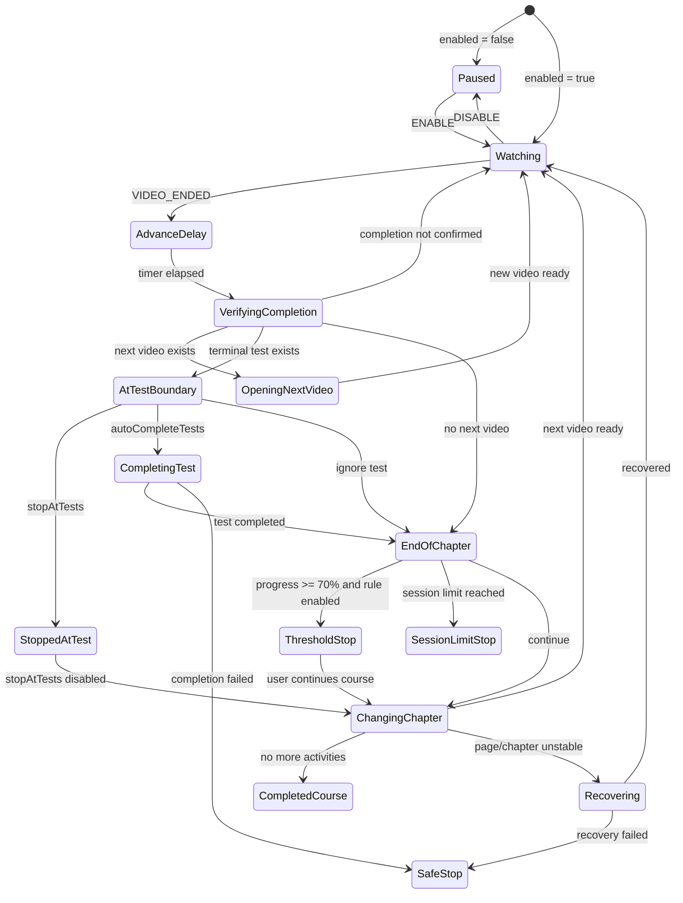

# 07 — Autoplay as a state machine

## From function flow to system behavior

We have now studied almost all the ingredients that make PlumePilot's autoplay possible: the host platform's dynamic DOM, the extension's JavaScript execution contexts, messaging, Multiversity APIs, Promises, timers and race conditions, caches, and persisted state.

Now we can change perspective.

Instead of asking:

> **Which function calls which function next?**

we can ask:

> **What state is autoplay in, which event just occurred, and which transitions are permitted from here?**

This is a significant difference. A simple program can be read as:

```text
A → B → C → D
```

PlumePilot's autoplay cannot.

While the same video is playing, the user or the host platform may change `enabled`, test preferences, the chapter session limit, the 70% threshold, the sidebar DOM, the selected lesson, page visibility, server-side progress, a recovery workflow, or another PlumePilot operation.

The actual behavior resembles a graph:

```text
                ┌──────────────┐
                │    PAUSED    │
                └──────┬───────┘
                       │ resume
                       ▼
                ┌──────────────┐
                │   WATCHING   │
                └──────┬───────┘
                       │ video ended
                       ▼
              ┌──────────────────┐
              │ VERIFY COMPLETION│
              └────────┬─────────┘
                       │
           ┌───────────┼───────────────┐
           │           │               │
           ▼           ▼               ▼
     NEXT VIDEO   TEST BOUNDARY   END OF CHAPTER
                       │               │
                       │               ├─ threshold → STOP
                       │               ├─ limit → STOP
                       │               └─ next chapter
                       ▼
               STOP / COMPLETE
```

This is the natural territory of **state machines**.

---

# Part I — What is a state machine?

## 1. What is a state machine?

A state machine describes a system's behavior using a few fundamental elements:

- **States**: the modes the system can be in.
- **Events**: things that happen.
- **Transitions**: permitted moves between states.
- **Guards**: conditions controlling transitions.
- **Actions**: effects performed when transitions occur.

The smallest representation is:

```text
STATE A --event--> STATE B
```

For example:

```text
WATCHING --VIDEO_ENDED--> VERIFYING_COMPLETION
```

A transition may only be legal when some condition is true:

```text
WATCHING --VIDEO_ENDED [enabled]--> VERIFYING_COMPLETION
```

The condition in brackets is a **guard**. A guard does not tell us *what to do*; it tells us **whether the transition is allowed**.

We can separate four questions:

```text
Where are we?     → state
What happened?    → event
May we proceed?   → guard
What should we do? → action / effect
```

This separation becomes more valuable as the number of conditions grows.

---

# Part II — An implicit machine in real code

## 2. PlumePilot does not use an FSM library, but the behavior is there

The current code does not contain a formal declaration such as:

```js
const autoplayMachine = createMachine(...);
```

or a single authoritative variable:

```js
let autoplayState = "watching";
```

Instead, relevant state is distributed across variables in `content.js`:

```js
let playbackContext = null;
let busy = false;
let enabled = true;
let stopAtTests = false;
let autoCompleteTests = false;
let autoplaySkipCompletedVideos = false;
let autoplayStopAt70Enabled = false;
let autoplayStopAt70Bypassed = false;
let stoppedAtTestContext = null;
```

There are also `smartResumeRunning`, `chapterLimitEnabled`, `chapterLimitSession`, `lastVideo`, recovery information in `sessionStorage`, `collectingCourseMaterials`, batch-operation state, advancement timers, and current lesson identity.

Together they form a **state vector**:

```text
autoplay = {
    enabled,
    busy,
    modeAtTests,
    currentLesson,
    currentVideo,
    stoppedAtTestContext,
    chapterLimit,
    threshold70,
    recovery,
    competingOperation,
    discoveryRunning,
    ...
}
```

A state machine therefore exists **semantically**, even though the code does not declare one formally. This is common in mature applications that grew incrementally.

---

## 3. Explicit versus implicit state

Consider:

```js
if (!enabled) return;
if (busy) return;
if (collectingCourseMaterials) return;
if (courseBatchRunning()) return;
```

We can see four unrelated `if` statements. Or we can understand them as one rule:

> The transition to `ADVANCING` is permitted only when autoplay is enabled, no advance is underway, and no incompatible operation controls the course.

In other words:

```text
if statements
```

can implement:

```text
guards on a transition
```

The distinction is principally architectural: it helps us reason about behavior as a whole instead of one condition at a time.

---

# Part III — Finding the real events

## 4. Actual autoplay events

Before defining states, identify the events in the existing implementation.

### Video started

`attach(v)` registers:

```js
v.addEventListener("play", () => {
    const row = currentLesson();
    if (row) rememberPlaybackLesson(row, v);
    ...
});
```

Conceptually:

```text
VIDEO_PLAYED
```

### Video ended

The same function listens for `ended`:

```js
v.addEventListener("ended", () => {
    void captureEndedVideoProgress(v);

    if (!enabled || smartResumeRunning) {
        return;
    }

    if (lastVideo === v) return;
    lastVideo = v;

    clearTimeout(timer);
    timer = setTimeout(() => {
        if (enabled) {
            advance(v);
        }
    }, DELAY_MS);
});
```

This provides:

```text
VIDEO_ENDED
```

but also several guards:

```text
[enabled]
[!smartResumeRunning]
[lastVideo !== v]
```

and a delayed transition:

```text
VIDEO_ENDED
    ↓
WAITING_ADVANCE_DELAY
    ↓ after DELAY_MS
ADVANCING
```

### Settings changed

The bridge publishes `PEGASO_AUTONEXT_STATE`. `content.js` updates:

```js
enabled = event.data.enabled !== false;
autoCompleteTests = event.data.autoCompleteTests === true;
autoplaySkipCompletedVideos = event.data.autoplaySkipCompletedVideos === true;
chapterLimitEnabled = event.data.autoplayChapterLimitEnabled === true;
autoplayStopAt70Enabled = event.data.autoplayStopAt70Enabled === true;
```

This is effectively:

```text
SETTINGS_CHANGED
```

Depending on the current state, it can mean:

```text
PAUSED --SETTINGS_CHANGED(enabled=true)--> WATCHING
```

or:

```text
STOPPED_AT_TEST --SETTINGS_CHANGED(stopAtTests=false)--> RESUMING
```

The second transition exists in the real code; it is not just a hypothetical diagram.

---

## 5. An event does not necessarily imply a transition

Receiving:

```text
VIDEO_ENDED
```

does **not** automatically mean "open the next video."

The system must ask:

```text
Is autoplay enabled?
Is another advance running?
Is this still the current video?
Has the platform recorded completion?
Does the DOM still represent the same lesson?
Is there a test?
Must we stop at the test?
May we complete it automatically?
Has 70% been reached?
Has the chapter session limit been reached?
Does another operation have ownership?
```

The event is only a **trigger**. The transition is a decision based on state, context, and guards.

---

# Part IV — Reconstructing the main machine

## 6. A conceptual autoplay machine

Here is one useful behavioral model:



This is **not a one-to-one transcription of the JavaScript**. It is a model of the behavior: the essential rules of the system, not every implementation detail or local variable.

---

## 7. `advance(v)` is almost a transition dispatcher

The central function begins:

```js
async function advance(v) {
```

Its early guards include:

```js
if (collectingCourseMaterials) {
    return;
}

if (courseBatchRunning()) {
    return;
}

if (!enabled) {
    return;
}

if (busy || v !== lastVideo) {
    return;
}
```

Then:

```js
busy = true;
```

The function has entered a guarded critical region. In state-machine language:

```text
EVENT: ADVANCE_REQUESTED

GUARDS:
- autoplay enabled
- no material collection
- no batch operation
- not already advancing
- requested video is still authoritative

TRANSITION:
WATCHING / DELAYED → VERIFYING_CURRENT_LESSON
```

The remaining workflow decides which branch to take.

---

## 8. `busy` is not the state machine

It is tempting to equate:

```text
busy = false → idle
busy = true  → advancing
```

That is too simplistic. `busy` is a **reentrancy guard**: it prevents two advancement workflows from entering the same sequence simultaneously.

It does not tell us *why* autoplay has stopped.

With `busy === false`, we might be paused, waiting for a video, stopped at a test, stopped at 70%, stopped by a session limit, recovering, or at the end of the course.

> **A flag may represent one property of state without representing the whole state.**

---

## 9. The combinatorial explosion of Boolean flags

With three flags:

```text
enabled
busy
stopAtTests
```

there are formally:

```text
2³ = 8 combinations
```

With ten Boolean flags:

```text
2¹⁰ = 1024 combinations
```

Many combinations are nonsensical or invalid—for instance a conceptual state that is simultaneously `PAUSED` and `ADVANCING`.

A well-designed explicit state machine can make these combinations **impossible by construction**.

Instead of inconsistent settings:

```js
enabled = false;
busy = true;
stoppedAtTestContext = ...;
```

we might represent one state:

```text
paused
```

with additional context stored separately.

This is the distinction between **finite state** and **extended state/context**.

---

# Part V — State versus context

## 10. Finite state and context

A machine does not need a separate state for every piece of data:

```text
watching chapter 5 lesson 2
watching chapter 5 lesson 3
watching chapter 5 lesson 4
```

All three can be:

```text
state = WATCHING
```

with:

```js
context = {
    courseCode,
    chapterIdentity,
    lessonIdentity,
    videoElement
}
```

PlumePilot already uses something similar:

```js
playbackContext = {
    videoElement,
    courseCode: courseCodeFromUrl(),
    lessonNumber: lessonNumberFromUrl(),
    identity,
    name: lessonName(row),
    index,
};
```

The **state** describes the mode. The **context** contains the data needed while in that mode.

---

## 11. `playbackContext` keeps identity stable across transitions

Chapter 03 showed why DOM nodes can become stale. We can now understand the same problem in state-machine terms.

During `advance(v)`:

```js
let cur = await recoverPlaybackLesson(v);
```

Then:

```js
const completedLesson = playbackContext;
```

After waiting:

```js
const completed = await waitForLessonCompletion(cur, v);
```

the code resolves and validates the current state again:

```js
const stableCur = await recoverPlaybackLesson(v);

if (
    !enabled ||
    v !== lastVideo ||
    video() !== v ||
    !stableCur ||
    playbackLessonRow(completedLesson) !== stableCur
) {
    return;
}
```

Think of it as:

```text
VERIFYING_COMPLETION
      │
      │ await platform state
      ▼
REVALIDATE CONTEXT
      │
      ├─ context unchanged → continue transition
      └─ context changed   → cancel transition
```

The machine does not assume the world is unchanged after an asynchronous wait.

---

# Part VI — Guards and transitions

## 12. Guards are scattered throughout the code

Consider these real conditions.

### Autoplay is enabled

```js
if (!enabled) return;
```

### An event has not already been handled

```js
if (lastVideo === v) return;
```

### No advance is already in progress

```js
if (busy) return;
```

### The same video is still current

```js
if (v !== lastVideo) return;
```

### No incompatible operation is running

```js
if (collectingCourseMaterials || courseBatchRunning()) return;
```

### Stop at the test

```js
if (test && stopAtTests) {
```

### Automatically complete the test

```js
else if (test && autoCompleteTests) {
```

### Threshold reached

```js
if (thresholdReached) {
```

### Session limit reached

```js
if (sessionLimitReached) {
```

Taken together, these checks are more than unrelated flow-control statements. They constitute autoplay's **implicit transition table**.

---

## 13. An explicit transition table

| State | Event | Guard | New state / action |
|---|---|---|---|
| `WATCHING` | `VIDEO_ENDED` | `enabled && !smartResumeRunning` | `ADVANCE_DELAY` |
| `ADVANCE_DELAY` | `TIMER` | `enabled` | `VERIFYING_COMPLETION` |
| `VERIFYING_COMPLETION` | `COMPLETED` | next video exists | `OPENING_NEXT_VIDEO` |
| `VERIFYING_COMPLETION` | `COMPLETED` | terminal test + stop | `STOPPED_AT_TEST` |
| `VERIFYING_COMPLETION` | `COMPLETED` | terminal test + auto-complete | `COMPLETING_TEST` |
| `COMPLETING_TEST` | `SUCCESS` | — | `END_OF_CHAPTER` |
| `COMPLETING_TEST` | `FAILURE` | — | `SAFE_STOP` |
| `END_OF_CHAPTER` | `CONTINUE` | threshold reached | `THRESHOLD_STOP` |
| `END_OF_CHAPTER` | `CONTINUE` | session limit reached | `SESSION_LIMIT_STOP` |
| `END_OF_CHAPTER` | `CONTINUE` | otherwise | `CHANGING_CHAPTER` |
| `STOPPED_AT_TEST` | `SETTINGS_CHANGED` | `!stopAtTests` | `RESUMING` |
| Any active state | `DISABLE` | — | `PAUSED` |

A table makes forgotten cases more visible. It also gives us an initial **test matrix**.

---

# Part VII — Deduplicating events

## 14. Duplicate `ended` events and `lastVideo`

The `ended` handler checks:

```js
if (lastVideo === v) return;
lastVideo = v;
```

Why? Because event-driven systems should not blindly assume that an important semantic event will be observed *exactly once*.

The browser and host application may reuse a video player, rebuild the DOM, change the source, or produce unexpected intermediate states.

The guard suppresses a repeated:

```text
VIDEO_ENDED(video X)
VIDEO_ENDED(video X)
```

so that only one logical advance is attempted for the same observed end.

This is **event deduplication**, or from the state-machine perspective, ignoring an event that should no longer cause a transition from the current state.

---

## 15. `play` adjusts the state when a video player is reused

There is a complication: the platform may reuse the *same `<video>` DOM element* for different logical videos.

The `play` handler therefore contains:

```js
if (
    lastVideo === v &&
    !v.ended &&
    (!Number.isFinite(v.duration) || v.currentTime < v.duration - 0.5)
) {
    lastVideo = null;
}
```

Without this reset:

```text
video element A ends
lastVideo = A

platform reuses element A for next lesson

new ended event on A
    ↓
"it is already lastVideo"
    ↓
event incorrectly ignored
```

State must reflect **semantic identity**, not only JavaScript object identity. This is the same lesson we learned about the DOM, now applied to event handling.

---

# Part VIII — Time is part of the machine

## 16. Delayed transitions are more than pauses

After `ended`, PlumePilot does not call `advance(v)` immediately:

```js
timer = setTimeout(() => {
    if (enabled) {
        advance(v);
    }
}, DELAY_MS);
```

A state-machine model might say:

```text
VIDEO_ENDED
   ↓
WAITING_AFTER_END
   ↓ after DELAY_MS
VERIFYING_COMPLETION
```

This is a **delayed transition**. The machine remains in a state during the delay, and other events may invalidate the eventual transition.

The callback rechecks:

```js
if (enabled)
```

because the user might have paused autoplay during the wait.

A timer does not freeze the world.

---

## 17. Lesson completion is a waiting state, not an instantaneous property

`waitForLessonCompletion()` illustrates this especially well.

When a video ends, the platform may not have updated its sidebar or progress yet. The incorrect model would be:

```text
video ended → completed
```

The more accurate model is:

```text
VIDEO ENDED
    ↓
AWAITING PLATFORM CONFIRMATION
    ↓
100% registered
```

or:

```text
VIDEO ENDED
    ↓
AWAITING PLATFORM CONFIRMATION
    ↓ timeout
real video end confirmed
    ↓
continue with safeguards
```

or:

```text
VIDEO ENDED
    ↓
platform validation fails
    ↓
SAFE STOP / RECOVERY
```

The state model must reflect the external system's actual timing.

---

## 18. The machine and the external platform

An application state machine does not control everything.

PlumePilot cannot decide when Multiversity updates progress, rebuilds its DOM, releases a video session, or responds to an API call. The user may also change lessons manually.

These are **external events** relative to PlumePilot.

```text
          ┌────────────────────┐
          │    Multiversity    │
          └──────┬─────────────┘
                 │
      DOM / API / video events
                 ▼
         ┌──────────────────┐
         │ Autoplay machine │
         └────────┬─────────┘
                  │ clicks / API calls / status
                  ▼
            Multiversity
```

The machine is **reactive**, not a predetermined script. It observes and responds to the world.
