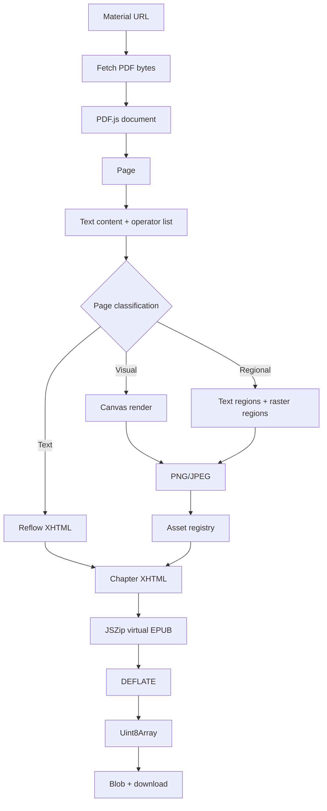

# 09 — Generating PDF, HTML, and EPUB in the browser

## Pipelines, binary data, transformation, and memory

PlumePilot does more than read a web page and automate a few interactions. It also takes information collected from the platform and transforms it into **new documents** that must be valid, downloadable, and usable outside the browser.

This is an important change of role.

Until now, our systems mostly looked like:

```text
page / API
    ↓
PlumePilot
    ↓
decision / navigation / state
```

Document generation introduces a different pipeline:

```text
page / API
    ↓
collect data and URLs
    ↓
normalize
    ↓
transform
    ↓
serialize
    ↓
binary or text file
    ↓
local download
```

It has three main forms:

```text
Course materials → PDF
Course materials → EPUB
Tests            → PDF / offline HTML
```

Each solves a different problem:

- **PDF** mainly preserves the original document faithfully.
- **Offline HTML** turns structured data into a small self-contained application.
- **EPUB** attempts to reinterpret a fixed-page document as an ebook that adapts to the reader's screen.

The third task is by far the hardest.

---

# Part I — Separate collection from building

## 1. Two phases that must not be confused

When a user requests course materials, PlumePilot does not immediately generate the file.

First it needs a representation of the materials:

```text
course
  ↓
sections
  ↓
chapters
  ↓
material URLs
  ↓
material[]
```

Only then can the document-building phase begin.

This separation is architecturally important:

```text
COLLECTION                         BUILD

Multiversity                      builder page
    ↓                                 ↓
content.js                        pdf-core.js
    ↓                             epub-core.mjs
material descriptors                  ↓
    ↓                             final bytes
background.js                         ↓
    ↓                              download
builder job
```

The collector knows about the course, sections, chapter order, material URLs, and collection failures.

The builder should primarily be concerned with downloading resources, transforming them, laying them out, serializing them, and producing the finished file.

### Backend analogy

It resembles:

```text
query / data acquisition
         ↓
normalized DTO
         ↓
report generator
```

The generator should not need to understand the LMS page's DOM.

---

## 2. The builder as a separate process

Chapter 02 showed that the background stores a job payload in `chrome.storage.local` and opens a dedicated builder page whose URL carries only a small `jobId`.

Conceptually:

```text
background
   │
   ├── storage["pegasoExportJob:abc123"] = large payload
   │
   └── opens materials-builder.html?job=abc123
                              │
                              ↓
                       builder reads job
```

This avoids huge URLs and repeatedly serializing large structures in messages.

The builder has its own page with a progress bar, PDF/EPUB buttons, cancellation, error messages, and a lifetime independent of the popup.

The popup can close without necessarily destroying document generation.

---

# Part II — The browser's binary building blocks

## 3. `ArrayBuffer`, `Uint8Array`, and `Blob`

Ordinary JavaScript application code often deals with strings and objects. PDFs and EPUBs are **sequences of bytes**.

Three browser types therefore appear throughout the code:

```text
ArrayBuffer
Uint8Array
Blob
```

For example, `pdf-core.js` contains:

```js
const bytes = new Uint8Array(await response.arrayBuffer());
```

The flow is:

```text
HTTP response
     ↓
ArrayBuffer
     ↓
Uint8Array
     ↓
PDF / EPUB library
```

### `ArrayBuffer`

A raw block of binary memory. By itself, it does not define characters, numbers, or pixels.

### `Uint8Array`

A **typed view** over unsigned 8-bit values. Each element represents:

```text
0 … 255
```

It is a natural representation for binary files because their fundamental unit is the byte.

### `Blob`

An immutable binary object that the browser can treat as file-like data. PlumePilot may ultimately produce:

```js
new Blob([bytes], { type: "application/pdf" })
```

or:

```js
new Blob([bytes], { type: "application/epub+zip" })
```

The MIME type tells the browser what kind of resource is being produced.

---

## 4. From memory to download: Object URLs

A `Blob` is a JavaScript object. An HTML `<a>` element expects a URL.

The bridge between them is:

```js
URL.createObjectURL(blob)
```

The material builder uses this pattern:

```js
function download(bytes, filename, mime) {
  const url = URL.createObjectURL(new Blob([bytes], { type: mime }));
  const anchor = document.createElement("a");
  anchor.href = url;
  anchor.download = filename;
  document.body.appendChild(anchor);
  anchor.click();
  anchor.remove();
  setTimeout(() => URL.revokeObjectURL(url), 5000);
}
```

The browser creates an opaque URL resembling:

```text
blob:chrome-extension://.../uuid
```

which refers to data managed by the browser:

```text
Uint8Array
    ↓
Blob
    ↓
Object URL
    ↓
<a download>
    ↓
file on the user's computer
```

### Why `revokeObjectURL()`?

As long as the Object URL remains active, the browser needs to keep the referenced Blob available.

PlumePilot revokes it after a short delay—not immediately—to allow the download to start:

```js
URL.revokeObjectURL(url)
```

This is a small, concrete example of **resource-lifetime management**.

---

# Part III — Generating the merged course PDF

## 5. PDF: compose rather than convert

Generating a combined PDF is conceptually much simpler than generating EPUB.

The source materials are already PDF documents. We do not need to reinterpret their content:

```text
Chapter 1 PDF ─┐
Chapter 2 PDF ─┼──→ combined PDFDocument
Chapter 3 PDF ─┘
```

The main function in `pdf-core.js` is:

```js
async function buildCoursePdf(
  courseTitle,
  materials,
  onProgress = () => {},
  fetchImpl = globalThis.fetch,
)
```

First we create the destination document:

```js
const document = await PDFDocument.create();
```

Then for each material:

```js
const response = await fetchImpl(material.url);
const bytes = new Uint8Array(await response.arrayBuffer());
const source = await PDFDocument.load(bytes, {
  ignoreEncryption: true,
  updateMetadata: false,
});
```

We now have two documents:

```text
source   → PDF for one chapter

document → combined PDF being built
```

---

## 6. Copying pages

The core of composition is:

```js
const sourceIndices = source.getPageIndices();
const copiedPages = await document.copyPages(source, sourceIndices);
```

Then:

```js
for (const copiedPage of copiedPages) {
  const addedPage = document.addPage(copiedPage);
  firstPage ||= addedPage;
}
```

The algorithm is almost literal:

```text
for each PDF:
    download
    open
    copy every page
    append pages in order
```

Its enormous advantage is that **we are not reconstructing PDF layout**.

Equations, graphics, fonts, tables, and page geometry remain those of the source document. The visual-fidelity problem is comparatively small.

---

## 7. Adding structure to an existing document

PlumePilot does not merely concatenate pages.

During copying it retains chapter metadata:

```js
included.push({
  chapter: material.chapter,
  chapterTitle: material.chapterTitle,
  section: material.section,
  firstPage,
  pageCount: copiedPages.length,
});
```

The key property is `firstPage`.

Once we know each chapter's first page, we can build an interactive contents page, internal links, and PDF bookmarks/outlines:

```js
addInteractiveIndex(document, courseTitle, included, regular, bold);
addBookmarks(document, included);
```

The pipeline becomes:

```text
original PDFs
     ↓
merge pages
     ↓
chapter → first page mapping
     ↓
contents + bookmarks
     ↓
serialization
```

---

## 8. Serializing the PDF

While manipulating `PDFDocument`, we have a JavaScript representation of a document.

To produce the actual file:

```js
const bytes = await document.save({
  addDefaultPage: false,
  useObjectStreams: true,
});
```

Now:

```text
PDFDocument
    ↓ save()
Uint8Array
```

The remaining step is the Blob-based download discussed earlier.

---

## 9. Partial success

One damaged source PDF should not necessarily destroy the entire export.

The loop records both successes and failures:

```js
try {
  ...
  included.push(...);
} catch (error) {
  failures.push(...);
}
```

The whole operation fails only when no material could be included:

```js
if (!included.length) {
  throw new Error(
    "Non è stato possibile scaricare e unire nessuna dispensa.",
  );
}
```

The Italian error string is preserved from the historical code snapshot.

This distinguishes:

```text
total failure
vs.
partial success
```

If 24 of 25 materials are usable, a document containing 24 chapters plus a clear failure report for the remaining one may be much more useful.

### Backend analogy

It resembles a batch job collecting:

```text
successes[]
failures[]
```

rather than enforcing all-or-nothing behavior on work where a partial result has genuine value.

---

# Part IV — Generating the quiz PDF

## 10. When there are no PDFs to merge

Self-assessment tests are different.

Questions arrive as structured data:

```text
chapter
questions[]
    question
    answers[]
    correctPosition
    images[]
```

There is no source PDF to concatenate. We must construct the layout.

`test-builder.js` creates:

```js
const documentPdf = await PDFLib.PDFDocument.create();
```

It loads bundled Unicode fonts and manually draws titles, questions, answers, images, solutions, internal links, bookmarks, and page numbers.

This pipeline resembles a **report renderer**.

---

## 11. Text layout: the invisible problem

Drawing text in a PDF is not simply:

```js
drawText(longString)
```

We need to know where each line should end.

The builder's `wrap()` function measures candidate text using the font:

```js
font.widthOfTextAtSize(candidate, size)
```

Conceptually:

```text
next word
     ↓
does line exceed width?
  ┌───────┴───────┐
 no              yes
  ↓               ↓
append         end line
               new line
```

This, too, is an algorithm.

HTML layout is normally handled by the browser. A programmatically generated PDF often makes us responsible for those layout decisions.

---

## 12. Images: caching and binary validation

Quiz questions may contain images.

`test-builder.js` uses:

```js
const imageCache = new Map();
```

The image loader is:

```js
loadImageAsset(image)
```

`loadImageAsset(image)` caches the **download Promise itself**:

```js
if (imageCache.has(url)) return imageCache.get(url);

const request = (async () => {
  ...
})();

imageCache.set(url, request);
return request;
```

This is notable: the cache deduplicates **concurrent requests**, not just completed results.

If two questions request the same image while the first download is still pending:

```text
request A ──────┐
                ├── same Promise
request B ──────┘
```

There is no second Fetch call.

### Validate content, not just file extensions

The builder also checks byte signatures:

```js
const jpeg =
  bytes[0] === 0xff &&
  bytes[1] === 0xd8 &&
  bytes[2] === 0xff;
```

It recognizes JPEG and PNG signatures rather than trusting an `image.jpg` suffix or the server's stated MIME type alone.

This is **controlled content sniffing**. Images are also limited to 8 MiB, helping with both reliability and memory control.

---

# Part V — HTML: turning data into a small application

## 13. The quiz HTML is not a static document

PlumePilot's generated HTML contains markup, CSS, JavaScript, test data, images, note state, an editor, filters, and answer-checking logic.

It is better understood as:

> **A self-contained web application distributed in a single file.**

The builder exposes:

```js
async function interactiveHtml()
```

---

## 14. Making images work offline

If an HTML export contains:

```html

```

it does not truly work offline.

The builder therefore downloads each image and converts it to a Data URL:

```text
https://.../image.png
      ↓ fetch
Uint8Array
      ↓ base64
data:image/png;base64,...
```

The data is embedded directly into the exported file, removing the external dependency.

### Trade-off

Base64 makes the file self-contained, but expands binary data in its textual representation.

Roughly:

```text
3 binary bytes → 4 Base64 characters
```

This generally adds about one third to the encoded payload before other overhead.

It is the familiar trade-off between **portability** and **size**.

---

## 15. Serializing data inside JavaScript

The builder constructs a JSON payload:

```js
const payload = JSON.stringify({
  courseTitle: job.courseTitle,
  annotatedFilename: ...,
  tests,
})
```

then applies further escaping:

```js
.replace(/</g, "\\u003c")
.replace(/\u2028/g, "\\u2028")
.replace(/\u2029/g, "\\u2029");
```

Why?

Because the JSON will be inserted inside a `<script>` element. Data that is valid JSON may acquire a different meaning when embedded directly into HTML/JavaScript.

The general principle is:

> **Correct escaping depends on the context into which a value is serialized.**

There is no single universal escaping function.

---

## 16. Separating runtime from data

The quiz runtime is not manually duplicated inside the builder.

It is loaded from:

```js
const runtimeResponse = await fetch("offline-quiz-runtime.js");
const runtimeSource = await runtimeResponse.text();
```

Then embedded:

```text
HTML template
   +
CSS
   +
JSON data
   +
offline-quiz-runtime.js
   ↓
interactive-quiz.html
```

During development, the **runtime** and the **generator** remain separate responsibilities. They are combined only in the final exported artifact.

---

# Part VI — EPUB is not a PDF with a different extension

## 17. What actually is an EPUB?

An EPUB is a ZIP container with a specific structure and contracts.

In simplified form:

```text
book.epub
│
├── mimetype
│
├── META-INF/
│   └── container.xml
│
└── OEBPS/
    ├── package.opf
    ├── nav.xhtml
    ├── toc.ncx
    ├── styles/
    │   └── book.css
    ├── text/
    │   ├── title.xhtml
    │   ├── chapter-001.xhtml
    │   └── ...
    ├── images/
    │   └── ...
    └── fonts/
        └── ...
```

This structure appears in `epub-core.mjs`.

The builder creates:

```js
const zip = new globalThis.JSZip();
```

Then:

```js
zip.file("mimetype", "application/epub+zip", {
  compression: "STORE",
});
```

The EPUB container specification requires the `mimetype` file to identify the format and remain uncompressed.

---

## 18. `container.xml`: locating the package document

PlumePilot adds:

```text
META-INF/container.xml
```

which points to:

```text
OEBPS/package.opf
```

A reading system can then find the publication's primary package description:

```text
EPUB root
   ↓
container.xml
   ↓
package.opf
```

---

## 19. Manifest and spine

`package.opf` contains two especially important concepts.

### Manifest

Defines which resources belong to the publication:

```text
chapter XHTML
images
CSS
fonts
navigation document
```

Entries are built in a form such as:

```xml
<item
  id="chapter-1"
  href="text/chapter-001.xhtml"
  media-type="application/xhtml+xml"
/>
```

### Spine

Defines the primary reading order:

```xml
<itemref idref="title"/>
<itemref idref="nav"/>
<itemref idref="chapter-1"/>
<itemref idref="chapter-2"/>
```

Thus:

```text
manifest = what resources exist
spine    = in what order they are read
```

This resembles the distinction between a collection of records and an ordered workflow.

---

## 20. Navigation document and contents

PlumePilot also builds:

```text
OEBPS/nav.xhtml
```

with section and chapter navigation, and keeps a `toc.ncx` for compatibility with older reading systems.

Each chapter can include a link:

```html
<a href="../nav.xhtml#toc">Torna all'indice</a>
```

The Italian text is part of the real generated-content example. Internal links are not cosmetic: they make the book navigable.

---

# Part VII — The real problem: PDF → EPUB

## 21. Fixed layout versus reflow

This is where we reach the central difficulty.

A PDF primarily describes **how a page should appear**.

A reflowable EPUB primarily describes **structured content that the reading system may lay out again**.

They are nearly opposite models.

### PDF

```text
page 595 × 842

draw text at x=84 y=320
draw a line from A to B
place an image in this rectangle
```

### Reflowable EPUB

```html
<h1>Title</h1>
<p>Paragraph...</p>
<ul>...</ul>
```

The reader chooses font size, line width, margins, pagination, and orientation.

That makes EPUB comfortable on Kindle and other ereaders—but only when we can **reconstruct semantics** from a source format that may no longer contain them explicitly.

---


## 22. Extracting text is not reconstructing a document

PDF.js can provide a list of text items, but:

```text
"The"
"function"
"f(x)"
"is"
"continuous"
```

does not tell us automatically which items belong to one paragraph, whether the page contains multiple columns, whether something is a formula, whether a line is a fraction bar, whether an image is essential, or whether a table has lost its row/column relationships.

So conversion is not just:

```text
PDF text → HTML
```

but:

```text
PDF operators
+ text items
+ coordinates
+ images
+ vector graphics
        ↓
classification
        ↓
preservation strategy
```

---

# Part VIII — Classifying pages

## 23. Three strategies, not one

PlumePilot's EPUB converter supports three conceptual modes:

```text
TEXT
VISUAL
REGIONAL / HYBRID
```

The code records:

```js
const record = {
  chapterIndex,
  pageNumber,
  mode: regional?.html
    ? "regional"
    : visual
      ? "visual"
      : "text",
  ...
};
```

### Text

For pages that can be reliably reconstructed:

```text
PDF text items
      ↓
reconstruct blocks
      ↓
reflowable XHTML
```

Benefits: selectable text, adjustable fonts, smaller files, better accessibility, and a more natural ebook experience.

### Visual

For complex content:

```text
PDF page
   ↓
canvas
   ↓
PNG / JPEG
   ↓

```

Benefit: high visual fidelity.

Costs: text is not truly reflowable, files are larger, zoom controls readability, and accessibility is weaker.

### Regional

A compromise that separates the page into regions:

```text
┌─────────────────────────┐
│ reflowable text         │
│                         │
├─────────────────────────┤
│ formula / diagram       │ ← image
├─────────────────────────┤
│ reflowable text         │
└─────────────────────────┘
```

We need not choose between **an entirely textual page** and **one full-page image**.

---

## 24. `pageNeedsVisual()` as a classifier

Before converting a page:

```js
const classification = await pageNeedsVisual(page, content);
```

The function considers significant images, vector graphics, rotated text, parallel columns, tables, suspicious patterns, formulas, and text that cannot be reconstructed safely.

This is a **classification heuristic**. It does not mathematically prove that a page can be converted. Instead, it chooses the strategy that appears to minimize information loss.

---

## 25. Verification after conversion

Even if the initial classifier chooses text, PlumePilot verifies the result:

```js
converted = textPageToHtml(...);
```

then:

```js
visual = textConversionLooksIncomplete(converted);
```

The process is:

```text
pre-check
   ↓
conversion
   ↓
post-check
```

This resembles the progressive refinement from Chapter 08: make a cheap initial decision, then check the actual result.

---

## 26. Equations: why they are difficult

A PDF formula might be represented with Unicode, mathematical fonts, individual glyphs, vector lines, images, or combinations of these.

For example:

```text
 a + b
───────
   c
```

might not be present as one meaningful string: the fraction bar could be an independent drawing command.

PlumePilot looks for cases such as:

```js
hasSimpleFractionRule(...)
```

and unsupported mathematical characters.

When the risk is high, a rendered region may be more faithful than selectable but mathematically incorrect reconstructed text.

> **Selectable text is not worth more than correct content.**

---

# Part IX — Canvas as a rasterizer

## 27. From PDF to pixels

For visually preserved pages, PDF.js renders into `<canvas>`:

```text
PDF page
    ↓
PDF.js render task
    ↓
CanvasRenderingContext2D
    ↓
RGBA pixels
```

The code calls:

```js
const task = page.render({
  canvasContext: context,
  viewport,
  intent: "print",
});
```

A canvas is a temporary rendering surface.

---

## 28. From canvas to image

`encodeCanvas()` chooses PNG or JPEG and calls:

```js
canvas.toBlob(...)
```

then:

```js
new Uint8Array(await blob.arrayBuffer())
```

The data flow is:

```text
canvas pixels
     ↓
toBlob()
     ↓
PNG/JPEG Blob
     ↓
ArrayBuffer
     ↓
Uint8Array
     ↓
EPUB asset
```

---

## 29. PNG or JPEG?

No format is universally better.

JPEG often compresses photographic material more efficiently. PNG can preserve rasterized text, diagrams, sharp lines, and images with limited colors better.

`chooseCanvasFormat()` samples the content to choose between strategies.

This is another **adaptive decision based on data**.

---

# Part X — Memory as an architectural constraint

## 30. Why EPUB can consume a lot of RAM

The final file size does not equal the memory required to construct it.

A rasterized page with:

```text
2000 × 2800 pixels
```

requires approximately:

```text
2000 × 2800 × 4 bytes
= 22,400,000 bytes
≈ 21.4 MiB
```

for an uncompressed RGBA buffer, even if its PNG encoding occupies only a few megabytes.

Several representations may coexist:

```text
PDF bytes
PDF.js structures
text items
operator list
RGBA canvas
encoded image bytes
JSZip entries
final ZIP buffer
```

Therefore an **80 MB EPUB does not imply an 80 MB peak-memory footprint**. Its working set can be considerably larger.

---

## 31. Peak memory, not total allocation

The key question is not just "How many bytes do we allocate in total?" It is:

> **How many bytes remain live simultaneously at the worst point?**

This is **peak memory**.

Compare:

### Strategy A

```text
load 100 pages
render 100 canvases
retain everything
create ZIP
```

with:

### Strategy B

```text
load chapter
  page 1 → convert → release
  page 2 → convert → release
  ...
clean up PDF
next chapter
```

Both may do similar total work. Strategy B keeps fewer large objects alive simultaneously.

PlumePilot attempts to follow the second strategy.

---

## 32. `page.cleanup()`

The code uses:

```js
finally {
  page.cleanup();
}
```

`finally` is important: even after conversion failure, we want PDF.js to release resources belonging to the page.

```text
success ─┐
         ├──→ cleanup
error ───┘
```

This is exactly the resource-lifetime principle studied in Chapter 05.

---

## 33. Shrinking canvas dimensions to `1 × 1`

Several paths end with:

```js
canvas.width = 1;
canvas.height = 1;
```

A canvas can retain a large backing buffer. Resizing it encourages the browser to replace that surface with an almost empty one:

```text
2000 × 2800 canvas
      ↓
no longer needed
      ↓
1 × 1 canvas
```

This is not a direct call to the garbage collector. JavaScript does not provide a general:

```js
free(canvasMemory);
```

But we can release references and reduce native resources that objects retain.

---

## 34. Destroying the PDF.js document

At the end of `convertMaterial()`:

```js
if (pdf) {
  await pdf.destroy().catch(() => {});
} else if (loadingTask) {
  await loadingTask.destroy().catch(() => {});
}
```

PDF.js can retain caches, worker state, fonts, operator lists, pages, and streams. We want the lifetime:

```text
convertMaterial(chapter)
    ↓
PDFDocumentProxy alive
    ↓
convert all pages
    ↓
destroy()
    ↓
next chapter
```

---

## 35. Yielding to the browser

After each page:

```js
await yieldToBrowser(signal);
```

This does not necessarily reduce overall work. It lets the browser update the UI, process events, respond to cancellation, and render progress smoothly.

This is **cooperative scheduling**.

---

# Part XI — Asset deduplication

## 36. Identical content may appear multiple times

Visual conversion can produce repeated images:

```text
image A → 1 MB
image A → 1 MB
image A → 1 MB
```

Without deduplication, these copies occupy 3 MB.

`epub-assets.mjs` defines:

```js
const byHash = new Map();
```

---


## 37. Content-addressable deduplication

For each image, the code computes:

```js
const digest = new Uint8Array(
  await crypto.subtle.digest("SHA-256", image.bytes)
);
```

and a key:

```js
const key = `${image.mediaType}:${extension}:${hash}`;
```

The conceptual flow is:

```text
image bytes
     ↓ SHA-256
hash
     ↓
Map lookup
  ┌──┴───┐
 hit    miss
  │       │
reuse   zip.file()
```

This is a miniature form of **content-addressable storage**.

The identity is determined by content, not the original filename.

---

## 38. Why not keep two copies of the bytes?

A useful comment in `epub-assets.mjs` says:

```js
// Export-scoped: hold only metadata here. JSZip owns unique encoded buffers.
```

The `Map` primarily holds metadata:

```js
{
  name,
  mediaType,
  size,
}
```

The unique bytes are entrusted to JSZip.

After registration, `epub-core.mjs` also does:

```js
image.bytes = null;
```

for registered images.

> **Deduplicating the output matters; avoiding duplicate live buffers is even more important for memory.**

---

# Part XII — Packaging and compression

## 39. JSZip as an in-memory build system

As chapters are converted, the code adds resources:

```js
zip.file(...)
```

JSZip behaves like a virtual filesystem:

```text
zip
├── mimetype
├── META-INF/container.xml
└── OEBPS/...
```

Finally it serializes that structure:

```js
const bytes = await zip.generateAsync({
  type: "uint8array",
  compression: "DEFLATE",
  compressionOptions: { level: 6 },
});
```

The result is one `Uint8Array`.

---

## 40. The hardest phase to cancel

Immediately before compression, PlumePilot reports:

```js
cancellable: false
```

to disable the Cancel button.

Until that stage, the code frequently checks:

```js
throwIfAborted(signal);
```

or uses cancellable operations.

During `JSZip.generateAsync()` it cannot offer the same control over work already started.

Therefore the UI makes an honest promise:

```text
conversion → cancellable
final compression → finalizing; wait
```

An interface should not advertise a capability the underlying implementation cannot reliably deliver.

---

# Part XIII — End-to-end cancellation

## 41. `AbortController` in the builder

When an EPUB build begins:

```js
buildController = new AbortController();
```

The signal is passed to:

```js
buildCourseEpub(..., {
  signal: buildController.signal,
});
```

The Cancel button calls:

```js
buildController.abort();
```

The signal crosses the entire pipeline.

---

## 42. Cancelling a download

`fetchPdfWithRetry()` creates a local controller for each attempt:

```js
const controller = new AbortController();
```

and connects the external abort:

```js
const cancel = () => controller.abort();
signal?.addEventListener("abort", cancel, { once: true });
```

Two distinct causes are handled:

```text
user clicks Cancel
        │
        ├────────────┐
        │            ↓
        │         fetch abort
        │
        └────→ pipeline abort

or

download timeout
        ↓
local controller abort
```

User cancellation and timeout are not identical, even if both may interrupt Fetch.

---

## 43. Cancelling PDF.js

Rendering must respond too.

`renderPage()` registers:

```js
const cancel = () => task.cancel();
signal?.addEventListener("abort", cancel, { once: true });
```

`convertMaterial()` also destroys its active document.

Cancellation is not merely:

```text
set cancelled = true
```

It propagates to the expensive work itself. This is a **cancellation pipeline**.

---

# Part XIV — Retry and resilience

## 44. Selective retry

The PDF downloader defines:

```js
const PDF_DOWNLOAD_RETRY_DELAYS_MS = [1000, 2500];
```

But not every failure triggers retry.

Client errors:

```js
status >= 400 && status < 500
```

are treated differently, with exceptions for potentially transient codes such as:

```text
408 Request Timeout
429 Too Many Requests
```

Retrying a 404 soon afterward is unlikely to help. Timeouts, unstable networks, and rate limiting may justify a further attempt.

As in Chapter 04, **retry is not indiscriminate repetition**.

---

## 45. Invalidating failed links

If generation discovers that a cached material URL is unusable, the builder reports:

```js
PEGASO_INVALIDATE_MATERIAL_CACHE
```

with the relevant failed `cacheKeys`.

The feedback loop is:

```text
collector
   ↓
cache material URL
   ↓
builder tries URL
   ↓
download fails
   ↓
invalidate cache
```

A cache's **consumer** helps correct the cache.

---

# Part XV — References and ownership

## 46. Garbage collection does not mean perfect automatic resource management

JavaScript uses garbage collection, but that does not mean memory can be ignored.

The collector can reclaim an object only once it becomes unreachable. References inside Maps, arrays, closures, JSZip, event listeners, and Object URLs may keep objects alive.

Some browser APIs also own native resources whose lifetimes do not map neatly onto the JavaScript object alone.

That is why PlumePilot uses explicit operations such as:

```text
page.cleanup()
pdf.destroy()
canvas.width = 1
image.bytes = null
URL.revokeObjectURL()
removeEventListener()
```

The principle is:

> **Garbage collection reclaims unreachable memory; architecture must avoid keeping unnecessary objects and resources reachable.**

---

## 47. Ownership

When handling large binary objects, ask:

> **Who owns these bytes now?**

During image deduplication:

```text
renderRegionalPage
      ↓
image.bytes
      ↓
assetRegistry.register()
      ↓
JSZip owns the unique required buffer
      ↓
image.bytes = null
```

Thinking about ownership helps even in JavaScript, which does not have Rust's borrow checker.

---

# Part XVI — Comparing the three pipelines

## 48. PDF, HTML, and EPUB

| Property | Materials PDF | Quiz HTML | Materials EPUB |
|---|---|---|---|
| Main input | Original PDFs | Structured JSON | Original PDFs |
| Transformation | Copy pages | Web rendering | PDF interpretation |
| Visual fidelity | Very high | Native HTML | Adaptive |
| Reflow | No | Yes | Yes / hybrid |
| Interactivity | Limited | High | Reader-dependent |
| Offline | Yes | Yes | Yes |
| Conversion complexity | Relatively low | Medium | High |
| Memory pressure | Medium | Low/medium | High |
| Binary assets | PDFs | Inline images | ZIP images/fonts |

The single word **export** actually hides three different architectures.

---

## 49. Lossless versus lossy transformation

Merging PDFs is close to a **lossless** visual transformation:

```text
PDF → copy pages → PDF
```

EPUB conversion necessarily carries greater potential for **lossy** transformation:

```text
PDF visual layout
      ↓ interpretation
semantic XHTML
```

That is why PlumePilot uses visual fallbacks.

There are two competing goals:

```text
reflowability
     ↑
     │
     │ trade-off
     │
     ↓
fidelity
```

Regional mode searches for a useful middle ground.

---

# Part XVII — The pipeline as a transformation graph

## 50. Think in stages

A useful representation of EPUB generation is:



This is closer to a compiler pipeline than a typical UI function.

Each stage accepts one representation, produces another, may fail, and has its own memory costs.

---

## 51. Intermediate representation

Compiler design often uses an **IR — intermediate representation**.

There is a similar pattern here:

```text
PDF operators
      ↓
classification
      ↓
converted.html + images[]
      ↓
EPUB chapter XHTML + assets
```

`converted` effectively acts as an intermediate representation: no longer the original PDF, not yet packaged as EPUB.

The architectural insight:

> **As a transformation grows more complex, explicit intermediate representations improve testability and separation of responsibilities.**

---

# Part XVIII — Observability and diagnostics

## 52. Progress is more than UX

The builder receives callbacks like:

```js
onProgress({
  completed,
  total,
  percent,
  message,
  details,
});
```

This powers the progress bar, but also exposes pipeline stages:

```text
download
conversion
page X of Y
compression
```

That helps debugging. If a user reports:

> "It always gets stuck at page 42 of material 7."

we have more actionable information than:

```text
Building...
```

---

## 53. Structured diagnostics

`epub-core.mjs` also accepts a `diagnostics` object that can record information such as:

```text
page mode
classification reason
imageCount
imageBytes
mathFontBytes
epubBytes
elapsedMs
```

This is **instrumentation separated from primary behavior**. Collecting diagnostics should not change the conversion result.

---

# Part XIX — Possible future directions

## 54. Streaming

The current implementation constructs an EPUB in memory with JSZip and eventually produces a single `Uint8Array`.

Very large documents might benefit from a more streaming-oriented design:

```text
input chapter
    ↓
convert
    ↓
append to archive
    ↓
release intermediates
```

with an archive writer that does not retain the complete file in memory.

That would be more complex and depend on available browser APIs and libraries. It is not automatically a better choice for typical documents.

---

## 55. Dedicated workers

Some expensive transformations could theoretically run away from the main thread:

```text
builder UI
    ↓ message
Web Worker
    ↓
conversion / encoding
```

But transferring work is not free:

- The ordinary DOM is main-thread-only.
- Canvas use may require different APIs such as OffscreenCanvas.
- Libraries have their own constraints.
- Passing large buffers needs careful design.
- Debugging and cross-browser support become more complex.

"Put it in a worker" is not a universal solution.

---

## 56. Backpressure

When one pipeline stage produces data faster than the next can consume it, memory can accumulate. This is **backpressure**.

A problematic design:

```text
render 200 pages quickly
        ↓
images[] grows
        ↓
ZIP processes data more slowly
```

Converting sequentially by page or chapter naturally reduces this risk.

It is another reason why maximum concurrency is not necessarily the fastest or safest strategy.

---


# Part XX — Error model

## 57. Not all errors are the same

Document generation can encounter:

```text
network error
HTTP error
invalid PDF
empty PDF
unsupported image
conversion uncertainty
render failure
timeout
user cancellation
archive failure
```

These demand different handling.

### Retry

For potentially temporary failures.

### Fallback

For content whose semantics cannot be reconstructed reliably but whose visual appearance can still be preserved.

### Skip and report

For one unusable chapter, when the remaining export is still valuable.

### Abort the whole operation

When the user cancels, no chapter can be produced, or integrity of the final artifact cannot be guaranteed.

This taxonomy is more useful than a generic:

```js
catch (error) {
  alert("Errore");
}
```

which discards essential information. The Italian string is preserved from the source example.

---

# Part XXI — Backend analogy

## 58. Document generation as ETL

A useful analogy is an ETL pipeline:

```text
Extract
  ↓
Transform
  ↓
Load
```

For PlumePilot:

```text
Extract
→ URLs / APIs / PDF bytes

Transform
→ pages / XHTML / images / metadata

Load
→ PDFDocument or EPUB ZIP
```

There is an important difference. A backend server often has substantially more memory, temporary filesystems, separate processes, job queues, and flexible streaming.

The browser has a more constrained runtime and shares resources with the user's interface.

That makes working-set management a visible part of the architecture.

---

# Part XXII — Testability

## 59. Pure functions are valuable

`epub-core.mjs` exposes some helpers through:

```js
export const __testing = {
  cleanExtractedText,
  chapterLabelFor,
  estimateBodySize,
  ...
  pageNeedsVisual,
  textConversionLooksIncomplete,
  textPageToHtml,
  ...
};
```

This allows decisions to be tested separately:

```text
Should this page use visual mode?
Do these text items represent columns?
Does this extracted text look suspicious?
```

without building a complete EPUB for every test.

A useful pattern is:

```text
external I/O
     ↓
pure or mostly pure functions
     ↓
final I/O
```

The more logic we can isolate in that testable middle, the easier the system is to reason about.

---

## 60. Golden files

Document generators can also use **golden files** as test fixtures:

```text
input fixture PDF
      ↓
conversion
      ↓
expected artifact
```

Tests may compare ZIP structure, manifest, chapter count, selected page modes, images, links, extracted text, and size within reasonable ranges.

Exact byte-for-byte output comparisons are not always appropriate, because UUIDs, timestamps, and compression details can differ.

Comparing the **artifact's semantics** is often more robust.

---

# Part XXIII — Exercises

## 61. Exercise 1 — Calculate the working set

Imagine three canvases, each:

```text
1800 × 2400
```

pixels, with RGBA backing buffers.

How much memory do they occupy simultaneously?

```text
width × height × 4 × canvasCount
```

The purpose is not only the arithmetic. Also ask:

> Could we avoid keeping all three canvases alive at the same time?

---

## 62. Exercise 2 — Offline HTML

Imagine an offline quiz with 100 images, each 500 KiB.

If all images are embedded as Base64:

- Approximately how large might the payload become?
- Is a single HTML file still preferable?
- At what point would a ZIP containing separate files make more sense?

There is no universal threshold. This is a product decision as much as an engineering decision.

---

## 63. Exercise 3 — Fidelity policy

Consider three pages:

```text
A. paragraphs only
B. text with a complex equation
C. a mostly graphical slide
```

Which preservation strategy would you choose?

Probably:

```text
A → text
B → regional
C → visual
```

Now ask:

> Which observable signals would allow an algorithm to choose automatically?

That is exactly the problem addressed by `pageNeedsVisual()`.

---

## 64. Exercise 4 — Partial success

A course contains 30 material PDFs. Number 17 returns HTTP 404.

Which behavior do you prefer?

```text
A. Fail everything
B. Build 29 chapters and report the failure of chapter 17
C. Retry forever
D. Silently replace chapter 17 with a blank page
```

For PlumePilot's domain, B is generally the most useful.

That would not necessarily hold for a digital signature or database transaction log, where completeness requirements can be very different.

---

# Part XXIV — Concepts to carry forward

## 65. Main lessons

### 1. An export is a pipeline

Not one function that "creates a file":

```text
collection → normalization → transformation → packaging → download
```

### 2. Data representations change throughout the pipeline

```text
URL
→ Response
→ ArrayBuffer
→ Uint8Array
→ PDF model / canvas / XHTML
→ archive
→ Blob
```

### 3. PDF and EPUB solve different problems

PDF prioritizes geometry and fixed-page fidelity.

Reflowable EPUB prioritizes structure and adaptability.

Converting between them requires interpretation.

### 4. Visual fallback protects correctness

When semantic conversion becomes uncertain, an image can be more faithful than poorly reconstructed text.

### 5. Memory depends on simultaneously live objects

Output size is only one part of the problem.

### 6. Cleanup and ownership matter even in JavaScript

Garbage collection does not remove the need to manage lifetimes, listeners, Object URLs, canvases, and resources retained by libraries, native code, or workers.

### 7. Content-based deduplication reduces file and working-set size

A content hash can identify truly identical assets regardless of filename.

### 8. Cancellation must propagate through the pipeline

A Cancel button is useful only if expensive stages receive and honor its signal.

### 9. Partial success is a domain decision

Not every batch must be atomic.

### 10. Complex transformations benefit from representation boundaries

As a system grows, explicitly defining stages and intermediate structures improves its design.

---

# Part XXV — Chapter glossary

Important terms introduced or expanded upon:

- `ArrayBuffer`
- `Uint8Array`
- `Blob`
- Object URL
- MIME type
- Serialization
- Rasterization
- Reflow
- Fixed layout
- Lossless / lossy transformation
- Intermediate representation
- Content-addressable storage
- Deduplication
- Working set
- Peak memory
- Ownership
- Backpressure
- Cooperative scheduling
- Partial success
- Golden file

---

# Part XXVI — Further reading

## Web standards and APIs

- MDN — File API  
  https://developer.mozilla.org/en-US/docs/Web/API/File_API

- MDN — Blob URLs  
  https://developer.mozilla.org/en-US/docs/Web/URI/Reference/Schemes/blob

- MDN — `URL.revokeObjectURL()`  
  https://developer.mozilla.org/en-US/docs/Web/API/URL/revokeObjectURL_static

- MDN — `Uint8Array`  
  https://developer.mozilla.org/en-US/docs/Web/JavaScript/Reference/Global_Objects/Uint8Array

- MDN — `HTMLCanvasElement.toBlob()`  
  https://developer.mozilla.org/en-US/docs/Web/API/HTMLCanvasElement/toBlob

- MDN — `AbortController`  
  https://developer.mozilla.org/en-US/docs/Web/API/AbortController

## EPUB

- W3C — EPUB 3.3  
  https://www.w3.org/TR/epub-33/

- W3C — EPUB 3 Overview  
  https://www.w3.org/TR/epub-overview-33/

## Libraries used by the project

- PDF.js  
  https://mozilla.github.io/pdf.js/

- pdf-lib  
  https://pdf-lib.js.org/

- JSZip  
  https://stuk.github.io/jszip/

---

# Toward Chapter 10

The offline HTML quiz showed us something new.

We are no longer just generating a file. We are generating an **application that the user can edit**.

Inside that small application, PlumePilot needs to manage the cursor, text selection, formatting, lists, checklists, callouts, colors, question statuses, and note storage.

This leads to the next problem:

> **How do you build a small rich-text editor using the browser's DOM, without relying on a complete editing framework?**

In **Chapter 10 — A small rich-text editor**, we will explore `contenteditable`, `Selection`, `Range`, formatting commands, nested lists, and the details that make a seemingly small editor surprisingly difficult to implement reliably.

---

[← 08 — Finding the first incomplete activity](08-finding-first-incomplete-activity.md) · [Contents](index.md) · [10 — A small rich-text editor →](10-small-rich-text-editor.md)
