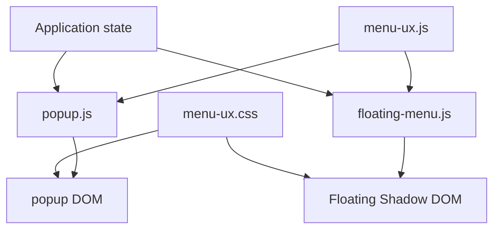
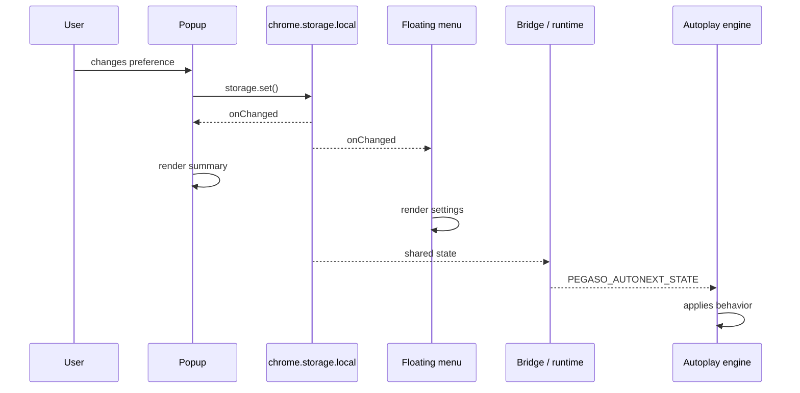

# 11 — UI without a framework

## Popup, floating menu, and synchronization

> **Reference snapshot for this chapter**  
> From Chapter 11 onward, the book moves from the v2.35.1 main snapshot used in Chapters 01–10 to the **v2.35.2 UI/UX candidate**, branch `feat/ui-ux-2.35.2`, commit `4d32a8c2a6cd291e4fe389bdf10fdbaf1856a8c2`. The branch manifest still displays `2.35.1` intentionally; the version bump is deferred until the release phase.

In the earlier chapters we studied the extension's engine: messaging, dynamic DOM, APIs, asynchrony, cache, autoplay, export, and the offline quiz editor. Now we turn to what the user directly sees.

PlumePilot has two main interfaces: the **toolbar popup** and the **floating menu** embedded in the LMS page. Over time they gained the same features at different speeds. A new action would first appear in the popup, later be requested in the floating menu, and then labels, styling, and preferences would slowly drift apart.

The v2.35.2 redesign addresses this as an **architecture and information-design problem**, not simply a CSS cleanup. Its goals are consistent meaning, fewer overwhelming screens, shared configuration behavior, preserved accessibility, and a predictable active-operation experience—without rewriting the stable autoplay engine.

---

# Part I — Two interfaces, one product

## 1. The problem is not duplicated HTML

It is tempting to blame the old interface on duplicated buttons and markup. But visual repetition is only a symptom: the popup and floating menu present the **same domain state** in different browser runtimes. The popup is an extension document, created when the toolbar icon opens and disposed of when it closes. The floating menu lives on the host LMS page. They cannot share mutable JavaScript globals or lifecycle assumptions.

A change to autoplay, course progress, an exam operation, or a layout preference must be reflected in both. The architectural question is therefore **how to keep the meaning of shared information consistent while preserving surface-specific controllers**.

---

## 2. Share the model, not necessarily the component

The 2.35.2 redesign introduces shared `menu-ux.js` and `menu-ux.css`, rather than replacing two independently working menus with one giant rendering function. The JavaScript module exposes `autoplayPresentation`, `bindCourseNavigation`, `bindExpansionScroll`, `ensureGamingFont`, `applyActionLayout`, and `bindLayoutEditor`.

An early comment defines the boundary: *"Presentation only: both menus keep their existing storage and operation owners."* The shared layer neither owns stored settings nor executes autoplay or exports. It converts state into consistent presentation and supplies reusable interaction behavior. That is a narrower and more maintainable responsibility than taking ownership of all popup and floating-menu logic.

The architecture is: shared application state flows into separate controllers; the controllers use shared presentation behavior and styles, then render into their respective DOM environments.

**Examples from the historical implementation:**

```js
PlumePilotMenuUx = {
  autoplayPresentation,
  bindCourseNavigation,
  bindExpansionScroll,
  ensureGamingFont,
  applyActionLayout,
  bindLayoutEditor,
};
```

```js
// Presentation only: both menus keep their existing storage and operation owners.
```



**Historical reference:** `menu-ux.js:269–270`; `menu-ux.js:24`

---

# Part II — State, view models, and rendering

## 3. The browser does not require a framework

With React, UI is often described as a function of state. With vanilla JavaScript, PlumePilot must explicitly read, assign, listen, and update. In `floating-menu.js`, `renderSettings()` sets individual control values from `settings`. On popup initialization, `popup.js` reads `chrome.storage.local` with defaults and populates controls.

There is no automatic reconciler: the developer decides **when** to render and **which nodes** to update. This is not necessarily poor architecture. It makes the work visible, but it also increases the need for clear state ownership and disciplined rendering functions.

**Examples from the historical implementation:**

```js
function renderSettings() {
  ...
  ui.autoplaySkipCompletedVideos.checked =
    settings.autoplaySkipCompletedVideos === true;
  ...
}
```

```js
chrome.storage.local.get(
  {
    enabled: true,
    stopAtTests: false,
    autoCompleteTests: false,
    ...
  },
  (result) => {
    checkbox.checked = result.enabled;
    ...
  },
);
```

**Historical reference:** `floating-menu.js:1079+`; `popup.js:1267–1334`

---

## 4. Persisted state and presentation state are different things

Saving a human-readable label such as "Skip completed videos · Stop at tests" would confuse presentation with domain state. The real source is a collection of preferences: whether completed videos are skipped, whether tests stop autoplay, whether a chapter limit is active, and whether the 70% threshold is armed.

The redesign formalizes that distinction with `autoplayPresentation()`. Given the underlying policy settings, the function returns a small **view model** containing `summary`, `testOverride`, and `stopHint`. Text displayed on screen is derived from state, not treated as authoritative state itself.

This separation also makes localization and testing easier: the data model and presentation language need not have the same structure.

**Examples from the historical implementation:**

```js
{
  autoplaySkipCompletedVideos: true,
  stopAtTests: true,
  autoCompleteTests: false,
  autoplayChapterLimitEnabled: true,
  autoplayStopAt70Enabled: true,
}
```

```js
function autoplayPresentation({
  skipCompleted = false,
  testBehavior = "ignore",
  limitEnabled = false,
  limit = 1,
  stopAt70 = false,
  thresholdBypassed = false,
} = {}) {
  ...
}
```

```js
{
  summary,
  testOverride,
  stopHint,
}
```

**Historical reference:** `menu-ux.js:25–42`

---

## 5. Derived state

Consider the rule in the historical implementation: when the chapter limit is enabled and the saved test policy is "stop", the effective behavior is temporarily interpreted as "ignore". The user has not necessarily changed or discarded the saved preference.

The UI must distinguish **stored intent** from **effective policy**. Otherwise it could announce "Stop at tests" while the autoplay engine is actually configured to skip that boundary under chapter-limit mode.

`autoplayPresentation()` therefore produces explanatory text via `testOverride`. The principle is broader: **an honest interface shows what the system will really do, not merely what one stored checkbox says**.

**Examples from the historical implementation:**

```js
const effectiveTestBehavior =
  limitEnabled && testBehavior === "stop"
    ? "ignore"
    : testBehavior;
```

```js
testOverride:
  limitEnabled && testBehavior === "stop"
    ? "Con il limite capitoli attivo, l’autoplay ignora i test ..."
    : ""
```

**Historical reference:** `menu-ux.js:27`

---

## 6. A pure function at the presentation boundary

`autoplayPresentation()` is useful because it does not touch the DOM, query storage, send messages, or mutate application globals. It receives a small object of policy inputs and returns display-ready values.

This is a classic **pure function** boundary. `tests/menu-ux.mjs` can assert its output directly in Node without starting Chromium, creating popup elements, or mocking the LMS. It demonstrates that even an imperative UI benefits from keeping its rules of meaning separate from its rendering effects.

**Examples from the historical implementation:**

```js
{
  skipCompleted,
  testBehavior,
  limitEnabled,
  limit,
  stopAt70,
  thresholdBypassed,
}
```

```js
assert.equal(
  autoplayPresentation().summary,
  "Tutti i video · Test ignorati",
);
```

**Historical reference:** `tests/menu-ux.mjs:7–18`

---

# Part III — Synchronization without a state manager

## 7. Two controllers, one persistent source

The popup and floating menu can be open simultaneously. If the user changes "Skip completed videos" in either surface, the other should update without direct communication between the two UI controllers.

The shared authoritative source is `chrome.storage.local`. Each controller writes the updated key through `chrome.storage.local.set(...)`, and each subscribes to `chrome.storage.onChanged`.

This is simpler and safer than inventing a separate popup-to-floating-menu messaging protocol for every preference. It also means either interface can be recreated later and still read the current value.

**Examples from the historical implementation:**

```js
chrome.storage.local.set({ [key]: value });
```

```js
chrome.storage.onChanged.addListener(...)
```

---

## 8. The popup as a subscriber

The popup listens for local storage changes, determines which keys changed, and updates only the relevant UI regions. For instance, changing `visualStyle` redraws the visual-style controls; changing `menuSize` updates the size selector; changing `floatingMenuLayout` updates the layout editor.

In reactive terminology, the model changes first and the view is subsequently updated. The implementation is **manual reactive synchronization**: ordinary callbacks replace the subscription/reconciliation machinery a framework might provide.

It is important that a subscription does not create a second owner of the data. The callback renders the new value but does not manufacture an unrelated truth.

**Examples from the historical implementation:**

```js
chrome.storage.onChanged.addListener((changes, area) => {
  if (area !== "local") return;
  ...
});
```

```js
if (changes.visualStyle)
  renderVisualStyle(changes.visualStyle.newValue);

if (changes.menuSize)
  renderMenuSize(changes.menuSize.newValue);

if (changes.floatingMenuLayout)
  renderFloatingMenuLayout(changes.floatingMenuLayout.newValue);
```

**Historical reference:** `popup.js:1370–1488`

---

## 9. The floating menu as a subscriber

The floating menu follows the same approach. Its storage-change listener merges updated keys from the declared defaults into its `settings` object and then selects the render operations affected by those keys.

It is effectively a **manual dependency graph**: preference A influences settings controls, preference B influences the theme, and the active operation influences relevant action buttons. The controller—not a global reactive framework—maintains those dependencies.

The value is consistency across surfaces. The cost is that the dependency graph must be kept up to date by the developer.

**Examples from the historical implementation:**

```js
chrome.storage.onChanged.addListener((changes, area) => {
  if (area !== "local") return;

  for (const key of Object.keys(defaults)) {
    if (changes[key])
      settings[key] = changes[key].newValue ?? defaults[key];
  }

  ...
});
```

**Historical reference:** `floating-menu.js:4588–4664`

---

## 10. Why not always call `renderEverything()`?

Calling one global render on every storage change would be simpler to write but more expensive to live with. It could rebuild unnecessary DOM, lose keyboard focus, reset `<details>` disclosure state, jump the scroll position, restart animations, overwrite temporary controls, and perform needless work.

PlumePilot instead uses **manual incremental rendering**. Updating a visual style should not force the operation banner, chapter list, and layout editor to be reconstructed.

Frameworks primarily make this dependency tracking more ergonomic. Without one, explicit selective rendering is a valid design provided the update contracts are clear.

**Examples from the historical implementation:**

```js
chrome.storage.onChanged.addListener(() => {
  renderEverything();
});
```

---

# Part IV — Navigation state

## 11. The redesign uses more than tabs

The 2.35.2 navigation divides the main UI into familiar areas—Course, Activities, Exams, Preferences, and Achievements. But within Course, autoplay configuration is no longer an always-visible wall of controls.

The common actions and a readable autoplay summary remain on the main surface. Detailed settings open in a dedicated secondary view. This is **progressive disclosure**: put frequent actions within easy reach while moving infrequent configuration behind a predictable interaction.

The features are not removed; the presentation hierarchy is changed to reduce cognitive load.

---

## 12. `bindCourseNavigation()`

The shared `bindCourseNavigation(root, scrollElement, onChange)` function finds the home view, detail view, opener, and back control through semantic `data-ux-*` attributes. On opening the detail view it records the current scroll position, hides home, shows detail, updates `aria-expanded`, scrolls to the top, and focuses the detail title without an unnecessary extra jump.

This is not merely toggling `hidden`. The transition includes visibility, scroll, focus, accessibility state, and a callback notifying the controller about the navigation change.

Its parameters allow the same behavior to work in the popup's document viewport and the floating panel's own scroll container.

**Examples from the historical implementation:**

```js
function bindCourseNavigation(root, scrollElement, onChange = () => {}) {
  const home = root.querySelector("[data-ux-home]");
  const detail = root.querySelector("[data-ux-detail]");
  const opener = root.querySelector("[data-ux-open]");
  const back = root.querySelector("[data-ux-back]");
  ...
}
```

```js
homeScroll = scrollElement?.scrollTop || 0;
home.hidden = true;
detail.hidden = false;
opener.setAttribute("aria-expanded", "true");
scrollElement.scrollTop = 0;
detail.querySelector("[data-ux-detail-title]").focus({ preventScroll: true });
```

**Historical reference:** `menu-ux.js:44–79`

---

## 13. Why preserve `homeScroll`?

Imagine scrolling halfway down Course, opening Autoplay Settings, then pressing Back. Returning to the very top technically works, but the user has lost their **spatial context**.

The shared controller stores `homeScroll` before opening the detail and restores `scrollElement.scrollTop` on return. This is a small piece of **navigation state**—distinct from domain state or a persistent preference.

Remembering the user's place helps the interface feel stable even when views are being conditionally shown and hidden.

**Examples from the historical implementation:**

```js
let homeScroll = 0;
```

```js
scrollElement.scrollTop = homeScroll;
```

---

## 14. Focus restoration

On closing the detail, the shared controller calls `opener.focus({ preventScroll: true })`. Mouse-only users may never notice. Keyboard and assistive-technology users depend on it.

Without restoring focus, keyboard interaction may resume at the document body or an unrelated control. With restoration, the user returns to the same button that opened the view.

This gives navigation a miniature state machine: `HOME → DETAIL → HOME`, with focus and scroll forming part of the transition contract.

**Examples from the historical implementation:**

```js
opener.focus({ preventScroll: true });
```

---

## 15. Escape as a transition

The shared navigation listener recognizes Escape only when the detail is open and `close()` succeeds. It prevents the default action and stops propagation after handling that transition.

Conceptually: `DETAIL --Escape--> HOME`.

This revisits Chapter 07 on state machines in a much smaller context. A keyboard event is not just a listener callback; it is an input that is meaningful only in a particular navigation state.

**Examples from the historical implementation:**

```js
if (event.key === "Escape" && close()) {
  event.preventDefault();
  event.stopPropagation();
}
```

**Historical reference:** `menu-ux.js:72–77`

---

# Part V — Tabs and accessibility

## 16. A tablist is a widget, not merely a row of buttons

The popup's navigation declares `role="tablist"` and the buttons use `role="tab"` with `aria-selected`. The implementation also manages `tabIndex` so only the active tab participates in ordinary Tab traversal.

This is commonly called **roving tabindex**. Other tabs are reached using directional keys rather than all becoming sequential Tab stops.

Declaring an accessible role creates behavioral obligations; it is not just a stylistic label. The popup must keep selected state, tab order, associated panels, and focus navigation consistent.

**Examples from the historical implementation:**

```html
<nav class="popup-tabs" role="tablist">
  <button role="tab" aria-selected="true" ...>Corso</button>
  <button role="tab" aria-selected="false" ...>Esami</button>
  ...
</nav>
```

**Historical reference:** `popup.html:34–39`

---

## 17. ArrowLeft, ArrowRight, Home, and End

The popup recognizes `ArrowLeft`, `ArrowRight`, `Home`, and `End` in tab navigation and computes which tab becomes active next. The pattern follows the WAI-ARIA expectations for a horizontal tablist.

Left/right move among tabs; Home/End navigate to the first/last tab. The code updates the corresponding focus and active state.

Accessibility is not achieved simply by adding `role="tab"`: the **keyboard interaction promised by that role** must also be implemented.

**Examples from the historical implementation:**

```js
if (!["ArrowLeft", "ArrowRight", "Home", "End"].includes(event.key))
  return;
```

```html
role="tab"
```

**Historical reference:** `popup.js:627–649`

---

## 18. ARIA does not implement behavior for us

A `role="tab"` attribute describes a component to accessibility APIs; it does not automatically handle arrow keys, change `aria-selected`, synchronize panels, or manage focus.

This is a general rule: **ARIA describes UI semantics; it does not write the interaction logic**. Correct accessibility is a combination of markup, state, keyboard behavior, and focus management.

**Examples from the historical implementation:**

```html
role="tab"
```

---

# Part VI — Scrolling in expanding panels

## 19. The deceptively simple scrolling bug

One concrete regression during the redesign was that expanding a settings group could reveal its content outside the visible area. Calling `panel.scrollIntoView()` everywhere would seem simple, but the popup and floating menu have different scroll containers and geometry.

The popup may scroll the document below a sticky header. The floating menu scrolls an internal Shadow DOM panel. The behavior must therefore be shared **and parameterized by surface geometry**.

A layout bug can thus reveal a missing abstraction, rather than merely a wrong margin.

**Examples from the historical implementation:**

```js
panel.scrollIntoView();
```

---

## 20. `bindExpansionScroll()`

This shared helper receives the root element, the scroll container, and a layout callback. It distinguishes document scrolling from scrolling an element by comparing against `document.scrollingElement`.

It then calculates the usable viewport and, for the popup, accounts for the sticky header when deciding where an expanded element should appear. This is **geometry-aware UI** rather than a blind call to `scrollIntoView()`.

A shared algorithm can operate on different surfaces without assuming the same scroll origin.

**Examples from the historical implementation:**

```js
(root, scrollElement, onLayout)
```

```js
const isDocument = scrollElement === document.scrollingElement;
const viewport = isDocument
  ? { top: 0, bottom: window.innerHeight }
  : scrollElement.getBoundingClientRect();
```

```js
const header = isDocument
  ? root.querySelector(".popup-sticky-header")
  : null;
```

**Historical reference:** `menu-ux.js:81–135`

---

## 21. Not everything that opens should cause scrolling

The helper listens in the capture phase, observing user intent before native `<details>` behavior has completed. But it distinguishes intentional user-triggered opening from restoration and closing.

A source comment explicitly states: *"Only user-triggered openings scroll; restoration and closing do not."* Otherwise restoring a previously expanded section could unexpectedly move the user's viewport.

The lesson is that UI effects often require an **intent guard**, not merely observing that a DOM state changed.

**Examples from the historical implementation:**

```js
root.addEventListener("click", ..., true);
```

```js
// Only user-triggered openings scroll; restoration and closing do not.
```

**Historical reference:** `menu-ux.js:106–107`

---

## 22. Animations and timing

If a panel animates open, measuring its geometry immediately can capture an intermediate frame. The implementation uses `requestAnimationFrame()`, waits for relevant animation completion with `Promise.allSettled(animations.map(animation => animation.finished))`, and uses another animation frame before final positioning.

Conceptually: user opens → layout changes → animation settles → measure → reveal.

This is the asynchronous timing model from Chapter 05 applied to layout. The DOM may be present before its final visual geometry is stable.

**Examples from the historical implementation:**

```js
requestAnimationFrame(...)
```

```js
Promise.allSettled(
  animations.map(animation => animation.finished)
)
```

```js
requestAnimationFrame(...)
```

**Historical reference:** `menu-ux.js:124–132`

---

## 23. `prefers-reduced-motion`

The scroll behavior checks the user's motion preference through `window.matchMedia("(prefers-reduced-motion: reduce)")`. If reduced motion is requested, the helper uses automatic rather than smooth scrolling.

The ability to reveal content remains available. Only the animation is reduced.

Accessibility here changes an effect without removing the underlying function.

**Examples from the historical implementation:**

```js
behavior:
  window.matchMedia("(prefers-reduced-motion: reduce)").matches
    ? "auto"
    : "smooth"
```

**Historical reference:** `menu-ux.js:103–104`

---

# Part VII — Customization as a data schema

## 24. Button layout as persistent state

The customization feature deliberately retains the historical storage key `floatingMenuLayout`, even though version 2.35.2 applies the saved layout to **both** menus.

Renaming the key would require a migration without delivering an obvious product benefit. Keeping it is a conscious compatibility choice and a reminder that old naming sometimes survives a broader refactor.

The persisted value models order and visibility; it is not just a CSS preference.

**Examples from the historical implementation:**

```js
const STORAGE_KEY = "floatingMenuLayout";
```

**Historical reference:** `floating-menu-layout.js:4`

---

## 25. The schema

The stored layout is versioned and contains an ordered `items` array. Each entry has a stable `id` and a `visible` Boolean.

The array order defines display order; the Boolean defines whether the action appears by default. Storing a normalized representation makes it possible for popup and floating menu to interpret the same customization independently.

This is a small, concrete data schema underpinning what users experience as dragging and hiding buttons.

**Examples from the historical implementation:**

```js
{
  version: 1,
  items: [
    { id: "complete-tests", visible: true },
    { id: "complete-objectives", visible: true },
    { id: "test-collection", visible: true },
    { id: "study-materials", visible: true },
  ],
}
```

**Historical reference:** `floating-menu-layout.js:4–15`

---

## 26. Why IDs matter more than labels

Users see localized names such as "Complete tests" or "Course materials". Storage retains stable action IDs such as `complete-tests` and `study-materials`.

Labels may change because of translation, product terminology, or UI copy refinements. Changing them should not invalidate a user's saved layout.

This repeats a recurring architectural rule: **stable logical identity must not depend on presentation text**.

---

## 27. `normalizeLayout()` as a small schema migration

The normalizer constructs a lookup of saved entries, rejects malformed values, unknown IDs, and duplicates, and appends any newly introduced actions that are missing from old layouts.

Imagine a new `new-action` introduced after a user customized the previous version. The user should not lose their layout; the new action can be added in a deterministic position.

This is a lightweight form of schema evolution. The reader accepts supported older structures and produces one current representation.

**Examples from the historical implementation:**

```js
const savedById = new Map();
```

```js
{ id: "new-action", ... }
```

**Historical reference:** `floating-menu-layout.js:17–37`

---

## 28. Global ordering versus semantic groups

The old layout customization could be understood as nearly arbitrary ordering. The new interface introduces fixed semantic groups such as completion actions and material operations.

`groupFor(id)` maps action IDs into those groups. Dragging is allowed **within** a group rather than across unrelated groups. This slightly constrains freedom but preserves visual and conceptual coherence.

The product deliberately prioritizes a comprehensible information architecture over every theoretical permutation.

**Examples from the historical implementation:**

```js
const groupFor = id =>
  ["complete-tests", "complete-objectives"].includes(id)
    ? "completion"
    : "materials";
```

**Historical reference:** `menu-ux.js:162`

---

## 29. Constraints belong to design

A layout editor need not allow every possible arrangement. PlumePilot permits reordering and visibility within a documented policy, while preserving semantic grouping and access to active operations.

This is **constrained customization**: the user controls many presentation details, but the product still enforces meaningful invariants.

Constraints are not automatically a failure of flexibility; they can prevent configurations that are confusing or operationally unsafe.

---

# Part VIII — UI invariants

## 30. An active operation must not become invisible

Suppose the user hides the Course Materials button and then a materials export is still running. Blindly honoring the hidden preference would conceal the only relevant progress or cancellation control.

Version 2.35.2 defines a UI invariant: **an action associated with an active operation remains visible, even if the saved layout says it should be hidden**.

This illustrates the difference between user preference and operational safety. Saved visibility is a default, not the final authority when it would make a running job uncontrollable.

---

## 31. `applyActionLayout()`

The shared helper determines the action corresponding to `operation?.kind`. Its visibility rule is essentially: hide an item only if the user disabled it **and** it is not the active operation's action.

The implementation therefore includes the predicate `!item.visible && item.id !== activeItem`.

That one line embeds a product-level invariant in the presentation layer: customization may hide idle actions but may not make the current work disappear.

**Examples from the historical implementation:**

```js
const activeItem = operationItems[operation?.kind];
```

```js
node.hidden = !item.visible && item.id !== activeItem;
```

**Historical reference:** `menu-ux.js:137–155`

---

## 32. The cancellation path is a safety property

Export, Turbo Test, and Objectives operations can span asynchronous stages. Users must retain a way to see and stop an active operation when cancellation is supported.

Treating cancellation controls merely as optional decoration would be a mistake. Losing access to the controlling action violates a **UI safety invariant**.

The layout algorithm must protect the cancellation path even while applying custom ordering and visibility.

---

## 33. Automatically expand the active group

Keeping a button technically unhidden is not sufficient if its enclosing disclosure group is collapsed. When operations such as `turbo` or `objectives` are active, the appropriate group opens automatically.

This is a second layer of the same invariant. A control should be not only present in the DOM but **reachable in the visible hierarchy**.

Effective visibility combines element visibility, ancestor disclosure state, focus, and layout.

**Examples from the historical implementation:**

```js
if (
  group.dataset.menuGroup === "completion" &&
  ["turbo", "objectives"].includes(operation?.kind)
)
  section.open = true;
```

**Historical reference:** `menu-ux.js:151–154`

---

# Part IX — Focus inside a layout editor

## 34. Rerendering and focus

`bindLayoutEditor()` rebuilds its rows through `list.replaceChildren(...rows)`. When DOM nodes are replaced, the currently focused button may disappear.

The helper first records the focused control's logical action ID and direction, then after rendering finds the equivalent new node and calls `focus({ preventScroll: true })`.

Without this recovery, a keyboard user might lose their position after every Up/Down reordering action. The act of rendering is itself a potential state transition that must preserve focus meaning.

**Examples from the historical implementation:**

```js
list.replaceChildren(...rows);
```

```js
const focused = list.getRootNode().activeElement;
const focusedId = ...;
const focusedDirection = ...;
```

```js
focus({ preventScroll: true });
```

**Historical reference:** `menu-ux.js:208`; `menu-ux.js:163–214`

---

## 35. Identity-based focus recovery

The technique mirrors the DOM recovery in Chapter 03: do not hold on to a dead node and hope it remains valid.

Instead, remember a **logical identity**—action ID plus which direction button had focus—then locate its new representation after the DOM has been rebuilt.

The broader pattern is: preserve identity → replace DOM → resolve equivalent element → restore focus. The same concept appears in autoplay lesson recovery and in dynamic-page automation.

---

# Part X — Popup and floating menu have different DOM trees

## 36. Semantic convergence

Popup and floating menu still have different markup. The popup contains HTML in its own extension document; `floating-menu.js` creates menu markup from a template within the LMS page.

The redesign does not require byte-for-byte identical DOM trees. It gives both trees a shared vocabulary of attributes such as `data-ux-home`, `data-ux-detail`, and `data-ux-open`.

These attributes form a small **DOM protocol**: the behavior helpers depend on shared semantics, not on identical nesting or class names.

**Examples from the historical implementation:**

```html
<section class="autoplay-section ux-group">
  <h2 class="ux-heading">Autoplay</h2>
  ...
  <button data-ux-open>Impostazioni autoplay</button>
</section>
```

---

## 37. Data attributes as an interface between markup and behavior

Selectors based on incidental structure—such as deeply nested `nth-child` paths—are fragile. A shared helper searching for `[data-ux-home]` instead communicates that the element has a deliberate navigation role.

A `data-*` attribute can act as an interface contract between HTML structure and JavaScript behavior. Each surface may implement that interface using different markup.

This is analogous to depending on stable methods in a software interface rather than a consumer reaching into another component's private implementation.

**Examples from the historical implementation:**

```css
.popup-course-autoplay-weird-wrapper > div:nth-child(2)
```

```js
root.querySelector("[data-ux-home]")
```

---

## 38. Why not extract everything into `renderMenu()`?

A single markup generator for both menus may sound attractive, but each surface still differs in lifecycle, root document, scroll container, available screen space, event coordination, and integration with host or extension UI.

A monolithic `renderMenu(surface, mode, ...)` would accumulate conditional behavior until it became harder to maintain than two controllers.

The chosen middle ground is deliberate: **share rules of meaning, shared design tokens, and reusable interaction helpers; retain surface-specific controllers and DOM trees**. It reduces duplication of knowledge without forcing unrelated implementation details into one abstraction.

---

# Part XI — Shadow DOM as a boundary

## 39. Why the floating menu uses Shadow DOM

The floating menu is injected into the LMS page. Without an encapsulation boundary, host styles such as global rules for `button` or common classes could collide with PlumePilot styles. Conversely, extension selectors might accidentally affect the page.

The menu therefore creates a ShadowRoot through `host.attachShadow({ mode: "closed" })`. Its descendants belong to a separate styling and DOM boundary. This reduces accidental interference between the host application and the extension UI.

The popup does not face the same problem: it already runs as its own extension document.

**Examples from the historical implementation:**

```css
.button { ... }
```

```js
const shadow = host.attachShadow({ mode: "closed" });
```

**Historical reference:** `floating-menu.js:1922–1931`

---

## 40. Closed ShadowRoot

With `mode: "closed"`, outside code cannot normally retrieve the root through `host.shadowRoot`, which evaluates to `null`. That does not prevent the code that created the root from retaining and using its `shadow` reference.

The distinction is between access through the host element's public property and access through a reference the creator already holds. Both cases must be understood when designing a menu controller.

Closing the root is an encapsulation preference, not a magic isolation mechanism.

**Examples from the historical implementation:**

```js
mode: "closed"
```

```js
host.shadowRoot.querySelector(...)
```

```js
host.shadowRoot === null
```

```js
const shadow = host.attachShadow(...);
```

---

## 41. Encapsulation is not security

Shadow DOM primarily encapsulates DOM structure, selectors, and style behavior. It is **not a security boundary for secrets** or authorization.

A closed root makes internals less conveniently accessible through `shadowRoot` but does not justify storing confidential tokens there. Security depends on browser execution contexts, message validation, credential handling, and proper trust boundaries, as discussed in earlier chapters.

Use Shadow DOM to prevent integration collisions, not as an authentication mechanism.

---

## 42. Shared CSS must be loaded in both worlds

The popup can include `menu-ux.css` directly through an extension-document stylesheet link. The floating menu, however, needs the same CSS loaded **inside its ShadowRoot**.

The menu markup contains a URL placeholder that the controller replaces with `chrome.runtime.getURL("menu-ux.css")`. Because the stylesheet is requested from a page-embedded context, the extension also declares appropriate `web_accessible_resources` in its manifest.

A seemingly small CSS refactor thus crosses multiple architectural layers: resource packaging, manifest permissions, document lifecycle, and shadow-root rendering.

**Examples from the historical implementation:**

```html
<link rel="stylesheet" href="menu-ux.css">
```

```html
<link rel="stylesheet" href="__PP_MENU_UX_CSS__">
```

```js
chrome.runtime.getURL("menu-ux.css")
```

```json
web_accessible_resources
```

**Historical reference:** `popup.html:14–16`; `floating-menu.js:3648
floating-menu.js:3886–3888`; `manifest.json:56–88`

---

# Part XII — Design tokens without a design-system framework

## 43. CSS custom properties as a contract

`menu-ux.css` establishes tokens including `--ux-font`, `--ux-copy-size`, `--ux-action-size`, `--ux-surface`, `--ux-muted`, and `--ux-accent`.

Rather than scattering hard-coded sizes and colors across unrelated selectors, each role can consume shared semantic variables. A setting title and a checkbox label may use the same typography token even though their DOM structures differ.

These CSS variables become a **design contract** across popup and floating menu. Themes and sizes can then alter token values instead of rewriting every component's rules.

**Examples from the historical implementation:**

```css
--ux-font
--ux-copy-size
--ux-action-size
--ux-surface
--ux-muted
--ux-accent
```

```css
font-size: 12px;
```

**Historical reference:** `menu-ux.css:1+`

---

## 44. Role-based typography

Earlier regressions showed mismatched text sizing in the floating menu—for instance labels for autoplay session limits or chapters not following the same scale as other controls.

The 2.35.2 fix does not assign arbitrary individual font sizes to the two offending labels. It defines groups of elements with a shared **typographic role**, using selectors that apply `font-size: var(--ux-copy-size)`.

This addresses the common cause. Future labels inheriting the same role will also benefit from the shared rule.

**Examples from the historical implementation:**

```css
:is(
  .ux-setting-title,
  .toggle-row > span,
  .chapter-limit-row,
  .test-choice-list label,
  ...
) {
  font-size: var(--ux-copy-size);
}
```

**Historical reference:** `menu-ux.css:80–95`

---

## 45. Design token versus component

A design system does not inherently require React or a reusable JSX component library. It can start with semantic spacing, typography, colors, grouping rules, and a small set of common behaviors.

Version 2.35.2 builds a lightweight shared design layer rather than introducing a full component framework. This is proportional to the existing codebase and easier to adopt incrementally.

---

# Part XIII — Fonts and Shadow DOM

## 46. An apparently aesthetic bug reveals architecture

The Gaming theme uses the Pixelify Sans typeface. Loading it inside the popup is straightforward, but Chromium's behavior with isolated `@font-face` declarations inside the floating ShadowRoot did not always provide the expected font registration.

The refactor adds `ensureGamingFont(document, url)` as an explicit font-loading helper. The problem began as a visual inconsistency yet reached the boundary between shadow-root CSS and the document's font registry.

Visual bugs can expose runtime constraints, not only poorly chosen CSS.

**Examples from the historical implementation:**

```js
function ensureGamingFont(document, url) {
  ...
}
```

**Historical reference:** `menu-ux.js:4–22`

---

## 47. The CSS Font Loading API

The helper fetches the font as an `ArrayBuffer`, creates a `FontFace` object with `new document.defaultView.FontFace("Pixelify Sans", bytes, ...)`, loads it, and registers it in the document's `FontFaceSet`.

This shifts from depending exclusively on CSS `@font-face` to explicitly loading a resource through the **CSS Font Loading API**. That is useful when document and Shadow DOM behavior diverge.

The font asset remains part of the extension. The helper only changes the reliable registration path.

**Examples from the historical implementation:**

```js
fetch(url)
  .then(response => response.arrayBuffer())
  .then(bytes =>
    new document.defaultView.FontFace(
      "Pixelify Sans",
      bytes,
      { style: "normal", weight: "400 700" },
    ).load()
  )
  .then(font => {
    document.fonts.add(font);
  });
```

---

## 48. Why `WeakMap`?

The module declares `const gamingFonts = new WeakMap()`. Each document is used as a key; the corresponding value tracks its pending or completed font-loading Promise.

This deduplicates work for a document without turning the cache into a global strong reference to every document it has ever seen. A `WeakMap` does not keep an otherwise unreachable object key alive.

Unlike the string-keyed API cache in Chapter 06, this is an appropriate case for object-identity keys and weak retention. The choice of data structure follows ownership and lifetime.

**Examples from the historical implementation:**

```js
const gamingFonts = new WeakMap();
```

---

# Part XIV — Operation state in the UI

## 49. Operation state crosses every surface

Chapter 06 introduced persisted `pegasoActiveOperation` as coordination state. In the floating menu it is read into `settings.pegasoActiveOperation` and interpreted through derived variables such as `busy = Boolean(operation)`.

Each action decides whether it should show a normal label, busy state, cancellation affordance, disabled condition, or status message. Turbo Test and materials export may require different presentation.

The UI does not invent an operation: it projects one that is owned by the background coordination layer.

**Examples from the historical implementation:**

```js
const operation = settings.pegasoActiveOperation;
const busy = Boolean(operation);
```

**Historical reference:** `floating-menu.js:1233–1246`

---

## 50. Render as a function of operational state

A button does not **own** the export or Turbo operation; it **represents** that operation. This difference is critical.

A dangerous anti-pattern would be to set a button's text to "Working..." and then treat that text as evidence that a job exists. The better model is the opposite: read the operation record, derive the button's label and availability, and update the DOM accordingly.

**UI state should not become an accidental second source of truth.** This rule also protects against popup destruction or floating-menu recreation during an operation.

---

## 51. The operation banner as a contextual shortcut

The popup includes an `activeOperationBanner` button. Clicking it selects the relevant tab, scrolls to the associated action, and focuses that control.

The banner is therefore more than a notification. It is an **internal deep link** from global operation status to the place where the user can inspect or control the job.

It helps preserve access to long-running operations even when the user navigates elsewhere in the popup.

**Examples from the historical implementation:**

```html
<button id="activeOperationBanner" ... hidden></button>
```

```js
selectPopupTab(operationTabId(activeOperation), true);
...
button.scrollIntoView({ block: "nearest" });
button.focus();
```

**Historical reference:** `popup.html:42`; `popup.js:652–660`

---

# Part XV — Progressive disclosure and information architecture

## 52. Reduce overwhelm without removing capabilities

The feedback that motivated version 2.35.2 was simple: the Course surface contained too many visible options at once. A superficial response would be to delete or hide useful features.

Instead, the redesign changes the **information hierarchy**. Common actions remain near the entry point; specialized configuration is grouped, summarized, and moved into a secondary view.

This is an information-architecture decision rather than an argument that PlumePilot had too many capabilities.

---

## 53. Frequency and depth

Frequently used actions—starting or stopping a workflow, generating materials, finding incomplete activity—should remain quick to reach. Detailed controls such as autoplay test behavior or chapter limits can live one level deeper if the current configuration is still visible.

A practical heuristic is: **the more often and urgently an action is needed, the less navigation should be required to reach it**.

This is especially important for cancellation and for operations whose current state changes while the user is looking at another part of the interface.

---

## 54. Hidden does not mean unreachable

Progressive disclosure succeeds only when users can locate a setting, understand the current effective mode, open the details, and return without losing context.

PlumePilot shows an autoplay summary before the user opens advanced settings. That reduces the informational cost of navigation depth.

Without the summary, a hidden detail view could conceal a setting that materially changes what autoplay will do next. The summary keeps the underlying behavior legible.

---

# Part XVI — Good and bad duplication

## 55. DRY does not mean one line of code

The popup and floating menu still have some similar markup, event handlers, and rendering logic. One could conclude that all duplication must be eliminated.

But identical-looking syntax does not always represent identical responsibility. The two surfaces have different lifecycles, scroll models, access to the host page, and root containers.

The important goal is not the smallest codebase measured in lines. It is minimizing the places where the **same rule of meaning** can diverge.

---

## 56. Duplication of knowledge

The dangerous kind of duplication is storing two independent implementations of one domain or presentation rule. For example, if the popup and floating menu calculate the effective autoplay test policy differently, a user can receive contradictory explanations.

Version 2.35.2 extracts rules that **must agree**: autoplay summaries, navigation semantics, expansion scrolling, layout normalization, visibility policy, and typography roles.

This reduces **duplication of knowledge**, which is more valuable than removing every repeated DOM statement.

---

## 57. Surface-specific duplication may be acceptable

Two controllers may be clearer than one giant abstraction when their host environments differ substantially.

A useful separation is: **share invariants and interpretation; duplicate surface-specific wiring when it expresses genuinely distinct responsibilities**.

In PlumePilot, one controller belongs to the popup document and the other belongs to a ShadowRoot embedded in the LMS page. Sharing everything would blur the lifecycle boundaries we intentionally keep separate.

---

# Part XVII — The cost of vanilla DOM

## 58. Without a framework, every detail is visible

Vanilla DOM code directly manages `hidden`, `aria-selected`, `aria-expanded`, `tabIndex`, `focus()`, `scrollTop`, `getBoundingClientRect()`, event listeners, storage subscriptions, selective rerendering, ordering, drag-and-drop, media queries, and Shadow DOM.

That is educationally valuable. We see precisely how state becomes behavior and markup.

Frameworks do not abolish these concerns; they encapsulate or coordinate many of them. Understanding the underlying browser primitives makes framework use more informed as well.

---

## 59. The primary risk: state drift

Without a declarative `UI = render(state)` boundary, it is easier for one event handler to update a checkbox while forgetting a summary, banner, or disabled state elsewhere.

This is **state drift**: two representations of the same fact no longer agree.

Aggregated render functions and shared derived-state helpers reduce the risk by bringing related updates through known entry points. Manual DOM code requires explicit attention to that dependency discipline.

**Examples from the historical implementation:**

```js
UI = render(state)
```

---

## 60. Render functions as mini-components

Even without JSX, functions such as `renderSettings()`, `renderOperationState()`, and related UI helpers behave like procedural components.

Instead of returning a new component tree, they mutate existing elements according to the current state. Their responsibilities can still be named, bounded, and tested.

A component architecture is a way of organizing responsibility, not a feature exclusive to JSX or any framework.

**Examples from the historical implementation:**

```js
return <OperationBanner ... />
```

---

# Part XVIII — CSS specificity and legacy styles

## 61. A UI refactor must coexist with legacy code

`menu-ux.css` enters a codebase that already has many historical popup and floating-menu rules. A new selector such as `.ux-heading` does not automatically override every earlier declaration.

Older rules may have higher specificity or be scoped to menu sizes and themes. The browser's CSS cascade determines which declaration actually wins.

A design-token migration must therefore be validated against the existing cascade, not just against a clean isolated CSS example.

**Examples from the historical implementation:**

```css
.ux-heading {
  font-size: var(--ux-action-size);
}
```

```css
html[data-menu-size="small"] .some-old-control { ... }
```

---

## 62. Specificity as a migration problem

The shared stylesheet even documents that root-level selector specificity is used to stop older size-specific rules from overriding the shared scale.

This reminds us that CSS also carries a form of **legacy compatibility**. Introducing a common style system into a mature extension requires understanding precedence, inherited values, shadow-root boundaries, and the scope of older selectors.

The aim is not to win specificity wars indefinitely. It is to make intended precedence explicit during the transition.

**Examples from the historical implementation:**

```css
Root specificity keeps old size-specific rules from overriding the shared scale.
```

**Historical reference:** `menu-ux.css:65+`

---

# Part XIX — Real responsive constraints

## 63. The narrow Preferences tab

With four navigation tabs, the Italian label "Preferenze" had too little room in the floating menu. Simply shrinking that word's font was not a convincing solution because the underlying layout constraint would remain.

The CSS instead uses `grid-template-columns: repeat(4, auto)` for the four-tab configuration. The columns can better accommodate their actual labels.

This is a small example of **constraint-based layout**: solve the allocation of space rather than patching an individual piece of text.

**Examples from the historical implementation:**

```css
:host .menu-tabs[data-count="4"] {
  grid-template-columns: repeat(4, auto);
}
```

**Historical reference:** `menu-ux.css:58`

---

## 64. Responsiveness is more than media queries

Interfaces also need to respond to menu size, number of tabs, theme, language length, user customization, viewport shape, and scroll-container geometry.

Attributes such as `data-menu-size` and `data-count` act as inputs to those layout rules. Responsive behavior is therefore driven by the **state and constraints of the component**, not just the width of the browser window.

---

# Part XX — Testing shared UI

## 65. Pure functions are the easiest test level

`autoplayPresentation()` can be tested directly in Node with known inputs and expected outputs. It verifies policy interpretations, summaries, and overrides without mounting a browser or host page.

This is fast, deterministic, and valuable for catching meaning-level regressions before looking at screenshots or DOM behavior.

---

## 66. Structural tests

`tests/menu-ux.mjs` also reads relevant HTML/JS resources and checks structural invariants—for example, that the home view appears before the autoplay detail view and that expected shared navigation hooks exist.

These tests are a useful middle layer between unit tests of pure values and full browser integration tests. They cannot prove that focus and scrolling work, but can catch accidental removals of required markup contracts.

**Historical reference:** `tests/menu-ux.mjs:22–46`

---

## 67. Browser fixture

The redesign documentation also describes a Chromium browser fixture running the real UI controllers with simulated storage.

It covers shared navigation, Back/Escape, focus behavior, bidirectional synchronization, policy summaries and overrides, cancellation access, checkbox/radio accents, typography, Gaming font loading, disclosure scrolling, spacing in the Exams surface, clipping, and runtime exceptions.

This tests the **interaction system**, not merely the HTML source. A controlled fixture can reproduce states that would be awkward or risky to require from the live LMS during every regression run.

**Historical reference:** `docs/features/menu-ux-2.35.2.md:48–53`

---

## 68. Why a screenshot is not enough

A screenshot can reveal visual spacing, font scale, color, clipping, and whether content is on screen at one moment.

It cannot prove that arrow keys work in a tablist, that Escape restores focus, that another surface receives storage changes, that a hidden active operation remains reachable, or that expansion scrolling waits for the correct layout.

A UI has **behavior**, not only pixels. Both forms of testing matter.

---

# Part XXI — UI architecture as data flow

## 69. The complete flow of one preference

Consider a user toggling "Skip completed videos" in the popup. The controller writes the corresponding key with `chrome.storage.local.set(...)`. That storage value becomes the shared authoritative preference.

`chrome.storage.onChanged` notifies other extension contexts. Each controller updates its own settings representation, recalculates derived presentation, and rerenders affected controls. The bridge and content-side autoplay engine receive the effective settings and apply the new behavior.

Thus the checkbox is only one entry point in a larger data flow: **user action → persisted state → subscriptions → presentation → runtime policy**.

**Examples from the historical implementation:**

```js
chrome.storage.local.set(...)
```

---

## 70. Sequence diagram

The full sequence makes one principle clear: **the popup and floating menu do not need to synchronize directly with each other**. Both communicate through shared storage and project-specific configuration propagation.

The diagram follows a popup preference change to storage, then to each UI view and finally through the bridge into the autoplay runtime.

**Examples from the historical implementation:**



---

# Part XXII — UI as a projection, not a database

## 71. The DOM is not the source of truth

Reading `checkbox.checked` tells us what that checkbox currently displays. It does not prove that this is the latest authoritative state.

The popup might have just opened; another surface might have written a new preference; or a policy change may make the effective runtime behavior differ from the stored checkbox.

The DOM is a **representation of application state**. For persisted preferences, `chrome.storage.local` is the shared source, with derived state computed as necessary. This reconnects our UI chapter to the DOM limitations studied in Chapter 03.

**Examples from the historical implementation:**

```js
checkbox.checked
```

---

## 72. UI-local state

Some state genuinely belongs only to the current UI instance: which detail view is open, the current scroll position, keyboard focus, an expanded temporary editor row, or a transient drag operation.

Persisting all of these in `chrome.storage.local` would create needless coupling and unexpected restoration behavior.

Chapter 06 provided the rule: **match state lifetime and scope to what the data actually represents**. A focused button usually need not survive a browser restart.

---

# Part XXIII — A backend analogy

## 73. Two frontends for the same backend

For a backend developer, the popup and floating menu can be thought of as two frontends for the same underlying application service.

A web administration console and a mobile client can use the same API while rendering very different interfaces. We would not demand identical markup, but we would demand shared rules for permissions, operation status, settings, and data interpretation.

Similarly, PlumePilot's controllers may differ in HTML and layout while agreeing on their view of the same persisted state.

---

## 74. `menu-ux.js` as a shared presentation service

The shared module acts like a small application/presentation service: it derives summaries, normalizes action layouts, handles navigation behavior, and helps keep interaction rules consistent.

It does **not** own the persistent database, autoplay engine, or export workflows. It accepts inputs and produces presentation outcomes.

That narrower boundary limits coupling and makes it easier to test what should be shared without forcing a single interface tree.

---

# Part XXIV — What would a framework do?

## 75. Would React or Vue have solved everything?

No. A framework would probably simplify declarative rendering, component reuse, conditional UI, local state propagation, lifecycles, and DOM reconciliation.

But the team would still need to design the shared source of truth, storage schema, saved-versus-effective settings, operational invariants, information architecture, accessibility, focus restoration, Shadow DOM integration, and synchronization among extension contexts.

A framework helps implement a UI architecture. It does not choose the architecture or its product rules for us.

---

## 76. When would a framework make sense?

If the interface grew substantially—with many independent interactive views, deep conditional rendering, increasingly tangled manual updates, and frequent state-drift regressions—a framework could lower coordination costs.

The migration would also impose costs: bundling, build tooling, store-review considerations, extension compatibility, a new abstraction to understand, and possible regressions in existing behavior.

For PlumePilot at this snapshot, vanilla JavaScript remains a defensible trade-off. The right evaluation is based on **total maintenance cost**, not fashion.

---

# Part XXV — A possible evolution without a framework

## 77. Before React: an explicit ViewModel

A future improvement could extract one `deriveMenuViewModel(state, courseContext)` function that produces settings summaries, operation visibility, course actions, and other display-ready information.

The popup and floating-menu adapters would consume the same ViewModel while rendering different DOM. This would reduce duplication of **knowledge** further without forcing both surfaces to share markup.

The provided function is a **possible design sketch**, not current application code.

**Examples from the historical implementation:**

```js
function deriveMenuViewModel(state, courseContext) {
  return {
    autoplay: {
      enabled: ...,
      summary: ...,
      canFindIncomplete: ...,
    },
    operations: ...,
    progress: ...,
    preferences: ...,
  };
}
```

---

## 78. Surface adapters

We could imagine `renderPopup(viewModel)` and `renderFloatingMenu(viewModel)` as distinct adapters.

The shared model would determine which action is available, why it is disabled, what the autoplay summary means, and what operation is active. Each adapter would decide where and how to display that information in its own document or ShadowRoot.

This is similar to the platform-specific DOM adapters from Chapter 03: **share the domain meaning; specialize the environment-dependent representation**.

---

# Part XXVI — Real bugs as UI lessons

## 79. Checkboxes with inconsistent colors

The problem was that semantically equivalent checkboxes and radio controls displayed different accent colors. The fix should not be to patch one particular input in isolation.

The shared CSS instead defines consistent roles and selectors based on `data-menu-size` and input type. The lesson is: **when several visual bugs share a cause, fix the shared role rather than each individual element**. Historical reference: `menu-ux.css:69+`.

**Historical reference:** `menu-ux.css:69+`

---

## 80. Spacing before “Clear exam data”

One item of feedback was simply that the text and the "Clear exam data" button were too close together.

A local rule such as the selector below is sufficient here. Not every UI problem calls for a broad abstraction. The useful judgment is distinguishing a systemic inconsistency from a **legitimate local spacing rule**. Historical reference: `menu-ux.css:99`.

**Historical code example:**

```css
[data-action="clear-commission-data"] {
  margin-top: 12px;
}
```

**Historical reference:** `menu-ux.css:99`

---

## 81. The narrow “Preferences” label

Four navigation tabs, labels of different lengths, and a panel with a limited width created a layout constraint. The Italian word "Preferenze" was visibly cramped.

The correct fix addresses how the tablist allocates space, not merely the typography of one word. This is why the four-column layout was revised rather than forcing every label into an equal-width slot regardless of its length.

---

## 82. Automatic expansion and scrolling

This regression was a behavior problem, not primarily a CSS problem. A `<details>` panel could open successfully but still produce a poor experience if its newly revealed content remained outside the viewport.

The distinction is simple: **DOM correctness is not identical to interaction correctness**. The relevant test must actually open a disclosure group and verify that its content becomes visible at the intended scroll position.

---

# Part XXVII — Redesign invariants

## 83. Useful invariants

The redesign can be summarized through seven properties:

**I1 — Shared information architecture.** Popup and floating-menu destinations should correspond semantically.

**I2 — Shared autoplay policy representation.** The two surfaces should use the same derived summaries and override explanations.

**I3 — Shared action customization.** Both use `floatingMenuLayout` and the same normalization rules.

**I4 — Active work remains controllable.** A running operation must retain a visible, reachable control and cancellation path when supported.

**I5 — Different presentation does not mean different domain state.** Neither surface should become a competing source of truth.

**I6 — Focus must remain predictable.** Opening a detail focuses its title; closing it returns focus to the opener.

**I7 — The host page must not be disturbed.** Scrolling inside the floating menu must not unexpectedly scroll the LMS page.

These invariants are more durable than a screenshot. They describe behavior that future refactors must preserve.

---

# Part XXVIII — An architectural reading

## 84. Before the refactor

Conceptually, the old architecture looked like two independent UI controllers:

```text
Popup controller ── UI rules A

Floating controller ── UI rules B
```

Over time A and B grew similar but not necessarily identical. This is the kind of drift that occurs when the same capability is independently implemented across multiple surfaces.

The problem was not that both had their own controllers. It was that important shared interpretations were duplicated.

---

## 85. After the refactor

The new architecture inserts a thin shared presentation layer between application state and the two surfaces:

```text
           shared presentation
           menu-ux.js / .css
                │
        ┌───────┴────────┐
        │                │
    popup.js      floating-menu.js
        │                │
        └───────┬────────┘
                │
      chrome.storage +
       runtime/domain state
```

The shared layer does not become the owner of the entire application. It concentrates the knowledge that **must remain consistent**. Keeping it thin limits coupling and preserves the two existing lifecycles.

---

# Part XXIX — Trade-offs

## 86. Advantages of the current solution

The redesign adds no major runtime framework dependency and preserves a relatively simple store package. It is easy to audit, shares code only where helpful, retains existing controllers and storage schema, leaves playback behavior untouched, and fixes common CSS inconsistencies at the role level.

Pure functions can be tested in Node and interaction behavior can be exercised in browser fixtures. These advantages matter because an extension must remain reliable across several browser stores and host platforms.

---

## 87. Costs

The code still contains some duplicated markup and many DOM queries. Rendering remains manual, state drift remains possible, some legacy CSS survives, controller functions can be large, accessibility requires explicit behavior, and each new UI feature must be integrated into two surfaces.

These are real trade-offs. Sharing presentation helpers reduces maintenance risk; it does not erase every cost of working without a declarative framework.

---

## 88. Why the refactor did not change the autoplay engine

The 2.35.2 feature documentation explicitly excludes changes to the **playback algorithm, persistent schema version, and permissions**.

That is a deliberate form of **scope control**. Redesigning popup and floating-menu behavior is already a significant change. Altering autoplay's core logic at the same time would increase the number of possible causes for every new regression.

Historical reference: `docs/features/menu-ux-2.35.2.md:38`.

**Historical reference:** `docs/features/menu-ux-2.35.2.md:38`

---

# Part XXX — Scope control as engineering

## 89. A horizontal refactor

Version 2.35.2 touches popup, floating menu, stylesheets, layout persistence, focus, scrolling, and browser tests while trying to preserve domain behavior.

This can be called a **horizontal refactor**: the same underlying capabilities are presented through a more consistent interface across multiple surfaces.

The scope is broad in presentation but intentionally narrow in business logic.

---

## 90. Why scope control helps debugging

Suppose autoplay unexpectedly skips a lesson after a UI refactor. The first question is whether the playback algorithm was changed.

If it was not, the investigation can focus on how preferences are displayed, written, synchronized, and forwarded to the runtime. The likely problem space is narrower: state propagation, effective policy, or presentation wiring.

Separating the scope of changes reduces **diagnostic uncertainty** and makes regressions easier to isolate.

---

# Part XXXI — What frameworks teach us

## 91. Frameworks mainly reduce coordination cost

Much of the work in this code is not the difficult act of setting a CSS color. It is coordinating state changes, rerenders, lifecycles, focus, accessibility, and multiple UI surfaces.

Frameworks provide conventions and tooling for this **coordination cost**. Their value is greater when there are enough interdependent UI components to make manual synchronization increasingly expensive.

Understanding the underlying problem is more important than assuming one library is inherently right.

---

## 92. Vanilla does not mean “without architecture”

A vanilla JavaScript UI can be carefully structured using shared view models, stable DOM protocols, explicit state ownership, rendering boundaries, subscriptions, lifecycle cleanup, design tokens, accessibility invariants, and tests.

The defining engineering question is not "React or no React?" It is **which component owns each responsibility, and how do the boundaries stay coherent?**

---

# Part XXXII — Concepts to carry forward

## 93. Presentation layer

The layer that transforms application state into a displayable representation without becoming the owner of the domain itself.

For this redesign, `menu-ux.js` and `menu-ux.css` are intentionally small shared presentation mechanisms.

---

## 94. Derived state

Information calculated from other state rather than stored independently. For example, an autoplay summary is derived from saved preferences and effective policy; it need not become its own persistent source of truth.

---

## 95. View model

A structure prepared for UI rendering, such as the `autoplayPresentation()` result containing `summary`, `testOverride`, and `stopHint`.

A view model describes what the UI needs to present; it need not own the workflow that produced the underlying state.

**Historical code example:**

```js
{
  summary,
  testOverride,
  stopHint,
}
```

---

## 96. Progressive disclosure

An information-design strategy that shows important actions immediately while exposing less frequently used details or configuration through explicit secondary interactions.

The redesigned Course view keeps primary actions accessible while opening autoplay configuration as a detail view.

---

## 97. Roving tabindex

An accessibility pattern in which one item in a group has `tabIndex=0` and the others use `-1`. Keyboard directional keys move among those items without adding every item to the normal Tab sequence.

---

## 98. Focus restoration

Deliberately returning keyboard focus to the control that opened a dialog, panel, or detail view when that view closes. It helps users retain interaction context and navigation predictability.

---

## 99. UI invariant

A property that must remain true regardless of preferences, selected tabs, or interaction order. For example: **an active operation must retain a reachable cancellation/control path**.

UI invariants can be tested just as domain invariants can.

---

## 100. Design token

A shared semantic value for visual presentation, including colors, typography, sizes, and spacing. CSS custom properties allow one token to be used across many selectors and surfaces.

---

## 101. DOM protocol

A convention of structure and attributes connecting markup to behavior across components. Here, `data-ux-*` and `data-menu-*` provide shared semantic hooks that do not require identical HTML trees.

---

## 102. Reactive synchronization

A pattern where updates to a shared source generate notifications and cause targeted updates in interested views. In PlumePilot, `chrome.storage.onChanged` and surface-specific render functions play those roles.

---

## 103. Constrained customization

User-configurable presentation within product-defined invariants. For example, actions can be reordered inside a semantic group, but the user cannot destroy the grouping hierarchy or make the controls for active work unreachable.

---

# Part XXXIII — Exercises

## 104. Exercise — Source of truth

Imagine a popup storing `let enabled = checkbox.checked` but never subscribing to `chrome.storage.onChanged`. The floating menu then changes `enabled`.

Which UI is stale? Where is the authoritative preference? How would you fix the synchronization and initial hydration paths?

Explain why simply reading the checkbox again would not be sufficient in every case.

**Historical code example:**

```js
let enabled = checkbox.checked;
```

---

## 105. Exercise — Derived state

Given a saved policy with `testBehavior: "stop"`, `limitEnabled: true`, `stopAt70: true`, and `thresholdBypassed: false`, derive the effective test behavior, summary text, and override warning **before** consulting `autoplayPresentation()`.

The exercise tests the distinction between stored intent and effective state.

**Historical code example:**

```js
{
  testBehavior: "stop",
  limitEnabled: true,
  stopAt70: true,
  thresholdBypassed: false,
}
```

---

## 106. Exercise — Focus

Imagine a layout editor that rebuilds rows with `list.replaceChildren(...newRows)` without preserving the previously focused control.

Using only a keyboard, activate the "Move down" button. What happens to focus after the row replacement? How would you recover the equivalent button without holding a stale DOM reference?

**Historical code example:**

```js
list.replaceChildren(...newRows);
```

---

## 107. Exercise — Invariant

The user has hidden "Complete all tests", but a Turbo Test operation is running.

Design two possible UI behaviors. Which one better preserves visibility, cancellation, and control of the active operation, and why?

---

## 108. Exercise — Shadow DOM

Explain why `menu-ux.css` can be included directly from the extension popup, yet the floating menu needs an extension URL accessible inside the injected ShadowRoot.

How do `chrome.runtime.getURL()` and the manifest's resource declarations fit into the loading path?

---

## 109. Exercise — Framework

Mentally rewrite `renderSettings()` as a React or Vue component. Which responsibilities become easier to express?

Then list the chapter's problems that the framework **would not solve automatically**: storage ownership, operational policy, browser execution contexts, keyboard behavior, focus, and host-page isolation.

---

# Part XXXIV — Further reading

## 110. Shadow DOM

MDN primary references:

- [`Element.attachShadow()`](https://developer.mozilla.org/en-US/docs/Web/API/Element/attachShadow)
- [`ShadowRoot.mode`](https://developer.mozilla.org/en-US/docs/Web/API/ShadowRoot/mode)

Review the distinctions between open/closed mode and the encapsulation provided by a shadow tree.

---

## 111. ARIA Tabs Pattern

The [W3C WAI-ARIA Tabs Pattern](https://www.w3.org/WAI/ARIA/apg/patterns/tabs/) describes appropriate structure, keyboard behavior, and tab/panel relationships.

Pay particular attention to `ArrowLeft`, `ArrowRight`, `Home`, and `End`. Declaring the role alone does not provide this navigation.

---

## 112. CSS Font Loading API

Relevant MDN resources:

- [`FontFace`](https://developer.mozilla.org/en-US/docs/Web/API/FontFace)
- [`Document.fonts`](https://developer.mozilla.org/en-US/docs/Web/API/Document/fonts)

These explain how a loaded font can be registered with a document's font set, as in PlumePilot's Gaming theme helper.

---

## 113. Extension storage events

The [Chrome Extensions Storage API](https://developer.chrome.com/docs/extensions/reference/api/storage) documents `chrome.storage.local` and `chrome.storage.onChanged`.

The change event is the central synchronization mechanism between popup and floating menu; each surface remains independent while reflecting one persisted set of preferences.

---

# Part XXXV — Summary

Version 2.35.2 shows that a UI refactor is not merely new colors, new cards, or more generous spacing. The hard part is realigning information architecture, state interpretation, navigation, focus, persistence, safety invariants, shared style roles, and cross-surface behavior.

Before the refactor, popup and floating menu had independently evolved rules. After the refactor, each retains its own controller but consumes shared presentation semantics:

```text
shared state
     ↓
separate controllers
     ↓
shared presentation rules
     ↓
two coordinated surfaces
```

The most important decision was not simply to use vanilla JavaScript. It was:

> **Share the knowledge that must remain consistent, while keeping separate those responsibilities that genuinely belong to different runtimes.**

This principle extends beyond PlumePilot: web and mobile clients, admin and user interfaces, CLI and GUI, popup and embedded panels, or server and client renderers can all benefit from it.

## Toward Chapter 12 — Performance and memory

We will now examine DOM scans, API pacing, caches, canvases, PDF.js, Blobs, workers, batch operations, MutationObservers, and memory pressure as a **resource-budget problem**, not a list of isolated micro-optimizations.

---

[← 10 — A small rich-text editor](10-small-rich-text-editor.md) · [Contents](index.md) · [12 — Performance and memory →](12-performance-and-memory.md)
