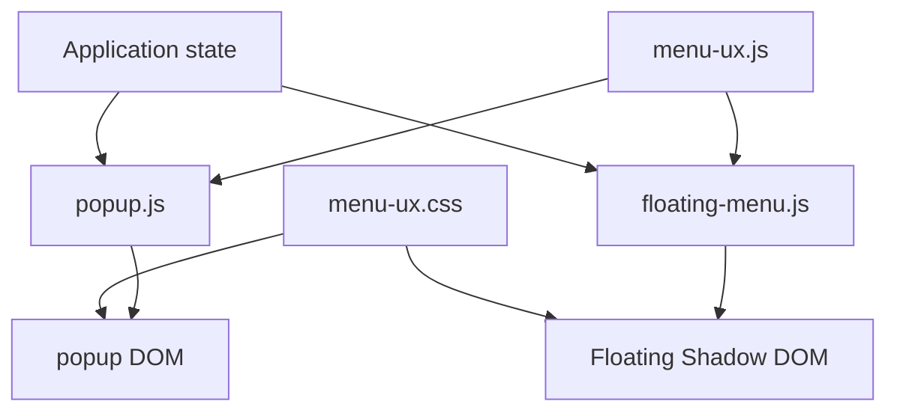

# 11 — UI without a framework

## Popup, floating menu, and synchronization

> **Reference snapshot for this chapter**  
> From Chapter 11 onward, the book moves from the v2.35.1 main snapshot used in Chapters 01–10 to the **v2.35.2 UI/UX candidate**, branch `feat/ui-ux-2.35.2`, commit `4d32a8c2a6cd291e4fe389bdf10fdbaf1856a8c2`. The branch manifest still displays `2.35.1` intentionally; the version bump is deferred until the release phase.

In the earlier chapters we studied the extension's engine: messaging, dynamic DOM, APIs, asynchrony, cache, autoplay, export, and the offline quiz editor. Now we turn to what the user directly sees.

PlumePilot has two main interfaces: the **toolbar popup** and the **floating menu** embedded in the LMS page. Over time they gained the same features at different speeds. A new action would first appear in the popup, later be requested in the floating menu, and then labels, styling, and preferences would slowly drift apart.

The v2.35.2 redesign addresses this as an **architecture and information-design problem**, not simply a CSS cleanup. Its goals are consistent meaning, fewer overwhelming screens, shared configuration behavior, preserved accessibility, and a predictable active-operation experience—without rewriting the stable autoplay engine.

---

# Part I — Two interfaces, one product

## 1. The problem is not duplicated HTML

It is tempting to blame the old interface on duplicated buttons and markup. But visual repetition is only a symptom: the popup and floating menu present the **same domain state** in different browser runtimes. The popup is an extension document, created when the toolbar icon opens and disposed of when it closes. The floating menu lives on the host LMS page. They cannot share mutable JavaScript globals or lifecycle assumptions.

A change to autoplay, course progress, an exam operation, or a layout preference must be reflected in both. The architectural question is therefore **how to keep the meaning of shared information consistent while preserving surface-specific controllers**.

---

## 2. Share the model, not necessarily the component

The 2.35.2 redesign introduces shared `menu-ux.js` and `menu-ux.css`, rather than replacing two independently working menus with one giant rendering function. The JavaScript module exposes `autoplayPresentation`, `bindCourseNavigation`, `bindExpansionScroll`, `ensureGamingFont`, `applyActionLayout`, and `bindLayoutEditor`.

An early comment defines the boundary: *"Presentation only: both menus keep their existing storage and operation owners."* The shared layer neither owns stored settings nor executes autoplay or exports. It converts state into consistent presentation and supplies reusable interaction behavior. That is a narrower and more maintainable responsibility than taking ownership of all popup and floating-menu logic.

The architecture is: shared application state flows into separate controllers; the controllers use shared presentation behavior and styles, then render into their respective DOM environments.

**Examples from the historical implementation:**

```js
PlumePilotMenuUx = {
  autoplayPresentation,
  bindCourseNavigation,
  bindExpansionScroll,
  ensureGamingFont,
  applyActionLayout,
  bindLayoutEditor,
};
```

```js
// Presentation only: both menus keep their existing storage and operation owners.
```



**Historical reference:** `menu-ux.js:269–270`; `menu-ux.js:24`

---

# Part II — State, view models, and rendering

## 3. The browser does not require a framework

With React, UI is often described as a function of state. With vanilla JavaScript, PlumePilot must explicitly read, assign, listen, and update. In `floating-menu.js`, `renderSettings()` sets individual control values from `settings`. On popup initialization, `popup.js` reads `chrome.storage.local` with defaults and populates controls.

There is no automatic reconciler: the developer decides **when** to render and **which nodes** to update. This is not necessarily poor architecture. It makes the work visible, but it also increases the need for clear state ownership and disciplined rendering functions.

**Examples from the historical implementation:**

```js
function renderSettings() {
  ...
  ui.autoplaySkipCompletedVideos.checked =
    settings.autoplaySkipCompletedVideos === true;
  ...
}
```

```js
chrome.storage.local.get(
  {
    enabled: true,
    stopAtTests: false,
    autoCompleteTests: false,
    ...
  },
  (result) => {
    checkbox.checked = result.enabled;
    ...
  },
);
```

**Historical reference:** `floating-menu.js:1079+`; `popup.js:1267–1334`

---

## 4. Persisted state and presentation state are different things

Saving a human-readable label such as "Skip completed videos · Stop at tests" would confuse presentation with domain state. The real source is a collection of preferences: whether completed videos are skipped, whether tests stop autoplay, whether a chapter limit is active, and whether the 70% threshold is armed.

The redesign formalizes that distinction with `autoplayPresentation()`. Given the underlying policy settings, the function returns a small **view model** containing `summary`, `testOverride`, and `stopHint`. Text displayed on screen is derived from state, not treated as authoritative state itself.

This separation also makes localization and testing easier: the data model and presentation language need not have the same structure.

**Examples from the historical implementation:**

```js
{
  autoplaySkipCompletedVideos: true,
  stopAtTests: true,
  autoCompleteTests: false,
  autoplayChapterLimitEnabled: true,
  autoplayStopAt70Enabled: true,
}
```

```js
function autoplayPresentation({
  skipCompleted = false,
  testBehavior = "ignore",
  limitEnabled = false,
  limit = 1,
  stopAt70 = false,
  thresholdBypassed = false,
} = {}) {
  ...
}
```

```js
{
  summary,
  testOverride,
  stopHint,
}
```

**Historical reference:** `menu-ux.js:25–42`

---

## 5. Derived state

Consider the rule in the historical implementation: when the chapter limit is enabled and the saved test policy is "stop", the effective behavior is temporarily interpreted as "ignore". The user has not necessarily changed or discarded the saved preference.

The UI must distinguish **stored intent** from **effective policy**. Otherwise it could announce "Stop at tests" while the autoplay engine is actually configured to skip that boundary under chapter-limit mode.

`autoplayPresentation()` therefore produces explanatory text via `testOverride`. The principle is broader: **an honest interface shows what the system will really do, not merely what one stored checkbox says**.

**Examples from the historical implementation:**

```js
const effectiveTestBehavior =
  limitEnabled && testBehavior === "stop"
    ? "ignore"
    : testBehavior;
```

```js
testOverride:
  limitEnabled && testBehavior === "stop"
    ? "Con il limite capitoli attivo, l’autoplay ignora i test ..."
    : ""
```

**Historical reference:** `menu-ux.js:27`

---

## 6. A pure function at the presentation boundary

`autoplayPresentation()` is useful because it does not touch the DOM, query storage, send messages, or mutate application globals. It receives a small object of policy inputs and returns display-ready values.

This is a classic **pure function** boundary. `tests/menu-ux.mjs` can assert its output directly in Node without starting Chromium, creating popup elements, or mocking the LMS. It demonstrates that even an imperative UI benefits from keeping its rules of meaning separate from its rendering effects.

**Examples from the historical implementation:**

```js
{
  skipCompleted,
  testBehavior,
  limitEnabled,
  limit,
  stopAt70,
  thresholdBypassed,
}
```

```js
assert.equal(
  autoplayPresentation().summary,
  "Tutti i video · Test ignorati",
);
```

**Historical reference:** `tests/menu-ux.mjs:7–18`

---

# Part III — Synchronization without a state manager

## 7. Two controllers, one persistent source

The popup and floating menu can be open simultaneously. If the user changes "Skip completed videos" in either surface, the other should update without direct communication between the two UI controllers.

The shared authoritative source is `chrome.storage.local`. Each controller writes the updated key through `chrome.storage.local.set(...)`, and each subscribes to `chrome.storage.onChanged`.

This is simpler and safer than inventing a separate popup-to-floating-menu messaging protocol for every preference. It also means either interface can be recreated later and still read the current value.

**Examples from the historical implementation:**

```js
chrome.storage.local.set({ [key]: value });
```

```js
chrome.storage.onChanged.addListener(...)
```

---

## 8. The popup as a subscriber

The popup listens for local storage changes, determines which keys changed, and updates only the relevant UI regions. For instance, changing `visualStyle` redraws the visual-style controls; changing `menuSize` updates the size selector; changing `floatingMenuLayout` updates the layout editor.

In reactive terminology, the model changes first and the view is subsequently updated. The implementation is **manual reactive synchronization**: ordinary callbacks replace the subscription/reconciliation machinery a framework might provide.

It is important that a subscription does not create a second owner of the data. The callback renders the new value but does not manufacture an unrelated truth.

**Examples from the historical implementation:**

```js
chrome.storage.onChanged.addListener((changes, area) => {
  if (area !== "local") return;
  ...
});
```

```js
if (changes.visualStyle)
  renderVisualStyle(changes.visualStyle.newValue);

if (changes.menuSize)
  renderMenuSize(changes.menuSize.newValue);

if (changes.floatingMenuLayout)
  renderFloatingMenuLayout(changes.floatingMenuLayout.newValue);
```

**Historical reference:** `popup.js:1370–1488`

---

## 9. The floating menu as a subscriber

The floating menu follows the same approach. Its storage-change listener merges updated keys from the declared defaults into its `settings` object and then selects the render operations affected by those keys.

It is effectively a **manual dependency graph**: preference A influences settings controls, preference B influences the theme, and the active operation influences relevant action buttons. The controller—not a global reactive framework—maintains those dependencies.

The value is consistency across surfaces. The cost is that the dependency graph must be kept up to date by the developer.

**Examples from the historical implementation:**

```js
chrome.storage.onChanged.addListener((changes, area) => {
  if (area !== "local") return;

  for (const key of Object.keys(defaults)) {
    if (changes[key])
      settings[key] = changes[key].newValue ?? defaults[key];
  }

  ...
});
```

**Historical reference:** `floating-menu.js:4588–4664`

---

## 10. Why not always call §renderEverything()§?

Calling one global render on every storage change would be simpler to write but more expensive to live with. It could rebuild unnecessary DOM, lose keyboard focus, reset `<details>` disclosure state, jump the scroll position, restart animations, overwrite temporary controls, and perform needless work.

PlumePilot instead uses **manual incremental rendering**. Updating a visual style should not force the operation banner, chapter list, and layout editor to be reconstructed.

Frameworks primarily make this dependency tracking more ergonomic. Without one, explicit selective rendering is a valid design provided the update contracts are clear.

**Examples from the historical implementation:**

```js
chrome.storage.onChanged.addListener(() => {
  renderEverything();
});
```

---

# Part IV — Navigation state

## 11. The redesign uses more than tabs

The 2.35.2 navigation divides the main UI into familiar areas—Course, Activities, Exams, Preferences, and Achievements. But within Course, autoplay configuration is no longer an always-visible wall of controls.

The common actions and a readable autoplay summary remain on the main surface. Detailed settings open in a dedicated secondary view. This is **progressive disclosure**: put frequent actions within easy reach while moving infrequent configuration behind a predictable interaction.

The features are not removed; the presentation hierarchy is changed to reduce cognitive load.

---

## 12. §bindCourseNavigation()§

The shared `bindCourseNavigation(root, scrollElement, onChange)` function finds the home view, detail view, opener, and back control through semantic `data-ux-*` attributes. On opening the detail view it records the current scroll position, hides home, shows detail, updates `aria-expanded`, scrolls to the top, and focuses the detail title without an unnecessary extra jump.

This is not merely toggling `hidden`. The transition includes visibility, scroll, focus, accessibility state, and a callback notifying the controller about the navigation change.

Its parameters allow the same behavior to work in the popup's document viewport and the floating panel's own scroll container.

**Examples from the historical implementation:**

```js
function bindCourseNavigation(root, scrollElement, onChange = () => {}) {
  const home = root.querySelector("[data-ux-home]");
  const detail = root.querySelector("[data-ux-detail]");
  const opener = root.querySelector("[data-ux-open]");
  const back = root.querySelector("[data-ux-back]");
  ...
}
```

```js
homeScroll = scrollElement?.scrollTop || 0;
home.hidden = true;
detail.hidden = false;
opener.setAttribute("aria-expanded", "true");
scrollElement.scrollTop = 0;
detail.querySelector("[data-ux-detail-title]").focus({ preventScroll: true });
```

**Historical reference:** `menu-ux.js:44–79`

---

## 13. Why preserve §homeScroll§?

Imagine scrolling halfway down Course, opening Autoplay Settings, then pressing Back. Returning to the very top technically works, but the user has lost their **spatial context**.

The shared controller stores `homeScroll` before opening the detail and restores `scrollElement.scrollTop` on return. This is a small piece of **navigation state**—distinct from domain state or a persistent preference.

Remembering the user's place helps the interface feel stable even when views are being conditionally shown and hidden.

**Examples from the historical implementation:**

```js
let homeScroll = 0;
```

```js
scrollElement.scrollTop = homeScroll;
```

---

## 14. Focus restoration

On closing the detail, the shared controller calls `opener.focus({ preventScroll: true })`. Mouse-only users may never notice. Keyboard and assistive-technology users depend on it.

Without restoring focus, keyboard interaction may resume at the document body or an unrelated control. With restoration, the user returns to the same button that opened the view.

This gives navigation a miniature state machine: `HOME → DETAIL → HOME`, with focus and scroll forming part of the transition contract.

**Examples from the historical implementation:**

```js
opener.focus({ preventScroll: true });
```

---

## 15. Escape as a transition

The shared navigation listener recognizes Escape only when the detail is open and `close()` succeeds. It prevents the default action and stops propagation after handling that transition.

Conceptually: `DETAIL --Escape--> HOME`.

This revisits Chapter 07 on state machines in a much smaller context. A keyboard event is not just a listener callback; it is an input that is meaningful only in a particular navigation state.

**Examples from the historical implementation:**

```js
if (event.key === "Escape" && close()) {
  event.preventDefault();
  event.stopPropagation();
}
```

**Historical reference:** `menu-ux.js:72–77`

---

# Part V — Tabs and accessibility

## 16. A tablist is a widget, not merely a row of buttons

The popup's navigation declares `role="tablist"` and the buttons use `role="tab"` with `aria-selected`. The implementation also manages `tabIndex` so only the active tab participates in ordinary Tab traversal.

This is commonly called **roving tabindex**. Other tabs are reached using directional keys rather than all becoming sequential Tab stops.

Declaring an accessible role creates behavioral obligations; it is not just a stylistic label. The popup must keep selected state, tab order, associated panels, and focus navigation consistent.

**Examples from the historical implementation:**

```html
<nav class="popup-tabs" role="tablist">
  <button role="tab" aria-selected="true" ...>Corso</button>
  <button role="tab" aria-selected="false" ...>Esami</button>
  ...
</nav>
```

**Historical reference:** `popup.html:34–39`

---

## 17. ArrowLeft, ArrowRight, Home, and End

The popup recognizes `ArrowLeft`, `ArrowRight`, `Home`, and `End` in tab navigation and computes which tab becomes active next. The pattern follows the WAI-ARIA expectations for a horizontal tablist.

Left/right move among tabs; Home/End navigate to the first/last tab. The code updates the corresponding focus and active state.

Accessibility is not achieved simply by adding `role="tab"`: the **keyboard interaction promised by that role** must also be implemented.

**Examples from the historical implementation:**

```js
if (!["ArrowLeft", "ArrowRight", "Home", "End"].includes(event.key))
  return;
```

```html
role="tab"
```

**Historical reference:** `popup.js:627–649`

---

## 18. ARIA does not implement behavior for us

A `role="tab"` attribute describes a component to accessibility APIs; it does not automatically handle arrow keys, change `aria-selected`, synchronize panels, or manage focus.

This is a general rule: **ARIA describes UI semantics; it does not write the interaction logic**. Correct accessibility is a combination of markup, state, keyboard behavior, and focus management.

**Examples from the historical implementation:**

```html
role="tab"
```

---

# Part VI — Scrolling in expanding panels

## 19. The deceptively simple scrolling bug

One concrete regression during the redesign was that expanding a settings group could reveal its content outside the visible area. Calling `panel.scrollIntoView()` everywhere would seem simple, but the popup and floating menu have different scroll containers and geometry.

The popup may scroll the document below a sticky header. The floating menu scrolls an internal Shadow DOM panel. The behavior must therefore be shared **and parameterized by surface geometry**.

A layout bug can thus reveal a missing abstraction, rather than merely a wrong margin.

**Examples from the historical implementation:**

```js
panel.scrollIntoView();
```

---

## 20. §bindExpansionScroll()§

This shared helper receives the root element, the scroll container, and a layout callback. It distinguishes document scrolling from scrolling an element by comparing against `document.scrollingElement`.

It then calculates the usable viewport and, for the popup, accounts for the sticky header when deciding where an expanded element should appear. This is **geometry-aware UI** rather than a blind call to `scrollIntoView()`.

A shared algorithm can operate on different surfaces without assuming the same scroll origin.

**Examples from the historical implementation:**

```js
(root, scrollElement, onLayout)
```

```js
const isDocument = scrollElement === document.scrollingElement;
const viewport = isDocument
  ? { top: 0, bottom: window.innerHeight }
  : scrollElement.getBoundingClientRect();
```

```js
const header = isDocument
  ? root.querySelector(".popup-sticky-header")
  : null;
```

**Historical reference:** `menu-ux.js:81–135`

---

## 21. Not everything that opens should cause scrolling

The helper listens in the capture phase, observing user intent before native `<details>` behavior has completed. But it distinguishes intentional user-triggered opening from restoration and closing.

A source comment explicitly states: *"Only user-triggered openings scroll; restoration and closing do not."* Otherwise restoring a previously expanded section could unexpectedly move the user's viewport.

The lesson is that UI effects often require an **intent guard**, not merely observing that a DOM state changed.

**Examples from the historical implementation:**

```js
root.addEventListener("click", ..., true);
```

```js
// Only user-triggered openings scroll; restoration and closing do not.
```

**Historical reference:** `menu-ux.js:106–107`

---

## 22. Animations and timing

If a panel animates open, measuring its geometry immediately can capture an intermediate frame. The implementation uses `requestAnimationFrame()`, waits for relevant animation completion with `Promise.allSettled(animations.map(animation => animation.finished))`, and uses another animation frame before final positioning.

Conceptually: user opens → layout changes → animation settles → measure → reveal.

This is the asynchronous timing model from Chapter 05 applied to layout. The DOM may be present before its final visual geometry is stable.

**Examples from the historical implementation:**

```js
requestAnimationFrame(...)
```

```js
Promise.allSettled(
  animations.map(animation => animation.finished)
)
```

```js
requestAnimationFrame(...)
```

**Historical reference:** `menu-ux.js:124–132`

---

## 23. §prefers-reduced-motion§

The scroll behavior checks the user's motion preference through `window.matchMedia("(prefers-reduced-motion: reduce)")`. If reduced motion is requested, the helper uses automatic rather than smooth scrolling.

The ability to reveal content remains available. Only the animation is reduced.

Accessibility here changes an effect without removing the underlying function.

**Examples from the historical implementation:**

```js
behavior:
  window.matchMedia("(prefers-reduced-motion: reduce)").matches
    ? "auto"
    : "smooth"
```

**Historical reference:** `menu-ux.js:103–104`

---

# Part VII — Customization as a data schema

## 24. Button layout as persistent state

The customization feature deliberately retains the historical storage key `floatingMenuLayout`, even though version 2.35.2 applies the saved layout to **both** menus.

Renaming the key would require a migration without delivering an obvious product benefit. Keeping it is a conscious compatibility choice and a reminder that old naming sometimes survives a broader refactor.

The persisted value models order and visibility; it is not just a CSS preference.

**Examples from the historical implementation:**

```js
const STORAGE_KEY = "floatingMenuLayout";
```

**Historical reference:** `floating-menu-layout.js:4`

---

## 25. The schema

The stored layout is versioned and contains an ordered `items` array. Each entry has a stable `id` and a `visible` Boolean.

The array order defines display order; the Boolean defines whether the action appears by default. Storing a normalized representation makes it possible for popup and floating menu to interpret the same customization independently.

This is a small, concrete data schema underpinning what users experience as dragging and hiding buttons.

**Examples from the historical implementation:**

```js
{
  version: 1,
  items: [
    { id: "complete-tests", visible: true },
    { id: "complete-objectives", visible: true },
    { id: "test-collection", visible: true },
    { id: "study-materials", visible: true },
  ],
}
```

**Historical reference:** `floating-menu-layout.js:4–15`

---

## 26. Why IDs matter more than labels

Users see localized names such as "Complete tests" or "Course materials". Storage retains stable action IDs such as `complete-tests` and `study-materials`.

Labels may change because of translation, product terminology, or UI copy refinements. Changing them should not invalidate a user's saved layout.

This repeats a recurring architectural rule: **stable logical identity must not depend on presentation text**.

---

## 27. §normalizeLayout()§ as a small schema migration

The normalizer constructs a lookup of saved entries, rejects malformed values, unknown IDs, and duplicates, and appends any newly introduced actions that are missing from old layouts.

Imagine a new `new-action` introduced after a user customized the previous version. The user should not lose their layout; the new action can be added in a deterministic position.

This is a lightweight form of schema evolution. The reader accepts supported older structures and produces one current representation.

**Examples from the historical implementation:**

```js
const savedById = new Map();
```

```js
{ id: "new-action", ... }
```

**Historical reference:** `floating-menu-layout.js:17–37`

---

## 28. Global ordering versus semantic groups

The old layout customization could be understood as nearly arbitrary ordering. The new interface introduces fixed semantic groups such as completion actions and material operations.

`groupFor(id)` maps action IDs into those groups. Dragging is allowed **within** a group rather than across unrelated groups. This slightly constrains freedom but preserves visual and conceptual coherence.

The product deliberately prioritizes a comprehensible information architecture over every theoretical permutation.

**Examples from the historical implementation:**

```js
const groupFor = id =>
  ["complete-tests", "complete-objectives"].includes(id)
    ? "completion"
    : "materials";
```

**Historical reference:** `menu-ux.js:162`

---

## 29. Constraints belong to design

A layout editor need not allow every possible arrangement. PlumePilot permits reordering and visibility within a documented policy, while preserving semantic grouping and access to active operations.

This is **constrained customization**: the user controls many presentation details, but the product still enforces meaningful invariants.

Constraints are not automatically a failure of flexibility; they can prevent configurations that are confusing or operationally unsafe.

---

# Part VIII — UI invariants

## 30. An active operation must not become invisible

Suppose the user hides the Course Materials button and then a materials export is still running. Blindly honoring the hidden preference would conceal the only relevant progress or cancellation control.

Version 2.35.2 defines a UI invariant: **an action associated with an active operation remains visible, even if the saved layout says it should be hidden**.

This illustrates the difference between user preference and operational safety. Saved visibility is a default, not the final authority when it would make a running job uncontrollable.

---

## 31. §applyActionLayout()§

The shared helper determines the action corresponding to `operation?.kind`. Its visibility rule is essentially: hide an item only if the user disabled it **and** it is not the active operation's action.

The implementation therefore includes the predicate `!item.visible && item.id !== activeItem`.

That one line embeds a product-level invariant in the presentation layer: customization may hide idle actions but may not make the current work disappear.

**Examples from the historical implementation:**

```js
const activeItem = operationItems[operation?.kind];
```

```js
node.hidden = !item.visible && item.id !== activeItem;
```

**Historical reference:** `menu-ux.js:137–155`

---

## 32. The cancellation path is a safety property

Export, Turbo Test, and Objectives operations can span asynchronous stages. Users must retain a way to see and stop an active operation when cancellation is supported.

Treating cancellation controls merely as optional decoration would be a mistake. Losing access to the controlling action violates a **UI safety invariant**.

The layout algorithm must protect the cancellation path even while applying custom ordering and visibility.

---

## 33. Automatically expand the active group

Keeping a button technically unhidden is not sufficient if its enclosing disclosure group is collapsed. When operations such as `turbo` or `objectives` are active, the appropriate group opens automatically.

This is a second layer of the same invariant. A control should be not only present in the DOM but **reachable in the visible hierarchy**.

Effective visibility combines element visibility, ancestor disclosure state, focus, and layout.

**Examples from the historical implementation:**

```js
if (
  group.dataset.menuGroup === "completion" &&
  ["turbo", "objectives"].includes(operation?.kind)
)
  section.open = true;
```

**Historical reference:** `menu-ux.js:151–154`

---

# Part IX — Focus inside a layout editor

## 34. Rerendering and focus

`bindLayoutEditor()` rebuilds its rows through `list.replaceChildren(...rows)`. When DOM nodes are replaced, the currently focused button may disappear.

The helper first records the focused control's logical action ID and direction, then after rendering finds the equivalent new node and calls `focus({ preventScroll: true })`.

Without this recovery, a keyboard user might lose their position after every Up/Down reordering action. The act of rendering is itself a potential state transition that must preserve focus meaning.

**Examples from the historical implementation:**

```js
list.replaceChildren(...rows);
```

```js
const focused = list.getRootNode().activeElement;
const focusedId = ...;
const focusedDirection = ...;
```

```js
focus({ preventScroll: true });
```

**Historical reference:** `menu-ux.js:208`; `menu-ux.js:163–214`

---

## 35. Identity-based focus recovery

The technique mirrors the DOM recovery in Chapter 03: do not hold on to a dead node and hope it remains valid.

Instead, remember a **logical identity**—action ID plus which direction button had focus—then locate its new representation after the DOM has been rebuilt.

The broader pattern is: preserve identity → replace DOM → resolve equivalent element → restore focus. The same concept appears in autoplay lesson recovery and in dynamic-page automation.

---

# Part X — Popup and floating menu have different DOM trees

## 36. Semantic convergence

Popup and floating menu still have different markup. The popup contains HTML in its own extension document; `floating-menu.js` creates menu markup from a template within the LMS page.

The redesign does not require byte-for-byte identical DOM trees. It gives both trees a shared vocabulary of attributes such as `data-ux-home`, `data-ux-detail`, and `data-ux-open`.

These attributes form a small **DOM protocol**: the behavior helpers depend on shared semantics, not on identical nesting or class names.

**Examples from the historical implementation:**

```html
<section class="autoplay-section ux-group">
  <h2 class="ux-heading">Autoplay</h2>
  ...
  <button data-ux-open>Impostazioni autoplay</button>
</section>
```

---

## 37. Data attributes as an interface between markup and behavior

Selectors based on incidental structure—such as deeply nested `nth-child` paths—are fragile. A shared helper searching for `[data-ux-home]` instead communicates that the element has a deliberate navigation role.

A `data-*` attribute can act as an interface contract between HTML structure and JavaScript behavior. Each surface may implement that interface using different markup.

This is analogous to depending on stable methods in a software interface rather than a consumer reaching into another component's private implementation.

**Examples from the historical implementation:**

```css
.popup-course-autoplay-weird-wrapper > div:nth-child(2)
```

```js
root.querySelector("[data-ux-home]")
```

---

## 38. Why not extract everything into §renderMenu()§?

A single markup generator for both menus may sound attractive, but each surface still differs in lifecycle, root document, scroll container, available screen space, event coordination, and integration with host or extension UI.

A monolithic `renderMenu(surface, mode, ...)` would accumulate conditional behavior until it became harder to maintain than two controllers.

The chosen middle ground is deliberate: **share rules of meaning, shared design tokens, and reusable interaction helpers; retain surface-specific controllers and DOM trees**. It reduces duplication of knowledge without forcing unrelated implementation details into one abstraction.

---
