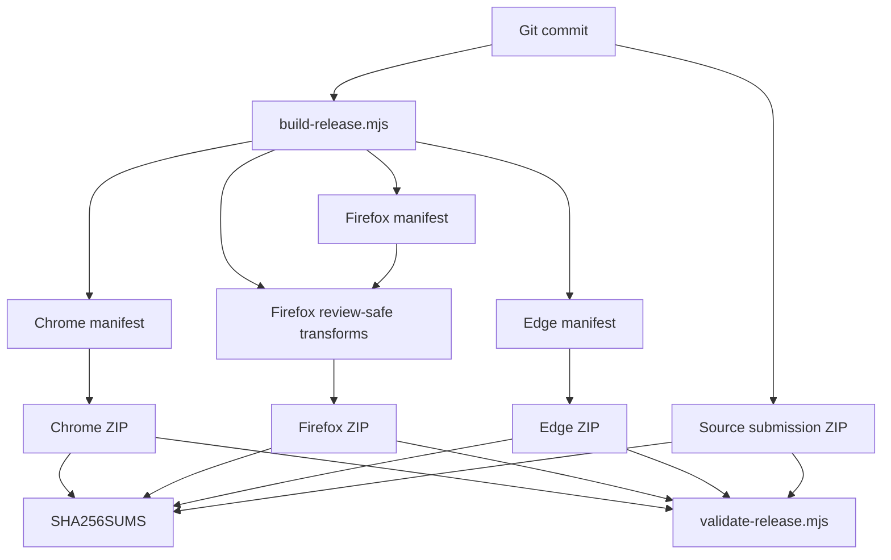

# 13 — Chrome, Edge, and Firefox

## One codebase, different runtimes

> **Reference snapshot for this chapter**  
> This chapter uses the **2.35.2 release candidate**, branch `feat/ui-ux-2.35.2`, commit `f6fcb4c29c83ba9150df0be31da04fc91dffb634`. Unlike Chapters 11–12, this snapshot also includes manifest preparation, release notes, and AMO-related material because cross-browser packaging is part of the topic.

DOM, Fetch, Maps, and Promises behave similarly across modern browsers, but a WebExtension is more than ordinary browser JavaScript. It depends on a manifest, privileged extension APIs, background lifecycles, declared permissions, packaged resources, and the distribution policies of multiple stores.

PlumePilot's cross-browser challenge is therefore not simply “make the same JavaScript run everywhere.” It is **keep the core functionality coherent while supplying independently valid Chrome, Edge, and Firefox artifacts that can be installed, reviewed, and updated**.

---

# Part I — Compatibility has multiple dimensions

## 1. Supporting Firefox does not mean one thing

The language feature `new Map()` is broadly supported; `chrome.offscreen.createDocument()` belongs to a particular extension runtime. The `background.service_worker` manifest declaration raises another issue: the platform's chosen background execution model. A vendor bundle containing `new Function(...)` introduces yet another concern—static analysis and store review—even if the relevant branch is not executed by PlumePilot. These are distinct compatibility dimensions, not one Boolean property called "Firefox support".

**Examples from the historical code:**

```js
const value = new Map();
```

```js
chrome.offscreen.createDocument(...);
```

```json
{
  "background": {
    "service_worker": "background.js"
  }
}
```

```js
new Function(...)
```

---

## 2. A more useful compatibility matrix

A realistic matrix asks separate questions about JavaScript syntax, DOM/Web Platform APIs, WebExtension APIs, manifest validity, background lifecycles, ZIP structure, distribution policies, reviewer reproducibility, and UI behavior. A feature can be compatible with one layer but incompatible with another.

| Layer | Question |
|---|---|
| Language | Does the JavaScript engine understand this syntax? |
| Web Platform | Is the DOM/browser API available? |
| WebExtension | Does the extension runtime expose this API? |
| Manifest | Is the declaration accepted for this browser? |
| Lifecycle | How does the background start, stop, or restart? |
| Packaging | Does the ZIP have the expected layout? |
| Policy | Will the store accept the contents? |
| Review | Can the reviewer understand and rebuild it? |
| UX | Does the feature behave coherently across browsers? |

---

# Part II — One source tree, several artifacts

## 3. The repository is not the store package

A repository contains sources, documentation, tests, build scripts, release metadata, and developer artifacts. An installed extension should receive only what its runtime needs. PlumePilot transforms a common source tree into browser-specific deliverables. This separation belongs to software architecture: the checked-out source and the shipped artifact are not automatically identical.

---

## 4. Build-time specialization

`scripts/build-release.mjs` knows three targets: `chrome`, `firefox`, and `edge`. Instead of scattering browser-name conditionals through all application functions, the release build adjusts known platform differences before packaging. This is **build-time specialization**: resolve distribution and runtime structural differences at build time, keeping most application behavior common.

**Examples from the historical code:**

```js
const browsers = ["chrome", "firefox", "edge"];
```

---

## 5. Why not three repositories?

Maintaining independent Chrome, Edge, and Firefox forks could seem simple initially. It would also duplicate every bug fix, feature, test, security update, and documentation change, and invite behavioral divergence. PlumePilot keeps a shared **domain implementation** and specializes the platform **adapters and artifacts** at their boundaries. The broader principle is: **share the domain, specialize the platform adapter**.

---

# Part III — Manifest V3 across different runtimes

## 6. The source manifest

The v2.35.2 source manifest carries declarations related to both background models. It is not necessarily delivered unchanged in every store ZIP. The builder adjusts those declarations for each supported target and the validator checks the resulting manifest. The manifest in the repository is therefore a build input, not the final contract for all platforms.

**Examples from the historical code:**

```json
"background": {
  "scripts": [
    "achievements.js",
    "commission-state.js",
    "sound-settings.js",
    "whats-new.js",
    "background.js"
  ],
  "service_worker": "background.js"
}
```

---

## 7. Chrome and Edge: service worker

For Chromium targets the builder sets `manifest.background = { service_worker: "background.js" }` and includes the `offscreen` permission. A service worker is ephemeral, does not have a normal `window` or document DOM, and must register event listeners when started. Persistent operation coordination belongs in browser storage rather than a worker global variable. Chapter 06 described the consequences of that lifecycle; this chapter explains its browser-specific cause.

**Examples from the historical code:**

```js
manifest.background = {
  service_worker: "background.js"
};
```

```js
"offscreen"
```

---

## 8. Firefox: background scripts

For the Firefox target, the build emits a `background.scripts` array instead of `background.service_worker` and excludes Chromium's `offscreen` permission. The validator rejects a Firefox artifact containing the unexpected service-worker declaration. The difference is not merely a string in a manifest: the actual **background execution environment** is different, even though much of the business logic remains shared.

**Examples from the historical code:**

```js
manifest.background = {
  scripts: [
    "achievements.js",
    "sound-settings.js",
    "whats-new.js",
    "background.js"
  ]
};
```

```js
if (manifest.background?.service_worker)
  throw new Error("Firefox: service_worker inatteso.");
```

---

## 9. Why build different manifests?

WebExtensions references discuss manifests containing both `background.scripts` and `background.service_worker` so each browser can choose a supported form. PlumePilot instead already creates browser-specific release packages; emitting a specialized manifest makes its exact permissions, execution model, and reviewer-facing metadata straightforward to validate. A universal manifest is not intrinsically wrong, but it does not simplify all distribution requirements for this project.

**Examples from the historical code:**

```json
"background": {
  "scripts": ["background.js"],
  "service_worker": "background.js"
}
```

---

## 10. Detect capabilities, not browser brands

At runtime, checking `chrome.offscreen?.createDocument` is usually stronger than checking whether the user agent says "Chrome". The first asks if the **capability** exists; the second assumes a brand implies the capability. This is feature detection. But capability detection cannot rescue an invalid manifest after an extension fails to load. **Runtime feature detection and build-time specialization complement one another.**

**Examples from the historical code:**

```js
if (chrome.offscreen?.createDocument) {
  ...
}
```

```js
if (browserName === "chrome") {
  ...
}
```

---

# Part IV — The offscreen audio case

## 11. The offscreen audio problem

Chromium service workers have no DOM, yet audio playback typically requires document APIs. The Offscreen API permits the extension to create an invisible document for that task. `ensureOffscreenAudioDocument()` first checks whether the API exists and whether a document is already present. The implementation also retains an `offscreenCreation` Promise to prevent simultaneous creation attempts. This is the same in-flight deduplication concept discussed for downloads.

**Examples from the historical code:**

```js
async function ensureOffscreenAudioDocument() {
  if (!chrome.offscreen?.createDocument) return false;

  if (await chrome.offscreen.hasDocument()) return true;

  if (!offscreenCreation) {
    offscreenCreation = chrome.offscreen.createDocument({
      url: "offscreen-audio.html",
      reasons: ["AUDIO_PLAYBACK"],
      justification:
        "Riproduce gli avvisi sonori locali richiesti dall’utente.",
    }).finally(() => {
      offscreenCreation = null;
    });
  }

  await offscreenCreation;
  return true;
}
```

---

## 12. A fallback instead of a second feature

The caller attempts offscreen audio when available, but can fall back to sending a command to an existing tab. The domain goal—play an appropriate notification sound—remains unchanged. Only the adapter is different. This is **graceful degradation** of a platform-specific API, not a second independently designed sound feature.

**Examples from the historical code:**

```js
if (await ensureOffscreenAudioDocument()) {
  return sendRuntimeMessage(...);
}

const tabs = await chrome.tabs.query(...);
...
return sendTabMessage(target.id, ...);
```

---

## 13. Why the Firefox build removes exactly that path

The release script replaces the offscreen helper with an implementation that returns `false`. The caller therefore naturally uses its preexisting tab-based fallback. Nothing else in the sound workflow needs to fork. This minimizes divergence: the same higher-level feature always chooses the supported mechanism rather than maintaining two separate notification systems.

**Examples from the historical code:**

```js
async function ensureOffscreenAudioDocument() {
  ...
}
```

```js
async function ensureOffscreenAudioDocument() {
  return false;
}
```

---

# Part V — Manifest, permissions, and data declarations

## 14. Least privilege can be browser-specific

Chromium asks for `["storage", "offscreen"]`; Firefox needs only `["storage"]` in the historical build. Declaring `offscreen` on Firefox "for consistency" would violate the intent of least privilege. The artifact validator checks the **expected permission set**, including the absence of unneeded capabilities, instead of merely checking that some required permission happens to be present.

**Examples from the historical code:**

```json
["storage", "offscreen"]
```

```json
["storage"]
```

```js
const expectedPermissions =
  browser === "firefox"
    ? ["storage"]
    : ["storage", "offscreen"];
```

---

## 15. The Firefox ID

The Firefox manifest includes `browser_specific_settings.gecko.id`. This is part of the installed add-on's identity, not decoration. Accidentally changing it can make what was intended as an update appear to be a different extension. The project's release history treats this identity as a stable compatibility requirement.

**Examples from the historical code:**

```json
"browser_specific_settings": {
  "gecko": {
    "id": "plumepilot@fabiofloris"
  }
}
```

---

## 16. Data collection declarations

The Firefox target declares `data_collection_permissions` with categories `authenticationInfo`, `websiteContent`, and `websiteActivity`. These terms are defined by Mozilla's declaration model; they should not be conflated with a generic claim that PlumePilot transmits all such information to its own servers. The engineering lesson is that **distribution metadata describes behavior under store-specific schemas**. The same runtime logic may require different manifest metadata for different stores.

**Examples from the historical code:**

```json
"data_collection_permissions": {
  "required": [
    "authenticationInfo",
    "websiteContent",
    "websiteActivity"
  ]
}
```

---

## 17. Minimum versions

The snapshot sets a Firefox desktop minimum version of `140.0` and an Android minimum of `142.0`. Minimum versions establish which runtime capability assumptions the project is willing to support. Explicitly raising the compatibility floor can sometimes be healthier than accumulating complex fallback branches for very old runtimes that are no longer part of the intended target.

**Examples from the historical code:**

```json
"strict_min_version": "140.0"
```

```json
"strict_min_version": "142.0"
```

---

# Part VI — Chrome and Edge: same engine, different distribution

## 18. “Edge is Chromium” is true but incomplete

Chrome and Edge share much of their modern extension runtime, yet the Edge package still receives additional store-oriented metadata and localized manifest display fields. Store behavior, market availability, release processing, and metadata requirements are not determined solely by the JavaScript engine. Browser-engine compatibility and distribution compatibility must remain separate concepts.

**Examples from the historical code:**

```js
manifest.name = "__MSG_extensionName__";
manifest.description = "__MSG_extensionDescription__";
manifest.default_locale = "it";
manifest.action.default_title = "__MSG_extensionName__";
```

---

## 19. Runtime compatibility versus distribution compatibility

**Runtime compatibility** asks whether the installed extension can execute its features successfully. **Distribution compatibility** asks whether its artifact, metadata, permissions, and policies satisfy the channel through which it is delivered. An extension can pass all local functional tests and still fail an upload, automated validator, or store review.

---

# Part VII — Reviewability is a technical property

## 20. Vendor bundles and review

PlumePilot uses substantial third-party libraries such as PDF.js, pdf-lib, JSZip, and fontkit. Bundled JavaScript is normal in web development, but extension reviewers need to understand what code is included, where it came from, and whether it uses restricted dynamic-execution capabilities. Thus third-party code is not only a runtime dependency; its **reviewability** becomes part of the release architecture.

---

## 21. Chrome: readability is not simply beautification

Chrome Web Store policy prohibits code obfuscation that conceals functionality, while ordinary minification can be acceptable. The project nevertheless encountered automated review concerns related to code shape and readability, documented around v2.32.10. It would be wrong to claim all minification is forbidden. The practical lesson is that the form and provenance of bundled code affect both human auditing and automated review systems.

---

## 22. Firefox: source submission is part of the product

Mozilla's review process may require a source submission with reproducible build instructions for artifacts generated from other files. PlumePilot therefore prepares a Firefox **source-review archive** in addition to the three installable runtime ZIPs. A complete release is not simply three ZIPs; it includes the metadata and evidence needed for the review process.

---

# Part VIII — The review-safe Firefox build

## 23. Transform vendor code only through a known list

The Firefox build applies review-specific transforms only to an explicit set of files: `background.js`, `vendor/jszip.js`, `vendor/fontkit.umd.js`, `vendor/pdf-lib.js`, `vendor/pdf.mjs`, and `vendor/pdf.worker.mjs`. Other files are left unchanged. This is not an open-ended rewrite of every file matching a suspicious pattern; it is a controlled, auditable set of platform adaptations.

**Examples from the historical code:**

```js
[
  "background.js",
  "vendor/jszip.js",
  "vendor/fontkit.umd.js",
  "vendor/pdf-lib.js",
  "vendor/pdf.mjs",
  "vendor/pdf.worker.mjs"
]
```

```js
return bytes;
```

---

## 24. `replaceExactly()`

The build helper searches for one expected substring, verifies that it appears **exactly once**, and only then performs the replacement. If it does not appear—or appears multiple times—the build fails with a labeled error. This turns fragile assumptions about dependency contents into explicit executable preconditions.

**Examples from the historical code:**

```js
function replaceExactly(source, search, replacement, label) {
  const first = source.indexOf(search);

  if (
    first < 0 ||
    source.indexOf(search, first + search.length) >= 0
  ) {
    throw new Error(
      `Firefox review-safe: pattern inatteso (${label}).`
    );
  }

  return (
    source.slice(0, first) +
    replacement +
    source.slice(first + search.length)
  );
}
```

---

## 25. Fail-closed transformation

When rewriting vendor code, the safe response to an unexpected upstream shape is not "replace whatever the regex can find and continue". It is **fail closed**: stop and require a developer to inspect why the known pattern changed. A release process should not silently produce partly modified executable code that nobody has reviewed.

**Examples from the historical code:**

```js
source.replace(regex, replacement);
```

---

## 26. Why exact matching matters

After upgrading PDF.js, the expression a patch expects may disappear, be rewritten, or occur twice. A blind substitution could create a package whose fallback behavior differs from what the author intended. `replaceExactly()` makes the dependency on a particular upstream representation visible and testable, much like a schema assertion in a data migration.

**Examples from the historical code:**

```js
new Function(...)
```

---

# Part IX — The JSZip case

## 27. Unused code can still matter

A readable JSZip distribution contains a legacy compatibility path that accepts a string callback and constructs a function dynamically. PlumePilot itself supplies actual functions and does not need that path. Nevertheless, a static scanner can flag `new Function(...)` even if the branch is unreachable for the project's usage. Runtime reachability and static-review acceptability are different dimensions.

**Examples from the historical code:**

```js
new Function(...)
```

---

## 28. Remove an unused capability, do not conceal it

For Firefox, the build replaces that JSZip fallback with a strict function-type requirement and a clear `TypeError`. It does not attempt to obfuscate or rename `new Function` to evade inspection. It **removes a capability that PlumePilot does not use**. This distinction is central to auditable platform specialization.

**Examples from the historical code:**

```js
if (typeof callback !== "function") {
  throw new TypeError(
    "setImmediate callback must be a function"
  );
}
```

---

# Part X — The fontkit case

## 29. fontkit and legacy fallbacks

fontkit includes older compatibility branches that may construct or expose executable code. The Firefox packaging step replaces known cases with safe alternatives that preserve the subset of fontkit functionality PlumePilot requires. Fewer unused dynamic-execution capabilities mean fewer review and security surfaces. The transformation is scoped and documented rather than changing vendor source indiscriminately.

---

# Part XI — The PDF.js case

## 30. A dependency tree is also a compatibility tree

PDF.js supports alternative implementation paths for older environments or restricted execution contexts. It may probe whether dynamic function compilation is available. For the Firefox artifact, PlumePilot forces the relevant probe to return `false`, selecting the interpreter-based path. Firefox is fully capable of running JavaScript; the constraint comes from the **deployment target and review requirements**, not a lack of JavaScript language support.

**Examples from the historical code:**

```js
function isEvalSupported() {
  try {
    new Function("");
    return true;
  } catch {
    return false;
  }
}
```

```js
function isEvalSupported() {
  return false;
}
```

---

## 31. Interpreter versus compiler

Some PDF.js fallback behavior can be understood as choosing between a dynamic-compiler path and an interpreter path. The Firefox build selects the interpreter path to avoid a dynamic code-generation capability. This is **capability reduction by build**, not a claim that an interpreter is always faster or universally superior.

---

## 32. Dynamic-import fallback

Other PDF.js fallbacks may attempt a computed dynamic import. If the required resource is absent from the packaged extension and the path is unnecessary for PlumePilot, keeping it broadens review and runtime uncertainty. The Firefox build disables that precise unsupported fallback. We must distinguish ordinary static ES module imports from computed dynamic imports, and both from truly remote executable code: their policies and semantics differ.

---

# Part XII — Why not modify vendor sources directly?

## 33. Chrome and Edge retain upstream

The repository retains readable vendor distributions corresponding to their documented upstream sources. Chrome and Edge can ship those sources unchanged where appropriate. Firefox receives a **build-generated derivative** containing a small reviewed set of adaptations. Keeping pristine inputs separate from derived outputs makes third-party provenance traceable and dependency upgrades easier to reason about.

---

## 34. Supply-chain provenance

For each third-party asset we should be able to answer which version was imported, where it came from, which checksum identifies the pristine bytes, what changes are applied, and which target receives them. `THIRD_PARTY_NOTICES.md` and validator checks express this provenance as inspectable data rather than vague recollection.

---

# Part XIII — Checksums as invariants

## 35. A filename proves very little

A file named `jszip.js` does not prove it contains a particular JSZip version or an unmodified release. A SHA-256 digest is a much stronger identifier of exact bytes. PlumePilot maintains expected checksum values and verifies vendored artifacts during packaging. The name is a convenience; the content hash is an integrity assertion.

---

## 36. Pinned dependencies

Checksum pinning says not merely "we use this library" but "we expect these precise source bytes". An accidental manual edit or unexpected dependency update causes validation to fail rather than slipping unnoticed into the next store archive. This is a useful release invariant even for a relatively small extension.

---

## 37. What checksums cannot prove

An identical checksum proves a file matches the reference bytes we expected. It does **not** establish that the library contains no vulnerabilities, that its license is suitable, or that all behavior is correct. Integrity and provenance are valuable but different from security auditing and functional correctness.

---

# Part XIV — The validator as an executable specification

## 38. Validate the output ZIP, not only the source

After building, `scripts/validate-release.mjs` reopens the generated artifacts and examines their actual contents. That is stronger than checking the repository inputs alone: an incorrect copy path, missed file, wrong manifest transformation, or accidental extra resource can occur during packaging. The release archive is a separate artifact with its own test obligations.

---

## 39. Examples of release invariants

The validator can assert target-specific background shape, permission sets, expected assets, vendor checksums, forbidden runtime patterns, and other packaging requirements. These checks serve as **executable specifications** for what a valid Firefox, Chrome, or Edge release looks like. Unlike an informal checklist, they fail automatically when the package stops satisfying its declared contract.

---

## 40. Packaging deserves tests

A feature may work perfectly when loaded from a development checkout and fail in a ZIP because the release script omitted a file, changed the manifest, removed a resource, or included an invalid path. Unit tests of application logic cannot detect all packaging mistakes. **The release artifact itself must be tested.**

---

# Part XV — Static analysis as a constructive adversary

## 41. Review-safe scans

For Firefox, the validator reads packaged JavaScript and checks for restricted or suspicious patterns associated with dynamic execution. This is heuristic **static analysis**, not a semantic proof of all possible control flows. Its role is to guard against known review failure categories before sending a package to AMO.

---

## 42. Static analysis can have false positives

A detector may find a suspicious expression inside an unreachable legacy fallback. The code might be harmless for the actual usage, but reviewers cannot execute every possible control flow in every dependency. Making packages understandable and unnecessary capability paths absent can be more reliable than depending on complex reachability arguments for every submission.

---

## 43. Readability is a security and governance property

Readable code improves not only developer debugging but also human auditing, reproducibility, dependency review, and trust in the artifact. In extension distribution, **reviewability is an operational property of the software**, not just an aesthetic preference.

---

# Part XVI — Heuristics for minified or unknown code

## 44. Approximate the reviewer locally

The validator includes a small `couldBeMinifiedCode(source)` heuristic. It is not Mozilla's actual AMO review algorithm. It is a local early-warning signal based on suspicious code shape such as very long lines and unusually dense/minified formatting. The correct use is to catch known risks, not to assume passing that heuristic guarantees store acceptance.

**Examples from the historical code:**

```js
function couldBeMinifiedCode(source) {
  ...
}
```

---

## 45. Turn postmortems into tests

An earlier review rejection or warning is most valuable when it becomes a repeatable safeguard. Once a problem is understood—dynamic evaluation, source provenance, missing reviewer instructions, or a malformed artifact—the build and validator should detect recurrence automatically. This turns human troubleshooting history into a testable release contract.

---

# Part XVII — Reproducible source submission

## 46. Reviewer rebuilds

The AMO source README documents the tools and command needed to rebuild the archives. A reviewer should not have to guess how the shipped output was generated.

**Historical code or diagram:**

```bash
node scripts/build-release.mjs
```

---

## 47. Offline builds

Building the release without a network dependency is valuable because the result does not rely on:

```text
a package registry temporarily serving different content
a dependency being deleted
a moving "latest" version
a remote service being available
```

Required dependencies and vendor sources are already included. This makes the build **nearly hermetic**, though it is not perfectly independent of the environment:

```text
Node.js version
operating system
```

Reducing external inputs makes reproduction and investigation substantially easier.

---

## 48. Reproducible vs deterministic

A deterministic build emits the same bytes for controlled identical inputs. A reproducible build lets another person rebuild and verify a claimed output from declared sources.

---

## 49. Fixed ZIP timestamp

Fixed ZIP entry timestamps prevent today's date from changing binary hashes when the code is otherwise unchanged.

**Historical code or diagram:**

```js
const fixedZipDate =
  new Date("2026-01-01T00:00:00.000Z");
```

---

## 50. Stable ordering

Sorting the collected file list stabilizes ZIP entry ordering and reduces meaningless differences between builds.

**Historical code or diagram:**

```js
return files.sort();
```

---

## 51. SHA256SUMS

The builder generates `SHA256SUMS.txt` with checksums for each archive:

```text
Chrome ZIP
Firefox ZIP
Edge ZIP
source ZIP
```

The validator recomputes those digests and compares them with the recorded values. The provenance chain becomes:

```text
source
  ↓
build
  ↓
artifact
  ↓
SHA-256
  ↓
review notes / verification
```

The source commit and the binary checksum answer **different** identity questions.

---

# Part XVIII — Source and runtime packages

## 52. Runtime package

The installable runtime archive should contain needed extension resources, not documentation, unit tests, development scripts, or unrelated sources.

---

## 53. Source submission

The Firefox review archive needs to allow reviewers to:

```text
understand
rebuild
verify
```

It therefore retains inputs such as:

```text
build scripts
tests
AMO README
vendor metadata
licenses
source code
```

It excludes unnecessary material such as:

```text
.git
previously built release artifacts
unrelated public documentation
```

The two archives have almost opposite objectives:

```text
runtime package → minimal installable output
source package  → explainable and reproducible inputs
```

Both must remain traceable to the intended source.

---

# Part XIX — First-party versus third-party

## 54. First-party and third-party responsibilities

First-party code can be refactored directly. Third-party vendor code should retain upstream provenance and receive only controlled, reproducible platform transformations.

---

## 55. Why undocumented vendor edits are dangerous

An undocumented manual vendor edit makes versions, license provenance, upstream updates, and behavior harder to audit. Build transformations express those differences explicitly.

---

# Part XX — HTML and executable review surface

## 56. Dynamic first-party markup

Some first-party dynamic innerHTML interpolation was replaced with safer DOM construction or controlled escaping. Not all innerHTML is inherently unsafe, but an unexamined HTML injection boundary increases review and security risk.

**Historical code or diagram:**

```js
element.innerHTML = `
  ...
  ${dynamicValue}
  ...
`;
```

---

## 57. Where security and review align

Reducing unnecessary dynamic execution, arbitrary HTML injection, remote executable code, and unreviewed vendor patches can benefit both security and store approval.

---

# Part XXI — Remote code and data boundaries

## 58. Runtime self-contained

Manifest V3 extension behavior is supplied by packaged executable assets. PlumePilot fetches PDFs and LMS data but should not fetch remote JavaScript to evaluate as new program logic.

**Historical code or diagram:**

```html
<script src="https://...">
```

---

## 59. Code vs data boundary

A downloaded PDF is data; a downloaded script executed with eval becomes code. The source of executable behavior is a fundamental trust boundary.

---

# Part XXII — Actual browser UI differences

## 60. Not all browser differences are API differences

Some recorded incompatibilities look minor:

```text
Chromium scrollbar gutter
Firefox popup shrink
Gaming frame clipping
right padding
```

They are nevertheless real cross-browser defects. They do **not** necessarily involve:

```text
chrome.tabs
browser.storage
manifest
```

Instead they arise from:

```text
layout engine
popup viewport
scrollbar behavior
timing
rendering
```

Treat visual and layout compatibility as seriously as privileged API compatibility.

---

## 61. Scrollbar gutters

Different scrollbar gutters can clip the same interface differently in Chromium and Firefox. Correct the layout constraint, rather than adding arbitrary browser-specific spacing.

---

# Part XXIII — Cross-browser timing

## 62. Chromium recovery race

The same eventual DOM may be reached at different times. Historical Chromium chapter recovery needed different settling behavior without altering Firefox's ordinary path.

---

## 63. Feature detection cannot fix timing assumptions

Timing issues cannot always be feature-detected. Use reproducible scenarios, guarded waits, and narrowly documented target workarounds when necessary.

**Historical code or diagram:**

```js
if ("domTimingBug" in window)
```

---

# Part XXIV — chrome versus browser namespaces

## 64. The namespace misconception

Firefox supports many chrome.* WebExtension interfaces as well as browser.*. The actual behavior of an API matters more than the namespace's spelling.

**Historical code or diagram:**

```js
chrome.storage
chrome.runtime
chrome.tabs
```

---

## 65. Callback vs Promise

Project-owned Promise wrappers over callback-style messaging provide stable asynchronous semantics where browser API contracts have historically differed.

**Historical code or diagram:**

```js
new Promise((resolve) => {
  chrome.runtime.sendMessage(message, resolve);
});
```

---

# Part XXV — Detection and adapters

## 66. User agent sniffing

User-agent string detection is brittle compared with capability detection, target-specific manifests, and observed runtime behavior.

**Historical code or diagram:**

```js
if (navigator.userAgent.includes("Firefox")) ...
```

---

## 67. When a browser-specific branch is justified

A browser-specific branch is justified when real, reproducible behavior differs and no capability check can distinguish it. Document the evidence and constrain its scope.

---

# Part XXVI — Build-time anti-corruption layer

## 68. The build shields the domain from store differences

Build-release specialization protects common domain code from store-specific manifest and packaging quirks. It acts as an anti-corruption layer.

---

## 69. A backend analogy

A backend developer might model external integrations as:

```text
domain model
    ↓
PostgreSQL adapter
Redis adapter
external REST API adapter
```

The equivalent separation for extension distribution is:

```text
extension core
    ↓
Chrome packaging adapter
Firefox packaging adapter
Edge packaging adapter
```

The details are different, but the principle is the same: **keep domain semantics stable while changing integration-specific representations**.

---

# Part XXVII — Cross-browser release matrix

## 70. A feature is not finished when it only works in Chrome

Release readiness is a matrix, not a single browser success:

| Area | Chrome | Edge | Firefox |
|---|---|---|---|
| Runtime feature | ✓ | ✓ | ✓ |
| Manifest | ✓ | ✓ | ✓ |
| Background | Service worker | Service worker | Scripts |
| Audio path | Offscreen | Offscreen | Tab fallback |
| Locale package | Base | `_locales` | Base |
| Review-safe transforms | No | No | Yes |
| Source-review archive | No | No | Yes |
| Store validation | CWS | Edge Add-ons | AMO |

A feature is done only when the relevant rows have been checked for each supported target. Runtime behavior alone cannot establish store readiness.

---

# Part XXVIII — Artifact testing

## 71. Testing source is insufficient

Source tests cannot catch an omitted stylesheet in a ZIP or a Firefox manifest accidentally containing Chromium-only permissions.

**Historical code or diagram:**

```js
menu-ux.js
```

---

## 72. Three testing layers

A mature cross-browser pipeline distinguishes three levels:

```text
1. Source tests
2. Browser / runtime tests
3. Artifact tests
```

**Source tests** exercise functions, algorithms, and normalization.

```text
functions
algorithms
normalization
```

**Runtime tests** exercise the browser environment and actual extension behavior:

```text
browser fixture
DOM
messaging
UI
```

**Artifact tests** inspect the exact distributable output:

```text
ZIP
manifest
required files
checksums
store-specific rules
```

PlumePilot has examples of all three. No single layer replaces the others.

---

# Part XXIX — AMO warning severity

## 73. An important AMO lesson

AMO lint distinguishes blocking errors and warnings that must be evaluated. Known warnings are not automatically failures, but new warnings cannot simply be ignored.

---

## 74. Severity classification

Severity matters: distinguish errors, warnings, accepted issues, runtime regressions, and harmless diagnostics rather than treating them identically.

---

# Part XXX — Reviewer instructions

## 75. Reviewers do not have our context

Reviewers lack internal project knowledge. Test credentials, exact steps, expected results, rebuild commands, and permissions rationale must communicate it explicitly.

---

## 76. Reviewer instructions as an API contract

Good reviewer instructions resemble an API contract: state the setup, command or action, expected outcome, and known limitations with minimal ambiguity.

---

# Part XXXI — Divergence and compatibility debt

## 77. Every browser-specific condition adds maintenance cost

Scattering if(firefox)/if(edge) through dozens of files multiplies feature complexity and tests. Concentrate platform branching at known boundaries.

**Historical code or diagram:**

```js
if (firefox) pathA();
else if (edge) pathB();
else pathC();
```

---

## 78. Divergence budget

Every browser-specific difference creates a future maintenance cost: the **divergence budget**.

Add a special path only when it addresses a demonstrated difference. The preferred shape is:

```text
large shared core
+
small target-specific adapters
```

not:

```text
three nearly identical implementations
```

This reduces the number of places that must be changed and retested when a common behavior evolves.

---

## 79. When is a wrapper useful?

An adapter is valuable when it hides a stable difference behind a shared outcome, such as audio notification through offscreen or a tab.

---

## 80. When does a wrapper become harmful?

A generic wrapper is harmful when it pretends incompatible environments are identical and accumulates exceptions. Abstract the common capability, not fictitious universal semantics.

---

# Part XXXIII — Polyfills, fallbacks, and specialization

## 81. Three different compatibility tools

Polyfill means implementing a missing API; fallback means choosing an alternative path to a common goal; specialization means generating different artifacts before runtime.

---

## 82. Audio example

Firefox audio uses a tab-based fallback rather than pretending to implement Chromium's Offscreen API.

---

## 83. Background execution example

Background execution uses build specialization: Firefox scripts instead of Chromium's service worker declaration.

---

# Part XXXIV — Common state schema

## 84. One shared schema

Keep storage keys, preferences, operation schemas, and course-state semantics common, even when manifests and runtime adapters differ.

---

## 85. Update identity

Extension identity also determines which local storage installation a browser uses. Changing a Firefox add-on ID can break continuity despite an unchanged schema.

---

# Part XXXV — Version metadata

## 86. A historical version-reading bug

An earlier getManifest() call ran in a context without the API. The version was instead read by a privileged bridge and passed through the existing protocol.

**Historical code or diagram:**

```js
chrome.runtime.getManifest()
```

---

## 87. Do not duplicate the version

Manifest version should be the source of truth. Copying a VERSION constant into many scripts creates inevitable drift.

**Historical code or diagram:**

```js
const VERSION = "2.35.2";
```

---

# Part XXXVI — Firefox Android declarations

## 88. Declaration is not distribution

A Firefox Android minimum version declaration does not imply the product was distributed as an Android extension; availability is a separate decision.

---

# Part XXXVII — Browser support costs

## 89. Supporting a browser has an ongoing cost

Supporting a browser commits the project to testing, review, updates, troubleshooting, and continued maintenance—not just a successful smoke test.

---

## 90. Why limiting platforms can be healthy

Supporting fewer browsers thoroughly can be more responsible than promising many untested platforms.

---

# Part XXXVIII — A compatibility decision workflow

## 91. Question 1: Web Platform or extension API?

Classify a new feature as Web Platform functionality or privileged extension functionality before assessing compatibility.

---

## 92. Question 2: Capability support

Verify current API capabilities in authoritative documentation for each actual target browser, instead of relying on memory.

---

## 93. Question 3: Same goal, same API?

Where possible, express a common user goal and provide separate adapters if the browsers require different mechanisms.

---

## 94. Question 4: Build-time or runtime?

Manifest, permissions, and shipped resources are build-time concerns; optional feature availability can often be checked at runtime.

---

## 95. Question 5: What must the artifact validator check?

Every platform-specific rule should have a matching artifact invariant. Firefox excluding offscreen becomes a build assertion.

**Historical code or diagram:**

```js
if (manifest.permissions?.includes("offscreen")) {
  throw ...
}
```

---

# Part XXXIX — Never patch generated ZIPs

## 96. Editing the ZIP manifest manually

Opening a built ZIP and manually editing manifest.json breaks reproducibility and guarantees the fix will be forgotten on regeneration.

---

## 97. Fix source, not artifact

Fix the source input or release script, rebuild, validate, and commit; treat the ZIP as output, not an editable source file.

---

# Part XL — Determinism

## 98. Why deterministic builds help developers

Deterministic archives eliminate timestamp and ordering noise so genuine differences are easier to inspect.

---

# Part XLI — Source and artifact identity

## 99. Commit SHA versus artifact SHA

These identify two different objects.

A **commit SHA** identifies a particular Git commit object and its source history:

```text
Git repository commit
```

A **ZIP SHA-256** identifies the exact binary bytes distributed to a browser store:

```text
distributed binary artifact
```

One commit can produce several archives:

```text
chrome.zip
firefox.zip
edge.zip
source.zip
```

Therefore:

```text
commit identity
≠
artifact identity
```

Both identities are necessary to explain what code was reviewed and what bytes were actually shipped.

---

# Part XLII — Release provenance

## 100. Draw the provenance graph

The release provenance graph runs from a commit through the builder, specialized manifests and vendor transforms, into browser ZIPs and their checksums.

**Historical code or diagram:**



---

# Part XLIII — Cross-browser invariants

## 101. What must remain the same

All targets should preserve the common domain rules: the course model, user preferences, autoplay decisions, test semantics, exports, and operation coordination. Platform-specific packaging must not silently change those promises.

---

## 102. What is allowed to vary

Background declarations, audio implementation, store metadata, permission sets, and review-oriented vendor transformations may vary. Classify each difference explicitly instead of assuming everything should be identical.

---

# Part XLIV — Semantic parity

## 103. Binary equality is unnecessary

Chrome and Firefox ZIP files need not have identical bytes. They need semantic parity: the same user-facing feature and correctness properties, within explicitly documented browser constraints.

---

## 104. Audio as an example

Chromium plays sounds through an offscreen document; Firefox may use a content tab. What we compare is the user-visible sound behavior and safety rules, not the underlying call path.

---

# Part XLV — Regression coverage

## 105. What to test per feature

A cross-browser regression test should verify success, failure handling, cancellation if relevant, persisted state, and at least one platform-specific case. Testing only the happy path on Chrome is insufficient.

---

# Part XLVI — Review regressions

## 106. Release builds can regress

An upstream JSZip update may reintroduce a dynamic execution pattern in a new location. All functional tests might pass while AMO rejects the submission. Run artifact validation on every release, not only after rejection.

---

# Part XLVII — Store policies as external contracts

## 107. Store policies can change

Chrome, Edge, and AMO policies are external rules maintained by other organizations. They can change independently of the pinned vendor libraries or the project source.

---

## 108. The consequence

Do not assume last month's review criteria remain unchanged forever. Revisit authoritative policy documents before important submissions, particularly when permissions, bundles, or data declarations change.

---

# Part XLVIII — Avoiding policy-driven overfitting

## 109. Avoid policy-driven overfitting

Chasing each warning with an isolated patch can distort the architecture. Prefer changes that also improve legitimate engineering properties: provenance, determinism, minimum privilege, reviewability, and explicit behavior.

---

# Part XLIX — Anti-patterns

## 110. Avoid permanent browser forks

Do not maintain nearly identical Firefox, Edge, and Chrome implementations when a shared core with small adapters provides the same result.

---

## 111. Try/catch is not universal feature detection

A try/catch around a missing API can be useful, but is not a universal compatibility strategy, especially for asynchronous errors. Prefer capability checks and documented API contracts.

**Historical code or diagram:**

```js
try {
  chrome.someApi.doThing();
} catch {
  ...
}
```

---

## 112. Chromium does not mean Chrome Web Store

Edge may share Chromium with Chrome but still require different store listing metadata, localization resources, submission steps, and review handling.

---

## 113. Warnings are not noise

A warning may be harmless, actionable, or evidence of a future failure. Classify it; never ignore all warnings or treat every warning as a blocking error.

---

## 114. Never modify vendor code without provenance

Every vendor change should state its upstream source, original checksum, reason for modification, affected platform, and validation evidence. Otherwise supply-chain risk grows.

---

# Part L — Core, adapters, and release compiler

## 115. Core plus adapters plus release compiler

We can visualize PlumePilot's boundaries as follows:

```text
            DOM / API / domain logic
                     │
          ┌──────────┴──────────┐
          │                     │
 extension runtime adapters   UI adapters
          │
          ↓
      source tree
          │
          ↓
  release "compiler"
          │
   ┌──────┼──────┐
   ↓      ↓      ↓
Chrome Firefox  Edge
```

Here **compiler** is a deliberately architectural analogy, not a claim that we are compiling JavaScript into native code.

The release builder, `build-release.mjs`, accepts a common **source representation** and emits several **target representations** with browser-specific manifest, resource, permission, and compatibility rules.

This is why the build process belongs in an account of the architecture, not only in release administration.

---

# Part LI — The build as a compiler

## 116. Compiler front-end

The compiler front-end is the source tree, including first-party assets, pinned vendors, manifest inputs, and metadata.

---

## 117. Intermediate representation

The intermediate representation is the selected runtime-file list together with base manifest data and release metadata.

---

## 118. Target lowering

Target lowering applies browser-specific manifest rules, permissions, localized metadata, and review-safe transformations.

---

## 119. Code generation

Code generation produces the installable browser-specific ZIP archives and source-review outputs.

---

## 120. Verification

Verification is performed by validate-release.mjs over the resulting artifacts rather than merely their input files.

---

# Part LII — Release validation as a type system

## 121. The validator as a release type system

A type system rejects invalid programs before runtime; similarly, the release validator rejects known-invalid artifacts before store submission. Its assertions encode platform contracts.

---

# Part LIII — Executable institutional knowledge

## 122. Human memory is fragile

“Remember to include both Edge locales” is fragile tribal knowledge: it relies on someone remembering an informal instruction.

---

## 123. Executable knowledge

A validator assertion on the packaged locale set turns that instruction into executable knowledge. Automated failure scales better than memory alone.

**Historical code or diagram:**

```js
if (
  JSON.stringify(packagedLocales) !==
  JSON.stringify(["en", "it"])
) {
  throw ...
}
```

---

# Part LIV — Graceful degradation

## 124. Feature parity can use graceful degradation

Adapters do not need identical internals. If an optional feature cannot be supported, the product should choose a clear fallback or explicit unavailable state rather than silently pretending success.

---

# Part LV — A support matrix

## 125. An explicit support matrix

A documented capability matrix can show background mode, sound route, local storage, popup behavior, MAIN-world injection, and store source-review obligations for each browser.

| Capability | Chrome | Edge | Firefox | Difference |
|---|---|---|---|---|
| Background | Service worker | Service worker | Scripts | Build |
| Notification audio | Offscreen | Offscreen | Tab fallback | Runtime |
| Storage | Local | Local | Local | Shared |
| Reviewable source package | Not normally required | Not normally required | Required for this build | Distribution |

---

## 126. Today

With only a few differences, a giant abstract capability framework could add more complexity than it removes. Keep the existing known variations localized.

---

## 127. Tomorrow

If the number of browser-specific capabilities grows, a small capability descriptor may help—but only when it reduces real conditionals and duplication.

**Historical code or diagram:**

```js
const capabilities = {
  offscreenAudio: ...,
  backgroundWorker: ...,
  ...
};
```

---

# Part LVII — Cross-browser debugging

## 128. Debugging: same input?

Before blaming Firefox, ensure both cases use the same course, account, data state, test steps, and relevant user preferences. Differing input can masquerade as a browser bug.

---

## 129. Debugging: same artifact class?

Compare equivalent release artifacts, not a development checkout on Chrome against a store ZIP on Firefox. Package-generated differences matter to reproduction.

---

## 130. Debugging: runtime or package?

If the browser refuses to load, investigate manifest and packaging; if it loads but a feature fails, examine runtime or API behavior; if stores reject it, investigate review policy and metadata.

---

# Part LVIII — Error taxonomy

## 131. A cross-browser error taxonomy

Classify failures into syntax/runtime incompatibility, absent API, lifecycle mismatch, packaging defect, UI/layout regression, behavioral race, and store-review issue.

---

# Part LIX — Case study: sound notification

## 132. Sound: requirement

The requirement for the sound feature is to provide a suitable notification at the correct moment without disrupting the user's course experience.

---

## 133. Sound: domain API

The domain operation should express the intent to play a notification sound, without making every caller decide which browser runtime is responsible.

---

## 134. Sound: Chrome and Edge

For Chrome and Edge, the adapter can create or reuse an offscreen document and send it the playback instruction.

---

## 135. Sound: Firefox

For Firefox, the adapter uses a supported tab-based message route because the Chromium Offscreen document API is not the chosen mechanism.

---

## 136. Sound: shared semantics

The same sound can play, the same user preference is honored, and errors remain handled in both browsers, although the implementation differs.

---

## 137. Sound: artifact validation

The Firefox ZIP must not advertise the unused offscreen permission or depend on a Chromium-only service-worker audio path. These checks make the fallback architecture auditable.

---

# Part LX — Case study: Edge localization

## 138. Edge localization: requirement

Edge needs appropriate localized extension metadata for its distribution target while the underlying PlumePilot feature set remains shared.

---

## 139. Edge localization: target lowering

The build lowers generic extension display metadata into Edge-specific __MSG_ keys and includes the required _locales resources.

---

## 140. Edge localization: validation

The validator checks the packaged localized keys and resource files rather than only the source manifest.

---

# Part LXI — Case study: readable vendor code

## 141. Readable vendors: requirement

Readable and traceable vendor code should be usable by reviewers and should not carry unneeded forbidden dynamic execution paths.

---

## 142. Readable vendors: repository

The repository preserves readable official upstream distributions and documented third-party provenance.

---

## 143. Readable vendors: Firefox target

The Firefox artifact applies a small deterministic set of review-safe code transformations while keeping normal code paths functional.

---

## 144. Readable vendors: source package

The AMO source archive contains the original readable inputs and instructions for reproducing the target-specific transformations.

---

## 145. Readable vendors: validation

Checksum verification and restricted-pattern scans provide an evidence chain from upstream source to reviewed Firefox archive.

---

# Part LXII — Cross-browser by architecture

## 146. What cross-browser architecture really means

It does not mean writing generic code at all costs. It means identifying what is universally true about the product, what differs by platform, and where those boundaries belong.

---

## 147. The principle to remember

**Unavoidable differences should remain local; shared semantics should remain global.** This gives future developers a clear test for whether a new browser branch belongs in domain logic or in an adapter.

---

# Part LXIII — Backend analogies

## 148. Browsers as deployment targets

A backend service may deploy to different operating systems or orchestration environments while preserving its domain model. PlumePilot similarly ships one product to different browser runtimes; what changes is the adapter, execution environment, packaging, and deployment contract.

---

## 149. Stores as control planes

Chrome Web Store, Microsoft Edge Add-ons, and AMO resemble separate distribution control planes. They evaluate metadata, permissions, executable artifacts, review materials, and updates. They do not implement PlumePilot's course-domain logic.

---

## 150. The build script as a deployment adapter

build-release.mjs translates one logical product into target-specific packages, much as deployment tooling adapts a service to a particular environment. It is not literally a compiler or infrastructure orchestrator, but both analogies clarify the boundary.

---

# Part LXIV — Alternative architectures

## 151. A universal manifest

One theoretical option is to ship one manifest usable everywhere. It reduces artifact variation, but cannot remove browser-specific permissions, source-review rules, localization, and extension lifecycles. Since PlumePilot already needs target packaging, manifest specialization remains a reasonable choice.

---

## 152. A WebExtension polyfill

A library might smooth differences between callback and Promise APIs or provide a consistent namespace. It would not solve service-worker versus background-script declarations, the Offscreen permission, store policies, or review-safe vendor output. It would cover only one layer of compatibility.

---

## 153. A multi-target bundler

A general bundler could offer conditional transforms, target flags, and more advanced compilation features. It would also add dependencies, configuration, build complexity, and another supply-chain surface. PlumePilot's current readable first-party code and small custom Node build retain useful simplicity.

---

## 154. Conditional compilation

A bundler could replace checks such as if (__FIREFOX__) at build time. This works, but target constants embedded everywhere in domain modules would spread compatibility knowledge. Prefer constrained adapters unless conditional compilation materially simplifies a clearly localized need.

**Original technical examples:**

```js
if (__FIREFOX__) ...
```

---

# Part LXV — The cost of target artifacts

## 155. The cost of multiple artifacts

Three browsers require three validated manifests, runtime archives, installation checks, metadata workflows, store submissions, and in Firefox's case an additional source-review archive. Complexity is real and must be budgeted.

---

## 156. The advantage of specialized artifacts

Each target package can be explicit, compact, independently testable, and tailored to its store and runtime requirements. The complexity is concentrated in reproducible build tooling rather than distributed throughout the application.

---

# Part LXVI — Release as code

## 157. Release scripts are production code

If build-release.mjs is wrong, a release can ship an invalid extension even while the application tests pass. Build scripts deserve version control, code review, deterministic behavior, failure handling, and regression tests just like the runtime.

---

# Part LXVII — Supply-chain security

## 158. Supply-chain threat models

A vendored file could be modified accidentally, replaced maliciously, or upgraded with unexpected dynamic-execution behavior. Hash pinning, provenance records, controlled transformations, and output validation reduce some of these risks; they do not replace auditing or dependency maintenance.

---

## 159. The build dependency itself

The ZIP builder relies on a readable locally retained JSZip distribution rather than downloading an unknown remote package at the last minute. This is a small but coherent part of the reproducibility strategy: build inputs should be explicit and verifiable.

---

# Part LXVIII — Policy versus security

## 160. Policy is not the same as security

A store policy can forbid something that might be technically safe in a narrow situation; a policy-permitted implementation can still be insecure. Compliance and security assessment are distinct obligations, even when well-designed solutions satisfy both.

---

# Part LXIX — Privacy across stores

## 161. One privacy reality, multiple store vocabularies

Stores ask about privacy and data use through different forms and category systems. PlumePilot must translate its real behavior—what it accesses, processes, stores, and sends—into each store's declaration vocabulary without changing the underlying facts.

---

## 162. A better privacy source of truth

Ideally, the source of truth is a maintained inventory of actual data flows, permissions, destinations, retention, and user controls. Store forms derive from that inventory; a dashboard checkbox should not become the authoritative description of application behavior.

---

# Part LXX — Updates and backward compatibility

## 163. A cross-browser release is also an upgrade

An update must work over an existing installation. Validate identity continuity, storage compatibility, prior settings, new assets, update notices, and behavior after migration—not just a fresh installation of the new ZIP.

---

## 164. Firefox and cumulative “What's New”

The project's history included cases where Firefox users skipped an intermediate release. Release notes for that target sometimes needed to cover changes since its last distributed version, not merely those from Chrome's most recent build. The installed-version path is input to the update experience.

---

# Part LXXII — Different release lifecycles

## 166. Identical text today does not mean identical lifecycles forever

The 2.35.2 snapshot aligned the update cards across browser targets, but future Firefox publication timing may differ from Chrome and Edge. Keeping small target-specific release-note data can be simpler than rebuilding complicated conditional history logic for every release.

---

# Part LXXIII — Retiring compatibility code

## 167. Compatibility code has an expiration question

Every browser workaround should carry a recurring question: is the underlying difference still present in supported minimum versions? If not, remove the branch. Otherwise compatibility code accumulates long after the environment that required it has disappeared.

---

# Part LXXIV — Minimum versions as a simplification tool

## 168. Raising minimum versions can simplify code

If an important API becomes reliably available above a certain browser version, raising the minimum version can eliminate workarounds. That choice also excludes some users. It is a product and maintenance decision, not merely a technical convenience.

---

# Part LXXV — Primary documentation

## 169. Compatibility information changes

Consult primary browser and extension API documentation, and pay attention to versions and publication dates. Old forum posts or cached browser tables should not be treated as permanent contracts.

---

# Part LXXVI — Operational method

## 170. Checklist for a new browser-dependent feature

Define the domain requirement, check primary documentation for every target, create a capability matrix, decide runtime detection or build specialization, retain common domain semantics, add a focused adapter, establish artifact assertions, test failure behavior, update reviewer documentation if necessary, and check current policies before submission.

1. Define the domain requirement.
2. Verify official support for every target.
3. Record a capability matrix.
4. Choose runtime detection or build specialization.
5. Keep domain semantics shared.
6. Add narrowly scoped adapters.
7. Define artifact validation invariants.
8. Test error and fallback behavior.
9. Update reviewer documentation when needed.
10. Review current store policies before submitting.

# Parts LXXVII–LXXXII — Exercises

## Exercise 1 — A browser-dependent API

We want to add:

```text
automatically copying content into notes
```

but the relevant API is only available in certain browser contexts.

Answer each question:

1. Is it a Web API or a privileged extension API?
2. Can you use capability detection?
3. Does it require a permission?
4. What should happen if it is unavailable?
5. Does the difference require a runtime adapter or manifest specialization?
6. How would you validate the generated browser artifact?

---

## Exercise 2 — An additional Edge locale

Suppose Edge Add-ons requires a third locale:

```text
fr
```

Where should the change be made?

A desirable plan touches:

```text
edgeLocales
+
the localized messages file
+
the artifact validator
```

It should **not** involve:

```text
manually editing the ZIP after building it
```

Explain why the latter would break reproducibility.

---

## Exercise 3 — A PDF.js upstream change

A PDF.js upgrade changes the pattern expected by:

```text
replaceExactly()
```

and the Firefox build fails.

Is that necessarily a bug in the builder? **No.** The failure is intentional when a pinned transformation no longer matches its assumed upstream code.

Before changing the transform, investigate:

```text
inspect the upstream changes
understand the new behavior
decide whether the patch is still required
update the transform and validator
```

Explain why silently bypassing the failed assertion would be unsafe.

---

## Exercise 4 — Firefox review rejection

The Firefox package works locally, but AMO reports:

```text
unknown minified code
```

Build a layered diagnosis:

```text
runtime?
manifest?
generated artifact?
vendor provenance?
store policy?
source submission?
```

What evidence belongs at each layer?

---

## Exercise 5 — A clipped Chrome popup

Chrome and Firefox render the same popup, but Chrome clips the right edge.

Why is it a mistake to begin with:

```js
if (isChrome) width -= 8;
```

without measuring:

```text
scrollbar
viewport
box sizing
overflow
```

Which observations would justify a browser-specific correction, and which indicate a general layout problem?

---

## Exercise 6 — Feature detection versus manifest specialization

Why is:

```js
if (chrome.offscreen?.createDocument)
```

usually a better runtime capability test than:

```js
if (!isFirefox)
```

yet insufficient to replace browser-specific manifest generation?

Distinguish **runtime API availability** from **static package declarations, permissions, and store policy**.

---

# Part LXXVII — Principles to carry forward

## 171. Compatibility is multidimensional

Language syntax, Web APIs, privileged extension APIs, background lifecycles, manifest declarations, packaging, UI behavior, store rules, and reviewer expectations are distinct compatibility dimensions.

---

## 172. Shared core, specific boundaries

Do not duplicate course, quiz, or autoplay business logic simply because a browser adapter differs. Keep shared semantics common and isolate unavoidable platform details.

---

## 173. Prefer feature detection when possible

When a capability can be inspected during execution, check the capability itself rather than guessing from a browser brand or version string.

---

## 174. Use build specialization when required

Manifest structure, packaged files, target permissions, and store-specific artifacts are natural candidates for build-time decisions.

---

## 175. Test the artifacts

Verify the actual archives users will install, not only the source tree that generated them.

---

## 176. Fail closed

If a target-specific patch no longer matches its expected input or output contract, stop the build rather than producing an ambiguous or partially transformed artifact.

---

## 177. Reviewability is engineering

Readable code, reproducible builds, pinned dependencies, and source provenance belong to the quality of the shipped software, not to separate paperwork.

---

## 178. Semantic parity over implementation parity

Browsers may use different internal adapters while delivering the same functionality and respecting the same domain guarantees.

---

## 179. Determinism reduces noise

Stable timestamps, file ordering, and checksums make artifact comparisons and release debugging more meaningful.

---

## 180. Store policy is an external contract

Policies must be monitored and rechecked; one successful review does not guarantee unchanged requirements forever.

### Browser support matrix

| Concern | Chrome | Edge | Firefox | Strategy |
|---|---|---|---|---|
| Background | Service worker | Service worker | Scripts | Build specialization |
| Audio without DOM | Offscreen | Offscreen | Tab fallback | Capability + fallback |
| Offscreen permission | Yes | Yes | No | Target manifest |
| Gecko add-on ID | N/A | N/A | Required | Firefox metadata |
| Source review | CWS policy | Edge policy | AMO review archive | Target release |

---

# Part LXXXV — Further reading

## 181. Background execution model

See MDN's WebExtensions background manifest documentation and Chrome's MV3 migration checklist for differences in service workers, background scripts, and event lifecycle.

- [MDN — WebExtensions background](https://developer.mozilla.org/en-US/docs/Mozilla/Add-ons/WebExtensions/manifest.json/background)
- [Chrome — MV3 migration checklist](https://developer.chrome.com/docs/extensions/develop/migrate/checklist)

---

## 182. Offscreen API

Chrome for Developers documents the Offscreen API used to provide document capabilities when extension service workers have no DOM.

[Chrome — Offscreen API](https://developer.chrome.com/docs/extensions/reference/api/offscreen)

---

## 183. Firefox browser-specific settings

MDN documents browser_specific_settings, including Gecko extension identity and minimum-version declarations.

[MDN — browser_specific_settings](https://developer.mozilla.org/en-US/docs/Mozilla/Add-ons/WebExtensions/manifest.json/browser_specific_settings)

---

## 184. AMO policies and source submission

Mozilla's Extension Workshop publishes add-on policies, source-code submission procedures, and third-party library guidance.

- [AMO add-on policies](https://extensionworkshop.com/documentation/publish/add-on-policies/)
- [Source submission](https://extensionworkshop.com/documentation/publish/source-code-submission/)
- [Third-party libraries](https://extensionworkshop.com/documentation/publish/third-party-library-usage/)

---

## 185. Chrome Web Store code readability

Chrome for Developers explains the store's code-readability and obfuscation policy. Read the current policy rather than assuming all minification is banned.

[Chrome Web Store code readability policy](https://developer.chrome.com/docs/webstore/program-policies/code-readability)

---

# Part LXXXVI — Recap

PlumePilot is developed from one shared source tree, but the installed product is **not one universal archive**. Its build produces Chrome, Edge, and Firefox runtime ZIPs and, for Firefox review, a source submission. The browsers share much of the web platform while differing in extension background models, API availability, manifest requirements, packaged resources, store policy, and review.

Shared domain logic remains common; unavoidable differences are confined to runtime adapters, the build script, specialized manifests, and artifact validation. The project favors **semantic parity, minimum privilege, traceable vendor code, deterministic packaging, and documented fallback behavior** over identical bytes or identical implementation.

> **A cross-browser product is not only software that runs in several browsers. It is software that can be built, tested, installed, reviewed, updated, and maintained correctly for each supported deployment target.**

# Next chapter — 14: Debugging, tests, and regressions

We will connect bug reports, reproducible examples, regression tests, validation, and historical fixes into a discipline for converting failures into long-term engineering knowledge.

---

[← 12 — Performance and memory](12-performance-and-memory.md) · [Contents](index.md) · [14 — Debugging, tests, and regressions →](14-debugging-tests-and-regressions.md)
