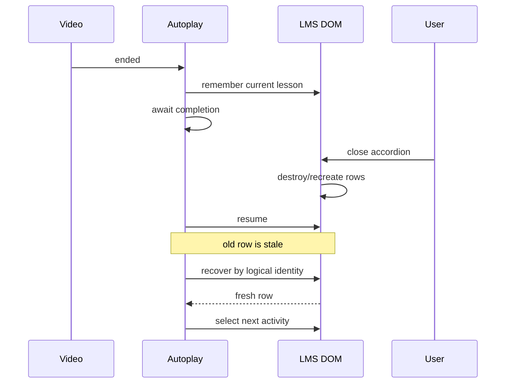

# 14 — Debugging, tests, and regressions

## Turning a bug into lasting knowledge

> **Reference snapshot for this chapter**  
> PlumePilot **2.35.2 release candidate**, branch `feat/ui-ux-2.35.2`, commit `f6fcb4c29c83ba9150df0be31da04fc91dffb634`.

A bug fixed today can return tomorrow. A bug explained through a minimal reproduction, a verified cause, a clearly stated invariant, and an automated regression test becomes durable project knowledge. PlumePilot offers many practical examples: autoplay recovery, reusable video elements, hidden tabs, incomplete-activity routing, multi-university storage, offline quiz exports, and the cross-browser release process.

---

## 1. From symptom to invariant

A proper fix follows a loop: observe a symptom, reproduce it, identify its cause, define the invariant, implement the change, and preserve that invariant in a regression test. Fixing only what is visible leaves the same underlying risk alive.

---

## 2. A symptom is not the root cause

If autoplay opens too many chapters, hiding intermediate UI transitions may conceal the symptom. The cause could be incorrect interpretation of the master index or ambiguous chapter identity. The test should protect the actual search contract, not a particular click sequence.

---

## 3. Debugging as the scientific method

Make a hypothesis about system behavior, predict a result, run a controlled experiment, and compare the outcome with the prediction. A failed prediction means the model or implementation needs revision.

---

## 4. Case study: the master index

An early assumption that 100% progress always meant complete was contradicted by real platform behavior. The algorithm evolved from treating summaries as proof to using them as prioritization evidence with verification paths. A bug improved the architectural model.

---

## 5. “Sometimes” is not a reproducer

A good report specifies browser, version, account or course conditions, state before the action, exact steps, expected result, and observed result. This description is already close to a test case.

---

## 6. Reduce the case

A failure in a large course can often be recreated with only two chapters and one unusual progress state. Minimal reproduction removes unrelated variables and makes the causal path easier to inspect.

---

## 7. A reproduction matrix

Relevant dimensions include browser, LMS platform, chapter order, activity state, autoplay settings, visible or hidden tab, popup or floating UI, and warmed or cold cache. Varying all of them at once defeats diagnosis.

---

## 8. Change one factor at a time

Hold the course, settings, and interaction sequence constant while changing only Firefox versus Chromium, or background versus content context. When one factor reliably changes the outcome, it becomes an actionable hypothesis.

---

## 9. One extension, several programs

Popup, service worker or background script, content script, MAIN-world code, and builder page have separate JavaScript lifecycles. Logs appearing in a different console are not evidence that a function failed to execute.

---

## 10. Start by identifying the execution context

To debug privileged messages, inspect the extension context that owns the API. To debug player DOM events, inspect the relevant tab/world. Always establish where the suspect line actually runs before interpreting its logs.

---

## 11. Same document, separate globals

MAIN and ISOLATED worlds can observe the same DOM yet have different global objects, patched functions, and event access. Debugging a shared page is not equivalent to debugging a shared JavaScript environment.

---

## 12. A typical bridge failure

A MAIN-world event may be emitted correctly while its ISOLATED bridge fails to forward it. Instead of asking whether one function was called, trace the entire event pipeline across its trust boundaries.

---

## 13. Instrumentation points

For a chain A → B → C → D, log or assert at the transitions, not only at D. Boundary observations reveal where a command disappears or changes shape.

---

## 14. Correlation IDs

A request ID connects the original command to acknowledgements, progress, completion, and failures. Without correlation, interleaved logs from concurrent exports are ambiguous.

**Example from the historical source:**

```js
requestId
```

---

## 15. A useful log answers a question

A vague “failed” message has little value. Prefer a structured record with operation identity, phase, expected condition, observed condition, and a safe failure reason.

---

## 16. Log invariants, not random details

For a routing bug, log lesson identity, display order, folder ID, target, and ambiguous matches. A button's CSS color is irrelevant unless the actual hypothesis concerns presentation.

---

## 17. Hypothesis-driven debugging

Avoid random edits followed by repeated manual checks. State the suspected cause, create a scenario that would disprove it, measure the result, then apply the narrowest correction.

---

## 18. There is more than one test type

PlumePilot uses small Node tests, DOM and timer fakes, source-structure checks, generated-artifact tests, browser integration fixtures, and release archive validation. Each protects a different layer.

---

## 19. Classify tests by the contract they prove

Separate pure unit behavior, state transitions, adapter boundaries, structure, browser integration, and final artifacts. A generic “test passed” label does not reveal what was actually validated.

---

## 20. The minimal Node assertion runner

Many project tests use node:assert/strict directly, including equal, deepEqual, match, and ok. A larger framework is not mandatory when a script can deterministically prove the invariant.

**Example from the historical source:**

```js
import assert from "node:assert/strict";
```

```js
assert.equal(...)
assert.deepEqual(...)
assert.match(...)
assert.ok(...)
```

---

## 21. Why strict assertions matter

Identity-sensitive assertions should not accidentally treat numeric 1 as string "1". Strict comparisons catch differences that JavaScript coercion might conceal in production data.

**Example from the historical source:**

```js
1
```

```js
"1"
```

---

## 22. Using node:vm as a small laboratory

Tests sometimes read part of production source and execute it in a VM context with controlled globals. This tests actual application logic while replacing browser dependencies.

**Example from the historical source:**

```js
const source = readFileSync(
  new URL("../content.js", import.meta.url),
  "utf8"
);

const context = vm.createContext({
  enabled: true,
  ...
});

vm.runInContext(
  extract("async function ...", "function ..."),
  context
);
```

---

## 23. What the VM gives us

A test can provide fake document nodes, timers, APIs, and storage, then observe side effects from a production helper. That isolates a targeted behavior from the full LMS.

---

## 24. Dependency injection without a framework

Instead of rewriting every production function to accept dependencies, a VM test context can inject specific globals at test time. This is pragmatic dependency injection for a legacy module shape.

**Example from the historical source:**

```js
function advance({
  currentLesson,
  recoverPlaybackLesson,
  sleep,
  ...
}) { ... }
```

---

## 25. A VM context is not a security sandbox

Node's vm contexts are not suitable for safely executing arbitrary hostile code. PlumePilot uses them with trusted project sources and deliberately controlled test inputs.

---

## 26. The closed-accordion test

A fake currentLesson initially returns null because its accordion is closed. A recovery helper returns a row only after a simulated rerender. The scenario isolates whether autoplay reacquires the actual playable row.

**Example from the historical source:**

```js
currentLesson: () => null
```

```js
recoverPlaybackLesson:
  async () =>
    ++recoveries === 1
      ? firstRow
      : restoredRow
```

---

## 27. Do not simulate all of React

The fake does not implement the LMS's framework. It models only the observable condition required by the invariant: a lesson element can disappear and be recreated before the next action.

---

## 28. What the test requires

The advance function must operate on the newly rendered lesson row rather than an obsolete reference. Assertions describe that behavior directly.

**Example from the historical source:**

```js
assert.equal(
  nextRowReceived,
  restoredRow,
  "advance must use the re-rendered lesson row"
);
```

---

## 29. Include a negative case

If the active lesson changes to a different one, the previous autoplay recovery must not advance it. A fix that always clicks a recovered row could override a user's manual navigation.

**Example from the historical source:**

```js
assert.equal(
  nextRowReceived,
  null,
  "a different active lesson must not be advanced"
);
```

---

## 30. Controlled timers

Capture the timeout callback rather than allowing real seconds to pass. The test decides precisely when the scheduled continuation runs.

**Example from the historical source:**

```js
setTimeout: (fn) => {
  pendingTimer = fn;
  return 1;
}
```

```js
await pendingTimer();
```

---

## 31. Deterministic race testing

Force a state change before invoking the captured callback. The race becomes reproducible and its effect can be asserted without hoping for fortunate timing.

---

## 32. One video element, different content

The LMS may reuse the same HTMLVideoElement across lesson changes. A test changes the media identity while retaining the object reference.

**Example from the historical source:**

```js
const reused = {
  ended: true,
  duration: 60,
  currentTime: 60,
  addEventListener(...)
};
```

---

## 33. Identity is not object identity

Autoplay must recognize a changed lesson even when the video DOM node remains identical. The semantic media identity must be checked, not only object equality.

---

## 34. Hidden-tab recovery

Background tabs may throttle timers and rendering. A naive timeout can be misread as evidence that the page is broken and trigger unnecessary reloads.

---

## 35. A fake clock

The test replaces Date.now and sleep with controlled virtual time. Recovery conditions can be exercised instantly and deterministically.

**Example from the historical source:**

```js
let now = 0;

Date: {
  now: () => now
}
```

```js
sleep = async (ms) => {
  now += ms;
  ...
};
```

---

## 36. Visibility transition

The fake document switches from hidden to visible after a chosen virtual timestamp and dispatches a visibility event. The wait should resume without treating the hidden interval as a fatal navigation failure.

**Example from the historical source:**

```js
assert.equal(
  result.rendered,
  true,
  "DOM waits must resume after the tab is visible"
);
```

---

## 37. Another invariant

Recovery must not reload a page merely because it remained hidden while timers were throttled.

**Example from the historical source:**

```js
assert.equal(
  reloads,
  0,
  "chapter recovery must not reload a hidden page"
);
```

---

## 38. Safety

A safety property says something bad never happens: for instance, do not advance a different active lesson or reload a hidden tab unnecessarily.

---

## 39. Liveness

A liveness property says something good eventually happens: once the tab becomes visible and the DOM appears, the workflow should proceed. A system can be safe but stuck, or active but unsafe.

---

## 40. An algorithmic regression suite

first-incomplete-activities.mjs uses controlled outlines, master percentages, detail responses, and side effects to verify discovery logic without rendering the entire LMS.

---

## 41. Earliest incomplete property

If chapter 1 is complete and chapter 2 is incomplete, return chapter 2; also assert which detail requests occurred and in what order.

**Example from the historical source:**

```js
assert.equal(
  result.entry.lessonNumber,
  2
);
```

```js
assert.deepEqual(
  requested.map(args => args[1]),
  [1, 2]
);
```

---

## 42. Performance can be a specification

With a master index prioritizing chapter 4 as incomplete, a test can require that only chapter 4 is queried on the successful fast path. This protects the optimization from regressions.

**Example from the historical source:**

```js
requested === [4]
```

---

## 43. Not at the expense of correctness

If the favored chapter is actually complete while an earlier chapter is incomplete, the fallback must continue searching. Protect the speed path and the recovery path together.

**Example from the historical source:**

```js
requested === [4, 1]
```

---

## 44. Happy paths are insufficient

Test stale summaries, missing mappings, malformed responses, conflicting percentages, failed requests, and user cancellation. These are adversarial inputs to an algorithm, not necessarily security attacks.

---

## 45. Complete, incomplete, unknown

A missing or non-finite percentage is not automatically 0% or 100%. Tests should preserve the third state: unknown.

---

## 46. Identity collisions

Different chapters can share display_order values when the numbering restarts in each folder. Global routing based only on display order is unsafe.

---

## 47. Test the ambiguity directly

Construct two plausible matches and require an empty or unresolved mapping when no stronger identity is available. This is fail-closed identity resolution.

**Example from the historical source:**

```js
assert.equal(
  playbackCourseRouteMap(ambiguous, outline).size,
  0
);
```

---

## 48. Test that a dangerous action does not occur

Some of the best tests assert no unwanted reload, no wrong-row click, no ambiguous match, and no inappropriate confirmation. Preventing harmful side effects is as important as successful execution.

---

## 49. Multiversity isolation

Pegaso and Mercatorum may have overlapping course codes or identifiers. Storage identity must include platform context to prevent cross-university collisions.

---

## 50. Deliberately construct a collision

Store data for two universities with matching logical IDs in one test, then verify both survive and remain distinct.

---

## 51. Test concurrent writes

Promise.all can start independent storage updates simultaneously. The test checks that serialization does not lose one of the updates.

**Example from the historical source:**

```js
await Promise.all([
  storePegaso(),
  storeMercatorum()
]);
```

---

## 52. Legacy keys

Old unprefixed data can remain valid for legacy Pegaso behavior without being incorrectly interpreted as Mercatorum data.

---

## 53. Migration behavior is a contract

A schema upgrade must define not only the new shape but what old keys mean, how long they remain readable, and what is not allowed to leak into another platform.

---

## 54. Not every test runs the feature

Some tests inspect static source or HTML with regular expressions and ordering assertions. They prove narrow structural properties rather than full behavior.

**Example from the historical source:**

```js
assert.match(
  popupHtmlSource,
  /id="chapterLimitValue" .../
);
```

```js
assert.ok(
  contentSource.indexOf("if (thresholdReached)") <
  contentSource.indexOf("if (sessionLimitReached)")
);
```

---

## 55. What structural tests protect

Source tests are effective for required IDs, manifest declarations, load ordering, and important guard placement. They are inexpensive early warnings.

---

## 56. Source matching is not behavior

Seeing a function name or guard expression in source does not prove the function runs correctly. Structural tests complement but cannot replace behavioral tests.

**Example from the historical source:**

```js
assert.match(
  source,
  /someFunction/
);
```

---

## 57. A particularly valid use

A test verifies menu-ux.js loads before floating-menu.js. That is a genuine architectural ordering contract, so checking the source manifest is appropriate.

**Example from the historical source:**

```js
assert.ok(
  scripts.indexOf("menu-ux.js") <
  scripts.indexOf("floating-menu.js")
);
```

---

## 58. Architecture tests

These verify wiring, dependency order, presence of declared features, and component boundaries. They protect system shape without impersonating an end user.

---

## 59. Generated HTML quiz tests

test-html-notes.mjs constructs a mock quiz job, invokes the export path, captures the Blob, and examines the output it would give a user.

---

## 60. Inspect the generated product

Assert that the saved HTML contains note structures, status data, allowed behavior, and other required content. Checking only an internal builder function would prove less.

---

## 61. Parse the embedded script

The test extracts the generated script and asks the local JavaScript parser to accept it. This catches accidental syntax errors in serialized offline HTML.

**Example from the historical source:**

```html
<script> ... </script>
```

```js
new Function(script);
```

---

## 62. Node is not a browser

A fake DOM cannot faithfully reproduce native focus, Shadow DOM, CSS layout, keyboard navigation, or Chromium rendering. Those contracts require integration tests in a real browser.

---

## 63. Browser integration layer

The v2.35.2 fixture exercises both UI controllers with a shared fake extension store, checking navigation, focus, preference synchronization, scroll, theme, and active operations.

---

## 64. Prefer user-visible E2E contracts

An E2E test that asserts private variable shapes can break on harmless refactors. Verify observable behavior whenever that is the contract being promised.

---

## 65. Contract-oriented E2E

Prefer “the Back button restores focus and the previous scroll position” over “internal homeScroll equals a particular number,” unless that internal value itself is an explicit contract.

---

## 66. The debugger can affect lifecycle

Keeping DevTools open can change the service worker's idle and termination behavior. A lifecycle bug may disappear while inspected.

---

## 67. The consequence

A feature that accidentally relies on a live background global can appear stable during debugging and fail after Chrome terminates the idle worker.

---

## 68. Test termination explicitly

Terminate the worker in a controlled browser test, restart the relevant workflow, and verify state restoration, event listeners, and active-operation coordination.

---

## 69. What is a flaky test?

A flaky test sometimes passes and sometimes fails without relevant source changes. Async timing and browser scheduling are common causes.

---

## 70. Common sources of flakiness

Uncontrolled timers, real network latency, shared persistent storage, animations, unexpected background termination, and unstable DOM readiness can all alter outcomes.

---

## 71. Fake time

Control Date.now, timers, and sleep whenever the property depends on logical order rather than real waiting.

---

## 72. Fake APIs

Inject deterministic success, partial results, rate limits, errors, or cancellations instead of depending on a live endpoint to fail at the right moment.

**Example from the historical source:**

```js
requestLessonWithRetry: async (...) => ({
  ok: true,
  data: ...
});
```

---

## 73. A minimal fake DOM

Create only the nodes, attributes, and events needed by the invariant. Avoid implementing an entire browser in a unit-test helper.

---

## 74. Do not fake away all reality

A perfect fake may conceal the browser quirk that caused the original bug. Combine deterministic tests with browser fixtures and selected manual checks.

---

## 75. The traditional test pyramid

A conventional pyramid has many fast unit tests, fewer integration tests, and a small number of expensive E2E tests.

---

## 76. An LMS extension needs several boundaries

PlumePilot integrates with browser APIs, remote LMS behavior, cross-world messaging, dynamic DOM, and packaged resources. Its test strategy therefore needs contract and artifact tests in addition to pure unit coverage.

---

## 77. Build a test matrix from each bug

For autoplay, axes include chapter identity, completion, visibility, cache freshness, test policy, browser, and DOM lifecycle. Do not try to enumerate every Cartesian combination.

---

## 78. Pairwise thinking

Select combinations likely to expose interactions. For example, a closed accordion combined with an autoplay recovery transition uncovered a real regression.

---

## 79. State-transition coverage

For a state machine, testing only states is not enough. Test transitions such as waiting → recovered, playing → stopped, and cancellation during a pending wait.

---

## 80. Cover guard outcomes

Each critical guard deserves at least a test where it permits an action and one where it rejects the action. Otherwise a skipped branch can hide an unsafe transition.

---

## 81. Line coverage is not behavior coverage

Executing every line does not establish correctness under ambiguous identities, unusual timing, malformed responses, or missing browser capabilities. Ask which property was proven.

---

## 82. Assertions document intent

The message “advance must use the re-rendered lesson row” is a concise statement of the system's contract, even when the test passes.

---

## 83. A regression test tells a story

A meaningful test name describes the scenario and protected result, not just an internal function number. Future maintainers should understand why an odd guard exists.

---

## 84. Use changelog, tests, and source together

The changelog explains when and why a workaround appeared; the test defines the intended invariant; source shows the implementation. Triangulate them before removing old-looking code.

---

## 85. Git bisect as a mental model

If a feature worked on one commit and fails on a later one, binary search over the history narrows when the regression first appeared.

---

## 86. Automated tests strengthen bisect

A command that reliably returns pass or fail can serve as the oracle for git bisect and identify the introducing commit.

**Example from the historical source:**

```bash
node tests/foo.mjs
```

---

## 87. Root cause and contributing factors

Hidden-tab failures may combine throttled timers, incorrect timeout interpretation, and an overly aggressive reload fallback. A useful postmortem distinguishes these factors instead of naming one vague cause.

---

## 88. A technical Five Whys

If routing chose the wrong chapter, ask why display_order was reused, why the route treated it as global identity, and why no ambiguity guard existed. The final question should identify the missing invariant.

---

## 89. Temporary debug logging

Large dumps of DOM nodes can help one session, but may retain objects, pollute output, and expose data. Remove them after diagnosis.

**Example from the historical source:**

```js
console.log(allDOMNodes)
```

---

## 90. Stable diagnostics

Structured events such as operationStarted, candidateRejected, fallbackSelected, or buildFinalized may deserve persistent, opt-in diagnostic support because they describe domain transitions.

---

## 91. Protect privacy during debugging

Extensions handle course data, authentication context, and personal notes. Avoid logging passwords, cookies, raw tokens, or unnecessary user content. Redact and limit diagnostic payloads.

---

## 92. “Failed” is not enough

A helpful error identifies which phase and resource failed, whether the condition might be temporary, and what happens next.

---

## 93. Two audiences

Users need a concise action-oriented message; developers may need operation IDs, response status, retry counts, and safe technical metadata. Do not expose all raw diagnostics to every user.

---

## 94. A fallback must be tested

Any code path that claims to recover from an API or DOM failure should have a test that deliberately triggers that failure and observes the fallback.

---

## 95. Inject an incomplete lesson response

The first-incomplete suite returns an explicit failed or incomplete detail response for one chapter instead of waiting for a live LMS failure.

**Example from the historical source:**

```js
if (args[1] === failedChapter) {
  return {
    ok: false,
    error: "LESSON_DATA_INCOMPLETE"
  };
}
```

---

## 96. Expected fallback result

The result should request visualVerification for the affected candidate and preserve already established search progress, not restart blindly.

**Example from the historical source:**

```js
assert.equal(
  failed.result.visualVerification,
  true
);
```

---

## 97. Cancellation is semantic behavior

Differentiate cancelled by user, network timeout, and ordinary operation failure. Abortion is not merely one more error.

---

## 98. Cancellation latency

A long operation should stop expensive stages promptly after cancellation; EPUB yields and abort checks are part of this contract.

---

## 99. Benchmark versus test

A test asks whether a required property holds; a benchmark asks how long or how much memory a workload consumes. They can inform each other but are not interchangeable.

---

## 100. EPUB fixtures and output

Use representative text, mathematical, visual, and table-heavy PDFs to verify conversion semantics, archive validity, and cancellation.

---

## 101. Stable performance properties

Instead of a fragile millisecond threshold, check request counts, cleanup, no duplicate expensive work, and memory-related invariants. These are often deterministic proxies for performance regressions.

---

## 102. Keep timing benchmarks separate

Measure wall time and throughput under a fixed browser, machine, and fixture. Do not make a strict pass/fail unit test depend on fluctuating machine load.

---

## 103. EPUB fixtures

Maintain representative PDFs for text, formulas, tables, diagrams, and page images. The same input should expose conversion regressions reproducibly.

---

## 104. Golden output

Inspect chapter order, manifest, links, media types, page modes, and expected content. Byte-identical ZIP output is not always necessary.

---

## 105. The giant snapshot trap

Committing every byte of a generated HTML or EPUB file as a snapshot can make harmless changes generate incomprehensible diffs.

---

## 106. Prefer semantic snapshots

Extract a small stable representation, such as chapter titles, resource paths, table-of-contents entries, and specific content markers. Compare that instead of the entire archive.

---

## 107. The pixel problem

Clipped labels, misaligned checkboxes, and inaccurate fonts may not be caught by DOM-state assertions alone.

---

## 108. Three visual regression levels

Combine structural DOM checks, browser geometry/behavior assertions, and selected image comparisons. The last is necessary for some visual defects.

---

## 109. When screenshot tests help

Screenshots are useful for typography, alignment, responsive layouts, color contrasts, and clipping. They are less useful for proving storage synchronization or race safety.

---

## 110. Make visual tests stable

Control browser version, viewport, zoom, fonts, animations, theme, and fixture data before comparing screenshots; otherwise harmless environmental differences create noise.

---

## 111. Focus is state

Keyboard focus is part of an interaction contract. A visual refactor can leave every pixel apparently correct while moving the user's focus to the wrong element.

---

## 112. Test focus explicitly

After opening settings, focus should enter the detail appropriately. Back and Escape must restore focus to the opener; reordering should preserve a logical focused control.

---

## 113. Many bugs are ordering bugs

Examples include loading shared UI helpers before consumers, registering background listeners before events occur, and processing asynchronous callbacks in the right generation.

---

## 114. Ordering is a contract when behavior depends on it

If two instructions can run in either order without changing semantics, do not assert an arbitrary sequence. When a dependency makes order essential, testing it is appropriate.

---

## 115. Concurrency does not require threads

Two asynchronous operations can interleave across await points on one JavaScript thread. Tests can control their promises and continuations explicitly.

**Historical code example:**

```js
Promise.all([...])
```

---

## 116. Expose a possible storage race

Introduce a scheduled pause between reading and writing shared state so two updates compete. A serialized write queue should preserve both changes.

**Historical code example:**

```js
storageGetMany: async (...) => {
  await new Promise(resolve => setTimeout(resolve, 2));
  ...
}
```

---

## 117. Controlled barriers are stronger than tiny sleeps

A deferred Promise lets the test deliberately resume operation B between two phases of operation A. This models an exact interleaving without relying on a real 2 ms timeout.

---

## 118. Identify nondeterminism

Review time, timers, UUIDs, network data, storage state, event order, browser lifecycle, fonts, and rendering. Any can make an otherwise simple assertion flaky.

---

## 119. Control only the relevant inputs

Not every dependency needs mocking. Fix the inputs whose variation would invalidate the property you are trying to prove.

---

## 120. Deterministic UUIDs

crypto.randomUUID is useful in production for operation identity. When a test compares serialized outputs, inject stable IDs to avoid meaningless snapshot changes.

---

## 121. Locale and timezone

Date formatting and timestamps can depend on timezone or locale. Either fix the environment or assert a representation insensitive to those variations.

---

## 122. Tests must not depend on preceding tests

A test that inherits modified storage or open tabs from another case is fragile. Isolation should be the default.

---

## 123. Create fresh state

Build new Maps, fake APIs, timers, DOM, and storage for each test unless the scenario explicitly tests upgrades or migration.

---

## 124. Add a regression test with the fix

Ideally reproduce the failure as a red test, implement the correction, verify green, then refactor safely.

---

## 125. Some bugs require exploration first

When the cause is unclear, manual experiments may precede automation. Before closing the issue, preserve the critical behavior in a repeatable test where feasible.

---

## 126. Keep tests proportional

A simple CSS label defect may need a small structure assertion or targeted browser check, not a complete three-browser E2E harness.

---

## 127. Use the lowest layer that can prove the property

A small deterministic test is preferable to a slow browser test only if it actually exercises the behavior of interest.

---

## 128. Do not choose a layer that is too low

Regex matching a focus handler does not prove focus was correctly restored. Interaction semantics require a real DOM or browser fixture.

---

## 129. What is a test seam?

A seam is a point at which a dependency can be replaced: a clock, request function, storage adapter, browser method, or DOM resolver.

---

## 130. PlumePilot's current seams

Several tests inject globals through VM contexts or controlled source extraction. Practical, but this indicates opportunities to make some dependencies explicit.

---

## 131. Textual source extraction

The current technique locates source boundaries as text and evaluates selected production functions in a test VM. It avoids importing complex browser startup code.

**Historical code example:**

```js
source.slice(
  source.indexOf("async function X"),
  source.indexOf("function Y")
)
```

---

## 132. The brittle boundary

Renaming or moving a function may break a string-based extractor even if runtime behavior is unchanged. That is test brittleness, not necessarily a functional regression.

---

## 133. Brittle tests

A brittle test fails because of harmless internal rewrites that do not change its promised property. Excessive DOM selector or source-text coupling is a common cause.

---

## 134. Sometimes structure is the contract

Load ordering, manifest declarations, and specific guard placement can themselves be required. Testing them intentionally is appropriate.

---

## 135. Extract pure helpers over time

Candidate ordering, summary formatting, normalized identities, and other deterministic logic can move into explicit exported modules.

---

## 136. The resulting test is simpler

Import the helper and call it with controlled inputs instead of slicing and evaluating arbitrary sections of content.js.

**Historical code example:**

```js
import {
  courseIndexRouteMap
} from "../playback-discovery.mjs";
```

---

## 137. Avoid massive testability refactors

Many PlumePilot functions legitimately depend on the host DOM. Pull out well-bounded pure logic without reorganizing the entire extension merely to satisfy one test framework.

---

## 138. External boundaries require contract tests

The LMS, browser messaging, extension storage, and generated document formats are external or shared contracts whose shapes can drift.

---

## 139. What a contract test verifies

Check input normalization, expected output fields, permissible missing data, errors, and safe fallback behavior at a boundary.

---

## 140. Contract drift

If the provider renames a lesson field, fail close to the adapter that reads it rather than allowing incorrect decisions deeper in autoplay.

---

## 141. Malformed input matters

Test missing entries, null IDs, invalid percentages, wrong types, duplicate display orders, and unexpected arrays in normalization helpers.

---

## 142. Safe parser outcome

When a provider response is malformed, prefer explicit unavailability or a controlled fallback rather than inventing values that look authoritative.

---

## 143. Artifact validation revisited

Chapter 13 showed that validate-release.mjs inspects the generated ZIP. Such verification is preventative debugging before any reviewer or user installs it.

---

## 144. A source-to-artifact failure

Source can contain the correct menu stylesheet while a build excludes it. The runtime source test passes; the artifact validator catches the omission.

---

## 145. Manual smoke testing still matters

Test real platform courses, popup and floating menu, autoplay, exports, and cancellation before submitting an update. Not everything can be reproduced in Node.

---

## 146. Make the smoke test a checklist

Replace "try the extension" with repeatable steps, prerequisites, expected outcomes, and browser/platform coverage.

---

## 147. Exploration complements checklists

Regression checklists protect known guarantees. Exploratory testing finds surprising combinations and unforeseen failure modes.

---

## 148. Dogfooding exposes reality

Using PlumePilot on real courses reveals long-tail layouts, unusual lesson states, delayed responses, and actual user workflows that synthetic fixtures might miss.

---

## 149. Turn dogfooding discoveries into tests

A bug found through real use should become an issue description, minimal fixture, and regression case so knowledge no longer exists only in the maintainer's memory.

---

## 150. A useful bug report

Record browser and extension version, LMS platform, course context, setup, steps, expected versus observed behavior, frequency, safe logs, and whether the issue reproduces on a clean state.

---

## 151. When a screenshot or video helps

Recordings help with animations, focus, visual clipping, and timing sequences. Structured logs and state snapshots may be more useful for storage or API identity collisions.

---

## 152. Prioritize by risk

Wrong activity navigation, data loss, uninterruptible work, or invalid release packages are more serious than cosmetic spacing. Severity should reflect impact and recovery options.

---

## 153. Fail closed on ambiguous identity

When two chapters are equally plausible, do not choose one arbitrarily and perform side effects on it. Require additional evidence or stop safely.

---

## 154. Unknown test completion

If completion cannot be established, do not silently classify a pending test as complete. Verify or present a safe intermediate state.

---

## 155. Ambiguous vendor transformation

If replaceExactly cannot prove it matched precisely one expected pattern, fail the build rather than producing questionable executable output.

---

## 156. Not every error means immediate failure

A transient HTTP error may merit retry; missing DOM may merit waiting; ambiguous identity requires restraint. Classify the condition before choosing recovery.

---

## 157. Error class determines recovery

Temporary network → retry/backoff; incomplete API → visual fallback; DOM not ready → wait; ambiguous identity → stop; hidden tab → defer; stale cache → refresh; user cancel → cleanup; invalid ZIP → fail build; store warning → assess.

---

## 158. Write an event timeline

For difficult races, list each operation's start, await, resume, write, and completion. The overlap often becomes obvious before opening the debugger.

---

## 159. Sequence diagrams express timing

A sequence diagram can show concurrent storage writes, messages, and callbacks. It is simultaneously an explanation and a temporal specification.

**Historical code example:**



---

## 160. The lost-update race

A and B can read the same old object, modify different fields, then overwrite each other when saving. A serialized read-modify-write queue changes the order and preserves both updates.

---

## 161. Control suspension points

Every await can let another operation run. During testing, explicitly decide what happens between yielding and resuming.

**Historical code example:**

```js
await
```

---

## 162. Features multiply state combinations

New settings, browsers, operation types, and activities increase the state space. Exhaustively enumerating the Cartesian product is impractical.

---

## 163. Tests compress knowledge

Choose scenarios that represent invariant classes rather than every single data combination. One good ambiguity test can protect many datasets.

---

## 164. Candidate ordering as a property

Whatever the percentages, candidates within the preferred group should keep course order, and earlier unverified chapters must not be permanently discarded.

---

## 165. Property-based testing as a future option

A generator could vary chapter counts, percentages, missing identities, and contradictory master values, then check stable properties automatically.

---

## 166. Lightweight fuzzing

Feed parsers and normalizers duplicate IDs, unusual arrays, missing fields, and invalid numeric values. Require deterministic, safe output instead of crashes or fabricated truth.

---

## 167. Mutation testing

Deliberately change a guard, invert a condition, or remove cleanup. Would the test suite fail? If not, the asserted property may be too weak.

---

## 168. Where mutation tests add value

Critical routing, cancellation, state ownership, and release validator checks are good candidates for future mutation testing.

---

## 169. A weak assertion

assert.ok(result) proves that some truthy value exists. It says little about which target was chosen or what side effect occurred.

**Historical code example:**

```js
assert.ok(result);
```

---

## 170. A stronger assertion

Check the exact target identity, request order, absence of forbidden side effects, and a clear failure message when the property breaks.

**Historical code example:**

```js
assert.equal(result.status, "target");
assert.equal(result.entry.lessonNumber, 4);
assert.deepEqual(requested, [4]);
```

---

## 171. A fragile sleep-based test

await sleep(2000) relies on elapsed time, is slow, and may still fail on a busy CI host.

**Historical code example:**

```js
await new Promise(r => setTimeout(r, 3000));
```

---

## 172. A better controlled continuation

Use a captured callback, virtual clock, or deferred Promise to make the relevant asynchronous transition deterministic.

---

## 173. An overly clever mock is a maintenance burden

A thousand-line fake reimplementation of the LMS duplicates product complexity and may repeat production bugs instead of exposing them.

---

## 174. Minimal test doubles

Model only the critical observable facts—for example, a closed accordion returns no row until recovery produces a new one.

**Historical code example:**

```js
currentLesson: () => null
```

---

## 175. Avoid overcoupling tests to implementation

Testing a private variable's exact shape can fail after harmless refactors. Prefer observable decisions and outcomes when they express the real contract.

---

## 176. Include negative cases in regression fixes

Restoring a closed accordion is important; refusing to advance the wrong manually selected lesson is equally essential.

---

## 177. Do not freeze irrelevant implementation order

If two equivalent implementations produce the same result, tests should not impose one call ordering unless ordering itself protects a dependency.

---

## 178. Continuous integration as automatic memory

Ideally every PR runs deterministic unit, structural, output, and artifact tests; it prevents merging changes that break known invariants.

---

## 179. The project's current position

The repository already contains a meaningful set of tests even where CI coverage is incomplete. A central command would be a natural next step.

---

## 180. A test command is a developer interface

When dozens of individual Node test files exist, relying on maintainers to remember all names is error-prone. Offer one repeatable entry point.

**Historical code example:**

```bash
npm test
```

```bash
node scripts/test-all.mjs
```

---

## 181. A simple test runner

Discover test files, run them in deterministic order, stop on failures, and provide an overall exit status without necessarily adding a heavyweight dependency.

---

## 182. Categorize test commands

A future CLI could distinguish fast unit checks, browser integration, build validation, and full release verification so cost and prerequisites remain visible.

---

## 183. Browser matrix with Playwright

Playwright supports multiple browser engines, but WebExtensions require loading real extension contexts. A web-page test in Firefox does not automatically exercise the AMO extension runtime.

---

## 184. Firefox Playwright is not the AMO extension target

Testing ordinary Firefox webpage behavior cannot prove a Firefox MV3 background script, manifest, or store ZIP is valid. Use appropriate target-specific extension tests.

---

## 185. Test the actual installed package

Generate, validate, install, and exercise the browser-specific release archive whenever practical. This more closely matches what users receive.

---

## 186. Store lint is not an E2E test

web-ext lint finds manifest and package issues but does not prove autoplay, notes, or exports work.

---

## 187. Use complementary validation layers

Source tests, browser interaction tests, final archive validation, lint, and manual smoke checks detect different failure classes.

---

## 188. Store rejection is a symptom

Before changing code, determine whether a rejection concerns manifest, remote code, obfuscation, missing source, reviewer access, or another policy category.

---

## 189. Reproduce review warnings locally

If a reviewer flags dynamic evaluation, scan the **generated Firefox ZIP**, not merely the repository source. This motivated review-safe transforms and validators.

---

## 190. Turn rejection into an invariant

Identify the exact cause, add a deterministic package check, and include it in every future release process.

---

## 191. Release metadata can regress

Outdated version strings, missing localization, incorrect What's New cards, and stale reviewer instructions are genuine release defects.

---

## 192. Docs as operational input

When a reviewer follows AMO_SOURCE_README.md or test instructions, those documents are part of delivery and deserve consistency checks.

---

## 193. Debug CSS geometry before guessing

For clipping, inspect the actual scroll container, bounding boxes, computed style, scrollbar gutter, and viewport rather than changing random margins.

---

## 194. CSS invariants plus browser measurements

A source check can ensure the right selector exists; a browser geometry check proves the content actually fits and remains reachable.

---

## 195. Reduced motion is a test input

Emulate prefers-reduced-motion and verify that interaction remains correct when smooth scrolling or animations are shortened or disabled.

---

## 196. Inspect generated files directly

PDF, EPUB, and offline HTML are independent artifacts. The builder UI saying “complete” does not prove that files parse, link correctly, or preserve content.

---

## 197. Structured EPUB diagnostics

The builder can expose page modes, asset counts, bytes, and elapsed time through a diagnostics object, enabling targeted tests and benchmarks.

**Historical code example:**

```js
diagnostics
```

---

## 198. Prefer diagnostic objects to noisy logs

Record structured data and let the caller decide whether to display, compare, or discard it. This separates observability from console output.

**Historical code example:**

```js
diagnostics.pages.push(record);
```

---

## 199. Difficulty testing often reveals coupling

If checking candidate order requires stubbing an entire LMS page, pure decision logic and DOM effects may be too tightly intertwined.

---

## 200. But not every browser feature should be pure

Some operations genuinely require host DOM, extension messaging, or layout. The goal is to isolate deterministic logic where beneficial, not pretend platform effects can disappear.

---

## 201. Functional core and imperative shell

Keep deterministic decisions in a small functional core and environment effects in an imperative shell. Core logic is easy to unit test; DOM interaction and browser messaging require appropriate integration tests.

---

## 202. A future discovery-engine boundary

Candidate ordering, identity comparison, and confidence rules could be extracted from the DOM adapter, making first-incomplete discovery easier to test directly.

---

## 203. The UI already provides an example

autoplayPresentation() takes policy inputs and returns a view model without touching the DOM. This separation is a successful example of testable presentation logic.

---

## 204. Stable observability fields

Operation IDs, phase names, statuses, and error categories can form a shared structured diagnostic model for UI, background, and tests.

---

## 205. Do not parse console output as an API

Tests should consume structured events or result objects where available, not depend on exact formatting of a human-readable log line.

---

## 206. Should we assert at runtime?

Production code cannot throw assertions indiscriminately, but normalization at trust boundaries should reject or classify invalid data. Test those guards explicitly.

**Historical code example:**

```js
if (!validIdentity(...)) return fallback;
```

---

## 207. Assert strongly at build time

The release compiler can fail immediately on an invalid manifest, missing file, or unexpected vendor transform. Shipping a questionable artifact is worse than failing the build.

---

## 208. First record a new bug

Record the symptom, expected and observed behavior, minimal steps, environment, affected identity, and possible consequences before changing code.

---

## 209. Then choose the strategy

Decide whether the case needs an exact reproducer, fake timer, boundary fixture, browser integration, artifact test, or a combination.

---

## 210. Debug checklist: identity

Which platform, course code, folder, lesson number, activity ID, or request ID identifies the affected object? Could any field be duplicated?

---

## 211. Debug checklist: context

Which script and execution world owns the relevant API, event, listener, or DOM node? Is a background process ephemeral?

---

## 212. Debug checklist: source of truth

Did the value come from master progress, lesson detail, DOM, local storage, or an old cache? How authoritative and fresh is it?

---

## 213. Debug checklist: lifetime

Could an await, rerender, tab visibility change, or worker restart make the data or node stale before the action?

---

## 214. Debug checklist: side effects

What harm follows a wrong decision: clicking another lesson, reloading a hidden tab, losing notes, concealing cancellation, or submitting an invalid package?

---

## 215. Debug checklist: fallback

Is there a safer, targeted verification or recovery route than proceeding with an uncertain result?

---

## 216. Debug checklist: regression test

What is the smallest deterministic environment that demonstrates the rule and its dangerous counterexample?

---

## 217. Closed accordion: symptom

Autoplay stops because it cannot find a visible lesson row after a chapter accordion has been closed or rebuilt.

---

## 218. Closed accordion: root cause

A stale DOM reference or premature lookup assumed the row was still present across a rendering boundary.

---

## 219. Closed accordion: fix

recoverPlaybackLesson() reacquires the currently rendered row before the next playback transition.

---

## 220. Closed accordion: test

Simulate a lesson row disappearing during an await and being recreated afterward.

---

## 221. Closed accordion: invariant

Advance only the refreshed row for the intended lesson, and never advance a different manually selected lesson.

---

## 222. Skip-completed: symptom

To reach incomplete chapter 5, autoplay unnecessarily opens chapters 2, 3, and 4.

---

## 223. Skip-completed: root cause

The search took an expensive visual traversal path despite master-index information that could prioritize later candidates.

---

## 224. Skip-completed: fix

Use master-guided forward API discovery to identify the target without opening each intermediate chapter.

---

## 225. Skip-completed: test

Set the first incomplete module beyond multiple completed ones and assert the request order and number of unnecessary DOM openings.

---

## 226. Skip-completed: invariant

A correct forward search should skip confidently completed chapters without opening each one, while retaining the appropriate verification behavior.

---

## 227. Stale master: symptom

The tool incorrectly concludes that every activity is finished even though a chapter has unfinished work.

---

## 228. Stale master: root cause

An aggregate 100% summary was treated as an unchallengeable source of truth.

---

## 229. Stale master: fix

Prioritize candidates below 100% but preserve detail verification and a second pass when summaries fail.

---

## 230. Stale master: test

Give the master an all-100% view while a detail response identifies unfinished work; ensure discovery does not stop prematurely.

---

## 231. Stale master: invariant

Aggregate completion is an index or heuristic, not always conclusive evidence about individual activities.

---

## 232. Hidden tab: symptom

A background tab triggers repeated recovery reloads after a timeout.

---

## 233. Hidden tab: root cause

Time spent hidden with throttled callbacks was interpreted as a broken page.

---

## 234. Hidden tab: fix

Use visibility-aware waiting and recovery rather than treating a hidden timeout as fatal.

---

## 235. Hidden tab: test

Advance a fake clock, fire visibilitychange, and assert successful resumption without reload.

---

## 236. Hidden tab: invariant

A hidden tab alone must not cause a recovery reload; work should resume when the page becomes visible and ready.

---

## 237. Platform collision: potential symptom

Course state from Pegaso and Mercatorum might overwrite each other when their IDs happen to match.

---

## 238. Platform collision: root cause

Storage keys did not fully encode the platform identity domain.

---

## 239. Platform collision: fix

Use composite keys scoped by university and relevant course or operation identity.

---

## 240. Platform collision: test

Perform concurrent same-ID writes under two platforms and verify both records remain distinct.

---

## 241. Platform collision: invariant

Data from one LMS platform must not overwrite or be interpreted as another platform's state.

---

## 242. Firefox review: symptom

A Firefox store submission fails even though the extension passes functional smoke tests.

---

## 243. Firefox review: root cause

Packaged vendor files retain review-sensitive dynamic execution patterns or insufficient provenance.

---

## 244. Firefox review: fix

Keep readable pinned upstream sources and apply controlled deterministic target transformations.

---

## 245. Firefox review: test

Inspect the finished ZIP with a restricted-pattern scanner and checksum validator.

---

## 246. Firefox review: invariant

The Firefox artifact must satisfy explicit review-safety and provenance contracts on every build.

---

## 247. UI redesign: symptoms

The popup and floating menu drift in typography, checkbox styles, layout, scroll behavior, and visibility of controls.

---

## 248. UI redesign: root cause

Presentation rules and interaction behavior were independently repeated across the two surfaces.

---

## 249. UI redesign: fix

Introduce shared menu UX helpers, design tokens, and stable DOM conventions while preserving independent controllers.

---

## 250. UI redesign: test

Combine source invariants with a Chromium fixture that actually exercises popup and floating-menu behavior.

---

## 251. UI redesign: invariant

Both surfaces must agree on shared meanings, keep keyboard navigation stable, and leave controls for active work reachable.

---

## 252. Improve source slicing over time

Source extraction through string boundaries accelerated development, but explicit exported testable modules would make future refactors less brittle.

---

## 253. Provide one test runner

A single discoverable command lowers the risk of accidentally omitting one of many regression scripts.

---

## 254. More browser-specific E2E testing

Exercise the actual Chrome/Edge and Firefox extension contexts, including background restart and packaged resource differences.

---

## 255. Versioned API contract fixtures

Sanitized real-world LMS responses could protect parsers and normalizers when upstream response shapes change.

---

## 256. Selective visual regression

Use screenshot comparison where geometry and pixels are part of the user-facing contract, not for every invisible behavior.

---

## 257. Do not replace everything with E2E

Browser-wide tests can be slow, flaky, costly to maintain, and difficult to diagnose. Preserve small deterministic tests where they genuinely prove a property.

---

## 258. Do not replace everything with pure unit tests

Real focus behavior, Shadow DOM styling, extension background lifecycles, and packaged manifests need integration or artifact coverage.

---

## 259. Do not equate quality with coverage percentage

The useful metric is which safety, liveness, and user-visible properties the suite actually protects.

---

## 260. A possible future test structure

Organize fast tests, browser integration, release artifact checks, and manual live scenarios by purpose so their cost and prerequisites are explicit.

---

## 261. Fast suite target

Run frequently during development and on each PR; include pure logic, VM scenarios, normalizers, and lightweight structural checks.

---

## 262. Browser suite target

Exercise real DOM, focus, shared settings, startup, Shadow DOM, and target-specific extension behavior.

---

## 263. Release suite target

Regenerate the packages, run artifact validation and lint, check manifests, checksums, and source-review material before submissions.

---

## 264. Manual live suite target

Test a concise set of real LMS flows—autoplay, incomplete discovery, quiz export, materials export, exam status, and cancellation—because fixture coverage cannot fully control an external provider.

---

## 265. Debugging reduces the search space

A bug begins with many possible explanations. Each well-designed observation rules out hypotheses and narrows the remaining causes.

---

## 266. Regression tests reduce future search work

When a future change violates a known invariant, a targeted test fails close to the cause before users rediscover it.

---

## 267. A comment can be ignored

A comment explains why an odd guard exists, but nothing forces future code changes to honor it.

**Historical code example:**

```js
// Don't break closed accordions
```

---

## 268. A test is executable memory

An assertion that fails if the guard's invariant disappears encodes the same knowledge in a form the release process can enforce.

**Historical code example:**

```js
assert.equal(nextRowReceived, restoredRow);
```

---

## 269. Tests change refactoring risk

Without coverage, developers hesitate to change unfamiliar code; behavior-focused tests do not remove risk but expose unintended changes sooner.

---

## 270. After a refactor, classify test failures

The code may have regressed, the test may be coupled to irrelevant structure, or the requirement may intentionally have changed. Do not blindly change assertions to green.

---

## 271. Intentional changes in autoplay requirements

If the desired policy changes, an old regression test may correctly fail. Update the documented requirement, implementation, and test together.

---

## 272. Tests record decisions, not eternal truth

A test reflects a historical expectation that can be mistaken or superseded. Treat failures as change detectors requiring investigation, not absolute oracles independent of product requirements.

---

## 273. What the debugger is good for

Inspect call stacks, live state, current DOM, breakpoints, and step-by-step control flow during one concrete failure.

---

## 274. What logging is good for

Track asynchronous events across contexts and time, especially when a debugger would change the relevant lifecycle.

---

## 275. What tests are good for

Replay controlled scenarios and guard against future regression. Debuggers, logs, and tests solve complementary problems.

---

## 276. Remember the service-worker DevTools effect

Inspecting a worker can keep it alive longer than production would. Reproduce termination-sensitive problems without accidentally changing the worker's normal lifecycle.

---

## 277. A practical async bug technique

Write three columns—before await, while suspended, and after resume—and list which state, identities, and DOM nodes may change between them.

---

## 278. A practical cache bug technique

Write down each entry's key, timestamp, source, freshness rule, and invalidation event. Then inspect how stale state could be reused.

---

## 279. A practical DOM bug technique

Record the node's semantic identity, where it was obtained, which UI actions rerender it, and when it must be reacquired.

---

## 280. A practical API bug technique

Capture a sanitized response for success and failure, then test the parsing boundary independently of the UI.

---

## 281. A practical release bug technique

Inspect the generated ZIP, its manifest, files, checksums, and transforms; do not assume the repository checkout describes the installed artifact.

**Historical code example:**

```js
await sleep(2000);
assert.equal(...)
```

---

# Part CXLVIII–CLV — Exercises

### Exercise 1 — Divergent popup and floating-menu state

A user reports that autoplay is displayed as **active** in the popup but **paused** in the floating menu.

Write your hypotheses, logging points at the storage boundary, and the smallest reproducible test. How would `chrome.storage.onChanged` help establish which controller is stale?

### Exercise 2 — The wrong first-incomplete chapter

The master index reports chapter 3 as 100% and chapter 8 as 70%, but chapter 3 contains a pending test.

Which regression test would protect against incorrectly navigating to chapter 8? Describe the expected first-pass and fallback behavior.

### Exercise 3 — Firefox and DevTools

Firefox behaves correctly with DevTools open but sometimes becomes unresponsive minutes later. Why should background lifecycle and context termination be among your first hypotheses?

### Exercise 4 — Replace a flaky sleep

A test waits for two real seconds:

```js
await sleep(2000);
assert.equal(...)
```

Design a deterministic alternative using a fake clock, a condition, an event, or a deferred Promise barrier.

### Exercise 5 — Test architecture or product regression?

A refactor moves a function inside `content.js`. Ten source-slicing tests report `Missing function boundary`, but the browser behavior is unchanged. How do you fix the test extraction architecture without deleting the meaningful assertions?

### Exercise 6 — A vendor checksum changes

A new PDF.js update changes the SHA-256 digest and causes release validation to fail. What must you verify about upstream provenance, dependency version, transformation patterns, API behavior, and output tests **before** accepting a new checksum?

### Exercise 7 — Visible but unreachable

A button is visibly displayed but cannot be reached through the keyboard. Which test layer can prove or disprove this problem: source regex, Node VM, real browser fixture, or screenshot? Explain the difference between rendered visibility and accessible reachability.

### Exercise 8 — A missing Edge locale

The application tests pass but the Edge Add-ons ZIP is missing a locale. Which testing layer was missing, and at what point in the release pipeline should it run?

---

# Part CLVI — Chapter glossary

## 282. Regression test

A test written to prevent a previously observed failure from returning.

## 283. Root cause

The underlying structural or logical reason that makes a visible symptom possible.

## 284. Minimal reproducer

The smallest controlled scenario that still demonstrates the failure.

## 285. Test double

A controlled replacement for a dependency, such as a fake API, timer, DOM node, or storage adapter.

## 286. Failure injection

Deliberately creating an API error, timeout, malformed response, or resource failure to validate recovery behavior.

## 287. Architecture test

A test that protects dependencies, load order, declarations, boundaries, or other structural relationships.

## 288. Artifact test

A test performed against the generated deliverable—the ZIP, EPUB, PDF, or HTML file—rather than only the source code.

## 289. Flaky test

A test that fails intermittently under apparently identical relevant inputs.

## 290. Hermetic test

A test whose external inputs and dependencies are strongly controlled to improve repeatability.

## 291. Golden test

A test that compares an artifact or its relevant semantics against an established reference output.

## 292. Transition coverage

Coverage of meaningful transitions between states of a state machine, not just individual state visits.

## 293. Behavioral coverage

The set of real system behaviors and properties demonstrated by the test suite.

## 294. Test seam

A boundary at which a real dependency can be replaced by a controlled test implementation.

## 295. Failure oracle

The rule or assertion that determines whether a particular experiment succeeded or failed.

## 296. Observer effect

A situation in which observing the system changes its behavior. For example, debugger attachment may influence extension service-worker lifetime.

## 297. Executable specification

A requirement expressed as code that fails when the requirement is violated.

---

# Part CLVII — Further reading

## 298. Node assert

Node.js documentation:

https://nodejs.org/api/assert.html

## 299. Node VM

Node.js documentation:

https://nodejs.org/api/vm.html

Remember that `node:vm` is not a sandbox for executing untrusted hostile code.

## 300. Chrome extension testing

Chrome for Developers:

https://developer.chrome.com/docs/extensions/how-to/test/end-to-end-testing

https://developer.chrome.com/docs/extensions/how-to/test/puppeteer

## 301. Service-worker termination

Chrome for Developers:

https://developer.chrome.com/docs/extensions/how-to/test/test-serviceworker-termination-with-puppeteer

## 302. Playwright

https://playwright.dev/docs/running-tests

https://playwright.dev/docs/test-projects

## 303. Firefox tooling

Mozilla Extension Workshop:

https://extensionworkshop.com/documentation/develop/getting-started-with-web-ext/

---

# Part CLVIII — Recap

In PlumePilot, debugging and testing are not separate activities. One real failure becomes a sequence of increasingly precise knowledge:

```text
unexpected user-visible behavior
          ↓
minimal reproduction
          ↓
identify execution context + identity + timeline
          ↓
form and challenge a hypothesis
          ↓
instrument the relevant boundary
          ↓
identify root cause
          ↓
implement the narrow correction
          ↓
add regression test
          ↓
record the protected invariant
```

The project combines Node and strict assertions, controlled VM contexts, fake clocks and DOM elements, failure injection, structural source checks, browser fixtures, EPUB fixtures, benchmarks, release archive validation, and live manual smoke tests. None of these is sufficient in isolation.

> **A bug teaches us a property of the system that we did not previously understand. The fix is only the first benefit; an executable test preserves that lesson.**

Knowledge held only by a maintainer can be forgotten. Knowledge expressed as an invariant and enforced by a test becomes part of the project's executable memory.

---

# Next chapter — 15: Git, branches, PRs, and release engineering

We will follow a change through its complete delivery lifecycle:

```text
issue / idea
    ↓
branch
    ↓
commit
    ↓
tests
    ↓
pull request and review
    ↓
merge strategy
    ↓
version bump
    ↓
browser artifacts
    ↓
store submission
    ↓
tag and release
```

The examples will include integration branches, stacked PRs, squash merges, release preparation, the transition from 2.35.1 to 2.35.2, browser-store packages, and tagging.

An important distinction emerges: **Git history, release history, and deployed-artifact history are related but not identical**.

---

[← 13 — Chrome, Edge, and Firefox](13-chrome-edge-and-firefox.md) · [Contents](index.md) · 15 — Git, PRs, and release engineering (translation in progress)
