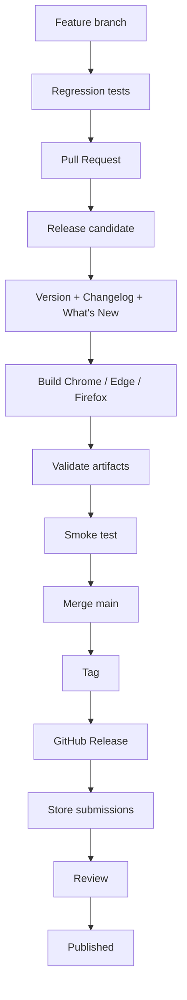
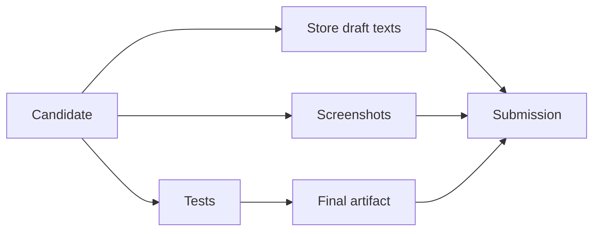
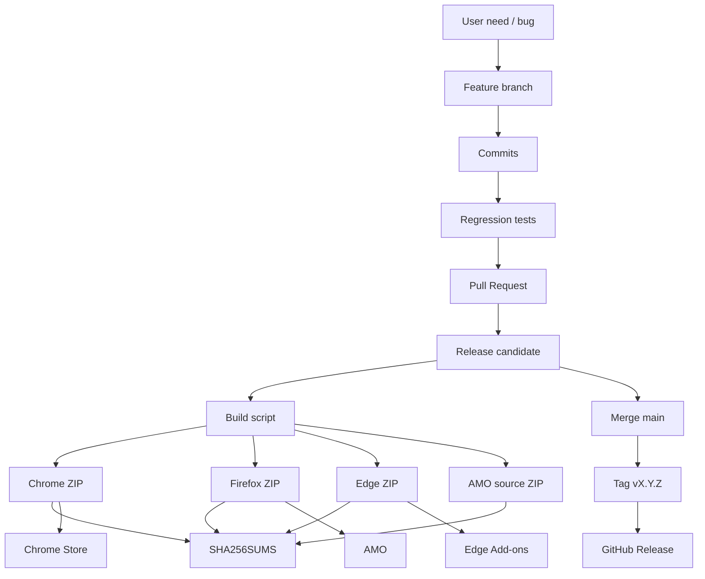

# 15 — Git, branches, PRs, builds, and release engineering

## Software beyond the code

> **Reference snapshot for this chapter**  
> PlumePilot **2.35.2 release candidate**, branch `feat/ui-ux-2.35.2`, commit `f6fcb4c29c83ba9150df0be31da04fc91dffb634`. The historical narrative also covers v2.35.1 and PRs #26, #31, #34, #39, #40, #41, and #42.

A software project exists as a working tree, commit graph, branch, PR, tag, release, browser archive, store submission, and installed user version. These are related but not identical.

The old candidate `170b21ec` and realigned candidate `4d32a8c2` share tree `992149b6`: **the files were identical, but the histories and parent commits differed**. This is our starting point for understanding Git as a data model and release engineering as a separate discipline.

---

# Part I — Git is not a folder of versions

## 1. The wrong mental model

Git is not a folder full of saved version copies. Branching, merging, rebasing, squashing, and reverting become understandable through Git objects and references.

**Historical example:**

```bash
git add
git commit
git push
```

---

## 2. Git's essential objects

Simplifying, Git works with objects such as:

```text
blob
tree
commit
tag
```

### Blob

The bytes of a file, without a filename.

### Tree

A directory snapshot connecting path names to blobs and nested trees:

```text
path → blob / tree
```

### Commit

A Git commit records at least:

```text
tree
parent(s)
author / committer
message
```

### Tag

A reference to a Git object, commonly a release commit (annotated tags are themselves objects).

For our purposes, the decisive formula is:

```text
commit
   =
tree
+ parent history
+ metadata
```

Changing the parent can change a commit's identity without changing its tracked file tree.

---

# Part II — Trees: file states

## 3. Tree SHA

The original 2.35.2 candidate 170b21ec and rebuilt candidate 4d32a8c2 both point at tree 992149b6. They therefore contain the same project files.

---

## 4. Different commits, same tree

The old candidate had merge ancestry; the new candidate was attached to the actual 2.35.1 release parent. Identical tree bytes do not imply identical commits.

---

# Part III — Commit identity

## 5. Why does the commit SHA change?

A commit's hash covers parent links, tree reference, message, and author/committer metadata. Changing ancestry creates a new commit identity even with unchanged files.

---

## 6. Practical consequence

Two branches may check out the same filesystem state yet appear divergent in Git comparisons because their history differs. This happened during PlumePilot 2.35.2 preparation.

---

# Part IV — Branches: movable references

## 7. A branch is a moving reference

A branch name is essentially a ref such as refs/heads/main pointing at one commit. Commits are reachable through refs; they do not belong exclusively to a branch.

---

## 8. Visualizing the graph

Main can point to C while a feature points to E after diverging at B. A, B, C, D, and E are commit objects; main and feature are movable labels at their tips.

```text
A──B──C  ← main
    └──D──E  ← feature
```

---

# Part V — HEAD

## 9. HEAD

HEAD normally refers to the checked-out branch. In detached HEAD mode it points at a commit directly without an intermediary branch ref.

---

# Part VI — Working tree, index, and commit

## 10. Three states

The working tree holds your edits, the index holds the staged snapshot, and the commit holds the repository snapshot. They need not contain the same file state.

**Historical example:**

```bash
git add
```

```bash
git commit
```

---

## 11. Working tree to commit

git add moves selected changes into the index; git commit records those staged changes in a new commit. This allows coherent commits even if the working directory contains unrelated edits.

---

# Part VII — Feature branches

## 12. Why not always work on main?

Feature branches isolate work that is not yet validated. PlumePilot used dedicated branches for autoplay, notes, cross-platform changes, and UI redesign.

---

## 13. The branch as a hypothesis container

A branch expresses a proposed implementation that may evolve or be discarded. It does not itself state that the feature is production-ready.

---

# Part VIII — Pull requests

## 14. A pull request is not a Git primitive

GitHub adds a collaboration object around Git: base, head, review, discussion, status checks, and a decision to merge.

---

## 15. A PR proposes a transition

A pull request asks whether the proposed changes should enter its target base. PR #41 represented the 2.35.2 UI candidate under review rather than an already published release.

---

# Part IX — Base and head

## 16. Base and head

The base is the target branch; the head carries the proposed commits. Selecting the right comparison base determines the actual review scope.

---

## 17. Changing base changes the diff

Comparing the same head to main versus a prerequisite feature branch can produce dramatically different diffs. This is crucial for stacked PRs.

---

# Part X — Stacked pull requests

## 18. PR #40 as a case study

PR #40 was stacked on earlier autoplay work rather than being compared directly with main. Its incremental change depended on that earlier branch.

---

## 19. The stacked graph

PR #39 represents the upstream work and PR #40 is reviewed against its tip. Otherwise a direct comparison to main may include the upstream work twice conceptually.

---

## 20. Why stack pull requests?

Stacking permits dependent work before its prerequisite has been merged and keeps the incremental review smaller.

---

## 21. The downside

Squashing, rebasing, or rewriting a stacked PR's base can leave downstream branches with history that no longer matches main.

---

# Part XI — Merge commits

## 22. Traditional merge commits

A merge may create commit M with two parents. This records the point at which two lines of development were integrated.

---

## 23. What merging preserves

The original commits remain ancestors of the merge. This retains detailed historical provenance and is useful for audits.

---

# Part XII — Squash merges

## 24. What a squash merge does

Squash turns the net effect of several commits into one new commit on the target. The original commits stay on their feature branch, but are not ancestors of the squash on main.

---

## 25. The real 2.35.1 release

PR #39 contained:

```text
20 development commits
```

The final mainline commit:

```text
a8007425f81792e7570516dbdf1e7fb2cbda4d53
```

had:

```text
one parent
```

and became the actual **v2.35.1 release commit**. That is consistent with squash integration: a PR containing many commits is represented by one new commit on `main`.

A downstream branch based on the original twenty commits does not automatically share that new ancestry, even if the resulting files are equivalent.

---

# Part XIII — Why squashing is attractive

## 26. A readable mainline

Squash can preserve one logical unit per PR instead of every intermediate experiment, cleanup, or review fix in main's history.

---

## 27. Atomic PR units

Squashing represents the complete reviewed pull request as one change. That simplifies main at the cost of some history detail.

---

# Part XIV — The hidden cost of squashing

## 28. A downstream branch after squash

A 2.35.2 branch based on original 2.35.1 commits cannot recognize the squashed commit as the same ancestry even when it contains equivalent changes.

---

## 29. Why comparisons become confusing

Ahead/behind counts and merge conflicts may be dominated by ancestry mismatch, not genuine file differences. Inspect the intended tree rather than assuming each reported commit matters.

---

# Part XV — The 2.35.2 case

## 30. Before candidate realignment

The candidate branch had inherited the original 2.35.1 integration history. The relevant commit was:

```text
170b21ec139c0f703a4f08809a9e51e479fc413c
```

It had two parents:

```text
2a97f9d8...
1db590c8...
```

and its tree was:

```text
992149b6...
```

This illustrates why the commit's **ancestry** and its **file tree** must be inspected separately when a release candidate contains the intended changes but an unintended merge history.

---

## 31. What main contained

Main already contained the actual 2.35.1 squash release commit a8007425, with different parentage from the feature's original chain.

---

## 32. Apparent divergence

The branch looked unexpectedly far ahead and behind even though much of that distance came from history noise.

---

# Part XVI — A natural attempt: merge main into the branch

## 33. The standard strategy

git merge main or git rebase main is usually the right way to update a feature branch. Try ordinary approaches before exceptional reconstruction.

**Historical example:**

```bash
git checkout feature
git merge main
```

---

## 34. Why it was problematic here

Git attempted to merge two representations of the same 2.35.1 work, generating confusing and noisy conflicts instead of a clear 2.35.2 delta.

---

# Part XVII — Do not force a merge you do not understand

## 35. The principle behind conflict resolution

A conflict does not mean choosing ours or theirs indiscriminately. Identify each historical contribution and the exact desired resulting tree.

---

# Part XVIII — Content-first reconciliation

## 36. Ask the correct question

What exact files should this release candidate contain, and which published commit should be its parent? The target tree is more important than silencing Git warnings.

---

## 37. Reconstructing the intended tree

The team rebuilt the 2.35.2 file snapshot above the actual v2.35.1 release, changing only files belonging to the UI/UX candidate.

---

## 38. The decisive equality check

The rebuilt snapshot produced the same tree SHA, 992149b6, as the old candidate. That strongly verified no intended file content changed.

---

# Part XIX — Conceptual reparenting

## 39. Creating the new commit

Commit 4d32a8c2 was created with the candidate tree and correct release parent, yielding a new commit hash but unchanged release candidate content.

---

## 40. The result

2.35.2 became a clean descendant of the actual 2.35.1 release while preserving the old candidate's tree.

---

# Part XX — Why not simply call this a rebase?

## 41. Conceptually like a rebase

The objective resembled rebasing: take the desired change and place it after the current release. The method used was more direct.

---

## 42. Technically a reconstruction

Rather than replaying every old commit, the team constructed the desired commit object from an explicitly verified tree and parent. This is advanced maintenance, not a routine workflow.

---

## 43. When is reconstruction appropriate?

Only when the desired snapshot is unambiguous and verifiable. Here equal tree SHAs supplied the safety evidence.

---

# Part XXI — Force-updating a branch

## 44. Moving the ref

The release-candidate branch pointer was moved from the old commit to the reconstructed one, rewriting the branch's visible history.

---

## 45. The risk of rewriting shared history

A forced update can surprise collaborators who have checked out a branch using the old commit history:

```text
Safer to rewrite:
- a personal or private feature branch
- a tightly controlled release candidate

Much riskier to rewrite:
- public main
- a branch shared by many collaborators
```

Even if the tracked files remain identical, rewriting history changes commit IDs and may invalidate other people's work. Coordinate before using force-with-lease on a shared branch.

---

## 46. Expected SHA and optimistic concurrency

A compare-and-swap or force-with-lease-style check prevents overwriting another person's new push while updating a branch ref.

---

# Part XXII — Rebase

## 47. Rebase graph

If main moves to F while a feature contains D and E based on C, rebase produces new D′ and E′ commits after F.

**Historical example:**

```bash
git rebase main
```

```text
main:    A──B──C──F
feature:       └──D──E
after rebase: A──B──C──F──D′──E′
```

---

## 48. Why D′ and E′ are new objects

Their parent relationships have changed, so their SHAs change even when their logical patches remain similar.

---

## 49. When to use rebase

Useful for private feature history, keeping a PR comparison focused, and moving commits onto the current mainline.

---

## 50. When to be cautious with rebase

Changing already-shared commit IDs requires coordination with collaborators and dependent branches.

---

# Part XXIII — Rebasing is not more correct than merging

## 51. Merge and rebase are different models

Merge preserves divergence and records integration. Rebase creates a new linear ancestry. Neither is universally right.

---

# Part XXIV — Squash versus rebase

## 52. What squash changes

Squash changes the granularity of history from many development commits to one logical commit.

---

## 53. What rebase changes

Rebase changes ancestry while normally recreating multiple commits in sequence.

---

## 54. Squash plus downstream branches

This combination leaves downstream work referring to original commits while main contains their squashed equivalent.

---

# Part XXV — Cherry-pick

## 55. Cherry-pick model

git cherry-pick copies the change introduced by one commit onto the current branch as a new commit.

---

## 56. A logical copy, not the same commit

Two equivalent patches can yield different commit SHAs because their parent histories differ.

---

## 57. When cherry-pick helps

Bring a specific fix to a release branch, backport a patch, or select one verified change without merging the rest.

---

# Part XXVI — Revert

## 58. Revert does not erase history

git revert creates a new commit undoing an earlier change's effect. The original commit remains in the graph.

---

# Part XXVII — The 2.34.0 case

## 59. The complicated 2.34.0 story

Premature integration into main was corrected through an explicit revert in PR #31 rather than silently erasing published history.

---

## 60. Why not force-reset main?

A public mainline may already have triggered CI, builds, reviews, or downstream work. Reverting preserves an auditable sequence.

---

# Part XXVIII — History auditability

## 61. An imperfect but truthful history

A public `main` that shows:

```text
accidental merge
corrective revert commit
```

records what really happened.

A force reset might make the history look as if the integration:

```text
never happened
```

even if it has already triggered:

```text
CI workflows
repository clones
store-release preparation
collaborator pulls
```

An explicit corrective commit preserves important evidence for people and automation that already observed the prior mainline state.

---

# Part XXIX — The cost of reverts on integration branches

## 62. PR #30 and #32

The integration branch contained a sequence like:

```text
revert branding
    ↓
restore branding after mistaken revert
```

This is important when reading PR #30 and PR #32: `git revert` is not a magical cancellation of history. It creates a **new change**, which may itself require a corrective commit. Keeping that sequence visible makes the history more auditable.

---

# Part XXX — Integration branches

## 63. Why integration exists

Before 2.34.0, an integration branch combined work for multiple LMS platforms and related features ahead of a mainline release.

---

## 64. Integration graph

Several feature branches feed into integration for combined testing. Main receives the tested, selected candidate afterward.

---

## 65. The benefit

Integration can expose interactions among multiple new features without destabilizing main throughout development.

---

## 66. The cost

Long-lived integration diverges from main and accumulates merge debt, conflicts, and complex ancestry.

---

# Part XXXI — Trunk-based versus integration-heavy development

## 67. Trunk-based versus integration-heavy

Trunk-based development integrates small changes frequently. Integration-heavy workflows validate a collection of changes before main.

---

## 68. PlumePilot's hybrid workflow

Large releases can use integration while smaller fixes take shorter paths. The goal is less coordination risk, not a doctrinaire branching model.

---

# Part XXXII — Main as a promise

## 69. What main promises

Main should represent a coherent integrated state, not necessarily something that every store has already approved.

---

## 70. How this project uses main

Candidates are usually tested, merged into main, then tagged and packaged. The installed user version can lag behind main.

---

# Part XXXIII — Release candidates

## 71. A feature branch becomes a candidate

feat/ui-ux-2.35.2 began as a feature branch and gradually served as the complete release candidate.

---

## 72. The name is historical

Branch names are helpful human metadata, not guarantees about current responsibility or deployment readiness.

---

# Part XXXIV — Draft pull requests

## 73. Why PR #41 stays Draft

Draft signals that development and review can continue without declaring the candidate merge-ready.

---

## 74. A social state machine

GitHub adds statuses such as draft, ready, review, and merged. Git tracks file objects; GitHub coordinates humans.

---

# Part XXXV — Small commits versus release commits

## 75. Small commits during development

Fine-grained commits make local troubleshooting and experimentation manageable.

---

## 76. Mainline commit granularity

The repository can favor a coherent PR-sized commit when integrating into main.

---

# Part XXXVI — Choosing a merge strategy

## 77. Merge commits

Retain the original branch commits and explicit integration ancestry.

---

## 78. Squash merges

Represent a branch's total result as one new commit, simplifying main but changing downstream ancestry relationships.

---

## 79. Rebase-and-merge

Replays commits onto the base so a linear sequence remains, with new commit IDs.

---

## 80. No strategy is free

Readability, auditing, downstream dependencies, conflict handling, and coordination costs must be balanced.

---

# Part XXXVII — Bisectability

## 81. Squash and bisect

A squash may isolate a problem to one large PR rather than its twenty internal steps. This is a real cost when diagnosing a regression with git bisect.

---

## 82. But detail is not always helpful

Preserving messy “try fix, undo fix” commits on main may make bisect less meaningful. Ideally each integrated commit is coherent and testable.

---

# Part XXXVIII — Tags

## 83. What is a tag?

A Git tag names a specific point in history, such as v2.35.1. It should remain stable after publication.

---

## 84. Tag versus main

Main advances with new commits; a published tag is intended as a fixed reference to the released state.

---

# Part XXXIX — GitHub Releases

## 85. Tag versus GitHub Release

A tag is a Git concept. GitHub Releases add titles, notes, and downloadable assets around that tag.

---

## 86. Historical tag example

The v2.35.1 release identifies the exact Git commit used to represent that product version. Its descriptive title is separate release metadata.

---

# Part XL — Version strings versus tags

## 87. Metadata should agree

During preparation, the candidate may already contain an updated manifest before a tag or Release exists. That temporary discrepancy is expected.

---

## 88. At release time

Manifest version, tag, GitHub Release, and browser artifacts should describe the same intended version and source state.

---

# Part XLI — Version drift

## 89. A classic mismatch

A package can run correctly yet bear the wrong manifest version or be associated with the wrong tag. That is still a release defect.

---

## 90. Validate release metadata

Automated validators check version fields, localized data, expected packages, and metadata consistency rather than leaving those checks to memory.

---

# Part XLII — Semantic Versioning

## 91. Version-number structure

PlumePilot uses versions such as 2.35.1 and 2.35.2, following a three-part version-numbering convention.

---

## 92. Practical version meaning

Version 2.35.0 introduced a significant feature set; 2.35.1 and 2.35.2 are smaller improvements or subsequent changes within the same product line.

---

## 93. SemVer is guidance, not a product oracle

Semantic Versioning is useful vocabulary, but deciding whether a consumer extension change is major, minor, or patch depends on product compatibility and real user impact, not a conventional library API alone.

---

# Part XLIII — Release versions as user-facing identity

## 94. Versions diagnose installations

The manifest version helps identify precisely which code an end user has installed, which is vital when investigating browser/store discrepancies.

---

# Part XLIV — Preparing store drafts before merging

## 95. Prepare store drafts early

Screenshots, reviewer access, listing copy, and test procedures can be assembled before the final candidate reaches main.

---

## 96. Keep drafts synchronized

A store draft must not become a second source of truth. If runtime features or permissions change, update the corresponding listing and reviewer instructions.

---

# Part XLV — Three release clocks

## 97. The Git clock

The time at which changes are merged into main is one timeline.

---

## 98. The GitHub Release clock

Creating the tag and Release is a separate event, often later.

---

## 99. The store clock

Upload, review, approval, listing publication, and user rollout follow each store's independent schedule.

---

## 100. These clocks differ

Main may contain v2.35.2 while a store still serves v2.35.1, and the three stores may be at different versions.

---

# Part XLVI — Release state machine

## 101. Distributed release state

For every store, distinguish source ready, artifact built, submitted, under review, accepted, published, and installed.

---

## 102. Three browsers, three schedules

Chrome may publish the newest package while Firefox is still reviewing it. This is a valid state of one multi-browser product.

---

# Part XLVII — Why release is ambiguous

## 103. “Released” is ambiguous

It might mean merged, tagged, uploaded, accepted, visible in a store, or actually installed. Avoid that ambiguity when decisions depend on precise state.

---

# Part XLVIII — Precise naming

## 104. Use concrete status wording

Say “Chrome 2.35.2 accepted and published” or “Firefox 2.35.2 under review” instead of the unqualified “released” where timing matters.

---

# Part XLIX — Build artifacts

## 105. A user installs the package

An end user receives a browser store artifact, not the Git commit object itself.

---

## 106. Trace the supply chain

Commit → build script → target-specific ZIP → store submission → user installation. Each boundary can introduce an inconsistency.

```text
Git commit → release builder → browser ZIP → store review → user installation
```

---

# Part L — Artifact identity

## 107. Commit SHA

Identifies the exact Git commit object and its history.

---

## 108. ZIP SHA-256

Identifies the exact bytes of one packaged browser artifact.

---

## 109. Version string

Identifies the human-facing product version and the update ordering expected by stores. These are three distinct identity schemes.

---

# Part LI — Provenance chain

## 110. The provenance question

We should be able to answer which commit and build produced a given published ZIP, and what SHA-256 identifies its bytes.

---

# Part LII — Deterministic builds

## 111. Deterministic builds, revisited

Chapter 13 introduced fixed ZIP timestamps, sorted entries, and controlled build inputs. These make artifact comparisons more reliable.

---

## 112. Why reproducibility matters

A released tag should be enough to reproduce its corresponding packages using a documented build recipe—without guessing which manual patches were applied.

---

# Part LIII — Release builds require clean trees

## 113. Dirty working trees are risky

Building with uncommitted local changes produces an artifact that may not match the named commit.

---

## 114. A clean-build rule

Before shipping, understand git status and preferably build from a clean, identifiable checkout of the intended release commit.

**Historical command or diagram:**

```bash
git status
```

---

# Part LIV — Tag after build or build after tag?

## 115. Two valid workflows

Build and validate the candidate before merge, or merge then build from main. Both can be sound if the published artifact is verified against the final intended source.

---

## 116. The invariant matters more than the ritual

The published ZIP must correspond to the intended reviewed, versioned source. Whether a preliminary build happened before merge is secondary.

---

# Part LV — Candidate artifacts

## 117. Why build before merge?

Pre-merge packages support browser smoke testing, reviewer preparation, and validating that packaging is ready.

---

## 118. Why rebuild after a changed merge commit?

A squash or merge may create a new commit. Confirm that packages submitted to stores were produced from the final intended tree, not an obsolete or modified candidate.

---

# Part LVI — Checksums

## 119. SHA256SUMS.txt

The release process records SHA-256 hashes for its generated browser archives, allowing exact byte-level verification.

---

## 120. Why hashes help

Unexpected changes to a file's digest reveal that output changed, even when the package name and version appear identical.

---

# Part LVII — Release notes as a product interface

## 121. Technical changelog

A developer-oriented changelog explains architecture, fixes, regressions, and implementation details.

---

## 122. Store description

User-facing What's New copy should explain visible benefits clearly and avoid internal implementation jargon.

---

## 123. Reviewer notes

Reviewer-facing instructions must provide access, steps, expected results, and relevant packaging or permission context.

---

# Part LVIII — One change, three descriptions

## 124. First-incomplete as a communication example

A changelog might describe master-guided API discovery; store copy says finding unfinished lessons is more efficient; review instructions tell a tester how to verify the feature.

---

# Part LIX — Release docs are not redundant duplication

## 125. Different projections of the same work

One source change has multiple legitimate descriptions for developers, users, and reviewers. They should agree factually while using different levels of detail.

---

# Part LX — Store review as an asynchronous dependency

## 126. Once the package is submitted

Review and publication depend on an external actor. The project controls its submission, but not every step of the approval clock.

---

## 127. Firefox release lag

If Firefox skips an intermediate version or remains behind Chrome, its next release notes may need to describe the full change set since its previous published version.

---

# Part LXI — Branching and release cadence

## 128. Smaller frequent releases

A small release delta is easier to review, test, diagnose, and potentially correct quickly.

---

## 129. The cost of excessive frequency

Every upload incurs packaging, review instructions, QA, possible rejection, and publication overhead.

---

## 130. PlumePilot's compromise

Separate releases into coherent feature or improvement groups rather than publishing every small commit.

---

# Part LXII — Hotfixes

## 131. When main is already ahead

A hotfix for the version users currently have may not be safe to build from main if main also includes unreleased features.

---

## 132. Release branches

Start a stable patch branch from the relevant release tag, apply the fix, and ship a higher patch version without unrelated future work.

**Historical command or diagram:**

```bash
git switch -c release/2.35 v2.35.2
```

---

## 133. Forward-port afterward

Move the stable fix into the future mainline via merge, cherry-pick, or another controlled change so the defect does not reappear.

---

# Part LXIII — Main-first versus release-first fixes

## 134. Main-first strategy

Fix on main and backport to a stable release branch when main already has the correct isolated solution.

---

## 135. Release-first strategy

Fix the deployed maintenance branch, publish safely, and forward-port to main when urgent stability is the priority.

---

# Part LXIV — Store rollback is not git reset

## 136. A problematic published release

Removing a local commit or tag does not remove a version already installed by users.

---

## 137. Roll-forward instead of binary rollback

Stores generally require increasing versions. Publish a new version that restores the intended behavior, rather than trying to republish older version bytes.

```text
2.35.2 released → issue discovered → 2.35.3 corrective release
```

---

# Part LXV — Version monotonicity

## 138. Store update ordering

Update systems compare versions and publication state. A previous lower version cannot simply be reissued as if newer installations had never happened.

---

# Part LXVI — Revert code, increment version

## 139. The roll-forward pattern

Release v2.35.2 → discover regression → publish v2.35.3 restoring behavior. History remains explicit and update versions increase.

---

# Part LXVII — Commit messages

## 140. Commit messages as future documentation

A good message explains the meaningful change and helps future maintainers inspect why it was introduced.

---

## 141. A useful message

“fix(autoplay): preserve lesson identity after accordion rerender” conveys purpose and scope.

---

## 142. A weak message

“fix” or “updates” contributes almost no reusable knowledge.

---

# Part LXVIII — Release commit messages

## 143. The a8007425 release commit

A squash/release commit can legitimately summarize the entire reviewed 2.35.1 unit rather than one tiny internal edit.

---

# Part LXIX — Pull request titles

## 144. Titles must survive time

Write commit subjects that will still communicate useful intent six months later.

---

# Part LXX — Branch names

## 145. Branch names are metadata

Names such as feat/ui-ux-2.35.2 tell humans the intended topic but do not enforce behavior or readiness.

---

# Part LXXI — Deleting branches after merging

## 146. Why prune old branches?

Stale refs increase UI noise, confusion about active work, and the risk of reviewing the wrong candidate.

---

## 147. Deleting a ref is not erasing history

Commits already reachable from main, tags, or other refs remain accessible after a branch is deleted.

---

# Part LXXII — Long-lived open pull requests

## 148. Historical PRs may remain open

A feature can reach main by another PR or cherry-pick while its original PR was never closed.

---

## 149. Why stale PRs are confusing

The dashboard can show apparently unmerged work that users already have. Close or annotate obsolete PRs to clarify product status.

---

# Part LXXIII — PR state is not feature state

## 150. A feature can ship without its original PR merging

Squash, cherry-pick, integration, or other merges may introduce equivalent content through a different ancestry path. PR state alone does not determine installed features.

---

# Part LXXIV — Merge conflicts

## 151. What a merge conflict means

Git cannot automatically decide how overlapping changes should combine. It is not proof that two functional changes are incompatible.

---

## 152. Semantic conflicts can be invisible to Git

Two branches may change different lines but together violate one assumption, such as version ownership or callback ordering.

---

# Part LXXV — Textual versus semantic merges

## 153. Git resolves source structure, tests resolve meaning

A clean textual merge does not prove correct behavior. The combined result still requires tests.

---

# Part LXXVI — Smoke testing after merges

## 154. Test after important convergence

When major branches join, rerun affected tests and exercise the combined features.

---

# Part LXXVII — Rerun tests on the merged result

## 155. Green feature tests are not enough

Two branches can each pass independently while the merged tree fails. The actual integrated candidate is what must be tested.

---

# Part LXXVIII — Synthetic merge results

## 156. GitHub's virtual merge candidate

GitHub may synthesize a merge result for status checks; its SHA need not equal the PR head SHA.

---

# Part LXXIX — Head SHA versus merge SHA

## 157. Head SHA

Identifies the actual tip commit of the source branch.

---

## 158. Merge-candidate SHA

Identifies a synthetic or computed integration result that checks might evaluate.

---

# Part LXXX — Tree equality as a diagnostic tool

## 159. The 2.35.2 equivalence proof

Matching tree hashes established that the candidate's files did not change during the history reconstruction.

---

## 160. Tree equality and an empty diff

A shared tree SHA is strong evidence of identical snapshots. A simple zero diff can be helpful, but the object identity directly identifies the full tree.

---

# Part LXXXI — Tree SHA as content identity

## 161. When tree equality is useful

Compare full file snapshots to verify a history rewrite, candidate alignment, or unexpected branch difference. Equal tree hashes are strong evidence of identical tracked content.

---

## 162. But a tree hash is not the whole commit

Tree equality does not preserve parentage, author metadata, messages, or review history. It proves content equivalence, not historical equivalence.

---

# Part LXXXII — Git graph as a data structure

## 163. The commit graph is a DAG

Git commits form a directed acyclic graph: commits point to parents, allowing ancestry queries without cycles.

---

## 164. Merge commits in the DAG

A merge commit has multiple parents, joining separate historical paths into one new successor.

---

# Part LXXXIII — Backend analogy

## 165. Commit as immutable record

A backend analogy is an immutable record storing file-tree identity, parent references, and metadata.

---

## 166. Branch as mutable pointer

A branch resembles a mutable database pointer or index to the current head record.

---

## 167. Tag as mostly immutable release alias

A published tag should name one chosen commit and stay stable so consumers can reproduce the release.

---

# Part LXXXIV — Event sourcing analogy

## 168. Is Git event sourcing?

The analogy is useful but imperfect. Git stores related snapshots, not a chronological event log of domain operations.

---

# Part LXXXV — Squash as history compaction

## 169. Squash as history compaction

Squashing resembles compressing many detailed changes into one conceptual unit, sacrificing mainline development detail for readability.

---

# Part LXXXVI — Rebase as history rewriting

## 170. Rebase as reconstructing a history

Rebase builds new commits with changed ancestors rather than mutating existing immutable objects.

---

# Part LXXXVII — Git immutability

## 171. “Rewrite a commit” is shorthand

Objects are immutable. A rewrite means constructing replacement commits and moving references so users see the new graph.

---

# Part LXXXVIII — Force push

## 172. What history rewriting actually does

It points a branch at a different series of existing/new commits; old ones may remain reachable elsewhere.

---

## 173. Why rewriting is dangerous

Collaborators with clones based on the old history must consciously reconcile their branches and may otherwise overwrite work.

---

# Part LXXXIX — Protected main

## 174. A healthy rule

Avoid rewriting important shared branches; when necessary, coordinate and protect ref updates with an expected old SHA or force-with-lease.

---

# Part XC — Code review

## 175. Review transfers knowledge

Code review explains why an approach was chosen, which invariants it protects, and what alternatives were rejected—not just whether syntax is valid.

---

## 176. Make PRs reviewable

Explain scope, expected behavior, tests, relevant screenshots, risks, and dependencies. A reviewer should understand the proposal without reconstructing a long chat.

---

# Part XCI — Oversized pull requests

## 177. Cognitive load

A PR changing many unrelated files and policies is harder to verify accurately. Keep reviews cohesive and appropriately sized.

---

## 178. Do not split changes artificially

Five tightly coupled PRs can be worse than one coherent PR. Split along meaningful responsibilities and independently testable boundaries.

---

# Part XCII — Commit dependencies versus feature dependencies

## 179. Explicitly stacked PRs

When B depends on A, use A as the base and describe that dependency rather than hiding it in confusing diffs.

---

## 180. Wait for the base when appropriate

Merging A first simplifies B's ancestry but delays work that could otherwise proceed in parallel.

---

# Part XCIII — Release checklist

## 181. The release-candidate pipeline

A normal sequence is scope selection, implementation, tests, PR review, candidate stabilization, package generation, store preparation, final merge, tag, and submission.

---

# Part XCIV — Freeze

## 182. Why freeze the scope?

Late feature additions expand the state space and may invalidate previous QA just as release evidence is becoming reliable.

---

## 183. Fixes versus features during freeze

Prefer fixes for confirmed blockers and regressions; defer unrelated new capabilities to the next cycle.

---

# Part XCV — A nearly immutable release candidate

## 184. Every change invalidates some evidence

A screenshot, test result, checksum, or QA session applies to a particular tree. If files change afterward, decide which evidence must be regenerated.

---

## 185. Recheck proportionally

Not every typo requires full testing, but changing autoplay logic or package manifests does. Align revalidation effort with impact.

---

# Part XCVI — Store draft workflow

## 186. Work that can begin early

Draft store copy, reviewer procedures, screenshots, translation, notes, and test-account planning while functional validation is ongoing.

---

## 187. Work that requires final bytes

Checksums, final reproducibility assertions, exact ZIP uploads, and tag/artifact provenance must use final verified content.

---

# Part XCVII — Tag titles and release notes

## 188. Release titles should age well

A title such as “2.35.2 — UI/UX consistency and navigation” helps future readers more than a generic “Update.”

---

# Part XCVIII — Release notes are not full changelogs

## 189. User-facing release notes select relevant changes

Users need improved workflows and visible fixes, not every internal code cleanup.

---

# Part XCIX — Cumulative changelog

## 190. Technical changelogs preserve the detailed why

Changelogs explain architecture and regressions; this book relies on that history to reconstruct decisions.

---

# Part C — GitHub Releases as narrative checkpoints

## 191. Tag as code checkpoint

The tag points to the release source commit.

---

## 192. Release page as narrative checkpoint

The Release title, notes, and assets tell users why the version exists. Together they connect code and product history.

---

# Part CI — Release branch cleanup

## 193. Record publication status

After submission, note which browser stores have accepted or published each version to avoid relying on memory.

---

# Part CII — Tracking per-store publication

## 194. A release-status table

Track browser, version, artifact checksum, submission date, review state, and publication state. A Git tag alone cannot tell what every user can install.

---

# Part CIII — Deployment metadata

## 195. When a deployment ledger is worth it

Larger projects may automate a releases.json ledger or GitHub deployments. A small project may use a simpler manual register.

---

# Part CIV — Release automation

## 196. What to automate

Repetitive, deterministic, high-risk checks such as file inclusion, manifest validation, stable ZIP generation, version consistency, and checksums.

---

## 197. What PlumePilot already automates

The release builder and validator create and check target-specific browser packages, vendor transforms, and supporting release files.

---

# Part CV — What remains human

## 198. What remains a human decision

Release timing, accepting UX trade-offs, changing product scope, and classifying uncertain warnings still require judgment.

---

# Part CVI — Release as a pipeline

## 199. A release decision graph

Development and testing feed a candidate while store-copy preparation can occur in parallel; final packaging and upload depend on validated source.

**Historical command or diagram:**



---

# Part CVII — The real pipeline can be parallel

## 200. Parallel store preparation

Screenshots, review access, and listing drafts can be prepared while PR testing and release alignment continue.

---

## 201. Parallel work without parallel truths

Make progress on independent preparation tasks, but keep manifest/version/source data authoritative in one documented place.

**Historical command or diagram:**



---

# Part CVIII — Release failure modes

## 202. Wrong base branch

A PR unexpectedly includes unrelated work because its selected comparison base is wrong.

---

## 203. Stale feature branch

A branch lacks newer fixes from main and may reintroduce a previously corrected regression.

---

## 204. Squash ancestry mismatch

Changes already integrated on main appear new because the dependent branch points to the original unsquashed commits.

---

## 205. Metadata drift

Manifest versions, listing copy, review notes, and releases describe different candidates.

---

## 206. Dirty build

An archive contains uncommitted local edits and no longer matches its claimed source commit.

---

## 207. Manual ZIP edit

Editing the generated package directly makes the artifact unreproducible from committed inputs.

---

## 208. Tagging the wrong commit

A version label points to code other than the intended reviewed candidate.

---

## 209. Uploading the wrong artifact

A stale build or a package for another browser is submitted to a store.

---

# Part CIX — Safeguards

## 210. Guard against wrong PR base

Confirm the intended base branch and inspect the real comparison before reviewing or merging.

---

## 211. Guard against stale branches

Reconcile with main when needed, review ahead/behind and merge-base information, and rerun relevant tests.

---

## 212. Guard against metadata drift

Validate the manifest version, release titles, localized resources, and reviewer documentation together.

---

## 213. Guard against wrong artifacts

Verify package filenames, manifest target, checksums, and source SHA before upload.

---

# Part CX — Empty output directories

## 214. Why refuse stale ZIPs?

A preexisting output in the release directory can be mistaken for the fresh package. Rejecting leftover archives prevents accidentally submitting a previous build.

---

## 215. Prevent build-state leakage

Each build should start from known inputs and a clean output area rather than mixing files from previous invocations.

---

# Part CXI — Build idempotency

## 216. The deterministic-build ideal

Same source commit, toolchain, and controlled parameters should yield the same archive bytes and checksums.

---

## 217. Why this helps investigation

When an expected artifact hash changes, a developer can compare build inputs and configuration to locate unexpected differences.

---

# Part CXII — Synchronizing branches before release

## 218. Merge or rebase?

The answer depends on whether history is shared, how much audit detail matters, and what target tree must be produced.

---

## 219. Choose based on collaboration

The choice depends on the branch's role:

```text
Shared branch?
→ merge to preserve collaborators' ancestry

Private branch and linear history desired?
→ rebase may be simpler

Squashed upstream dependency created confusing ancestry?
→ content-aware reconstruction may be safer,
  but demands explicit comparison and stronger verification
```

A tool preference does not decide the strategy. Collaboration, risk and the expected final tree do.

---

# Part CXIII — The tree as arbiter of content

## 220. Use the target tree as an anchor

When history is confusing, identify which tracked files the result must contain and compare tree objects directly.

---

## 221. Then choose coherent ancestry

Preserve correct source content while creating a maintainable historical relation. Do not alter known-good content simply to appease a merge heuristic.

---

# Part CXIV — Git enables collaboration; it cannot judge semantics

## 222. What Git knows

Git understands bytes, objects, trees, parent links, refs, and graph ancestry.

---

## 223. What Git cannot know

Git does not understand whether two logically equivalent patches implement the same product rule or if merged behavior remains semantically valid.

---

# Part CXV — Merge strategies as a team protocol

## 224. A consistent repository policy

If main commonly uses squash merges, plan how dependent branches will be rebased or realigned after the base is squashed.

---

## 225. Before squashing a dependency

Identify downstream branches, notify collaborators, and decide how their base ancestry will be repaired.

---

# Part CXVI — Stacked-branch discipline

## 226. A safe dependent-branch workflow

Confirm the base reached main, update dependent work against the real release commit, verify resulting tree/diff, and run tests.

---

## 227. force-with-lease

Prefer git push --force-with-lease to blind force push. It checks that the remote ref has not moved unexpectedly.

**Historical command or diagram:**

```bash
git push --force-with-lease
```

---

# Part CXVII — merge-base

## 228. Merge base

Git locates the common ancestor to decide which changes diverged. Squash changes ancestry, so the merge base may become surprising.

---

# Part CXVIII — git log --graph

## 229. Visualize graph ancestry

git log --graph --oneline --decorate --all often explains branch problems better than trial-and-error merges.

**Historical command or diagram:**

```bash
git log --graph --oneline --decorate --all
```

```bash
git log --graph --oneline --decorate --all
```

---

# Part CXIX — git diff

## 230. Which files changed?

git diff answers a content-comparison question between states.

---

## 231. Which commits differ?

git log answers a history-reachability question, not necessarily a file-content question.

---

## 232. Do not conflate diff and log

The same final tree can have many different ancestors, as demonstrated in the 2.35.2 candidate repair.

---

# Part CXX — git status

## 233. Inspect the working tree

git status shows the uncommitted edits and staging state that may affect a build.

---

# Part CXXI — git show

## 234. Inspect the branch graph

git branch -vv and related graph tools reveal tracking references and ahead/behind counts.

---

# Part CXXII — git cat-file

## 235. Read Git objects directly

git cat-file -p can inspect a commit's tree SHA, parents, and metadata when higher-level commands obscure the issue.

**Historical command or diagram:**

```bash
git cat-file -p <commit>
```

---

## 236. Why this matters

Viewing the actual commit object proves that parent and tree are independent fields rather than vague concepts.

---

# Part CXXIII — GitHub compare

## 237. Ahead/behind measures graph reachability

These counts measure commit ancestry differences, not whether the files differ semantically.

---

## 238. Counts do not measure feature difference

A branch many commits “ahead” may still have the same source tree as main after squashing.

---

# Part CXXIV — Why we inspect the graph first

## 239. If counts look wrong

Inspect merge base, graph, and tree hashes before interpreting a surprising GitHub compare result as new product work.

---

# Part CXXV — Published tags should be immutable

## 240. Do not move published tags casually

Consumers and CI may already have cached a published tag. Retargeting it undermines release provenance.

---

## 241. If the tagged release commit was wrong

Prefer a corrective new release or a clearly documented replacement policy over silently moving a tag that consumers may already use.

---

# Part CXXVI — Immutable artifacts

## 242. Publish checksums

An artifact digest in release assets provides a fixed reference against which downloaded packages can be verified.

---

## 243. A changed artifact is a new identity

Changing even one byte changes SHA-256 with overwhelming probability, so a modified ZIP should not be represented as unchanged release bytes.

---

# Part CXXVII — Git tags and store artifacts

## 244. A tag is not a browser package

The tag identifies source history; each target ZIP is a derived artifact built from that source.

---

## 245. Why checksums matter

A commit and builder recipe can be connected to an exact produced archive digest, improving chain-of-custody evidence.

---

# Part CXXVIII — Release reproducibility tests

## 246. Strong reproducibility evidence

Rebuild from the claimed tag and compare the package hash with the published checksum. Agreement supports the asserted provenance.

---

# Part CXXIX — Review-note hashes

## 247. AMO reviewer evidence

Provide the source archive, rebuild instructions, and expected artifact digest to let the reviewer confirm the uploaded add-on was generated from the disclosed sources.

---

# Part CXXX — GitHub branch protection

## 248. Branch protection in larger projects

Require passing checks, review approvals, and restricted direct pushes to main, where project scale justifies those controls.

---

## 249. Trade-offs of stricter gates

More protection can reduce accidents but also increase administrative friction and slow releases. Select controls appropriate to the actual risks.

---

# Part CXXXI — Human error as part of the threat model

## 250. The accidental integration merge

A wrong-click merge into main does not require a Git defect; it reveals a process opportunity.

---

## 251. Useful guardrails

Review confirmations, protected main, branch naming, required checks, and a verified release checklist can make mistakes harder.

---

# Part CXXXII — Quick reverts instead of panic

## 252. When a wrong merge happens

First identify what merged, what has already shipped, and whether downstream work depends on it. Then choose revert, forward correction, or another safe method.

---

# Part CXXXIII — Git incident response

## 253. A wrong-merge checklist

Inspect source graph, affected artifacts, published refs, store submissions, and collaborators before rewriting or reverting.

---

# Part CXXXIV — A release branch as a transaction

## 254. A release candidate as a long transaction

Over several days it accumulates features, fixes, tests, screenshots, review notes, and packaging decisions before final integration.

---

## 255. But not an ACID transaction

Other developers, store drafts, and mainline changes can evolve concurrently. There is no automatic isolation or rollback; reconciliation remains necessary.

---

# Part CXXXV — Commit atomicity

## 256. A coherent commit

Ideally a commit represents one logically complete change with relevant code, tests, and documentation.

---

## 257. Why commit coherence matters

A checkout at an intermediate commit should make sense. This improves bisectability, review, and rollback reasoning.

---

# Part CXXXVI — Do not commit generated store ZIPs

## 258. Where release ZIPs belong

Generated binary artifacts normally belong in GitHub Releases or store uploads rather than ordinary source history.

---

## 259. Source and artifact separation

The Git repository holds source, tests, build recipe, and reproducibility metadata. The release publishes built ZIPs and checksums.

---

# Part CXXXVII — Versioned build scripts

## 260. The build recipe belongs in source

Version build-release.mjs with the code so a tag preserves how its runtime archives were constructed.

---

# Part CXXXVIII — Should store metadata be versioned?

## 261. Release documents in the repo

Technical notes and reviewer instructions that help reconstruct the release can appropriately remain in version control.

---

## 262. Store-only dashboard fields

Some listings and submission fields live on external dashboards. Preserve enough text or process description in the project to minimize drift.

---

# Part CXXXIX — Release engineering as reproducible decision-making

## 263. Rebuild the explanation, not only the bytes

Good release records establish what was published, how it was produced, who it was for, and why the change was made.

---

# Part CXL — Changelog as causal context

## 264. Changelogs record why

Diffs answer what changed. Changelogs and release notes explain motivation, intended behavior, and known limitations.

---

# Part CXLI — Issue → branch → pull request

## 265. A traceable feature flow

Idea or report → issue/notes → branch → commit → tests → PR → release notes → tag → store package. Each handoff should preserve meaningful context.

---

## 266. Small-project feedback is often informal

PlumePilot fixes sometimes start in direct feedback rather than a formal ticket. Record the decision in a PR, test, changelog, or documentation anyway.

---

# Part CXLII — Traceability

## 267. Traceability across artifacts

A reported defect should be traceable to a correction, regression test, release tag, and packaged browser version.

---

## 268. Why traceability helps

When a user reports a problem months later, this chain helps identify whether their installed version includes the fix.

---

# Part CXLIII — Merge queues?

## 269. Merge queues for large teams

A merge queue tests candidates against a recent integration state, reducing races where separately green PRs conflict when merged.

---

## 270. Probably unnecessary today

For a small repository a full merge queue could be excessive, but testing the actual integration result remains good practice.

---

# Part CXLIV — Release freeze and branch synchronization

## 271. Before packaging

Confirm the intended release source, completed fixes, version metadata, tests, and package prerequisites.

---

## 272. Not necessarily the latest main

If main already contains future unreleased features, start from the appropriate stable release branch rather than bundling everything indiscriminately.

---

# Part CXLV — Current PlumePilot state

## 273. The 2.35.2 candidate snapshot

The earlier UI commit 4d32a8c2 represented the verified UI tree, while the later release candidate f6fcb4c2 added packaging and release preparation.

---

## 274. Why it is a real release candidate

Its scope extends beyond visual redesign into manifest/version preparation, documentation, tests, and artifact readiness.

---

# Part CXLVI — When to merge

## 275. What follows final validation

Merge the accepted candidate according to policy, confirm the resulting source tree, tag the release, and publish the intended artifacts.

---

## 276. Store approval comes later

Store review is asynchronous and external. Code may be tagged and merged before any store formally accepts its submitted package.

---

# Part CXLVII — Suggested tagging sequence

## 277. A clean 2.35.2 path

Finish and test the candidate, merge the intended tree into main, verify package contents, publish release metadata, and submit target archives.

---

## 278. If upload must happen early

Prepare store drafts or even upload verified candidate archives, then ensure post-merge build provenance agrees before final publication.

---

# Part CXLVIII — Tree equality can also help here

## 279. Squash can change the final commit

Compare candidate and resulting main tree hashes. Equal trees support identical tracked content despite different commit hashes.

---

# Part CXLIX — Should PR #41 be squashed?

## 280. Squashing the candidate

A new mainline commit represents the whole 2.35.2 PR; the detailed candidate commits may no longer be direct ancestors of main.

---

## 281. Downstream implications

Branches built on candidate commits can suffer the same ancestry mismatch that affected the earlier 2.35.1 transition.

---

# Part CL — A future operational rule

## 282. Before squashing a base

Ask whether other active branches depend on it. Plan their ancestry realignment before creating a confusing downstream PR graph.

---

# Part CLI — Release branches for the next version

## 283. A simple future workflow

After 2.35.2 is integrated, branch 2.35.3 work from the actual mainline release commit rather than an obsolete candidate head when possible.

---

# Part CLII — Git history as a design artifact

## 284. What good history should convey

The sequence of meaningful decisions, when integration occurred, what reached users, and how regressions were handled.

---

## 285. Linear history is not necessarily truer

Removing every merge may hide actual dependencies; preserving every experimental commit can add noise. Choose what is useful and honest.

---

# Part CLIII — Commit graphs and cognitive load

## 286. A simple mainline

A small number of logical PR-sized commits makes major product changes easier to locate.

---

## 287. Detailed feature histories

Original feature branches and PR discussions can preserve granular development history even when main receives a squash.

---

# Part CLIV — Pull requests as archival context

## 288. Human history survives merges

PR discussions, review comments, attached test outcomes, and linked issues remain useful documentation after the code enters main.

---

# Part CLV — Release provenance graph

## 289. Three timelines in one picture

Git commits and PRs lead to tags/releases, which in turn lead to separate Chrome, Edge, and Firefox store publications.

**Historical command or diagram:**



```text
Git commit graph
      ↓
tag and release
      ↓
Chrome / Edge / Firefox store deployment
      ↓
user-installed versions
```

---

# Part CLVI — Three histories

## 290. Git history

Records source commits, parent relationships, merges, and branch refs.

---

## 291. Release history

Records versions, tags, changelog entries, GitHub Releases, and packaged artifacts.

---

## 292. Deployment history

Records what each store accepted, published, and offered users over time.

---

## 293. Why they differ

A version can exist in Git without being published; a store may lag behind the tag; and installed users may lag behind the store.

---

# Part CLVII — Diagnosis from a support ticket

## 294. Identify the user's deployed version

Ask which browser, extension version, and store installation the person uses. A repository tag alone is insufficient.

---

# Part CLVIII — Source commit from a version

## 295. Use the release tag

A correct tag narrows the code snapshot relevant to that released version.

---

# Part CLIX — Runtime release metadata

## 296. Read the installed manifest version

chrome.runtime.getManifest().version identifies the installed version where that privileged API is available.

---

## 297. Respect execution worlds

Do not call the privileged manifest API from an ordinary page-world context without a bridge; release identity crosses extension boundaries too.

---

# Part CLX — Release engineering and mental rollback

## 298. Smaller releases aid diagnosis

If 2.35.2 mostly changes UI, a new autoplay regression may be easier to localize to setting propagation than a complete algorithm rewrite.

---

## 299. Scope helps isolate causes

A disciplined release boundary acts as an imperfect but valuable debugging boundary.

---

# Part CLXI — Trunk stability

## 300. Main cannot be infallible

A perfectly unbroken mainline is an aspiration. The realistic goal is detecting and recovering from problems quickly.

---

## 301. Small PRs and checks reduce detection time

Useful tests, review, and branch protection reduce the chance that a mistake survives unnoticed.

---

# Part CLXII — Release validation as a gate

## 302. A merge gate

Require appropriate checks or review before a candidate is integrated or tagged.

---

## 303. Gates do not replace judgment

A UI can pass source tests and still be confusing, inaccessible, or poorly laid out. Manual acceptance remains important.

---

# Part CLXIII — Definition of Done

## 304. Definition of Done for a feature

The code is implemented, relevant tests pass, behavioral expectations are checked, and documentation is adjusted.

---

## 305. Definition of Done for a release

All target artifacts, version metadata, smoke tests, store documentation, checksums, and deployment readiness must be validated.

---

# Part CLXIV — Automation candidates

## 306. A future GitHub Actions pipeline

CI could execute Node suites, packaging, validation, and perhaps browser fixture tests automatically on PRs.

---

## 307. Should store submission be fully automated?

Automation can help, but credentials, changing store policies, review control, and publication timing add risk. Manual upload can remain reasonable.

---

# Part CLXV — CI/CD terminology

## 308. Continuous Integration

CI combines changes frequently and runs checks to detect regressions early.

---

## 309. Continuous Delivery versus Deployment

Delivery keeps a releasable artifact ready; deployment automatically publishes it. These are different promises.

---

## 310. Stores complicate continuous deployment

External store reviewers can delay publication even when the project automates its own packaging and submission.

---

# Part CLXVI — Release engineering as a socio-technical system

## 311. Release engineering is not only tooling

It encompasses scope, communication, verification, version identity, traceability, permissions, and collaboration.

---

## 312. Design the human handoffs

Accurate reviewer credentials and concise test steps can be as important to approval as a technically valid ZIP.

---

# Part CLXVII — Backend analogy: deployment pipelines

## 313. Backend analogy

A server has source commits, container digests, migrations, deployment environments, and observed running versions.

---

## 314. PlumePilot analogy

An extension has source commits, ZIP digests, storage migrations, browser stores, and installed user versions.

---

## 315. Artifact immutability

A container digest and an extension ZIP SHA-256 both identify exact immutable artifact bytes, even though their distribution systems differ.

---

# Part CLXVIII — Backend analogy: database migrations

## 316. Deployment includes persistent state

An update can change stored settings or cache schemas. Users already have data, so forward compatibility matters.

---

## 317. Test storage migrations

Backward-compatible reads and platform-specific key migrations are part of release acceptance, not only unit behavior.

---

# Part CLXIX — Forward compatibility

## 318. Downgrade risk

A prior version may not understand newly persisted data. Formal downgrade support is optional, but the risk should be recognized.

---

# Part CLXX — Release notes as schema migration communication

## 319. Explain visible changes

If the update changes how buttons or menus work, release notes should help users find those controls.

---

# Part CLXXI — Permission changes

## 320. Permissions are release-sensitive

A new privileged permission can trigger new review, user prompts, or trust concerns. It deserves more scrutiny than a minor CSS tweak.

---

# Part CLXXII — Release risk classification

## 321. Low-risk change

Examples include isolated copy changes, minor CSS spacing, and documentation updates. They need limited targeted review but still require basic artifact checks where affected.

---

## 322. Medium-risk change

Examples include layout behavior, preferences, conditional UI, and newly introduced files. Test both surfaces and platform-specific rendering as appropriate.

---

## 323. High-risk change

Autoplay routing, identity, cache migrations, permissions, background lifecycle, document conversion, and release builder logic warrant focused regression and cross-browser validation.

---

## 324. Match test intensity to risk

A two-line typo fix and a manifest-permission change should not require identical QA plans. The test plan should reflect failure impact, not line count.

---

# Part CLXXIII — PR descriptions as risk maps

## 325. What a good PR description contains

Describe objective, scope, behavior changes, relevant risks, test evidence, screenshots when useful, and any required follow-up.

---

# Part CLXXIV — Reviewing the release-branch diff

## 326. Inspect the aggregate tree before merge

Review the final changed-file list and complete PR diff, not just individual commits. The final artifact is determined by the resulting tree.

---

## 327. Why aggregate review matters

Several reasonable commits can combine into an unintended final state or include a file that nobody meant to ship.

---

# Part CLXXV — Reviewing the file list

## 328. Look for unexpected files

A UI-only release candidate that changes unrelated backend or vendor files should trigger investigation.

---

# Part CLXXVI — Scope invariants

## 329. An allowlist can help

For a narrow hotfix, verifying a predetermined set of changed files can prevent accidental unrelated changes. It is not necessary for every normal release.

---

# Part CLXXVII — The accidental file problem

## 330. An example of an accidental inclusion

A temporary test credential, generated source file, or unrelated fixture should not enter the runtime ZIP. Artifact validation and exclusion policies can catch mistakes.

---

# Part CLXXVIII — .gitignore is not enough

## 331. .gitignore

Controls which untracked local files Git normally ignores. It does not determine which already-tracked files a release builder packages.

---

## 332. Builder exclusions

Prevent tracked source, tests, documentation, and non-runtime assets from entering an installable browser archive.

---

# Part CLXXIX — Release directory

## 333. Generated ZIP is output

An old archive should never silently become input to the next build. Validate or clean the output area first.

---

# Part CLXXX — Source archive

## 334. Source archive versus runtime archive

Installable ZIPs exclude development materials; the Firefox AMO source-review archive intentionally includes inputs and scripts needed to reproduce the build.

---

# Part CLXXXI — Sparse Git concerns

## 335. Repository state

The working source tree is a broad input set containing runtime code plus build, tests, docs, and metadata.

---

## 336. Runtime artifact

The installable package is a selected subset of files plus target-specific manifest or vendor transformations.

---

## 337. Source submission

The review archive is a different selected subset designed for reconstruction and auditing. Both are projections of one source repository.

---

# Part CLXXXII — Timing the version bump

## 338. Version bump too early

Raising the declared version during early feature work can make test or draft artifacts look release-ready before scope is stable.

---

## 339. Version bump too late

Changing the version after generating packages and store copy creates inconsistent metadata and requires regenerating artifacts.

---

## 340. A reasonable timing

Bump the version during final candidate preparation, before final package validation and tagging.

---

# Part CLXXXIII — Version as configuration

## 341. One version source of truth

The manifest should be authoritative for the installed extension version where practicable. Other contexts can read it through permitted APIs or a bridge.

---

## 342. Validate unavoidable duplication

When versions appear in release notes, screenshots, or store metadata, verify consistency rather than assuming every copy was updated.

---

# Part CLXXXIV — Release commits versus version-bump commits

## 343. Squash or keep separate commits?

One squash gives a simple PR-sized mainline event. Separate commits can preserve UI implementation and release preparation as distinct milestones.

---

## 344. The 2.35.2 candidate has two clear commits

The UI tree 4d32a8c2 was followed by release preparation f6fcb4c2. This reveals the boundary between functionality and shipping metadata.

---

# Part CLXXXV — Squash the final two?

## 345. Choose according to mainline policy

Squash is coherent when the repository wants one PR-sized logical unit on main.

---

## 346. Preserve the distinction if useful

Merge or rebase-and-merge may retain multiple steps. Decide before other branches depend on the candidate hashes.

---

# Part CLXXXVI — Release decision records

## 347. A future release-record improvement

For a nontrivial release, a possible decision record would be:

```text
docs/releases/2.35.2.md
```

with:

```text
scope
test plan
known limitations
store state
candidate SHA and artifact hashes
```

Earlier releases already had some similar notes. Months later, a question such as *Why was the Firefox package different?* could be answered from the release record rather than reconstructed from scattered conversations.

---

# Part CLXXXVII — Why this helps

# Part CLXXXVIII — GitHub API as an inspection tool

## 348. Why inspect Git objects directly?

This book used tree objects, commit parents, and exact SHA values to understand situations the simplified GitHub UI did not fully explain.

---

# Part CLXXXIX — Low-level inspection

## 349. When low-level inspection is warranted

Ancestry puzzles, unexpected ahead/behind counts, file-equivalent branches, and release provenance justify direct Git-object inspection.

---

## 350. Usually the CLI is enough

git log, git status, git diff, git merge-base, and git cat-file explain most historical questions without custom scripts.

---

# Part CXC — A mental decision tree

## 351. “I need to update my feature branch”

First ask whether others depend on the existing commits. On a shared branch prefer merge or careful coordination; on a private branch rebase may be reasonable.

---

## 352. “The base was squash-merged”

Check whether the downstream branch still contains the old unsquashed commits and whether they correspond to work now on main. Inspect content and ancestry before a blind merge.

---

## 353. “Main contains an accidental merge”

Check whether other people or automation have seen it. On public history, prefer a deliberate revert or follow-up over silently force-resetting.

# Part CXCI — Error recovery table

| Problem | Primary tool or recovery |
|---|---|
| Feature branch merely out of date | Merge or rebase |
| One selected commit to transfer | Cherry-pick |
| Change to undo in published history | Revert |
| Noisy private history | Interactive rebase |
| Squash ancestry mismatch | Rebase, reparenting, or verified content reconstruction |
| Wrong commit on public `main` | Revert or restorative commit |
| Wrong release artifact | Rebuild; publish a new higher version if already distributed |
| Wrong tag that is not public | Recreate carefully |
| Wrong tag already public | Prefer a new corrective release |

---

# Part CXCII — Exercise 1

## Exercise 1 — Squash ancestry and dependent branches

Given:

```text
main:
A-B-S

feature:
A-B-D-E-F-G
```

where:

```text
S = squash of D-E-F
G = new feature
```

Why might a normal merge produce a noisy or confusing history?

Draw **two possible strategies** for obtaining the intended result:

```text
A-B-S-G'
```

Explain how you would verify that the resulting tree preserves the wanted file content.

---

# Part CXCIII — Exercise 2

## Exercise 2 — Identical tree, different parent

Two commits have:

```text
identical tree
different parent
```

Which properties are guaranteed to be the same? Which properties may differ?

Distinguish tracked-file content, commit identity, ancestry, history comparisons, and metadata.

---

# Part CXCIV — Exercise 3

## Exercise 3 — Should this PR be squashed?

A pull request contains 15 commits:

```text
5 feature commits
4 fixes to earlier fixes
3 typos
3 tests
```

When would you prefer:

```text
squash
```

and when would preserving separate commits be more useful for review, bisectability, or audit history?

---

# Part CXCV — Exercise 4

## Exercise 4 — A regression in a published version

You have already published:

```text
v2.35.2
```

but discover a serious defect.

Why would moving the Git tag to a corrected commit **not** repair installations that users have already received from browser stores?

Explain why a newer corrective version may be needed.

---

# Part CXCVI — Exercise 5

## Exercise 5 — Three independent publication clocks

Chrome Web Store shows:

```text
2.35.1
```

The latest GitHub Release shows:

```text
2.35.2
```

Firefox offers:

```text
2.35.0
```

Which version is “a PlumePilot user” running?

```text
It depends on the browser and distribution channel.
```

Explain why the question is incomplete without information about the installed extension.

---

# Part CXCVII — Exercise 6

## Exercise 6 — A non-reproducible Firefox ZIP

The same release source commit now produces a Firefox ZIP whose checksum differs from yesterday's output.

Investigate possible inputs:

```text
Node version
builder changes?
dirty working tree?
timestamps?
archive entry ordering?
vendor source files?
environment?
```

How would you isolate the source of the difference?

---

# Part CXCVIII — Exercise 7

## Exercise 7 — Rewriting a shared feature branch

Three people have based ongoing work on the same feature branch. You want to realign it with `main`.

Why do:

```bash
git rebase main
git push --force
```

require considerably more care than an ordinary merge?

Describe what can happen to collaborators' commit references and why a guarded ref update matters.

---

# Part CXCIX — Exercise 8

## Exercise 8 — A clean merge with a semantic conflict

A PR is marked mergeable and its files apply without textual conflicts.

Which **semantic conflicts** might still exist?

Consider manifest versions, shared state ownership, async callback ordering, incompatible preferences, and code that works independently but fails in the combined release tree.

---

# Part CC — Concepts to carry forward

## 354. Blob

An immutable Git object storing file bytes.

---

## 355. Tree

An immutable object recording a directory structure and references to file or subtree objects.

---

## 356. Commit

An immutable Git object identifying a tree, parent commits, author/committer metadata, and message.

---

## 357. Ref

A named pointer to an object, commonly the head of a branch.

---

## 358. HEAD

The special reference describing the current checkout's branch or detached commit.

---

## 359. Merge commit

A commit with multiple parents recording integration of divergent lines.

---

## 360. Squash merge

An integration that takes multiple changes and creates one new commit on the destination.

---

## 361. Rebase

A process that replays or reconstructs commits on a new base, assigning new commit IDs.

---

## 362. Cherry-pick

Apply a selected commit's change elsewhere in history through a new commit.

---

## 363. Revert

Create a new commit applying the inverse of an earlier change without removing the original history.

---

## 364. Merge base

A common ancestor used for graph comparison and merge computation.

---

## 365. Tree equality

Two commits identify the exact same tracked-file snapshot despite differing parentage or metadata.

---

## 366. Artifact

A packaged, distributable output generated from the repository.

---

## 367. Release provenance

The traceable chain from source commit and builder to exact packages, hashes, and store release.

---

## 368. Release candidate

A source state under final validation that may become the next published version.

---

## 369. Deterministic build

A process that produces the same output for equivalent controlled inputs.

---

## 370. Deployment history

The record of versions actually made available across deployment channels, distinct from source commits.

---

## 371. Roll-forward

Publish a newer corrective version rather than attempting to replace existing installations with an older version.

---

## 372. Divergence

Differences in branch ancestry, often reported as ahead/behind commit counts; not necessarily a difference in final files.

---

## 373. Stacked PR

A pull request intentionally based on another feature branch or unmerged PR.

---

## 374. Force-with-lease

A guarded forced ref update that rejects unexpected remote changes.

---

# Part CCI — Further reading

## 375. Git object model

Git's authoritative object and ref documentation explains blobs, trees, commits, tags, and named pointers.

- https://git-scm.com/book/en/v2/Git-Internals-Git-Objects
- https://git-scm.com/book/en/v2/Git-Internals-Git-References

---

## 376. Branches and merges

The Git Book covers branching, merging, rebase, and common workflows.

- https://git-scm.com/book/en/v2/Git-Branching-Basic-Branching-and-Merging
- https://git-scm.com/book/en/v2/Git-Branching-Rebasing

---

## 377. GitHub pull requests

GitHub documentation describes base/head comparisons, review, merge choices, and PR collaboration.

- https://docs.github.com/en/pull-requests
- https://docs.github.com/en/pull-requests/collaborating-with-pull-requests/incorporating-changes-from-a-pull-request/about-pull-request-merges

---

## 378. Squash merges

GitHub documentation explains configuring and performing squash integration.

- https://docs.github.com/en/repositories/configuring-branches-and-merges-in-your-repository/configuring-pull-request-merges/configuring-commit-squashing-for-pull-requests

---

## 379. Tags and GitHub Releases

Git and GitHub document how tags anchor commits and Releases attach narrative metadata and assets.

- https://docs.github.com/en/repositories/releasing-projects-on-github/about-releases
- https://git-scm.com/book/en/v2/Git-Basics-Tagging

---

## 380. Semantic Versioning

SemVer defines a widely used three-part versioning convention; its application to consumer-extension features requires product judgment.

- https://semver.org/

---

# Part CCII — Recap

The decisive PlumePilot example is simple: **the same tree is not the same commit**. Git connects source snapshots to parent history and mutable references. GitHub adds pull requests, review, Draft state, and release pages. The release system adds browser builds, checksums, submissions, approvals, and publications.

```text
idea → branch → commit → tests → PR → candidate
     ↓
build → target artifact → merge/tag → GitHub Release
     ↓
browser store review → publication → user installation
```

The central lessons are that a branch is a pointer, not a container; a commit identifies a tree in a specific history; squash improves mainline simplicity but changes ancestry; conflict-free merges do not guarantee semantic correctness; and repository state is not itself the software a user installs.

> **Release engineering makes reproducible not only the source code but the route by which that code becomes software installed by real people.**

# Next chapter — 16: Architectural lessons

After contexts, messaging, DOM, APIs, async behavior, caches, state machines, search, exports, the editor, UI, performance, cross-browser delivery, tests, and Git, we can now identify the patterns that repeatedly emerged in PlumePilot: boundaries, identity, sources of truth, anti-corruption layers, progressive refinement, safe failure, functional core and imperative shell, idempotence, graceful degradation, ownership, lifetime, observability, and artifacts.

---

[← 14 — Debugging, tests, and regressions](14-debugging-tests-and-regressions.md) · [Contents](index.md) · [16 — Architectural lessons →](16-architectural-lessons.md)
