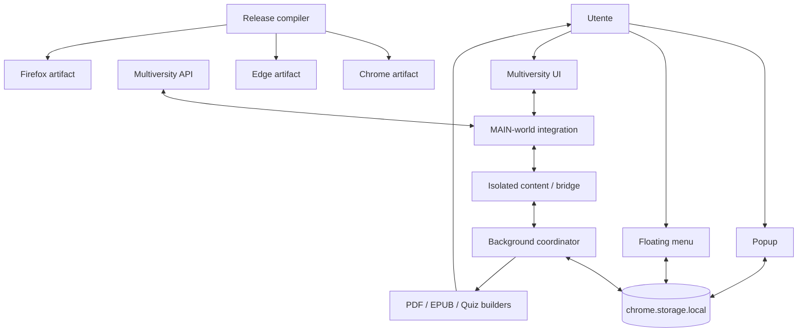

# 16 — Architectural lessons

## Patterns that emerged from the real project

> **Reference snapshot for this chapter**  
> PlumePilot **2.35.2 release candidate**, `feat/ui-ux-2.35.2`, commit `f6fcb4c29c83ba9150df0be31da04fc91dffb634`. Earlier feature commits and the architecture chapters provide supporting examples.

The previous chapters looked at concrete subsystems: messaging, APIs, dynamic DOM, autoplay, state, EPUB and quiz export, editing, UI, browser distribution, tests, and Git. This chapter asks a different question: **which recurring architectural ideas explain why those systems work, fail, recover, and evolve?**

These principles were not all designed up front. Many became visible through real bugs and refactors. The goal is to name those patterns without claiming that PlumePilot needs a large framework or a wholesale rewrite.

---

# Part I — Architectural boundaries

## 1. Physical structure versus logical structure

A list of files such as content.js, popup.js, background.js and epub-core.mjs describes repository organization, not the architecture. Logical organization is defined by responsibilities: domain rules, platform adapters, data sources, state owners, effects and build targets. The two views should be connected, not confused.

---

## 2. What is a boundary?

A boundary is a point where trust, execution context, ownership, identity, lifecycle, data representation, or contract changes. PlumePilot crosses boundaries among the LMS, isolated content world, MAIN world, background, popup, builder, and distribution channels.

---

## 3. Why boundaries matter

Many real defects occurred not inside an isolated algorithm but because something crossing a boundary was assumed safe: a lesson node remained current after rerender, a privileged API existed in the page world, or a browser accepted another target's manifest.

---

## 4. Translation at the boundary

Rather than propagating provider-specific terms everywhere, transform them into stable internal meaning. Normalize lesson API data, map varying DOM selectors into one course structure, and compile a shared manifest into browser-specific packages. A good boundary translates, validates and explains.

---

# Part II — Anti-corruption layers

## 5. The recurring anti-corruption layer

Domain-Driven Design calls an adapter that protects an internal model from an external model an **anti-corruption layer**. PlumePilot has modest versions of this pattern; it is not necessary to install a DDD framework to benefit from the principle.

---

## 6. API normalization

The LMS exposes provider-oriented fields, inconsistent nullability and platform-specific IDs. Internal logic wants well-defined course identity, lesson status, and completion evidence. The API adapter translates raw responses into this domain vocabulary and rejects or marks ambiguous fields.

---

## 7. DOM adapter

Pegaso, Mercatorum and San Raffaele can render related course features in different DOM arrangements. Helpers such as sections() produce a common representation instead of scattering institution-specific querySelector paths across unrelated features.

**Historical code or diagram:**

```js
if (pegaso) ...
if (mercatorum) ...
```

---

## 8. Browser packaging adapter

Chrome and Edge use service-worker-oriented manifests while Firefox receives background scripts and different review-safe resources. Build specialization is another anti-corruption layer: shared behavior stays stable, target-specific constraints remain at the boundary.

---

# Part III — Stable identity

## 9. The DOM is not identity

A DOM node can be removed, recreated or reused for another lesson. Autoplay defects exposed why a node reference is not the durable identity of a course activity.

---

## 10. Node identity versus domain identity

HTMLElement references describe one instance of a rendering. Course code, chapter/folder context, lesson ID and media identity describe the activity being processed. Before acting on a DOM node, reconnect it to the intended domain identity.

---

## 11. Composite identity

display_order can restart in each folder or be duplicated across categories. Use composite keys such as platform + course + folder + lesson, or the strongest stable provider IDs available, instead of pretending a local ordinal is globally unique.

---

## 12. The general identity rule

**Choose identity that remains stable for the lifetime of the operation**, not merely what is convenient to read from the current view. A stable ID may require multiple fields.

---

## 13. Identity belongs to a domain

An exam ID is not necessarily unique across different universities or courses. Scope the identity to the domain in which uniqueness is actually guaranteed.

---

## 14. Scoped storage keys

Persisted data keyed only by course ID risks cross-platform collisions. A composite university/course prefix preserves separation without requiring unrelated stores for each university.

---

## 15. Collisions expose missing model structure

When two entities collide, the deeper question is not only how to avoid overwriting their objects but which domain context was omitted from the identity model.

---

# Part IV — Hierarchies of evidence

## 16. Sources have different authority

Master progress, lesson detail APIs, visible DOM, and cached snapshots can disagree. Their values are not interchangeable; model an evidence hierarchy and consider freshness, granularity, and context.

---

## 17. Master call

The master index is cheap and useful for prioritizing chapters or discovering broad completion. It cannot always certify that every activity inside a chapter is complete.

---

## 18. Lesson-detail API

Detail responses can provide better activity-level evidence but may be missing, partial, stale, or temporarily unavailable. Increased granularity does not guarantee perfect reliability.

---

## 19. Visible DOM

The DOM is vulnerable to rerendering and loading delays, yet can provide visual verification when APIs cannot resolve an activity. A fallback source should not silently override stronger fresh evidence.

---

## 20. Layered truth

In practice the pipeline is **summary → detailed API → visual verification**, with state-specific exceptions. This is not a rigid global rank for every field; it is an explicit decision model.

```text
master summary → activity-level API → guarded visual verification
```

---

## 21. Choose which evidence wins

If a fresh detail response proves unfinished work, do not let an old DOM snapshot replace that fact. If the detail response is absent, a guarded visual check may become necessary.

---

## 22. Precedence needs rules

Define priority in terms of evidence freshness, level of detail, identity confidence and known provider quirks. A fallback is justified by a specific uncertainty, not a random preference for one source.

---

# Part V — Three-valued knowledge

## 23. Booleans are often too weak

A completed flag modeled as only true or false loses the distinction between known incomplete and not yet observed. These two cases must not cause the same automated action.

---

## 24. A missing percentage

The absence of a rendered percentage does **not** mean zero progress or full progress. It means the value is currently **unknown**.

---

## 25. Three-valued knowledge

Use complete, incomplete and unknown where appropriate. Similar ternary states appear in exam verdicts, activity readiness, APIs, cache status and asynchronous operations.

---

## 26. Why explicit unknown is useful

Unknown allows the program to request more evidence or decline an unsafe action rather than fabricating certainty through a default Boolean.

---

# Part VI — Fail closed at risky boundaries

## 27. Uncertainty and side effects

When the destination chapter is ambiguous, do not navigate destructively. When a pending test cannot be identified confidently, do not auto-submit or silently skip it.

---

## 28. Fail closed under uncertainty

A good pattern is: obtain evidence → check identity and confidence → perform the side effect only if the required conditions hold; otherwise verify or stop safely.

---

## 29. Real fail-closed cases

An ambiguous course route yields no forced match; an unexpected Firefox vendor patch fails the build; an uncertain bookmark test triggers targeted verification rather than an arbitrary completion judgment.

---

## 30. Correctness over aggressive automation

A system is not smarter merely because it always makes a decision. Sometimes the correct output is “there is insufficient evidence to proceed safely.”

---

# Part VII — Progressive refinement

## 31. Do not start with the most expensive source

First-incomplete discovery should consult the cheap course index before issuing detailed requests or repeatedly opening LMS accordions. Escalate cost only when the cheap evidence is inconclusive.

---

## 32. The same pattern in EPUB

Try text extraction and structural analysis before allocating a full visual canvas; use regional or full rasterization when fidelity requires it.

---

## 33. The same pattern in caches

Return a valid cached value when its identity, status and freshness policy allow reuse; pay for a new network request only when necessary.

---

## 34. Fast path and slow path

**Cheap evidence → fast path if justified → stronger fallback when needed** combines performance with completeness and safety. The slow path is not a failure; it is part of the correctness guarantee.

---

# Part VIII — A cost-aware decision engine

## 35. Not every read has equal cost

Reading a Map entry, making an HTTP detail request and rendering a full chapter in the host DOM have dramatically different resource and latency costs.

---

## 36. Make the decision engine cost-aware

The engine need not assign precise numerical prices to each action. It should order checks deliberately: in-memory index first, targeted detail calls next, expensive visual interaction last.

---

## 37. Query-planner analogy

Like a database query planner, the first-incomplete engine arranges candidate checks so likely useful answers require fewer expensive operations. It optimizes the *search plan* without redefining the correct result.

---

# Part IX — Scope and lifetime of state

## 38. Each state has a natural lifetime

PlumePilot uses short-lived in-memory state, tab/session-scoped state, persistent extension storage, and authoritative LMS server data. Each fits a different lifetime and recovery contract.

---

## 39. In-memory state

Useful for controllers, current DOM targets, temporary request coalescing and runtime caches whose loss on reload is acceptable or recoverable.

---

## 40. sessionStorage

Useful for state intended to survive certain same-tab navigations without becoming permanent user configuration. It belongs to that browsing session, not the entire extension lifetime.

---

## 41. chrome.storage.local

Appropriate for user preferences, relevant long-lived operation snapshots and notes metadata that must survive popup or background restarts.

---

## 42. The server

Authoritative for course content, enrollment and exam outcomes provided by the LMS. Extension storage is not an independent database of official academic state.

---

## 43. The lifetime rule

**Persist state long enough for its purpose, but not longer than necessary.** Excess persistence causes staleness, privacy exposure and confusing migrations.

---

# Part X — State ownership

## 44. Who owns state?

A key architectural question is which component is responsible for changing a value and which components merely observe it. Ownership should match the operation's domain and lifecycle.

---

## 45. Operation state ownership

The background coordinates cross-context operations and is a natural owner of active job state, leases, cancellation and global progress metadata.

---

## 46. UI state projection

The popup and floating menu may display the same operation while being created and destroyed independently. They should not manufacture two separate truths about that operation.

---

## 47. Ownership reduces races

If independent components can read and write shared state without a protocol, lost updates and split-brain presentation become likely.

---

## 48. Single-writer where possible

A useful pattern is many readers, one authoritative writer, plus a defined command boundary for changes. Not every preference needs such strict centralization, but high-risk operations often do.

---

## 49. Commission-storage writes

Serializing writes through background ownership protects exam/commission snapshots from concurrent read-modify-write losses.

---

## 50. Where one writer is impractical

Users can change ordinary settings from popup and floating menu. Shared storage, change notifications and consistent normalization are more suitable than inventing an exclusive UI owner for every checkbox.

---

# Part XI — Messaging as a protocol

## 51. Messages are not ordinary remote function calls

chrome.runtime.sendMessage crosses an execution-context and lifecycle boundary. The receiver can be absent, restarted, busy or operating on newer state than the sender expects.

**Historical code or diagram:**

```js
chrome.runtime.sendMessage(...)
```

---

## 52. Messages need contracts

An operation command should have an explicit type, accepted fields, identifier, response meaning, error behavior and—when relevant—correlation with later status events.

---

## 53. Accepted is not completed

A response acknowledging START means the request was received or accepted; a long-running export may still be working. This resembles HTTP 202 rather than a completed synchronous function return.

---

## 54. Current protocols

PlumePilot uses string message types and conventional structured objects. They work because the scope is manageable and the contracts are understood.

---

## 55. Possible later growth

As message varieties increase, shared schemas and discriminated message shapes could validate types and make protocol evolution clearer.

---

## 56. Do not abstract prematurely

A complex internal RPC framework can exceed the problem it is meant to solve. Prefer explicit simple contracts now and strengthen only demonstrated weak boundaries.

---

# Part XII — Temporal validity after await

## 57. await changes the world

Before an await, code observes one state. While suspended, the user can navigate, storage can change and the host DOM can rerender. Resuming does not restore the old world.

**Historical code or diagram:**

```js
await something();
```

---

## 58. Revalidate after suspension

Acquire identity → await external work → check cancellation/generation/identity again → apply the result if still relevant. This protects against stale continuations.

```text
capture identity → await → recheck identity → guarded side effect
```

---

## 59. Compare before side effect

Before clicking a lesson or advancing playback, compare the current rendered target and active operation with the identity captured before the wait.

---

## 60. Backend analogy: optimistic concurrency

A database update may require version X still to be current before committing. In browser automation, a generation token or selected lesson identity serves a similar precondition.

---

## 61. Browser version tokens

“Version” can mean an operation generation, DOM render generation, selected lesson identity or current request ID rather than a formal database version number.

---

# Part XIII — Generation tokens

## 62. Discovery generations

A first-incomplete search increments a generation marker so results from an older search can be identified as stale and ignored.

---

## 63. The generation-token pattern

Store generation on start; await asynchronously; compare at resume; do not perform side effects if the generation changed.

---

## 64. Lightweight cancellation

A generation token does not physically abort every pending Promise. It prevents obsolete results from taking action once they complete.

---

# Part XIV — Functional core and imperative shell

## 65. Functional core and imperative shell

Separate pure decisions—candidate priority, identity matching, effective policy, presentation summaries—from imperative browser effects such as DOM clicks, storage writes and network requests.

---

## 66. An existing pure presentation function

autoplayPresentation() derives a view model from input settings without reading DOM or storage. This is an already practical example of a testable functional core.

---

## 67. Route mapping as logic

resolve-target or route-mapping decisions can often be tested as transformations of explicit objects, even if their inputs originated in the LMS DOM.

---

## 68. The imperative shell

Navigating chapters, focusing controls, sending messages and updating persistent state remain browser side effects that should be triggered by validated decisions.

---

## 69. Why this separation helps

Pure rules support fast deterministic tests and clearer invariants. Effects remain concentrated in adapters where lifecycle and error handling can be managed.

---

# Part XV — State machines

## 70. Behavior with history requires state

Autoplay cannot always be represented as one independent function call. What happens next depends on what is playing, waiting, completed, cancelled or superseded.

---

## 71. Symptoms of an implicit state machine

Several flags tracking autoplay, recovery, tests and pending operation often mean a state machine already exists, even if nobody named it.

---

## 72. Reason explicitly about transitions

Ask which event is legal in each state, which guard it requires, which action follows and what must happen on cancel or timeout.

---

## 73. Distributed state vectors

The actual state may be a tuple of operation record, playback phase, current lesson, test policy and cancellation state rather than one enum value.

---

## 74. State explosion

Independent Booleans create many combinations, some impossible or contradictory. Derive redundant values where possible and constrain transitions.

---

## 75. Future state-machine improvement

Where a workflow keeps growing, a reducer, explicit transition table or statechart may reduce illegal combinations. Introducing one everywhere today would be unnecessary complexity.

---

# Part XVI — Idempotence and event identity

## 76. Duplicate events are ordinary

Retries, listeners, reconnections and cross-context notifications can deliver the same logical event more than once. Handle that possibility deliberately.

---

## 77. Deduplication versus idempotence

Deduplication suppresses repeat processing of one event. **Idempotence** guarantees repeating the same operation leaves the same final result. They are related but distinct guarantees.

---

## 78. Operation identifiers

An operationId allows handlers to determine whether an acknowledgement, progress event or completion belongs to the currently relevant job.

---

## 79. Remembering sound events

Notification sounds and achievement events have bounded recent-event memory to reduce duplicate effects across replays.

---

## 80. Design for repeated messages

Even if the transport is simple, ask what happens on duplicated, late or out-of-order events. Event identity and idempotent handling often provide inexpensive resilience.

---

# Part XVII — Snapshot and event convergence

## 81. Snapshots and events together

A UI should subscribe to change notifications but also read the current operation snapshot when it starts. Events tell an already-open interface what changed; snapshots let a newly opened interface reconstruct the latest state.

---

## 82. Why event-only is fragile

A popup opened after an export-completed notification cannot recover the state from an event that it never observed. The component lifecycle is shorter than the workflow lifecycle.

---

## 83. Why snapshot-only is expensive

Polling extension storage repeatedly wastes work and introduces latency. With events available, the UI can react promptly instead of constantly requesting the whole state.

---

## 84. The combined approach

Read a snapshot on initialization; subscribe to updates; reconcile events against current identity. This is robust under popup reopening and independent floating-menu lifecycles.

```text
read state snapshot → subscribe to events → reconcile by operation ID
```

---

## 85. Two views converge asynchronously

Popup and floating menu may show slightly different values for a brief period. The goal is not perfectly simultaneous updates but convergence on one authoritative persisted value.

---

## 86. chrome.storage.onChanged as reactive channel

Changes to extension storage notify interested contexts. This becomes a lightweight reactive propagation mechanism without introducing a shared UI process or full state-management framework.

---

# Part XVIII — Semantically fresh caches

## 87. What a cache promises

A cache says “I have evidence previously obtained for this identity with a particular freshness contract,” not “I hold eternal truth.”

---

## 88. A complete cache entry

Store content with the relevant identity, timestamp, source, partial/completion status and any schema or confidence metadata needed for reuse. The raw value alone is often insufficient.

---

## 89. Semantic freshness

A previously established completed activity may remain useful longer than a “video currently playing” observation. TTL alone cannot describe the different staleness semantics of all fields.

---

## 90. Monotonic information

Within a stable activity identity, completion normally progresses from unfinished to finished, not backward. Such monotonicity may allow a stronger fact to survive a weaker older response.

---

## 91. Merging cache observations

When identity is unchanged, combine compatible evidence without downgrading a known completed result merely because a partial response omitted it.

---

## 92. Identity before monotonicity

Never merge “complete” from one route with “incomplete” from another route only because both happen to have the same display order. Monotonicity rules are valid **after** entity identity is established.

---

# Part XIX — Bounded growth

## 93. An unbounded cache is a logical leak

A perfectly functioning garbage collector cannot reclaim objects deliberately held forever by a Map. Capacity and lifetime rules are required for long-lived caches.

---

## 94. pageLessonSnapshots has a limit

The MAIN-world interception cache caps retained lesson snapshots at 50 entries. Bounded insertion-order eviction is simple, predictable and often sufficient.

---

## 95. Notification event memory is bounded

Short-lived event deduplication uses a limited history or time window rather than indefinitely remembering every sound or achievement.

---

## 96. Every cache needs four answers

Who owns it? Which identity does a key represent? When does an entry expire or become invalid? What maximum amount of state may remain resident?

---

# Part XX — Cooperative cancellation

## 97. A Cancel button is not cancellation

Hiding an interface or acknowledging a click does not stop requests, rendering, and packaging. Cancellation must be respected by the actual workflow stages.

---

## 98. Cooperative cancellation

JavaScript does not terminate arbitrary work on command. Long-running code checks an AbortSignal, propagates it into abortable APIs and yields between expensive stages.

---

## 99. Cancellation latency

A signal checked only once every thirty seconds offers poor practical cancellation. Processing units and checks should keep the time between user request and work stopping acceptably small.

---

# Part XXI — Resource ownership

## 100. Allocation implies cleanup ownership

For canvases, PDF.js page objects, event listeners, Object URLs and large buffers, define which stage acquires the resource and which stage is responsible for releasing or invalidating it.

---

## 101. A resource lifecycle

The general lifecycle is acquire → use → transfer ownership or release, with cleanup on success, failure and cancellation. finally blocks are part of algorithm correctness.

---

## 102. Document generation peaks

A 30 MB final EPUB may require much more RAM during conversion because PDF buffers, parsed pages, canvases, images and ZIP data coexist.

---

## 103. Working-set reasoning

Peak memory reflects concurrently live representations. Reducing overlapping lifetimes can be more effective than reducing final archive bytes.

---

## 104. Memory-aware architecture

Sequential conversion, bounded canvas dimensions, banded image processing, asset deduplication and prompt buffer release are architectural choices, not isolated micro-optimizations.

---

# Part XXII — Concurrency and backpressure

## 105. More concurrency is not always better

Promise.all over a large PDF collection might reduce wall-clock time yet multiply active documents, canvas buffers, requests and peak memory.

---

## 106. Pacing is backpressure

Delays between API calls limit bursts and protect the external LMS and local browser from uncontrolled request fan-out.

---

## 107. Possible future concurrency limiter

For some workloads a bounded worker pool may regulate simultaneous requests more precisely than fixed delays. Add one only when measurements justify its complexity.

---

# Part XXIII — Graceful degradation

## 108. Robust features may use different paths

The same user-facing capability may need different adapters or fallbacks. Consistent behavior is more important than identical internal function calls everywhere.

---

## 109. EPUB quality fallback

Text-first conversion, hybrid regions and full visual rendering form a controlled escalation in rendering cost and fidelity.

---

## 110. Materials export fallback

If a high-quality transformation cannot preserve essential information, a safer visual representation can protect document usefulness instead of silently dropping content.

---

## 111. Graceful degradation is not silent corruption

A fallback should produce a valid, understandable result—or report why it cannot. Hiding lost formulas or pretending an export succeeded violates the user contract.

---

# Part XXIV — Semantic parity across runtimes

## 112. Cross-browser semantic parity

Chrome and Edge may use Offscreen API audio; Firefox can use tab messaging. Different mechanisms preserve the same notification goal.

---

## 113. UI semantic parity

Popup and floating menu use different DOM roots and lifecycles, yet should agree on settings, operation availability and effective autoplay policy.

---

## 114. What semantic parity means

Do not force identical HTML trees and lifecycle management. Require both surfaces to satisfy the same meaningful product invariants.

---

# Part XXV — Sharing UI meaning rather than markup

## 115. The 2.35.2 redesign choice

The project did not replace popup and floating menu with one massive shared component. It extracted common presentation rules and retained separate controllers.

---

## 116. Why separate controllers?

The popup is an extension page; the floating panel is embedded in the LMS in Shadow DOM. Scroll geometry, initialization, and focus behavior differ.

---

## 117. What is actually shared?

Autoplay policy summaries, layout normalization, groups, accessibility helpers, typography tokens and other stable rules of meaning.

---

## 118. The rule

**Share stable semantics without forcibly merging surfaces whose lifecycles differ.** Duplicated small DOM wiring can be less harmful than one tangled universal renderer.

---

# Part XXVI — Derived presentation state

## 119. Do not render raw state blindly

Saved preferences and effective runtime behavior can diverge under policy overrides. The UI needs a deliberate interpretation of state, not a direct text label copied from a storage key.

---

## 120. A presentation function

autoplayPresentation() computes summary, testOverride and stopHint from policy inputs. This is an inexpensive shared view model.

---

## 121. Why it matters

Separate popup and floating-menu controllers consume the same interpretation, avoiding two manually maintained rule sets.

---

## 122. Not everything needs persistence

A derived summary can be computed from saved preferences instead of stored as a second independent value.

---

## 123. Duplicate state creates drift

If both enabled and a separately stored “enabledLabel” change independently, one may become stale. Keep one authoritative representation and derive the rest.

---

# Part XXVII — Architectural invariants

## 124. An invariant is a strong sentence

Examples: no ambiguous chapter is clicked; an active export retains a reachable cancellation control; a cancelled EPUB export does not continue expensive work; no unknown vendor transform silently succeeds.

---

## 125. An invariant is better than one patch

A patch says “add a condition after this bug.” An invariant says which behavior must remain true even if the implementation changes.

---

## 126. Tests are executable invariants

Chapter 14 showed how reproductions become assertions. This is an important step from reactive bug fixing to explicit architectural guarantees.

---

# Part XXVIII — Build artifacts are part of the program

## 127. Repository source is not the installed product

An extension runs from a target-specific ZIP, with its own manifest, included files and adapted vendor bundles.

---

## 128. The build belongs to the architecture

Browser specialization, locale inclusion, packaging, pinned vendor transforms, validation and checksums change what users install. They are part of program correctness.

---

## 129. Testing only the source tree is insufficient

A missing stylesheet or invalid Firefox manifest can leave all pure function tests green. The final artifact must be inspected and exercised.

---

# Part XXIX — A build as a compiler

## 130. Build front end

The release pipeline reads shared source, vendor dependencies, manifest definitions and release inputs as its initial representation.

---

## 131. Target lowering

Each browser target receives manifest adjustments, permissions, resource selection and documented compatibility transforms.

---

## 132. Code generation

The builder emits runtime ZIP archives and the Firefox source-review archive.

---

## 133. Verification

The validator inspects the generated artifact for required files, manifest contracts, restricted patterns and checksums. The build resembles a small compiler with validation.

---

# Part XXX — Runtime versus release error behavior

## 134. Runtime workflow fallback

When an external platform is unavailable or content is uncertain, recovery or graceful fallback may be a valid runtime response.

---

## 135. Build failure should be explicit

A deterministic precondition violation—such as a vendor patch matching zero or two times—should fail the release build rather than fall back to unknown output.

---

## 136. Why these failure policies differ

At runtime, users may benefit from an alternate valid route. During packaging, silently emitting an unexpected binary undermines reproducibility and trust.

---

# Part XXXI — Observability and privacy

## 137. Log only useful evidence

A good diagnostic record answers which operation, identity, phase, expected state and observed failure were involved. Dumping all objects indiscriminately rarely helps.

---

## 138. Better diagnostics

“Candidate rejected because lesson ID differs after await” conveys more than “navigation failed.” Logs should explain a decision boundary and its reason.

---

## 139. Structured EPUB diagnostics

Capture elapsedMs, pagesText, pagesVisual, outputBytes and related metrics as structured values. Tests and benchmarks can inspect them without parsing console prose.

---

## 140. Authenticated extensions see sensitive data

Debug output can expose course content, notes, session context or credentials. Treat logs as a privacy-sensitive output, not harmless toy text.

---

## 141. Minimize diagnostic payloads

Log IDs, categories, timings and redacted safe metadata where possible—not passwords, cookies, raw authorization tokens or unnecessary personal content.

---

# Part XXXII — Boundaries around volatility

## 142. Multiversity is an external source of volatility

The LMS can alter API payloads, DOM structure, identifiers and page behavior without a simultaneous extension release.

---

## 143. Browsers evolve independently

Supported browsers differ in lifecycle, rendering, APIs and version cadence. Compatibility contracts must be checked and adapted at their own boundary.

---

## 144. Stores evolve independently

Review rules, metadata schemas, submission processes and automated validators can change even when runtime code does not.

---

## 145. Design for change at integration boundaries

Every external integration should have a documented contract, explicit failure behavior and tests for likely changes.

---

## 146. Ask how, not whether, an external system changes

It is safer to ask which assumptions are likely to vary and where those assumptions are isolated.

---

## 147. A useful response

Put volatile provider parsing in adapters, runtime capability differences in wrappers or build rules, and store-specific constraints in reproducible packaging.

---

# Part XXXIII — Containing essential complexity

## 148. Complexity cannot always be removed

PlumePilot must accommodate multiple universities, evolving LMS code, three browsers and document formats. These are essential product constraints.

---

## 149. But complexity can be contained

An adapter keeps API quirks local, a normalized identity model localizes route collisions, and one release compiler localizes manifest differences.

---

## 150. The alternative spreads exceptions

If every browser or LMS exception appears across ten modules, changing one external rule requires risky edits in many unrelated areas.

---

# Part XXXIV — Principles that generalize

## 151. Patterns compress exception handling

Instead of scattered “if Firefox,” “if Mercatorum,” and “if this chapter was just rerendered,” use stable interfaces, lifecycle rules and identity checks at well-defined boundaries.

---

## 152. A principle replaces many patches

“Revalidate identity after await” explains and prevents an entire family of DOM-race failures more effectively than dozens of isolated extra null checks.

---

## 153. That is architecture

A small vocabulary of boundaries, ownership, identity, evidence and lifetime allows us to reason about many otherwise unrelated defects.

---

# Part XXXV — Pattern map across subsystems

## 154. An emerging pattern map

Core recurring patterns: boundary translation, stable identity, evidence hierarchy, unknown state, progressive refinement, guarded effects, single-source ownership, revalidation, bounded resources, and artifact verification.

---

## 155. First-incomplete example

The search combines platform normalization, scoped identities, index-first evidence, generation tokens, fail-closed ambiguity handling, and expensive fallback only when necessary.

---

## 156. EPUB export example

The converter combines controlled input parsing, quality escalation, memory ownership, cooperative yielding, abort propagation, deduplication and output validation.

---

## 157. Popup and floating menu example

The pair illustrates shared semantics, derived view models, reactive storage synchronization, local UI lifetime and focus-preserving DOM adapters.

---

## 158. Chrome and Firefox example

Targeted build adapters provide shared domain behavior while honoring background, permission, audio, review and artifact differences.

---

# Part XXXVI — Architecture without overengineering

## 159. A hypothetical concept-oriented module map

One might group domain, adapters, workflow coordination, presentation, build, and tests more explicitly. Such a diagram is **conceptual**, not a proposal to immediately relocate every file.

---

## 160. Beware architecture astronautics

Introducing layers, protocols and frameworks solely to make diagrams tidy can add accidental complexity. The architecture must be justified by concrete maintenance or correctness benefits.

---

# Part XXXVII — Architecture should earn its cost

## 161. Architecture has a cost

Every new abstraction adds files, contracts, integration work, tests and a concept to learn. The benefit must justify those continuing costs.

---

## 162. Abstract stable recurring relationships

**Abstract when a relationship is demonstrated, stable and repeated—not merely when we can imagine that one day it might be.**

---

# Part XXXVIII — Essential and accidental complexity

## 163. Essential complexity

PlumePilot genuinely integrates three universities, changing LMS behavior, multiple browsers, long-running workflows, PDF/EPUB conversion and user-facing settings. These product demands cannot simply be erased.

---

## 164. Accidental complexity

Unnecessary duplicate policies, scattered browser branches, implicit state, oversized globals, confusing ownership and brittle release steps are complexity introduced by our implementation choices.

---

## 165. Good architecture reduces the avoidable

The objective is to reduce accidental complexity while honestly modeling the complexity the product necessarily contains.

---

# Part XXXIX — Cohesion and coupling

## 166. What coupling means here

Two components are coupled when changing one requires knowledge of internal details in the other. Coupling is not inherently bad, but avoid needless reliance on volatile internals.

---

## 167. Tight coupling to host DOM

A function depending on a brittle nth-child selector or a specific accordion nesting is tightly coupled to the LMS's current HTML structure.

---

## 168. A DOM adapter reduces coupling

Callers should request a conceptual operation such as “resolve current course sections,” leaving changing selectors and special layouts behind a limited adapter.

---

## 169. Cohesion means a reason to change

A cohesive module groups logic that changes for one domain reason—for example, normalized sound preferences and their validation, rather than unrelated video, storage and typography concerns.

---

## 170. The large content.js module

content.js has grown to serve many features. File length alone does not prove bad architecture, but many independent reasons to change one module suggest future seam extraction.

---

## 171. Length alone is not a useful verdict

A long file can still be readable when its internal model is coherent and its responsibilities explicit.

---

## 172. Too many reasons to change

If a file handles course DOM, video recovery, export orchestration, messaging and unrelated parsing, tests may need source slicing and many mocks. Those are clues that conceptual responsibilities already exist.

---

# Part XL — Tests and natural seams

## 173. Tests reveal seams

When testing one helper requires injecting dozens of globals, consider whether some pure decision or adapter boundary could be made explicit.

---

## 174. Pure functions are straightforward to test

A transformation of explicit inputs into outputs needs neither a virtual DOM nor a running browser. The resulting test is fast and deterministic.

---

## 175. Do not refactor only for the test harness

Treat test difficulty as evidence of coupling, not as a command to rearrange every functioning subsystem to fit one testing tool.

---

# Part XLI — Volatility-oriented boundaries

## 176. What changes frequently?

LMS response fields, DOM selectors, store policies, browser quirks, menu layout and rendering details can change independently and unpredictably.

---

## 177. What changes less often?

Concepts such as identity, operation ownership, cancellation, course progress meaning and requirements for export fidelity generally evolve more slowly.

---

## 178. Design around volatility

Place frequently changing details behind clear boundaries so the stable domain decisions do not depend directly on them.

---

## 179. Do not let the domain inherit irrelevant volatility

A course-completion decision should consume a normalized status rather than parsing a CSS class whose name can change with the provider's redesign.

---

# Part XLII — Error modeling

## 180. Errors are normal operating states

Network failure, missing DOM, cancelled operations, incomplete API responses, throttled tabs and unsupported browser capabilities are normal integration conditions, not impossible anomalies.

---

## 181. Define an error taxonomy

Distinguish transient network, invalid identity, incomplete evidence, stale generation, unsupported capability, cancelled work, invalid package and unexpected internal error.

---

## 182. Choose recovery from the category

Temporary network may retry; absent DOM may wait; stale API may refresh; ambiguous identity should stop; cancellation should clean up; invalid release artifacts should fail the build.

**Historical code or diagram:**

```js
catch { return null; }
```

---

## 183. null is overloaded

Returning null can mean “not found,” “not loaded,” “invalid input,” “cancelled,” or “ambiguous.” Callers may accidentally treat these states as identical.

---

## 184. Use explicit results when ambiguity grows

A structured result with status and reason helps the caller choose appropriate recovery without guessing what null meant.

**Historical code or diagram:**

```js
{ status: "target", ... }
{ status: "end" }
{ status: "cancelled" }
{ status: "fallback" }
```

---

## 185. Informal result types in JavaScript

Even without TypeScript unions, a small status field can distinguish ok, unavailable, ambiguous, cancelled and error safely.

---

## 186. Booleans are too weak for operation lifecycle

An operation can be accepted, pending, running, cancelling, completed, failed or aborted. One busy flag cannot communicate every transition.

---

## 187. Result objects convey semantics

A shape such as { status: "ambiguous", reason: "duplicate display order", candidates: 2 } is more useful than false when the caller must decide whether to act.

**Historical code or diagram:**

```js
{
  accepted: false,
  reason: "duplicate"
}
```

---

# Part XLIII — Explicit sequencing and state

## 188. Order-sensitive functions

Some helpers only work after initialization, a listener setup, or resource creation. Such ordering dependencies are real program contracts.

---

## 189. Formalize required ordering

Express order through an explicit initialization function, returned controller, state machine transition or tested module-loading dependency rather than undocumented caller memory.

---

## 190. Globals create implicit coupling

Global variables are convenient but can hide which functions depend on settings, DOM state, current operation and cancellation generation.

---

## 191. Group state by subsystem

A future direction might create explicit state objects for playback, chapter discovery, UI preferences and exports with known owners and lifecycle policies.

**Historical code or diagram:**

```js
playbackState
exportState
commissionState
```

---

## 192. Use co-change as evidence

Functions that always change together may belong behind one interface. Parts of the same large file that change for unrelated reasons may deserve separation.

---

# Part XLIV — Reading architecture from history

## 193. Git history reveals coupling

If every autoplay fix also requires changes to unrelated UI and export internals, the repository's change history is signaling high coupling.

---

## 194. Independent PRs suggest cohesive boundaries

When targeted PRs consistently touch only relevant files, that is qualitative evidence that responsibilities have been separated usefully.

---

# Part XLV — Bugs expose assumptions

## 195. Bugs expose hidden assumptions

A regression often reveals an invariant the design did not model: a DOM node was assumed stable, a percentage authoritative, or a service worker permanent.

---

## 196. The regression pattern

**Every important regression points to an architectural dimension we had not yet modeled explicitly.** Add the missing model, not only a local patch.

---

# Part XLVI — Constraints teach design

## 197. Performance exposes ownership

Excess EPUB memory consumption reveals that canvas lifetimes, buffer ownership, processing order and archive retention are architectural decisions.

---

## 198. Review constraints produced better boundaries

Firefox AMO requirements encouraged pinned readable vendor inputs, deterministic transformations, exact-match guards and artifact checks.

---

## 199. Constraints can improve architecture

Manifest V3, cross-browser differences and review policies forced the project to clarify runtime assumptions, least privilege and distribution provenance.

---

# Part XLVII — Trade-offs and reversibility

## 200. Every choice trades resources

A cache spends memory to save requests; a squash reduces mainline noise but loses commit-level ancestry; shared UI rules reduce drift but introduce a dependency. No design is free.

---

## 201. State what is being optimized

A good decision names the protected property—correctness, memory peak, maintainability, reviewer reproducibility, or latency—and acknowledges its trade-off.

---

## 202. Some choices are easy to reverse

Renaming a local CSS class or rearranging an internal helper may be inexpensive if its interface is private and well tested.

---

## 203. Other choices are expensive to reverse

Extension identity, persisted schema, manifest permissions, public APIs, release tags, and cross-world protocols can become commitments to installed users and reviewers.

---

## 204. Spend design effort in proportion to reversibility

Put more thought and tests around expensive, externally visible commitments than around easy local refactors.

---

## 205. Concurrency as an example

Promise.all may improve wall time for small independent tasks but worsen peak RAM and server load when applied to hundreds of PDFs. A local optimization can damage system-level outcomes.

---

## 206. Architecture sees the whole system

Evaluate performance, correctness and user control across all contexts, not just one function's microbenchmark.

---

# Part XLVIII — Human intent and automation

## 207. Manual choice overrides autoplay continuation

If a user selects a different lesson while autoplay awaits, the newer explicit action should invalidate the pending automatic continuation.

---

## 208. Bookmark versus automatic tests

“Find first incomplete activity” is a navigation request, not permission to launch an unrelated auto-test workflow merely because auto-test is enabled elsewhere.

---

## 209. Human intent takes precedence

**The user's most recent explicit intent should outrank previously scheduled automation.** This rule informs generation tokens, cancellation and interaction handoff.

---

## 210. PlumePilot is an assistant layer

It supports the user's work on an existing LMS rather than taking unbounded autonomous control of the platform.

---

## 211. User control implications

Provide clear start/stop controls, predictable manual overrides, visible active-operation state and safe cancellation where possible.

---

# Part XLIX — Risk-aware side effects

## 212. More consequential effects require more evidence

Reading a progress summary may tolerate uncertainty; navigating to another chapter requires stronger identity; submitting test responses requires even more deliberate authorization and correctness.

---

## 213. Risk-aware confidence thresholds

The architecture should demand stronger evidence as the potential impact of a wrong side effect grows.

```text
consequence severity ↑  ⇒  required evidence confidence ↑
```

---

## 214. A useful rule

**Risk of action ↑ → required identity/evidence confidence ↑.** This is more helpful than one global confidence threshold for all automated steps.

---

# Part L — Architectural debugging vocabulary

## 215. Start architectural debugging with a boundary

After many chapters, the productive first question is often “Which boundary, identity, authority or lifetime assumption failed?” rather than “Which line is wrong?”

---

## 216. A post-await bug hypothesis

If an issue occurs after await, inspect whether a user action, DOM rerender or operation switch made the earlier captured reference stale.

---

## 217. Say what failed

“The current lesson identity was not revalidated after a suspended API request” is a much more useful diagnosis than “autoplay sometimes clicks wrong.”

---

## 218. Shared vocabulary shortens discussions

Terms such as generation token, source of truth, fail closed, bounded cache, and adapter let contributors reason precisely about problems seen in different features.

---

# Part LI — Decision records

## 219. Architecture Decision Records as a future option

Small ADR files could capture decisions whose reasons would otherwise live in long chat histories or be reconstructed from commits.

---

## 220. What an ADR contains

Document context, chosen decision, alternatives, consequences, supporting evidence and a date or status. Keep it concise and linked to relevant code.

---

## 221. Why ADRs help

This architecture book already teaches past decisions; short ADRs near the repository could make operational trade-offs easier to retrieve during a future refactor.

---

## 222. Diagrams without “why” are fragile

A diagram showing background → popup does not explain why background owns operation state or how lifecycle recovery works.

---

## 223. Useful architecture documentation

Couple diagrams with identity, authority, ownership, and failure rationale. These explanatory contracts remain useful after file locations change.

---

# Part LII — Data-flow and control-flow maps

## 224. A synthetic map

Across PlumePilot we can distinguish data flow (where state and evidence move) from control flow (which component schedules and authorizes actions).

**Historical code or diagram:**



---

## 225. Progress and discovery flow

LMS master/detail/DOM → normalization → candidate ordering → verification → chosen target or safe unresolved result.

---

## 226. Operation flow

UI command → background coordination → runtime workers/builders → progress and cancellation → persisted operation snapshot → subscribed views.

---

## 227. Release flow

Repository commit → target build rules → validated ZIP artifacts → GitHub release metadata → browser stores → installed users.

---

## 228. Data versus control flow

Data flow describes how values travel or are transformed; control flow describes which actor decides that another action should happen.

---

## 229. The control actors

Background orchestrates many global operations; MAIN/content coordinate playback and host-page effects; shared storage distributes state, not a command interpreter for every feature.

---

# Part LIII — Control-plane analogy

## 230. Control-plane analogy

The background operation coordinator resembles a lightweight control plane that schedules, supervises and reports jobs.

---

## 231. The data plane

The content/MAIN and builder contexts perform concrete work against the LMS or document content. This is analogous to a data plane, although the separation is not absolute.

---

## 232. Do not overextend the analogy

The boundaries overlap in places. The control/data-plane vocabulary helps explain ownership, not replace actual function-level documentation.

---

# Part LIV — Evolution without rewriting

## 233. Current pressure points

Large content.js responsibilities, source-sliced tests, cross-context state assumptions and richer UI synchronization show where further complexity may hurt maintainability.

---

## 234. No need for a big rewrite

Pressure indicates where to pay attention during future changes, not a mandate to refactor all working features immediately.

---

## 235. Small safe evolutionary steps

Extract pure logic, tighten identity contracts, isolate selectors, improve tests and enforce packaging invariants incrementally.

---

## 236. Preserve behavior at each step

Write or strengthen regression coverage before moving a high-risk boundary. Refactoring is successful when behavior remains trustworthy.

---

# Part LV — Architectural fitness functions

## 237. Architecture fitness functions

An automated check that fails when an architectural invariant is violated—for example, a Firefox ZIP declares the wrong background model.

---

## 238. Existing examples

Vendor checksum assertions, package validators, bounded cache tests and source loading-order tests already protect architecture in executable form.

---

## 239. Future fitness checks

Possible checks include preventing dynamic code execution, enforcing operation visibility, ensuring proper source normalization or limiting unsafe dependencies. Add them only where their value exceeds upkeep.

---

## 240. Some architecture already lives in tests

A test that a 100% master summary cannot permanently hide a pending activity is an executable statement about evidence hierarchy, not merely one algorithm example.

---
