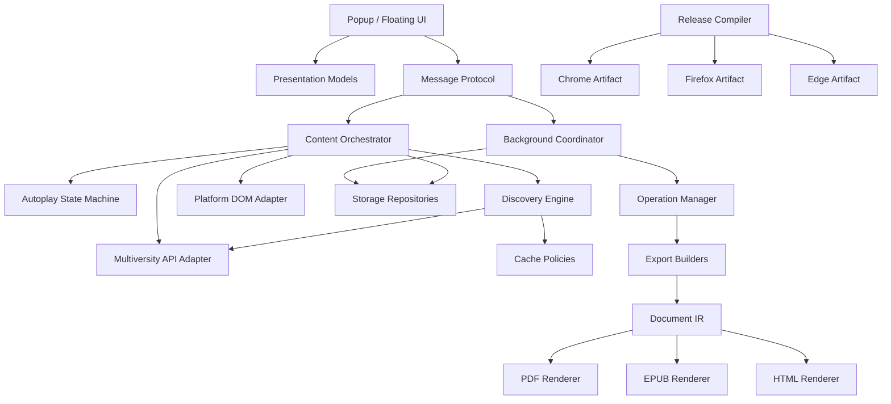

# 17 — What would we do differently today?

## A retrospective without hindsight bias

> **Reference snapshot for this chapter**  
> PlumePilot **2.35.2 release candidate**, branch `feat/ui-ux-2.35.2`, commit `f6fcb4c29c83ba9150df0be31da04fc91dffb634`.

Looking back on a real project, it is tempting to say a file is too large, an internal API should have been explicit, or a framework should have been introduced earlier. But retrospective certainty knows the future. When PlumePilot began, we did not yet know it would support three universities, three browsers, two menu surfaces, PDF/HTML/EPUB exports, rich-text quiz notes, configurable autoplay, commission monitoring and independent browser-store builds.

An architecture suited to three files may be poorly suited to fifty features. Conversely, designing for a hypothetical large system on day one may itself be a mistake. The useful question is not *What would the perfect original architecture have been?* It is **Knowing the actual shape of the problem, what would we change as PlumePilot grows—and what would we deliberately keep?**

---

# Part I — Debt is not the same as error

## 1. Four different categories

When evaluating an old choice, distinguish a mistake, a trade-off, scaling debt, and a decision that is still correct. Judging all four as “bad architecture” would erase the history that explains why the system grew as it did.

---

## 2. A genuine mistake

Some decisions are unsound even with the information available at the time, for instance persisting authentication secrets unnecessarily or assuming ambiguous identifiers are globally unique. The remedy is to correct the underlying invalid assumption.

---

## 3. A trade-off

Choosing vanilla JavaScript reduced build-tool overhead, package complexity and review surface. The same decision may become more expensive as the interface grows, but it was not necessarily wrong at the beginning.

---

## 4. Scaling debt

One file containing several related features may be simplest for a tiny extension. As unrelated capabilities accumulate, coupling and regression risk rise. The choice was reasonable then and now carries an evolutionary cost.

---

## 5. A decision that remains correct

Working locally in the user's authenticated LMS session avoids a new developer-operated backend. A hosted service would add privacy, authentication, deployment and operational obligations without automatic benefit.

---

# Part II — Avoid a complete rewrite

## 6. The temptation to rewrite everything

After learning about boundaries, protocols, state machines and test seams, one can sketch a beautiful replacement architecture. That temptation undervalues the proven behavior embedded in the existing system.

---

## 7. What a rewrite would lose

The current code contains knowledge acquired through DOM races, API inconsistencies, hidden tabs, Firefox review, PDF edge cases and real course regressions. Rebuilding familiar features may accidentally omit the unusual exceptions that make them reliable.

---

## 8. The Strangler approach

Prefer incremental replacement around stable boundaries: identify a responsibility, protect its behavior with tests, extract it, and redirect callers. The Strangler Fig pattern allows a better architecture to grow around working software without risking a wholesale rewrite.

---

# Part III — Extract boundaries from content.js

## 9. Why content.js is under pressure

content.js coordinates DOM discovery, autoplay, chapter state, message bridges, export entry points and platform workarounds. It is not automatically one undifferentiated God object, but it has become a convergence point for many reasons to change.

---

## 10. What we would do today

Split by cohesive responsibility rather than arbitrary file length. Candidate modules include LMS adapters, lesson identity, discovery policy, playback orchestration, course progress, and UI-facing bridges.

---

## 11. The extraction rule

Start with functions that have stable inputs and outputs, few browser globals, clear tests and an obvious owner. Do not assume the biggest function is the safest or most valuable first extraction.

---

# Part IV — Functional core, imperative shell

## 12. Functional core and imperative shell in practice

A pure decision layer decides what the next step should be; the surrounding shell reads the current DOM, sends requests, performs navigation and persists state. This makes complicated rules testable without pretending browser effects can disappear.

---

## 13. First-incomplete as an example

A discovery engine could accept normalized chapter state and effective policy, returning a logical target or an unresolved result. Only an adapter would locate and open the corresponding LMS element.

**Code from the original chapter:**

```js
const plan = chooseDiscoveryPlan({
  outline,
  masterIndex,
  verifiedComplete,
  mode,
});
```

```js
{
  candidates: [...],
  requiresFreshData: true,
  fallbackPolicy: "visual"
}
```

---

## 14. The advantage

Candidate ordering, stale summaries, duplicate identities and fallback decisions could be tested with plain objects rather than loading much of content.js through node:vm.

---

# Part V — Effects are essential

## 15. A browser extension necessarily has effects

Reading host DOM, sending messages, playing notification sounds, generating downloads and selecting lessons are fundamental to the product. Hiding them behind elaborate pure abstractions can make code harder to understand.

---

## 16. A realistic objective

**Make deterministic decisions pure when useful; keep browser effects explicit and guarded.** This is more practical than attempting to turn the entire extension into one pure-functional program.

---

# Part VI — Formal platform adapters

## 17. The platform-adapter problem

Support grew from one LMS environment into Pegaso, Mercatorum and San Raffaele. Many course operations are shared, while DOM shapes, routes and provider data vary.

---

## 18. Formalize the platform adapter earlier

A simple adapter object can expose normalized capabilities—resolve sections, identify current course, locate lesson, parse progress—without imposing a class hierarchy.

**Code from the original chapter:**

```js
const platform = {
  id,
  courseCodeFromUrl(),
  sections(),
  chapters(section),
  currentLesson(),
  commissionLabel(...),
};
```

---

## 19. Why an adapter helps

Domain code should ask “which lesson does this represent?” instead of knowing whether an LMS uses a particular class name, page section or folder nesting.

---

# Part VII — A clearer anti-corruption layer

## 20. The adapter already exists implicitly

Existing normalizers, route helpers and platform checks perform much of this role. The improvement is making contracts, ownership and boundaries explicit rather than claiming the code currently has none.

---

## 21. What we would reorganize

Group volatile external contracts into modules such as platform DOM, API response normalization and course identity. Other subsystems consume stable normalized values.

---

# Part VIII — Internal messaging contracts

## 22. Today's messaging shapes

Messages already carry types, IDs, payloads and acknowledgements. Although expressed as ordinary objects and string constants, they are internal APIs between different execution worlds.

**Code from the original chapter:**

```js
{
  type: "PEGASO_START_EXPORT",
  ...
}
```

---

## 23. Treat those messages as APIs

Centralize important message names and expected payload contracts. Validation at the receiver protects against missing fields, stale contexts and malformed requests.

**Code from the original chapter:**

```js
export const MessageType = Object.freeze({
  START_EXPORT: "PEGASO_START_EXPORT",
  CANCEL_EXPORT: "PEGASO_CANCEL_EXPORT",
  ...
});
```

---

## 24. Boundary validation

For critical commands, validate required operation identity, recognized type, field shape, supported state and expected response semantics before any consequential effect.

---

## 25. Why not automatically use JSON Schema?

A library or formal schema can help a large protocol, but a few small explicit validators may be cheaper and clearer for the present message inventory.

**Code from the original chapter:**

```js
function parseStartExportMessage(value) {
  ...
}
```

---

# Part IX — Protocol versions only when needed

## 26. Protocol versioning is not always needed

Content scripts and background resources normally upgrade together as one extension package, so this is not a long-lived public client/server versioning problem.

---

## 27. But lifecycles can overlap

A tab might remain open across an extension update, or a context can receive an unexpected old or new payload. Lightweight protocol version metadata could help diagnose a real compatibility transition.

---

# Part X — Explicit autoplay state transitions

## 28. Autoplay is already a state machine

Chapter 07 showed that playback behavior depends on the current lesson, operation, test policy, manual overrides, async recovery and cancellation. Its logical state is currently spread across several cooperating values.

---

## 29. Introduce an explicit transition layer

A reducer or transition function can accept current state and an event, return the next state and describe permitted effects. XState is optional; a small domain-specific reducer may be enough.

**Code from the original chapter:**

```js
function transition(state, event) {
  switch (state.phase) {
    ...
  }
}
```

---

## 30. One possible state shape

Represent phase, current lesson identity, operation generation, effective policy and pending recovery explicitly rather than relying on independently mutable Booleans.

**Code from the original chapter:**

```js
{
  phase: "watching",
  playback: {...},
  policy: {...},
  pendingBoundary: null,
  generation: 12,
}
```

---

## 31. Important events

Start, pause, stop, lesson changed, video ended, test boundary reached, navigation requested, recovery completed, and user-selected lesson can all be modeled as state-machine inputs.

---

## 32. Why make transitions visible?

The priority among manual action, skip-completed behavior, test boundaries and stale async callbacks becomes one reviewable contract instead of being scattered across listeners.

---

# Part XI — Do not centralize every state

## 33. Not one global Redux store

Popup, floating panel, MAIN world and background have genuinely separate lifecycles. A “global” store would still need messaging, persistence and ownership rules.

---

## 34. Keep local state local

Focus, temporary editing state and open detail panels belong to individual UI instances; long-running operation state belongs to its coordinator; durable preferences belong to shared storage.

---

# Part XII — Storage repositories

## 35. Today's storage wrappers

Helpers exist, but many modules know concrete storage keys, legacy forms and upgrade paths. That knowledge is vulnerable to duplication as features grow.

---

## 36. A storage repository boundary

A small repository object per domain can own key construction, parsing, serialization, migration and platform scoping while callers work in domain terms.

---

## 37. What the caller should request

Ask for getCourseProgress(platform, courseId) or saveExamSnapshot(identity, value), not a raw key with undocumented prefix rules.

**Code from the original chapter:**

```js
await courseState.get(courseIdentity);
```

---

# Part XIII — Schema evolution

## 38. Version complex stored structures

Snapshots and layout schemas benefit from an explicit version so a reader can distinguish valid old data from malformed or unsupported formats.

**Code from the original chapter:**

```js
{
  version: 3,
  ...
}
```

---

## 39. A migration pipeline

Read raw persisted input → detect version → normalize or migrate → validate current shape → return one clear domain representation. This avoids permanent scattered legacy checks.

---

# Part XIV — Cache policies

## 40. Current cache variety

PlumePilot uses Maps for different needs: lesson detail, intercepted snapshots, images in progress and recent sound events. Their different policies are often justified.

---

## 41. Make each policy explicit

Document owner, identity, maximum capacity, freshness, invalidation, error caching and what a caller may safely infer from a hit.

---

## 42. Avoid one universal GenericCache

A cache of completed lesson facts and an in-flight request registry have different contracts. One overly abstract class might hide those essential differences.

---

## 43. Reuse mechanisms, not meanings

Shared utilities for bounded maps, TTL checks or pending-Promise deduplication can be helpful while each subsystem retains its domain-specific correctness policy.

---

# Part XV — In-flight request coalescing

## 44. Coalesce requests in flight

If two consumers ask for the same lesson detail simultaneously, share the pending Promise for the same qualified identity instead of issuing duplicate network requests.

---

## 45. Coalescing flow

Check an in-flight map → reuse an existing Promise, or start one and register it → remove its entry after settlement. This avoids a cache stampede without forcing unrelated requests into one serial queue.

---

## 46. Why it helps

Duplicate requests, parsing and temporary buffers are avoided while distinct identities can still proceed concurrently under suitable pacing rules.

---

# Part XVI — Independent discovery engine

## 47. First-incomplete and skip-completed share concepts

Both evaluate course order, completion evidence, ambiguous identity, API availability and navigation targets. Their policies differ, but their underlying discovery model overlaps.

---

## 48. Extract a discovery engine

Let the engine work on normalized course snapshots and a requested mode, returning domain targets or a reason verification is required.

---

## 49. Discovery mode is explicit

Differentiate first-incomplete search, forward skip-completed and other navigational intentions rather than toggling hidden flags whose combinations change the meaning of discovery.

---

## 50. Return an explicit result

A target should contain identity and supporting evidence; unresolved outcomes should include the reason. Avoid returning a guessed row or a bare Boolean for ambiguous cases.

**Code from the original chapter:**

```js
{
  status: "target",
  chapterIdentity,
  activityIdentity,
  evidence,
  requiresVisualVerification
}
```

---

## 51. Apply the DOM adapter afterward

Only once a logical target is selected does a browser adapter locate the current rendered element, revalidate identity and navigate. The domain decision can then be tested separately from DOM timing.

---

# Part XVII — Intermediate representations for export

## 52. PDF, EPUB and HTML have distinct pipelines

They share some extracted content and assets but have different requirements for pagination, reflow, image handling, interactivity, accessibility and output format.

---

## 53. A modest intermediate representation

Normalized source content—sections, text, tables, figures, formulas and associated resources—could feed format-specific renderers, reducing repeated extraction logic.

**Code from the original chapter:**

```js
{
  course,
  sections: [
    {
      title,
      chapters: [...]
    }
  ],
  assets: [...]
}
```

---

## 54. Not one enormous universal IR

Quiz and course-material exports have different domain structures. Smaller purpose-built representations may be clearer than a universal document object attempting to model everything.

---

# Part XVIII — Workers for measured CPU bottlenecks

## 55. Should CPU-heavy work move to workers?

Some PDF rendering, image analysis or encoding stages may block the UI. Moving targeted transformations to Workers or OffscreenCanvas could help responsiveness where supported.

---

## 56. A Worker does not guarantee speed

Worker startup, serialization, data transfer, additional buffers, API compatibility and coordination create costs. Total elapsed time or peak memory may even increase.

---

## 57. Measure first

Profile actual CPU hotspots, main-thread long tasks and memory peaks. A worker is ineffective if the bottleneck is the LMS network or a final archive that still allocates large buffers.

---

## 58. Transfer large buffers deliberately

When using Workers, prefer transferable ArrayBuffers where ownership can move, rather than duplicating large data unnecessarily. Detached sender buffers change lifetime semantics.

---

# Part XIX — A modern editing-command model

## 59. The editor today

The offline notes editor pragmatically uses Selection, Range and execCommand() for some formatting and undo behavior. This worked at the project's scope and browser baseline.

---

## 60. Future editor debt

execCommand() is deprecated. If editing requirements expand, introduce an explicit command model while preserving current selection, caret and undo contracts.

---

## 61. Model editing commands

Commands such as toggle bold, apply color, insert callout or move list type should specify intended range, result, selection restoration and undo effects.

---

## 62. Study Input Events

beforeinput, inputType and related APIs can support a more intentional editing model and reduce reliance on legacy formatting commands, subject to browser tests.

---

# Part XX — Keep the rich-text editor proportional

## 63. Preserve the actual scope

The editor is for personal notes and review annotations in an offline quiz, not realtime collaboration, document publication or elaborate multi-user change tracking.

---

## 64. Do not build Google Docs

Powerful rich-text frameworks introduce large scope and dependency cost. Do not adopt them simply because the current editor has an imperfect implementation detail.

---

# Part XXI — Shared UI primitives

## 65. The 2.35.2 UI extraction already began

menu-ux.js and menu-ux.css share autoplay summaries, navigation, layout policies, font handling and typography between popup and floating menu.

---

## 66. Formalize a few shared primitives

Small helpers for navigation details, disclosure scrolling, action groups and focus restoration could become stable reusable UI interfaces.

---

## 67. No framework is required for that

Vanilla DOM factories and shared attribute protocols can be enough when the component hierarchy remains manageable and the UI has well-defined responsibilities.

**Code from the original chapter:**

```js
function createSettingsGroup({...}) {
  ...
}
```

---

# Part XXII — A framework is a trade-off

## 68. Would React help?

A larger UI with many interdependent views could benefit from declarative components and more predictable rendering. The question is about coordination costs, not popularity.

---

## 69. What a framework might solve

It may simplify rerendering, local component state, conditional layout, reconciliation and reuse of view components.

---

## 70. What it would add

Build dependencies, bundle size, migration work, runtime integration concerns and new regressions. It would not automatically solve browser execution contexts, store review, source of truth or focus semantics.

---

## 71. Our current React decision

At the present scale we probably would **not rewrite the UI in React**. First strengthen view models, adapters and stable primitives, then reevaluate if actual complexity keeps growing.

---

# Part XXIII — Gradual static typing

## 72. TypeScript is a different proposition

Type information can help with message payloads, normalized API data, stored records and operation result shapes. Its expected benefit is relatively stronger, but gradual adoption remains preferable.

---

## 73. No need for a total migration

Begin with JSDoc types, // @ts-check and checkJs on selected new or extracted modules, rather than changing the entire toolchain and codebase immediately.

---

## 74. A practical gradual example

Annotate a normalized lesson or operation record so editors and the TypeScript language service can catch incorrect field use while runtime remains JavaScript.

**Code from the original chapter:**

```js
/**
 * @typedef {Object} PlaybackTarget
 * @property {"target"|"end"|"fallback"} status
 * @property {ChapterIdentity=} chapter
 */
```

---

# Part XXIV — Type the important boundaries first

## 75. Type the high-risk boundaries first

Messaging, platform adapters, storage repositories and operation transitions should receive attention before spending effort typing arbitrary CSS class strings or stable local details.

---

# Part XXIV — Types where they matter

## 76. Do not type CSS class strings for its own sake

Static typing creates the greatest value where wrong assumptions cross boundaries or cause broad effects. Annotating arbitrary stable local strings merely to raise a coverage percentage is not a priority.

---

# Part XXV — A single test entry point

## 77. What Chapter 14 revealed

Many individual Node .mjs regression scripts already protect PlumePilot, but running them by memory is error-prone. A single discoverable test entry point would improve reliability.

---

## 78. A simple runner

A small Node runner can discover and execute scripts, report failures and return a nonzero exit code. No large test framework is required just to ensure the entire suite runs.

---

## 79. Separate suites by purpose

Keep fast logic and VM tests separate from structural checks, browser integration and package verification so developers understand their costs and prerequisites.

---

# Part XXVI — Continuous integration

## 80. Continuous Integration now has positive ROI

On every pull request, run the fast suite, selected type checks, lint if practical, and relevant source or output invariants. The project is mature enough to benefit from automated verification.

---

## 81. Browser checks at a different cadence

Full extension browser tests can run on candidate branches or periodically if their setup and runtime cost make them unsuitable for every small edit.

---

## 82. Automate the release build

For a release candidate or tag, generate Chrome, Edge and Firefox artifacts, run validate-release.mjs, verify SHA256SUMS and report exact outputs.

---

# Part XXVII — Human-controlled publishing

## 83. Keep a human publication gate

A small project can reasonably retain manual approval before uploading or publishing browser-store packages. New permissions, reviewer access and store text deserve human judgment.

---

# Part XXVIII — Target-specific browser E2E

## 84. High-value target-specific E2E cases

Test actual extension loading, background startup/restart, popup-to-floating synchronization, Shadow DOM behavior, notification fallback, export cancellation and accessible focus where the platform differs.

---

## 85. A few meaningful E2E tests

Browser-wide tests are expensive to write and maintain. Select scenarios that Node test doubles cannot prove instead of attempting hundreds of redundant screenshots.

---

# Part XXIX — Sanitized provider fixtures

## 86. Versioned API fixtures

Keep a small library of representative, sanitized master-index and lesson-detail responses from supported LMS platforms alongside synthetic edge-case fixtures.

---

## 87. The benefit of provider fixtures

When the LMS changes response shape, normalization tests can detect contract drift while still checking known real-world cases.

---

# Part XXX — Privacy before fixtures

## 88. Never commit private raw payloads

Strip bearer tokens, cookies, email addresses, identifiers tied to actual people, course notes and unnecessary user content. Fixture realism is not a reason to expose private academic data.

---

# Part XXXI — Structured diagnostics

## 89. Existing diagnostics are fragmented

The converter has some structured diagnostic fields; other workflows rely more heavily on free-form logs. A common minimal event vocabulary could make debugging easier.

---

## 90. Standardize safe diagnostic events

Use an operation ID, phase, source, duration, outcome and categorized reason where helpful. Avoid collecting arbitrary page data just because logging is convenient.

**Code from the original chapter:**

```js
{
  event: "playback.discovery.target",
  courseCode,
  lessonNumber,
  source: "master+detail",
  elapsedMs,
}
```

---

## 91. Not remote telemetry by default

These records can remain local or be enabled only for a debugging session. A developer-operated analytics backend is not necessary to benefit from structured events.

---

## 92. Why structure helps

A clear operation timeline and error category are easier to compare and test than hundreds of ad hoc console lines.

---

# Part XXXII — Explicit operation lifecycle

## 93. The existing background operation model

PlumePilot already coordinates long-running work using operation identities, stored snapshots, progress and cancellation. This is one of its stronger architectural foundations.

---

## 94. Formalize the operation lifecycle

A small repository and state-transition layer could define accepted, running, cancelling, completed and failed states with guarded changes.

---

## 95. Share lifecycle, not content pipelines

PDF material export, EPUB conversion and Turbo Test may share operation IDs, progress, error states and cancellation semantics while retaining different domain-specific processing logic.

---

# Part XXXIII — Shared cancellation capability

## 96. Cancellation appears throughout the code

A consistent signal-and-cleanup contract would reduce repeated policy interpretation across exports, requests and background coordination.

**Code from the original chapter:**

```js
function createOperationContext({ signal, operationId, report }) {
  ...
}
```

---

## 97. Pass cancellation context explicitly

Each pipeline stage can receive its AbortSignal, operation ID and progress reporter instead of repeatedly reaching into mutable globals.

---

# Part XXXIV — Timing and deadline primitives

## 98. Timeout behavior is spread across features

Many existing timeouts are purpose-specific and justified, but the mechanics of deadlines, signal composition and cleanup repeat.

---

## 99. Extract deadline primitives carefully

Helpers such as waitForCondition(condition, { signal, timeoutMs }) can centralize mechanics while callers specify the domain's readiness and timeout policy.

---

## 100. Never replace readiness with arbitrary sleep

A universal sleep(1000) hides the difference among retry pacing, navigation readiness, deadline handling and intentional UI delay. An abstraction should make these purposes clearer, not blur them.

---

# Part XXXV — Architecture Decision Records

## 101. Why ADRs would help now

Decisions about service-worker lifecycle, API hierarchy, cross-browser packaging and cache ownership may be difficult to infer from source alone. Their alternatives and trade-offs deserve short records.

---

## 102. A small decision record

An ADR can capture context, decision, alternatives, consequences, date and relevant code/PR links in a concise file.

---

## 103. Do not document every if

Use ADRs for important choices with a lasting reversal cost, especially when a later maintainer could easily question an unusual but deliberate implementation.

---

# Part XXXVI — A concise project architecture map

## 104. This book is not the everyday architecture reference

The complete tutorial is useful for study, but too large to be the only operational index for contributors making focused changes.

---

## 105. Maintain a short architecture map

Keep a concise document naming each subsystem, its owner, key state, adapters, entry points, dependencies, and relevant tests, with links to in-depth chapters.

---

# Part XXXVII — Keep local-first

## 106. We would keep no proprietary backend

Core features work through the user's already-authenticated LMS session and local browser resources. A server is not justified merely to make the architecture look more conventional.

---

## 107. Local-first benefits

No extra account system, lower infrastructure and operations burden, local processing of learning materials and simpler user privacy boundaries are substantial benefits.

---

## 108. When to reconsider a backend

Only if a concrete capability requires cross-device state, centralized scheduling or server-side processing with enough value to justify added trust, maintenance, cost and security commitments.

---

# Part XXXVIII — Keep API-assisted automation

## 109. Avoid DOM-only automation

Combining API evidence, master-index summaries and guarded DOM fallback provides robustness and efficiency that pure visual clicking would struggle to match.

---

## 110. Still treat host APIs as external contracts

Normalize fields, handle inconsistent completion, guard missing responses, version fixtures and preserve safe verification paths. A private LMS endpoint is not our stable public API.

---

# Part XXXIX — Keep master-index prioritization

## 111. Master-guided discovery remains sound

Use cheap aggregate progress to prioritize likely incomplete chapters, then verify details and fall back when the index can be wrong.

---

## 112. Do not return to unconditional global scanning

Future refactors should preserve the master-first algorithm and its correctness fallback, even if the implementation moves into a new discovery module.

---

# Part XL — Continue to fail closed

## 113. Keep ambiguous identity unresolved

When chapter identity cannot be established, the program should not confidently click an arbitrary plausible row.

---

## 114. Fail an unexpected vendor transform

If a Firefox review-safe replacement no longer matches its expected source, fail the package build instead of shipping unreviewed output.

---

## 115. Do not invent completion

If there is insufficient evidence that a lesson or test is complete, request verification or represent unknown rather than silently treating it as finished.

---

# Part XLI — Preserve user control

## 116. Autoplay should not become an uncontrolled autopilot

User-selected policies for tests, completed videos, chapter limits and the 70% threshold must remain explicit and understandable.

---

## 117. The latest manual action wins

A manual lesson selection should invalidate older automatic navigation and recovery callbacks. This is a UX rule and a concurrency rule.

---

# Part XLII — Preserve the LMS player boundary

## 118. Let the LMS own its player

PlumePilot coordinates navigation and permitted behavior instead of replacing the platform's player engine with raw video.play() calls.

---

## 119. Respect the right boundary

The extension works with the platform's playback lifecycle and visible course context; it should not assume direct DOM control equals ownership of every video event.

---

# Part XLIII — Keep browser-specific builds

## 120. One universal ZIP is not inherently better

Chrome, Edge and Firefox have legitimate differences in background models, permissions, store metadata and review policy.

---

## 121. Continue target-specific builds

Produce explicit browser artifacts from common source, with deterministic transforms and automated package validation.

---

# Part XLIV — Readable vendors and deterministic outputs

## 122. Readable vendors and build determinism pay off

They improve provenance, security review, dependency updates, debugging and confidence that the shipped bytes match the intended sources.

---

# Part XLV — No remote executable behavior

## 123. No remote executable code

Fetching LMS PDFs, videos or quiz data is normal; downloading executable program code into the extension runtime would undermine the packaged-code trust boundary.

---

# Part XLVI — Vanilla as a proportional choice

## 124. Do not interpret the lesson as “vanilla forever”

The correct maxim is **use the least complexity that solves the present real problem**. A framework or type checker can become worthwhile when the evidence changes.

---

## 125. Vanilla was right at the beginning

The original small extension gained simplicity from direct Web APIs. Adding some module structure today does not require repudiating that choice.

---

# Part XLVII — Preserve tests born from bugs

## 126. Protect the imperfect existing test suite

Current tests are not architecturally perfect, but they encode important regression knowledge. A refactor must make them more maintainable without discarding the behavior they protect.

---

# Part XLVIII — Priorities, not wish lists

## 127. Prioritize by benefit and risk

Consider expected maintenance value, implementation cost, risk of regressions and reversibility. Avoid treating every imaginable improvement as equally urgent.

---

## 128. High priority, low-to-medium risk

One test runner, selected static checking, concise architecture mapping, clearer message contracts and more reliable CI checks offer tangible value.

---

## 129. High priority, medium risk

Extract discovery decision logic and stable platform normalization boundaries with strong regression tests before modifying autoplay internals.

---

## 130. Medium-priority refinements

Storage repositories, operation lifecycle clarity, shared cancellation helpers and consistent diagnostics can evolve as touched by relevant feature work.

---

## 131. Conditional investments

Workers, a full editor command system, a frontend framework or sweeping TypeScript migration should wait for measured needs or clear scope growth.

---

# Part XLIX — Incremental roadmap

## 132. Phase A: protect before moving

Create or strengthen tests for existing high-risk behavior, including first-incomplete routing, hidden tabs, cancellation, cross-platform identity and the generated artifacts.

---

## 133. Phase B: extract pure decisions

Move candidate ordering, route identity and effective policy calculations into directly importable modules without changing their observable behavior.

---

## 134. Phase C: define adapters

Introduce normalized LMS API and DOM contracts so stable discovery logic does not parse provider-specific selectors or response fields.

---

## 135. Phase D: simplify content.js

Leave it mainly coordinating browser events and imperative effects while cohesive decisions and adapters move to their natural modules.

---

## 136. Phase E: deepen browser integration coverage

After boundaries stabilize, add a few high-value target-specific E2E tests for the lifecycles and effects pure unit tests cannot simulate.

---

# Part L — A possible target architecture

## 137. A possible target map

Domain includes identity and discovery decisions; platform adapters handle API and DOM; workflow controllers own operations; presentation helpers render shared view models; build tooling emits specialized artifacts.

**Code from the original chapter:**



---

# Part LI — Benefits of modularity

## 138. What modularity gains: locality

A route-mapping bug can be diagnosed in a small adapter rather than by searching a huge content script with many unrelated responsibilities.

---

## 139. What modularity gains: testability

Deterministic logic can be imported directly and tested with plain input objects instead of textual source slicing and dozens of fake globals.

---

## 140. What modularity gains: ownership

Each subsystem has a clearer source of truth, state lifetime and reason to change.

---

## 141. What modularity gains: replaceability

If Mercatorum changes its DOM, ideally the Mercatorum adapter changes without forcing a rewrite of the discovery engine.

---

# Part LII — Costs of modularity

## 142. What modularity costs: more files

The dependency graph grows and contributors need conventions to navigate module boundaries.

---

## 143. What modularity costs: import order

Loading and execution across browser worlds require careful module compatibility, bundling decisions or well-tested script ordering.

---

## 144. What modularity costs: more abstractions

Contributors may need to learn several names or intermediate representations before making a small change. These costs must be justified.

---

## 145. Therefore modularity is not free

We would adopt more of it because the actual domain has grown, not because an architecture diagram looks prettier.

---

# Part LIII — Avoid architecture astronautics

## 146. A warning sign

A provider factory, registry, strategy hierarchy and dependency-injection framework for two simple implementations may create more complexity than they remove.

---

## 147. Prefer simple JavaScript interfaces

Objects of functions, plain exported modules and small validators are often sufficient until actual variation or testing demands more ceremony.

---

# Part LIV — Abstract after evidence

## 148. The first example reveals little

With one use case, it is hard to know which details are intrinsic and which are accidental.

---

## 149. After two or three cases patterns emerge

The shared menu-ux layer was introduced after popup and floating-menu behavior genuinely drifted. That is a defensible time to extract common rules.

---

# Part LV — The rule of three is not absolute

## 150. The rule of three is not dogma

When the downside of divergence is severe—identity safety, security, data corruption or important protocol semantics—an abstraction can be justified before the third duplication.

---

# Part LVI — Static types versus runtime data

## 151. TypeScript does not validate runtime API data

Even if a property is declared as a number, an external LMS endpoint can send a string, null or an unexpected object. Static types do not change bytes arriving from outside the program.

**Code from the original chapter:**

```ts
interface LessonResponse { ... }
```

---

## 152. Use both typing and runtime validation

Static checking catches mistakes in our code; runtime checks protect the boundary where untrusted or changing input enters. Both are needed for high-impact adapter contracts.

---

# Part LVII — Frameworks do not create architecture

## 153. A UI framework does not create good boundaries automatically

It is possible to build an entangled React application just as it is possible to build a clear vanilla JavaScript one. Components alone do not assign state ownership or solve cross-context messaging.

---

## 154. Ask a better framework question

Not “Should we use React because this is now a serious project?” but “Which current coordination problems would the framework remove, and which additional dependencies would it create?”

---

# Part LVIII — Lessons for a backend developer

## 155. Many ideas will be familiar to backend developers

Message contracts resemble API schemas, background coordination resembles job orchestration, cache policy resembles backend caching, and adapters resemble ports and translation layers.

---

## 156. The browser-specific difference

DOM lifecycle, layout, user focus, rendering, isolated worlds and tab visibility become fundamental correctness concerns alongside normal async and storage issues.

---

# Part LIX — Frontend work goes beyond pixels

## 157. Frontend is more than rendering

A mature browser extension deals with queues, caching, retries, state machines, transactions in miniature, message contracts, storage and resource ownership.

---

## 158. It also has extra constraints

Host-page styles, extension permissions, reviewer requirements, native focus and user input introduce concerns many conventional server services do not encounter in the same way.

---

# Part LX — Distributed systems on one computer

## 159. A client can be a miniature distributed system

Popup, background worker, MAIN world, ISOLATED world and builder communicate asynchronously despite running on one user's device. Multiple lifecycles can create the same kinds of race and ownership problems as distributed services.

---

# Part LXI — Working with an external host

## 160. The host is not ours

We do not control LMS deploys, DOM shapes, API responses, player lifecycle or site-specific JavaScript. An extension is an integration with someone else's moving system.

---

## 161. Robustness requires adaptation

Expect external boundaries to change. Normalize input, protect identities and effects, retry cautiously and maintain safe fallbacks.

---

# Part LXII — Observe before reverse engineering

## 162. Observe before imitating behavior

Understand the host's real API semantics, timing, navigation model and state before attempting to automate it. Making guesses in a controlled lab can miss crucial production conditions.

---

## 163. A private API is not our API

Treat undocumented host endpoints as unstable contracts. Validate responses, monitor shape drift and preserve alternative paths where necessary.

---

# Part LXIII — The real cost of browser operations

## 164. Big-O is not enough

Opening a chapter, performing a network request, rasterizing a PDF page and looking up a Map key carry radically different real costs even if two algorithms share a complexity class.

---

## 165. Avoid work before optimizing work

Prioritize master-index queries, valid cache hits, in-flight request reuse and text-first extraction. Eliminating expensive steps can matter more than faster local loops.

---

# Part LXIV — Regression testing as knowledge

## 166. The most valuable fix becomes a property

A regression correction is strongest when expressed as an invariant and executable test, not left as one special-case conditional.

---

# Part LXV — Git history and source content

## 167. Content and ancestry are separate axes

The 2.35.2 candidate's identical Git tree with different parent commits is an especially clear lesson: the same source snapshot is not the same historical commit.

---

# Part LXVI — A repository is not the installed product

## 168. The product is not the repository

Users run browser-specific artifacts published through different stores. Packaging, review state, extension identity and installed version determine the actual product they receive.

---

# Part LXVII — The first questions for a new feature

## 169. Ask architectural questions before code

Who owns state? Which identity is stable? What source is authoritative? Can an await invalidate our assumption? What must happen on failure or cancellation?

---

## 170. Unknown answers reveal likely future debt

An unanswered design question need not stop development, but it identifies a place where an implicit dependency may later become a regression.

---

# Part LXVIII — An architectural scorecard

## 171. A subsystem scorecard

Check ownership, identity, authority, lifetime, unknown-state handling, side-effect guards, cancellation, failure categories, fallback safety, test coverage, integration boundary and observability.

| Question | Desired answer |
|---|---|
| State owner | One clear owner |
| Identity | Stable and scoped |
| Authority | Explicit evidence hierarchy |
| Lifetime | Matches persistence mechanism |
| Unknown | Representable |
| Side effects | Protected by guards and revalidation |
| Cancellation | Defined |
| Failure | Classified |
| Fallback | Safe and observable |
| Tests | A verifiable property |
| Boundary | Normalized |
| Observability | Useful and privacy-aware |

---

# Part LXIX — What to bootstrap at the beginning

## 172. Bootstrap the repository sensibly

Start with an understandable README, runtime entry points, small domain modules, basic test entry point and release notes. Do not create dozens of placeholder directories before the project has meaningful responsibilities.

---

## 173. Separate execution contexts

Distinguish background, content, MAIN-world bridge, popup and builder early because they genuinely have different APIs and lifecycles.

---

## 174. Shared message contracts

Use one discoverable home for message types and critical payload validation before duplicated string protocols become difficult to change.

---

## 175. Centralize storage naming

Keep persistent key construction, platform scoping and schema parsing in explicit helpers rather than spreading string conventions across every feature.

---

## 176. Tests when regressions become real

A simple runner can be added at the first serious regression suite, not necessarily the project's first commit. Capture discovered behavior instead of relying on maintainer memory.

---

## 177. Specialize build output when it becomes necessary

Once browser differences matter, express them in a reproducible build and validator, rather than maintaining unrelated forks or manually patching ZIPs.

---

# Part LXX — What not to build prematurely

## 178. What we would not prepare on day one

Avoid a microservices backend, universal RPC framework, statechart library for every button, global application framework and abstractions with no actual second use case.

---

# Part LXXI — Architecture is discovered

## 179. Some architecture is deliberate from the start

Separating privileged execution contexts, respecting authentication boundaries and requiring clear user controls are foundational constraints worth recognizing early.

---

## 180. Some architecture is discovered

Closed-accordion recovery, stale progress, cross-platform collisions, PDF memory pressure and Firefox store checks taught us which invariants actually mattered.

---

## 181. Discovery is not failure

Software integrating an external system will necessarily encounter unknown behavior. Engineering maturity is how quickly experience becomes a clear contract, test or boundary.

---

# Part LXXII — Technical debt versus bad code

## 182. Technical debt is not simply ugly code

It is a future cost created by a current design decision. It can be deliberate, justified and valuable until the interest becomes substantial.

---

## 183. A deliberate historical example

Textual source extraction and VM tests provided rapid regression protection before the code had cleanly exported modules. It created value before its maintenance limitations became evident.

---

# Part LXXIII — The interest on debt

## 184. When is it worth paying down debt?

Look for repeated regressions, large coordination edits, brittle tests, duplicated meaning, ambiguous ownership or increasingly expensive modifications to one subsystem.

---

# Part LXXIV — UI drift as debt

## 185. Popup and floating menu had drift

Shared menu UX presentation helpers were introduced when duplicated typography, navigation and settings semantics were creating real maintenance cost.

---

# Part LXXV — Search cost as debt

## 186. Global scans once worked

Full DOM chapter scans were acceptable at small scale but became expensive on long courses. Master-index-first discovery was introduced when the practical cost justified a different algorithm.

---

# Part LXXVI — Browser packaging as debt

## 187. One mostly common package once sufficed

Firefox and Edge review/runtime requirements later made deterministic target-specific packages worthwhile. Specialization responded to a demonstrated need.

---

# Part LXXVII — Overengineering debt

## 188. Too much architecture is also debt

Every abstraction must be learned, kept consistent, tested and modified. Excess hierarchy can raise the price of simple future work.

---

## 189. The wrong abstraction may cost more than duplication

Duplicating small environment-specific wiring can be a good temporary decision when the supposed common behavior is not yet understood.

---

# Part LXXVIII — Cost of reversing decisions

## 190. Ask before adopting technology

What real issue will this solve? What does it cost in maintenance, deployment and review? How can we verify improvement? How expensive would reversal be?

---

## 191. An easily reversible decision

A private helper or local CSS arrangement can usually be changed with modest cost. Experimentation is reasonable.

---

## 192. An expensive-to-reverse decision

Extension IDs, persistent schema, publicly distributed API behavior, background execution choices or release provenance have more far-reaching commitments.

---

# Part LXXIX — One-way and two-way doors

## 193. Two-way versus one-way-ish doors

Some decisions can be reversed cheaply; others create long-lived dependence for users, collaborators or stored data. Spend more evidence and design effort on the latter.

---

## 194. Apply reversal cost to PlumePilot

Do not overdesign a simple local UI helper, but review changes to persisted identities, browser permissions or external messaging contracts much more carefully.

---

# Part LXXX — Only three refactors

## 195. First priority: discovery engine and platform adapters

These address coupling in one of the project's most safety-sensitive areas: matching activity identity and navigating reliably across changing host layouts.

---

## 196. Second priority: message and operation contracts

Browser contexts are fundamental to the extension. Explicit protocols and lifecycle states would clarify ownership, failure handling and cancellation.

---

## 197. Third priority: test runner, CI and importable modules

These make subsequent changes safer and create a dependable feedback loop before deeper structural refactors.

---

# Part LXXXI — The rewrite we would avoid

## 198. The change we would not make: a total rewrite

The risk would be disproportionate to the benefit. Proven behavior, bug knowledge, cross-browser packaging and user-facing features would become simultaneously unverified.

---

## 199. Why a rewrite is the wrong answer today

The existing architecture contains tested workflows, unusual LMS workarounds and release knowledge. Incremental improvements preserve those investments while increasing clarity.

# Part LXXXII–LXXXIX — Exercises

### Exercise 1 — Extract or keep together?

You have a 400-line function. When is it better to extract a pure decision helper, and when is the function itself a cohesive browser-effect coordinator? Define the evidence you would look for.

### Exercise 2 — A normalized playback target

Design a `PlaybackTarget` capable of identifying platform, course, chapter and lesson without exposing an `HTMLElement`. How should an adapter resolve it into a fresh node?

### Exercise 3 — Shared operation state

Which fields belong in a common `OperationState` for PDF export, EPUB export and Turbo Test? Which stages and details should remain job-specific?

### Exercise 4 — Migrating content.js

Which module would you extract first, which tests must pass before moving it, and how would you verify that the published script load order still works?

### Exercise 5 — Cache identity and freshness

Design a lesson-detail cache with platform-qualified keys, pending-request coalescing, expiry rules and safe failure behavior. Explain why a generic TTL alone is insufficient.

### Exercise 6 — Framework decision

List the actual UI problems you would expect React to solve and the problems it would not solve, including storage synchronization, extension lifecycles and focus.

### Exercise 7 — Worker ownership

A PDF conversion uses a 50 MB buffer. Describe when transferring it to a Worker is preferable to copying it, and how cancellation changes ownership.

### Exercise 8 — A release gate

Design a minimum CI/release gate that checks Node tests, version consistency, Chrome/Edge/Firefox manifests, checksum integrity, and the correct source submission for AMO.

---

# Part XC — Final glossary

## 200. Hindsight bias

Judging a past decision using information that became available only after it was made.

---

## 201. Scaling debt

A previously suitable simple design that becomes costly as scope and usage grow.

---

## 202. Strangler refactor

Replacing a system gradually through stable boundaries rather than rebuilding everything simultaneously.

---

## 203. Functional core and imperative shell

Deterministic decision logic with few effects surrounded by code that talks to browsers, storage and external systems.

---

## 204. Platform adapter

A module translating browser or host-platform differences into a stable internal contract.

---

## 205. Repository pattern

A boundary centralizing persistence access, key construction, schema and relevant migrations.

---

## 206. Intermediate representation

A normalized model between acquisition/parsing and one or more format-specific renderers.

---

## 207. In-flight request coalescing

Sharing one pending Promise or request among concurrent consumers seeking equivalent data.

---

## 208. Structured diagnostics

Observability events represented as structured fields rather than only free-form console text.

---

## 209. Architecture Decision Record

A short decision document recording context, selected solution, alternatives and consequences.

---

## 210. Decision reversal cost

The cost of undoing a technical choice after other parts of the system or deployed users have come to depend on it.

---

## 211. Wrong abstraction

An abstraction created before accurately understanding what is truly common across its intended use cases.

---

# Part XCI — Further reading

## 212. Further reading: Architecture Decision Records

AWS Prescriptive Guidance describes documenting architecture decisions: https://docs.aws.amazon.com/prescriptive-guidance/latest/architectural-decision-records/adr-process.html

---

## 213. Further reading: Strangler Fig

Martin Fowler's Strangler Fig Application: https://martinfowler.com/bliki/StranglerFigApplication.html

---

## 214. Further reading: JavaScript type checking

TypeScript Handbook, type checking JavaScript files: https://www.typescriptlang.org/docs/handbook/type-checking-javascript-files.html

---

## 215. Further reading: Input Events

W3C Input Events Level 2: https://www.w3.org/TR/input-events-2/

---

# Part XCIV — Final architectural insight

## 216. Architecture is not the initial diagram

The architecture is the continuing collection of decisions, contracts and verified properties that allows software to evolve without losing what matters.

---

## 217. Good architecture does not eliminate change

It makes necessary change more local, understandable, verifiable and reversible when possible.

---

# Part XCII — The final answer

If we were starting PlumePilot today with everything we now know, we would establish clearer modules and contracts sooner: **platform adapters, message schemas, persistent-state repositories, a separate discovery engine, and more directly importable tests**.

But the important point is why we did not already have all of these at the beginning: **we had not yet discovered enough about the real problem**. Reliable software architecture emerges as constraints become visible and are translated into enduring rules.

# Part XCIII — A real project as a learning process

PlumePilot did not move from “bad code” to “perfect code.” It evolved from an initially useful extension into a project with broader responsibilities and a richer understanding of its operating environment. Each feature, regression and release contributed evidence about what needed to be explicit.

# Part XCV — Back to the beginning

Chapter 00 asked **Where does the truth live?** There is no universal single answer. The system observes server authority, API snapshots, DOM state, caches, extension storage, user intent and operation state. Architecture helps us choose the appropriate source **for each decision, for a particular lifetime and confidence level**.

# Part XCVI — A second thread: execution contexts

PlumePilot is not one JavaScript program. It is a set of locally bounded execution contexts, coordinated by protocols around an external platform that the developer does not control.

# Part XCVII — A third thread: identity

Many difficult bugs were identity bugs: **DOM node ≠ lesson**, **label ≠ global identity**, **exam ID ≠ cross-platform identity**, **Git history ≠ tree content**, and **version ≠ ZIP bytes**. Once identity is distinguished from temporary representation, the rules become clearer.

# Part XCVIII — A fourth thread: time

Other problems were temporal: suspension after `await`, rendering delay, hidden-tab throttling, service-worker termination, retries and store-review timing. **Time is part of state**, not an implementation detail outside the model.

# Part XCIX — A fifth thread: boundaries

The most fragile places are often the transitions: page ↔ extension, DOM ↔ logical model, API ↔ normalized model, storage ↔ state, source ↔ artifact, and artifact ↔ store. The project's strongest improvements made these boundaries more explicit.

# Part C — Closing

What appeared to be JavaScript layered over a university platform led us to process isolation, RPC, state machines, caching, optimistic revalidation, anti-corruption layers, resource ownership, binary conversion, rich-text editing, cross-browser build adaptation, artifact provenance, regression engineering, Git DAGs and release state machines.

Not because complexity was the goal, but because following a real-world problem far enough reveals deeper engineering principles.

# Part CI — If there is one idea to remember

> **You do not have to design the final architecture on day one. You need to build a system where each new piece of information can become a clearer decision, a better boundary, or a testable invariant.**

That is what turns a useful script into maintainable software—and the most transferable lesson PlumePilot offers for the next project.

---

# The end

**Inside PlumePilot — Anatomy of a real browser extension**

JavaScript, WebExtensions, DOM, APIs, asynchrony and software engineering through a real project.

---

[← 16 — Architectural lessons](16-architectural-lessons.md) · [Contents](index.md)
